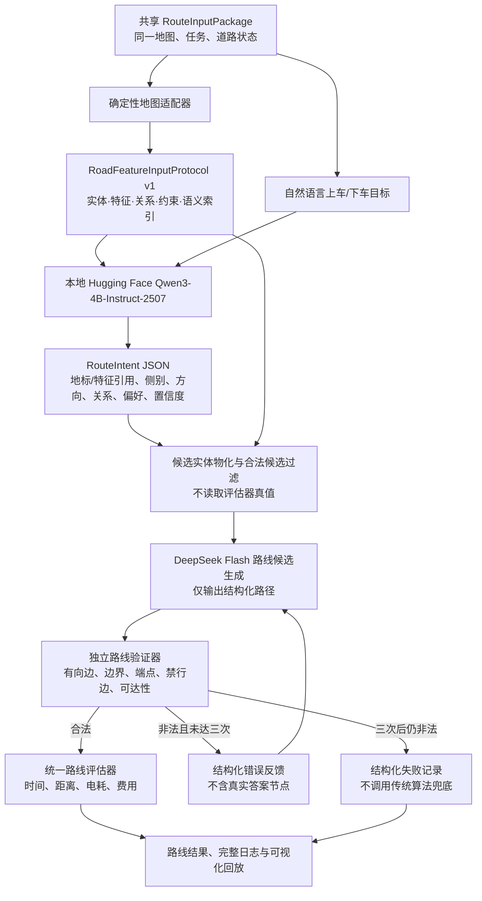

# 路线层第三组 R4：Agent 路线检索与可读地图范式

**设计状态：用户已确认，2026-10-18；截至 R4 smoke v17，DeepSeek 尚未返回经过验证的路线。** v17 在确认有向可达的 8×8 任务上返回 32 个边槽，其中 10 个不在允许边集合，整条序列不连续；本地校验拒绝接纳。模型自检标记数 63 与路线步数 32 不匹配。详见 [R4 烟雾记录](route-layer-r4-smoke-test-2026-10-18.md) 与 [v17 回放](../outputs/route_layer/r4_smoke_v17_api/replay.html)。该单任务烟雾不是成功率样本；正式 R4 多种子实验未启动，100×100 预算仍待重新核算。

## 1. 研究重点与边界

R4 突出两项设计：

1. **Agent 可阅读地图范式**：把同一底层道路事实转换成有版本、可查询、有来源的 `RoadFeatureInputProtocol v1`，用实体、特征、关系、约束和语义索引表达道路，而不是只把道路特征编码成位置坐标。
2. **路线检索新流程**：先从自然语言目标中提取可追溯的地点意图，再依据地图协议检索有限的合法候选，生成有向路线；由独立程序校验并将错误结构化反馈给 Agent，最多进行三次规划尝试。

R4 只处理单个车辆—订单路线任务，不做车队派单、车辆—订单冲突消解、下一订单衔接或调度层优化。该设计是待验证的实验方法，不预先宣称新颖性或路线效果优势。

## 2. 三组方法边界

| 组别 | 模型所见地图输入 | 地点理解 | 路线生成与检查 |
|---|---|---|---|
| 传统算法组 R0–R2 | 统一路线包、普通拓扑 | 固定 `graph_only` 规则解析 | Dijkstra / A*；统一程序评估 |
| 纯 LLM 组 R3 | graph-only 有向路网输入 | DeepSeek 直接处理任务文本 | DeepSeek 单次输出；统一程序事后校验，无修复 |
| 创新组合组 R4 | `RoadFeatureInputProtocol v1` | 本地 MLX 4-bit Qwen3-4B-Instruct-2507 结构化解析 | DeepSeek Flash 生成路线；程序校验并反馈，最多三次规划 |

三组复用种子 0–9 的同一地图、道路状态、订单/正式场景、统一路线校验器、能耗模型和费用口径。R4 中 Qwen 本地推理的耗时单独统计，不计 API token；DeepSeek 调用记录实际模型标识、输入/输出 token、延迟和 API 费用。正式记录中固定具体模型 revision、提示版本、推理精度/量化、输出上限和超时配置。

## 3. 结构图



可单独查看或用于汇报的图文件：[PNG](route-layer-r4-agent-workflow-structure.png) · [SVG](route-layer-r4-agent-workflow-structure.svg)；可编辑源文件：[Mermaid](route-layer-r4-agent-workflow-structure.mmd)。

## 4. 道路特征输入协议

`RoadFeatureInputProtocol v1` 由确定性适配器从共享地图/路线输入生成，固定采用 JSON 序列化；模型不得自行改写底层道路事实。完整协议在本地按地图/道路状态版本保存，推理时通过协议索引查询，只向模型提供与当前任务相关的特征索引和局部有向路网片段，不把 100×100 全图反复塞进每次提示。查询响应携带同一 `map_id`、版本和实体 ID，便于复放与校验。协议字段与代码中的 `RoadFeatureInputProtocol` 数据模型一致：

| 部分 | 内容 |
|---|---|
| `context` | `map_id`、地图版本、道路状态版本、种子、任务 ID、输入范围及来源时间 |
| `route_query` | 起点、原始上/下车描述、任务类型；不含语义任务的真实答案节点 |
| `entities` | 路口节点、道路边、普通地标、路牌、电线杆、合法候选上/下车点 |
| `features` | 坐标、方向、单行属性、道路状态、信号灯、名称/别名、道路侧别和朝向 |
| `relations` | 有向连接、通向、邻近、特征所在节点/道路、特征与另一侧候选点配对 |
| `constraints` | 地图边界、许可方向、封闭边、上下车合法性和严格输出格式 |
| `semantic_index` | 地标/道路特征的规范名、别名、引用 ID 和可检索候选实体 ID |
| `output_contract` | `RouteIntent` 与路线提议的 JSON 字段、枚举范围及“不发明 ID”规则 |

每个实体和道路事实必须保留稳定 ID；协议记录地图、道路状态版本和字段单位。`semantic_index` 中的候选只代表可供检索的对象集合，不等于评估器真实答案。语义真值保存在评估侧，规划模型和反馈消息都不能读取它。

### 自然语言意图输出

固定使用 Qwen3-4B-Instruct-2507 的本地 MLX 4-bit 量化版本：基础模型 `Qwen/Qwen3-4B-Instruct-2507` revision `cdbee75f17c01a7cc42f958dc650907174af0554`，本地推理制品 `mlx-community/Qwen3-4B-Instruct-2507-4bit` revision `50d427756c6b1b2fe0c0a10f67fbda1fc8e82c1b`。量化仓库约 2.28 GiB，Apache-2.0。该模型只把任务原话与协议查询结果转成紧凑 `RouteIntent`，不负责全图路线搜索，不调用 Hugging Face 托管推理服务，不进行微调或跨场景知识库写入。

`RouteIntent` 至少包含：

```json
{
  "schema_version": "route_intent_v1",
  "status": "resolved",
  "pickup": {
    "anchor_refs": ["feature_or_landmark_id"],
    "relation": "near|at|relative_to",
    "side": "north|south|east|west|unknown",
    "orientation": "north|south|east|west|unknown",
    "candidate_entity_refs": ["listed_candidate_id"]
  },
  "dropoff": {
    "anchor_refs": ["feature_or_landmark_id"],
    "relation": "near|at|relative_to",
    "side": "unknown",
    "orientation": "unknown",
    "candidate_entity_refs": ["listed_candidate_id"]
  },
  "route_preferences": ["min_travel_time"],
  "feature_evidence_refs": ["listed_feature_id"],
  "confidence": 0.0
}
```

字段值必须引用当前协议允许的 ID；置信度和证据引用只用于审计/评估，不能替代程序合法性检查。无法消歧时返回 `ambiguous` 或 `unresolved`，不能把缺失地点伪造成节点。

## 5. 路线检索与反馈规则

1. 从同一地图、道路状态和任务包构造并本地保存版本化地图协议；精确节点任务的端点字段保留，语义任务隐藏评估真值。
2. 协议查询器按任务文本检索小型语义索引及关联特征关系；Qwen 对自然语言目标进行一次本地解析，产出 `RouteIntent`。解析过程、模型版本、输入/输出长度和本地耗时留档。
3. 适配器只从协议 `semantic_index` 物化已列出的候选实体，按引用 ID 查询对应的局部道路子图，并校验 ID 存在、上下车点合法；未通过时作为端点解析失败记录，不进入路线规划请求。
4. DeepSeek Flash 只接收当前路线所需的局部有向路网片段、结构化自然语言地图指南和已解析候选，只执行路径检索，不输出长篇思维链或路线外内容。紧凑输入采用 `directional-cost-grid-v1`；输出采用从局部图实际有向边生成的 strict function tool schema，每个动作是一个有向边槽码。反向单行边的槽码不加入 schema。模型还要为整条路线提交一个 `step_check_sequence`，每条边对应一个 `1`，作为逐步自检声明。自检只否决当前候选，模型应继续尝试其他候选；不确定或未证明全局最优不能作为无路理由。常规 R4 输出保留 `failure_reason_code`，区分模型声称有向图不可达与未构造出路线。v15 烟雾只对本地已确认可达的任务试验“仅允许非空 completed 路线”的输出门禁；请求发生响应解析错误，未得到模型路径或 provider 用量，不能视为模型能力验证。
5. 独立验证器检查每一步道路方向、节点/边存在性、路线连续性、地图边界、端点顺序、必须在下车点终止、封闭边和两段可达性；评估器真值不得进入验证反馈。可视化逐步对照模型自检声明和本地复核结果。
6. 合法路线交给统一的时间、距离、电耗和费用评估器。多个合法路线按固定程序顺序选择：先合法，再按行驶时间、距离、电耗排序。
7. strict schema 限制每个输出动作只能是地图中存在的合法有向边；它不保证动作序列连续或到达端点。模型自检序列必须与边数一一对应，但它只是模型声明。本地程序逐步独立复核出边、边连续性、端点顺序及停止位置，并对全路径执行统一校验。路线只有在模型端点字段、自检字段和全部本地硬约束均通过后才接纳；任何校验失败都记录为失败路线，不计入有效结果。其他路线错误可将错误码和发生步号反馈给 DeepSeek，最多规划三次（初次 + 两次重规划）。不反馈真实目标节点，不调用 Dijkstra/A* 修复或替代路线。因此“零违规”指零条违规路线被接纳，不表示模型不会提出违规路线。
8. 达到上限仍没有合法路线时记录结构化失败；若模型已给出部分或完整非法提议，保留提议步骤并估算提议能耗，明确标记为估算，不把它计作合法路线实际能耗。

重规划请求必须保持用户消息为合法 JSON：把校验反馈放入原输入对象的顶层 `r4_validation_feedback` 字段；系统提示说明该字段是程序生成的纠错信息，不是地图事实。不得在 JSON 对象闭合后追加自由文本。

R4 真实 DeepSeek 客户端必须持有与当前 `RouteInputPackage` 对应的 strict 输出约束；缺失或错配时请求前失败。若 strict API schema 被服务端拒绝，保留该失败并停止，不得降级为自由文本/普通 JSON 路线输出。

每任务最多一次本地意图解析和三次路线规划。网络重试不计入规划次数，正式运行默认关闭自动重试，避免重复费用。授权的 v9 烟雾使用一条语义任务，最多三次 DeepSeek 请求，以验证结构化错误反馈闭环；因模型第二次返回失败，实际发送两次后停止。烟雾不计入正式结果。完成正式 10 种子运行前，仍须对正式输入配置进行离线 token 预检并核算调用预算。

## 6. 对照与消融

正式比较仍以 R0–R2、R3、R4 为主组，底层输入地图、任务与程序评估条件一致。R4 增加两项小消融，分别验证两项设计是否带来可观察差异：

| 条件 | 道路特征协议 | 意图模型 | 路线反馈重规划 | 用途 |
|---|---|---|---|---|
| R4 主组 | 完整 v1 | 本地 Qwen | 最多三次 | 两项创新组合的主结果 |
| R4-A 地图输入消融 | graph-only，不暴露路牌/电线杆侧别关系 | 同一本地 Qwen | 最多三次 | 比较地图语义范式带来的差异 |
| R4-B 反馈消融 | 完整 v1 | 本地 Qwen | 关闭，单次规划 | 比较验证反馈检索流程的差异 |

除被消融的因素外，模型 revision、任务、预算、输出 schema、验证器和费用评估必须一致。两项消融不替代三组主比较，若成本不允许，先完成一个烟雾任务并根据实测报价冻结正式调用预算，不通过删掉失败样本来省费用。

## 7. 留痕、指标与失败分类

每个任务保存协议 JSON、输入 hash、模型 revision、解析结果、候选实体、每个路线尝试、原始结构化响应、模型逐步自检码、本地逐步复核、校验结果、反馈、能耗/成本、token、时延及版本。可视化沿用传统算法索引结构：十个种子 → 共享原地图 → 订单/正式场景 → 方法结果 → 单任务回放。单任务页面展示道路特征协议摘要、Qwen 意图及证据、候选端点、每步路线及模型/本地校验状态、非法路线标记、错误反馈、最终状态、路线时间/距离/耗电和模型/API/本地计算成本。未保存自检字段的旧产物标记为历史数据缺失，不补造自检结果。

主指标：合法路线率、上/下车点精确匹配率、道路特征证据命中率、候选端点偏差、重规划次数、路线距离/时间/电耗、API 与本地计算开销、单任务总时延。失败分开记录 API 请求失败、意图 JSON 解析失败、地点歧义/无候选、候选 ID 非法、路线 JSON 解析失败、非法有向边、越界、禁行、端点非法、不可达和三次规划耗尽。

## 8. 预实验门槛与当前状态

正式实验开始前完成如下单条烟雾：固定的小地图语义任务 → 本地 Qwen 结构化意图 → 候选 ID 白名单检查 → 一次 DeepSeek 路线调用 → 独立验证 → 结果落盘。只有前一环节成功才继续下一环节；任何失败均停止，先修适配或提示，不重复请求。烟雾数据用于检查接口，不并入正式种子结果，也不作为算法效果样本。

本机 Apple MPS 可用、内存 24 GiB。固定 revision 的 MLX 4-bit 权重已按本地缓存哈希验证。v9 的 Qwen 意图解析、schema、候选白名单、协议引用和真值隔离共 15 项门禁均通过。v9 使用 `directional-cost-grid-v1`：首轮 998/82 输入/输出 token，费用估算 0.003240 CNY；收到结构化错误反馈后第二轮为 1207/40 token、0.003741 CNY，模型返回 `failed/no_valid_route`。两次路线 API 调用无网络重试，合计费用估算 0.006981 CNY。对存档有向图做的事后 BFS 审计确认该任务实际可达；该路径没有发给模型，也没有用于兜底。连同前四次烟雾，共六次 API 调用、费用估算 0.029910 CNY。8×8 单任务交互回放见 [v9 回放页](../outputs/route_layer/r4_smoke_v9/replay.html)。100×100 的 JSON 体量中位 20,395 字节、最大 42,014 字节；8×8 实测 token 不能直接作为正式批次预算。先前的正式调用预算仍是未验证预警值。**正式 R4 仍未启动**；反馈机制已在线验证但路线烟雾未过门槛。完整记录见 [R4 烟雾检查](route-layer-r4-smoke-test-2026-10-18.md) 和 [v9 事后可达性审计](../outputs/route_layer/r4_smoke_v9/posthoc_reachability_audit.json)。

2026-10-19 strict schema 单次验证：用户授权 1 次 8×8 请求、512 输出 token、零重试。DeepSeek 接受由真实有向边生成的 strict schema，输入/输出 token 为 2,168/116，API 费用估算 0.006852 CNY；模型返回 `failed`，没有路线或更细失败原因。事后 BFS 显示起点→上车点→下车点均可达，该审计没有发给模型，也没有用作路线回退。该 smoke 未通过路线成功门槛，不能验证合法路线的逐步自检；累计八次 API 烟雾费用估算 0.040593 CNY。回放和请求记录见 [v11 回放页](../outputs/route_layer/r4_smoke_v11/replay.html) 和 [R4 烟雾检查](route-layer-r4-smoke-test-2026-10-18.md)。正式 R4 仍未启动。

2026-10-19 离线复核：v9 第二轮输入的 1,207 个 input token 比首轮多 209 个；按旧拼接方式重建用户消息会触发 `JSONDecodeError: Extra data`。代码现把反馈放入合法 JSON 顶层字段，固定输入测试通过。对 v9 实际地图的 205 条方向边和边成本逐项还原，结果与原地图完全一致；模型首步向东缺少出边，而反向单行边存在。现有批次尺寸审计按 140 个可构造输入、三组最多 980 次调用重新估算，结合 v9 实测反馈开销的示例值约 23.87 CNY；每个用户输入字节按一个 token 计、系统提示按每次 200 token、输出每次打满 512 token 的估算为约 64.91 CNY；若反馈也按每字节一个 token 压力估计为约 65.73 CNY。它们均为粗估，8×8 tokenizer 比例可能不适用于 100×100 紧凑网格，且反馈长度会随违规条目变化。另 10 条预检未构造项经底图复核，都是每种子预设的 `illegal_endpoint` 场景，两个端点均非法；每组仍按 150 条计分，这 10 条记为 API 前端点拒绝且不产生路线搜索费用。详细公式和门槛见 [反馈输入与地图编码审计](../outputs/route_layer/r4_smoke_v9/retry_input_and_map_audit.json) 与 [重规划成本预检](../outputs/route_layer/r4_preflight/retry_feedback_cost_preflight.json)。修改没有发出 API 请求；正式 R4 仍未启动。

2026-10-19 有向边硬约束与逐步自检离线实现：strict schema 仅接收根据局部图真实有向边生成的槽码；反向单行边不在允许集合内，网络重试固定为 0。模型输出每条边一个 `1` 作为自检记录，并要求记录数与路线步数相同；本地验证器独立检查有向边、连续性和端点顺序，未通过路线不可接纳。回归测试证明真实有向边组成但第二步断开的提议会显示第二步连续性失败并拒绝整条路线。可视化增加逐步检查表，并对未保存字段的旧数据显示历史缺失说明。全套 72 项离线测试通过，重生成的旧烟雾 HTML 及内嵌 JavaScript 语法检查通过。未发 API 请求，因此服务端 strict schema 兼容性、模型按新契约输出情况和实际 token 计量仍待单次有界验证；schema 不保证路线连续或端点可达。实现和证据见 [R4 烟雾检查记录](route-layer-r4-smoke-test-2026-10-18.md)。

2026-10-19 v11 失败分支修复（离线）：v11 原提示允许“不能确认路线”直接返回 `failed`，并把任一候选自检失败当作全任务失败；输出 schema 没有原因字段。事后 BFS 确认该 smoke 的两段路线均可达，但不能据此还原模型内部为何返回失败。现要求自检失败后继续搜索其他候选，并将未证明全局最优与无路区分；失败输出必填 `failure_reason_code`（`no_directed_path` 或 `unable_to_construct_route`），有效完成时为 `none`。失败说明标记“无路”是模型报告、未经独立验证。回放文案已修正并基于原始 JSON 重生成。没有使用传统算法兜底、没有重试或 API 请求。全套 77 项离线测试通过；DeepSeek 是否因此给出路线仍需之后一次有界 API 验证。详见 [R4 烟雾检查](route-layer-r4-smoke-test-2026-10-18.md)。

2026-10-19 修复后单次 API 验证（R4 smoke v12）：本地 Qwen/协议门禁通过，strict schema 被 DeepSeek 接受；模型返回结构化 `failed/unable_to_construct_route`，没有路线或逐步自检序列。事后 BFS 证明本地图上的两段均可达，路径未传给模型或用于回退。一次请求使用 2,377/141 输入/输出 token，1,111.523 ms，API 费用估算 0.007554 CNY；Qwen 本地推理费用估算约 0.000024005 CNY。烟雾仍未通过合法路线门槛，不是 API/schema 故障；无法计算模型路线的耗电。累计九次 API 烟雾费用估算 0.048147 CNY，R4 正式十种子和消融实验仍未启动。回放通用失败提示已修正为读取本次失败原因，并由测试保护；完整 78 项离线测试和内嵌 JavaScript 语法检查通过。原始结果、事后可达性审计与回放见 [v12 JSON](../outputs/route_layer/r4_smoke_v12_api/seed0_semantic_road_feature.json)、[v12 BFS 审计](../outputs/route_layer/r4_smoke_v12_api/posthoc_reachability_audit.json) 和 [v12 回放](../outputs/route_layer/r4_smoke_v12_api/replay.html)。

2026-10-19 同输入复验（R4 smoke v13）：与 v12 使用相同 8×8 地图、语义任务及完整模型输入，SHA-256 哈希一致；只发送一次请求，512 输出 token 上限、零重试。模型原始响应与 v12 完全一致，返回 `failed/unable_to_construct_route`，输入/输出 2,377/141 token、延迟 932.902 ms、API 费用估算 0.007554 CNY；Qwen 本地推理费用估算约 0.000022207 CNY。事后 BFS 再次确认任务两段可达且没有向模型提供路径。该重复调用未返回路线；它是同任务复验，不是独立样本，不能用于估计成功率。累计十次烟雾 API 费用估算 0.055701 CNY，正式多种子/消融仍未启动。原始结果、可达性审计和回放见 [v13 JSON](../outputs/route_layer/r4_smoke_v13_api/seed0_semantic_road_feature.json)、[v13 BFS 审计](../outputs/route_layer/r4_smoke_v13_api/posthoc_reachability_audit.json) 和 [v13 回放](../outputs/route_layer/r4_smoke_v13_api/replay.html)。

2026-10-20 v14–v16 路线能力门槛更新：v14 同输入请求再次返回 `failed/unable_to_construct_route`。v15 为已通过本地有向可达性检查的同一任务构建仅允许非空 `completed` 的 strict schema；Qwen 与协议门禁 15/15 通过、205 条地图有向边进入允许集合。唯一一次获准 DeepSeek 请求在响应解析时失败，报 `Unterminated string starting at line 1 column 108`；实际 token/费用不可观测，之前写出的零值已纠正为未知。后续适配器修正为保留格式错误的工具参数及 provider usage/`finish_reason`，并为外层 JSON 错误保留脱敏片段、字节数和哈希；离线测试共 85 项通过。v16 preflight 复用 v15 的地图、任务、消息和 schema 哈希，只把输出上限提高到 1,024 token；本地门禁通过，API 请求数为 0。v14/v15 均未产生可校验路线，v16 尚未调用模型；路线能力烟雾未通过，正式 R4 未启动。此前 11 次请求的已知费用小计为 0.063255 CNY，v15 单次 API 成本未知。记录见 [v14](../outputs/route_layer/r4_smoke_v14_api/seed0_semantic_road_feature.json)、[v15 回放](../outputs/route_layer/r4_smoke_v15_api/replay.html)、[v16 预检回放](../outputs/route_layer/r4_smoke_v16_preflight/replay.html) 与 [R4 烟雾记录](route-layer-r4-smoke-test-2026-10-18.md)。

## 9. 证据边界

Qwen 模型卡说明其为 4B 参数指令模型，支持多语言文本指令；这只支持选型，不证明其能正确读取本协议或完成地点解析。R4 的路线质量、道路特征使用能力及相对基线的优势，必须由同任务、多种子结果和消融实测支持。

## 10. v16 单次模型验证后的输出处理

v16 的 DeepSeek 请求只发生 1 次，输出在 1,024 token 上限处截断。原始响应没有形成完整工具调用；部分 `edge_slot_sequence` 按照输入规定的 base36 解码后有 160/244 个槽码不属于地图有向边，且整条序列没有从当前节点连续前进。因此结果是“截断且未形成路线”，不能归类为 API 不可用，也不能当作完成了严格 schema 校验的路线。

路线输出 schema 现在将最大边数限制为局部包节点数减一（8×8 smoke 为 63），提示中明确 base36 与十六进制的差异并带有跨位示例，同时要求输出路线边序列而不是枚举地图槽码。v16 截断响应的离线回放能显示逐步边检查和假设能耗；完整路线实际电耗仍为“未计算”。地图方向、边连续性、端点顺序和终点仍由本地独立验证器决定能否接纳。v17 又一次确认本地 validator 拒绝了未满足边约束的响应；截至 v17，仍无合法路线证据，正式 R4 未启动。

## 11. v17 单次 API 复测：本地校验拒绝违规响应

用户授权仅再请求一次；本地 Qwen/协议门禁 16/16 通过，任务两段有向可达，strict schema 允许地图中的 205 条边，最大路线长度 63 边。DeepSeek 实际请求 1 次（2,405/212 输入/输出 token，1,378.598 ms，估算 0.007851 CNY，零重试），返回完整 `completed` 工具参数，但槽码序列不匹配本地 schema，解析器报 `r4_edge_slot_constraint_violated`。

离线回放还原 32 个槽码，其中 10 个不属于允许边集合（9 个越界、1 个违反单行方向），32 步均不连续；没有经过上车点 `node_1_2` 或下车点 `node_6_2`，最终节点为 `node_1_0`。模型给出 63 个自检标记，不能逐步对应 32 个动作。路线未接纳、未执行、未重试；不存在传统算法兜底。假设提议能耗/电费为 0.600100 kWh/1.374229 CNY，实际路线电耗未计算。

这次结果证明本地门禁能够拒绝违规输出，但发送的 prompt/strict schema 没有确保服务端只返回允许槽码。单次响应不能确定服务端放行原因；在此之前不应启动正式十种子 R4，也不应把该失败归因于 API 额度。实现补记完整 schema 违规响应的自检数量、逐步检查及假设能耗，历史原始响应保持不变。验证和产物见 [v17 R4 烟雾记录](route-layer-r4-smoke-test-2026-10-18.md)、[v17 JSON](../outputs/route_layer/r4_smoke_v17_api/seed0_semantic_road_feature.json) 和 [v17 回放](../outputs/route_layer/r4_smoke_v17_api/replay.html)。

## 12. 下一轮离线调试方案：精简输入与逐步确定性校验

**状态：用户建议已落实为离线可测原型；尚未经过新的 DeepSeek 请求验证，也不是正式方法结果。** 基于 v17 的逐步路线生成思路，已完成输入精简、动态动作 schema、本地逐步校验与假客户端测试。当前授权仅覆盖已经完成的 v17 请求；本次实现没有发新的 DeepSeek 请求。

### 12.1 精简地图输入

v17 DeepSeek 用户消息为 2,539 字节：`map` 1,055 字节、`map_reading_guide` 305 字节、`output_contract` 662 字节、`route_query` 410 字节和版本字段 26 字节；系统提示为 1,555 字节，服务端 strict schema 另有 1,261 字节。上述字节大小不能直接等同 token 数。实际 v17 请求的输入为 2,405 token、输出 212 token。

精简时先保留影响路线语义的全部信息：每个节点的有向出边、成本解码、起点/上下车点及其顺序、边界、禁止反向通行、不可重复节点和首次到达下车点即停止、优化目标。地图 ID、版本、道路状态版本及完整哈希留在本地请求审计中；若工具执行不依赖这些标识，不再重复发给模型。比较 `map_reading_guide`、`coordinate_rule`、`grid_indexing` 与 strict schema/系统提示中可由固定版本协议解释的重复规则；能从 `directional-cost-grid-v1` 及版本化解码器确定恢复的信息，不重复长篇自然语言描述。成本表仍须完整表达优化所需的时间和距离，不能为缩短输入而改变成本或有向边集合。`output_contract` 与 strict 输出 schema 的重复字段应先做逐字段对照，再移除可由 schema 强制的重复说明；保留模型必须理解的短编码示例。

离线输入精简门禁：用新旧解码器还原后，允许有向边集合、每条边成本、端点、边界与任务约束必须完全相同；写入 canonical hash 和逐项差异报告。对 100×100 的 150 条共享任务只计算序列化大小、边集合哈希及离线 tokenizer 可用时的 token 估算，不发 API。字段删除不能把评估真值带入提示，也不能删掉道路特征解析阶段所需信息；路线阶段输入精简与 Agent-readable 地图协议是不同阶段。

本次实现使用 `directional-cost-grid-step-v1`，仅向路线模型发送紧凑网格 `m`、端点与目标 `q`、当前状态 `s` 和必要错误反馈 `f`。地图版本等审计元数据留在本地。模型动作改为当前节点的一个 `E/W/N/S` 方向，不再要求它把地图字符转换成全图全局槽码；地图成本字符仍只编码对应方向的行驶秒数和距离。离线审计还检查紧凑网格边界，并对每条有向边及其时间/距离成本生成 canonical SHA-256。8×8 本地预检中，系统与用户提示合计从 6,334 字节降到 2,126 字节，减少 66.44%；这只是字节数对比，不能当作 token 节省比例。

### 12.2 将逐步校验移到确定性程序

模型每次只提议一个下一步方向，本地 validator 持有唯一权威状态：当前节点、是否已到上车点、已访问节点、接受的方向前缀。动态 strict schema 只列出当前实际存在、未禁行、不会重复访问且不违反上/下车顺序的方向；本地程序收到响应后仍会重新按当前坐标和冻结地图解析有向边，检查边起点、目标边界、禁行状态、重复节点、上下车顺序和停止规则。模型结构化自检字段是明确的布尔声明：自检有任一项为假时，动作不会接纳；即使模型全填为真，本地检查仍不可被绕过。只有本地校验和模型自检都通过，才提交新状态。失败则保留原状态，记录调用、步号、方向、检查旗标和错误码，再在仍有调用额度时反馈短错误码并请求下一动作。正式方案规定节点不得重复，因此剩余可达性门禁也排除已访问节点；若当前仍有按顺序到达端点的有向延续，schema 不提供放弃动作。若服务端仍返回 `give_up`，本地会复核并在路径仍可达时拒绝该终止、反馈继续搜索。

这项工具能保证违规动作不会被程序接纳或进入下一状态；它不能保证模型从不提出违规动作。要真正实现“每一步检查后再生成下一步”，需要模型—本地工具交互：模型提出一步，程序校验并返回有限状态结果，然后模型再生成下一步。一次调用生成整条路线后才运行 validator，只能拒绝整条提议，不能在生成过程中拦截后续步骤。结构化回放记录每步候选动作、validator 结果和状态变化；不要求输出长篇自由文本 CoT，以控制 token 消耗并保持可复核。

### 12.3 成本门槛与执行顺序

逐步交互的 API 调用次数通常会随路线步数增加，另有拒绝动作导致的重提成本；对 100×100 任务可能明显高于当前一次生成完整路线的方式。smoke runner 当前默认每任务最多 32 次动作请求、每次输出上限 128 token、网络重试为 0；输出 token 配置上限为 4,096，但输入会在每次请求重复发送地图，故没有预先可保证的 token 级总上界。每次请求记录输入/输出 token、请求字节、状态哈希、schema 哈希及费用；若请求已发出但 provider 未返回用量，则 token、时延和 API 费用记为未知，不填零。拒绝动作也计入调用预算；到达上限立即停止，不使用传统算法兜底。32 次只是当前 8×8 单任务烟雾上限，不是 100×100 正式实验预算。

离线假客户端目前覆盖：地图有向边与成本等价、边界变更检测、当前允许方向 schema、已访问节点和过早下车过滤、非法方向不推进状态、阻塞边被本地拒绝、模型自检为假时拒绝、格式错误反馈、调用上限、请求错误停止和零重试门禁。目标实现和可视化脚本见 `route_experiment/r4_stepwise.py`、`scripts/run_route_r4_smoke.py`、`scripts/render_route_r4_smoke.py`、`tests/test_r4_stepwise.py`。

本地预检在 8×8、seed 0 的语义地点任务上通过 Qwen/协议与路线输入门禁，地图压缩等价审计通过；该轮 DeepSeek 请求数为 0。该任务起点到上车点至少 4 步、上车点到下车点至少 5 步；仅凭这 9 步理论下界不足以预估模型绕行后的实际调用数。

随后一次真实分步 smoke 返回了 11 个合法动作后主动 `give_up`，共 12 次请求；没有非法移动，但没有完成路线。离线事后有向图审计证明模型停下时仍有 16 步的合法剩余路线。该证据暴露了模型放弃声明缺少程序复核以及原 16 次调用上限不足。代码现已增加“按正式不重复节点约束做剩余可达性复核”、剩余调用预算输入和完整剩余路线提示，smoke 默认上限提高到 32。用原响应状态进行离线 schema 重放时，`node_7_7` 只允许 `move/S`；更新后的 Qwen/协议及路线输入门禁 16/16 通过，API 请求数为 0，记录见 [修复后本地预检](../outputs/route_layer/r4_stepwise_live_v1/final_local_preflight.json)。这些修正尚未得到第二次真实模型验证。当前只能确认约束层不会接纳违规步，不能宣称 DeepSeek 已能完成路线规划。详见 [分步 smoke 与离线修正记录](route-layer-r4-smoke-test-2026-10-18.md) 及 [模型停止时的事后可达性见证](../outputs/route_layer/r4_stepwise_live_v1/posthoc_reachability_audit.json)。

### 12.4 新约束的真实 smoke 结果与当前边界

之后进行的一次 8×8 分步 DeepSeek smoke 在 32 次请求上限内没有完成路线。模型接受 29 个方向动作，其中 2 次提出的方向不符合当步动态 schema（一次使用地图缺失的方向，一次重复访问节点）；本地 validator 均拒绝，未推进路线状态。最终模型在 `node_6_0` 放弃；按正式“不重复节点”约束，此时剩余路线不可达。请求正常返回，不是鉴权或额度错误。输入 41,292 token、输出 3,972 token、32 次请求、零重试，API 费用按项目价估算 0.135792 CNY。没有合法完整路线，因此实际路线电耗和电费均未计算；29 步已接纳前缀的假设能耗为 0.54245 kWh、电费估算为 1.2422105 CNY，只作失败轨迹估算，不是完成订单的实际路线成本。

对保存的旧动作流进行离线重放后，更新版门禁会在第 26 次请求、节点 `node_2_2` 处拒绝当时的 `S` 提议：剩余调用预算已不足以容纳任何一个合法续步及其后续目标路线，schema 只保留 `give_up`。这表明新门禁能提前阻止“走进预算内无法完成的分支”，但不证明模型会选出可完成路线。地图紧凑输入与冻结地图语义等价检查均通过；记录的每请求提示字节由 6,334 降至 2,353，比例仅是字节变化，不等同 token 节省。重新运行的无 API 本地预检通过全部 17 项路线输入检查，205 条有向边及时间/距离成本哈希等价，首步预算下界为 9、调用上限为 32、API 请求数为 0。

本轮定向测试 13 项、全量测试 104 项通过；Python 编译检查通过，已保存回放 HTML 的内嵌 JavaScript 语法检查通过。真实尝试和事后约束审计见 [v2 原始结果](../outputs/route_layer/r4_stepwise_live_v2/seed0_semantic_road_feature.json)、[离线重放审计](../outputs/route_layer/r4_stepwise_live_v2/posthoc_constraint_replay_audit.json)、[交互回放](../outputs/route_layer/r4_stepwise_live_v2/replay.html) 与 [最终本地预检](../outputs/route_layer/r4_stepwise_live_v2/local_preflight_final.json)。

截至 v2，已完成“紧凑地图输入 + 动态候选约束 + 本地逐步有向边/可达性/预算校验 + 逐步审计回放”的实现，但还没有真实模型完成路线的证据。动态 schema 也没有阻止服务端返回集合外方向；因此对外承诺应是“违规动作不会被本地程序接纳”，不能写成“模型绝不会违规”。v3 后续验证见 12.5 节。

### 12.5 修复版门禁的端到端验证

用户随后要求继续完成目标，因此在剩余可达性/预算门禁已通过离线测试后，对同一 8×8 语义地点任务发起一次修复版分步 smoke。DeepSeek 在最多 32 次、每步最多 128 输出 token、零重试条件下，实际 31 次请求后构造出一条通过 validator 的路线：25 条有向边，从 `node_0_5` 经 `node_1_2` 到 `node_6_2`；无重复节点、所有方向边存在且顺序正确，逐步本地检查及模型自检全部通过。地图压缩语义哈希一致。模型在失败动作上的行为仍需如实说明：共 6 个方向提议不在当步允许集合中（5 次缺失北向边，1 次重复节点），均被程序拒绝且未进入路线状态；模型对这 6 次非法提议的 `self_check` 仍全部标为 `true`。故模型自检不是正确性证据，成功条件是“没有违规路线被接纳”，不是“LLM 从不提议非法方向”。

该路线仿真 2,500 m、316.042 秒、0.46275 kWh；API 输入/输出 40,270/3,844 token，31 次调用，API 费用估算 0.132342 CNY；模型路线源为 `r4_stepwise_llm`，没有传统算法回退。API 原始捕获、独立校验审计和回放见 [v3 结果记录](../outputs/route_layer/r4_stepwise_live_v3/seed0_semantic_road_feature.json)、[原始捕获副本](../outputs/route_layer/r4_stepwise_live_v3/seed0_semantic_road_feature_raw_capture.json)、[离线路线审计](../outputs/route_layer/r4_stepwise_live_v3/posthoc_success_validation_audit.json) 和 [回放页面](../outputs/route_layer/r4_stepwise_live_v3/replay.html)。结果记录中的嵌套 `validation_status` 曾与顶层校验冲突，现已修正运行代码并通过回归测试；v3 的 API 尝试记录未更改。

本次可确认：紧凑输入、LLM 分步提议和确定性程序校验组成的 R4 smoke 在这一个 8×8 任务上能够产出可接纳的路线。它不是 100×100 的正式评测，不能推出路线最优或十种子成功率。R4 十种子主组及 R4-A/R4-B 仍未开始；正式预算、地图规模和三个方法对照仍按实验方案处理。

