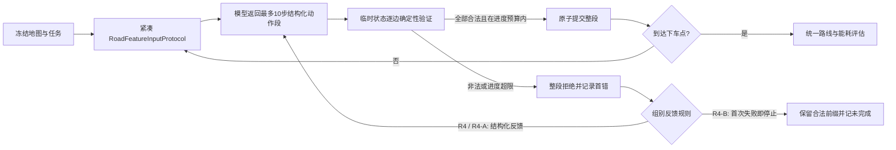

# R4 短路线段检索 v1：设计提案

**状态：离线原型已实现并通过 task9 零调用完整链路预检；尚无真实模型试跑，未冻结为正式 R4 协议。**

## 目的

保留 R4 的 Agent-readable 道路特征输入、分步路线生成和本地确定性硬校验，同时减少“一条道路边一次模型请求”的交互成本，并阻止模型沿合法道路持续绕行。

这是一种新协议候选。现行 R4 单方向请求的 v3/v6 运行和历史产物保持原样，不拼接、不改标为本提案结果。

## 依据

- 冻结的 seed 0 `task-0000-0009` 初始完整路线动作下界是 109。v3 主试跑成功收到 7 次响应，7 个方向通过程序校验；7 步已走动作加剩余 102 步下界仍为 109，但试跑在到达上车点前停止。
- v6 中 219 个合法动作后仍未到上车点。沿冻结有向图重算，“已走动作数 + 当前到上车点的最短剩余步数”在第 2 个动作后开始超过初始下界；按本提案的 `2 × 109` 进度上限，第 147 个候选动作将首次越界。原 v6 仍继续到 219 步。
- 2026-10-26 对旧轨迹做了确定性进度门槛重放：v3 的 7 步前缀未越过 218 上限；v6 的第 147 步首次越界（当时累计进度下界 219）。v6 的 219 步中，剩余有向最短步数下界在 125 步下降、94 步上升；第 2 步起累计进度偏离起点下界。剩余步数忽略已访问节点，是乐观下界；若按 10 步原子提交，第 15 段将被拒绝，保留此前已提交前缀。详见 `outputs/route_layer/r4_segment_v1_proposal_offline_gate_20261026_v1/progress_curve.html` 与 `progress_guard_replay.json`。
- `r4-step-v3` 已实现紧凑地图/访问状态和目标下界提示；本地 deterministic validator 已是唯一的路线状态推进门槛。紧凑首条消息字节减少约 10.02%，但实际 token 节省未证明。合法性校验本身不负责目标导向。
- 129 个可路由任务的逐方向协议最低需要 17,072 次请求。零调用敏感性审计显示，K=10 的短段协议最低为 1,758 次请求、重复输入字节下界约 45.56 MB；129 个离线验证的不重访见证合计需 1,795 个十步以内片段。它们是理论/回放下界，不是实测 usage、费用或模型完成率。
- 既有 task9 单步用量复核：stateless v2–v6 的同一条 219 步合法路线累计 219 次请求、3,645,450 输入 token、169,899 输出 token，累计响应延迟约 43.9 分钟；另有 v3 7 步授权前缀为 124,645 输入、931 输出 token。以这些单步输入均值线性外推，129 项的逐步请求输入约 284–304 百万 token；K=10 若每次输入大小完全不变，敏感性值约 29–31 百万输入 token。该假设未测多步输出、拒绝反馈、缓存及完成率，不是实际 token/费用预测。详情：`outputs/route_layer/r4_segment_v1_proposal_offline_gate_20261026_v1/usage_sensitivity.json`。
- 现有 129 个不重访可行见证的长度均不超过 `min(512, 2 × 初始动作下界)`。这为一个共同的进度停止门槛提供了离线依据；它不代表模型能找到这些见证。
- 2026-10-26 对冻结输入重新运行完整本地见证审计：150 项任务中有 129 项可路由，129/129 见证通过共用 validator、0 次拒绝，最长 370 边；未启动正式 R4、模型请求为 0。新审计产物：`outputs/route_layer/r4_segment_v1_proposal_offline_gate_20261026_v1/`。

## 候选协议

### 每次响应

每次模型请求最多提议 10 个有序动作。输出只包含结构化 JSON，不要求模型输出隐藏 CoT 文本；每个动作包括方向和简短自检字段：

```json
{
  "actions": [
    {
      "direction": "W",
      "self_check": {
        "allowed_directed_edge": true,
        "starts_at_current": true,
        "inside_boundary": true,
        "pickup_order_ok": true,
        "target_node_is_new": true
      }
    }
  ]
}
```

实际 JSON Schema 固定 `actions` 最多 10 项，方向值限于 `E/W/N/S`，拒绝额外字段。每个任务使用一条持久会话：首轮输入带冻结地图、道路特征和任务端点；后续输入只带最新路线状态、访问状态、取送顺序、剩余动作预算、进度预算和校验反馈。模型会保留先前会话上下文，使用量必须以 CLI 实际回执为准。评估真值、传统算法路线和离线见证不进入模型输入。

### 本地验证与原子提交

程序在临时状态副本上按顺序逐边重放整段，并核验：

1. 当前节点的真实有向边与方向、路线连续性、地图边界和封闭边；
2. 不重复访问、先上车后下车、抵达下车点后立即终止；
3. 每一步剩余可达性、动作预算和进度门槛；
4. 把模型自检与本地事实逐项比对并记录差异；差异是模型行为诊断，不作为路线合法性的判定条件。

程序根据有向边、地图范围、障碍、取送顺序、重访、可达性和进度预算做硬判定，所有动作通过后才一次性提交整段。任一硬约束失败，整段不推进；保存完整原始提议、首个失败位置/类型和自检差异。模型自检字段缺失或格式错误属于响应格式错误；字段格式正确但与本地事实不一致时，只记入 `model_self_check_discrepancy_count`，仍以本地确定性检查决定接纳与否。被拒绝的动作不会进入车辆执行或有效路线；没有完整合法路线时，不报告完整路线能耗。模型仍可能提出非法候选，因此结果口径是“零违规动作被接受/执行”，不能声称模型从不提出违规方向。

### 路线进度门槛

定义冻结任务初始最短动作下界 `L0`。临时重放每一步后计算：

```text
已接受动作数 + 本段临时动作数 + 当前状态的乐观剩余动作下界
```

该值不得超过 `min(512, 2 × L0)`。若超过，整段拒绝并记录 `progress_budget_exceeded`。它只限制路线绕行，不替模型选方向、不生成替代路线、不调用 Dijkstra/A* 兜底。此规则必须对所有对照组相同；报告因进度门槛停止的任务为未完成，不把它们删出分母。

此门槛是本候选的关键方法假设，虽有 129 个离线见证覆盖依据，仍未证明模型会找到见证或产生高质量路线。当前 task9 零调用预检验证了冻结输入、压缩图等价、完整分段运行器和回放页面；假客户端使用本地见证模拟 12 个响应、完成 111 步。该结果仅为代码链路测试，不能当成 LLM 路线、成功率、usage 或费用。

### 预算与反馈

每任务动作上限为 `min(512, 2 × L0)`；K=10 时，共同模型请求上限为：

```text
ceil(动作上限 / 10) + 3
```

额外 3 次只供拒绝路线段后的反馈重提议使用；网络层重试为 0。所有响应计入 usage、延迟和请求数。达到请求上限后仍未完成，标记部分路线。

按 129 个冻结可路由任务逐项计算，上限合计为 3,848 次请求/方法（不含预检拒绝任务）；对应最低需求 1,758 次。这里的“上限”是假设每项任务用尽动作预算并再用尽 3 次反馈额外调用的协议上限，不是预计费用或账户额度。

## 三组对齐建议

三组共用 Codex CLI 后端、Qwen 端点解析结果、地图/任务/端点、K=10、动作与请求预算、validator、进度门槛、能耗模型和结果指标；各组都保留 150 项分母，其中预设非法端点、不可达和语义解析失败按预检规则处理。

| 组别 | 路线请求地图输入 | 拒绝路线段后的规则 | 唯一方法差异 |
|---|---|---|---|
| R4 | Agent-readable 道路特征 + 紧凑有向图 | 最多 3 次额外结构化验证反馈；超限则停止 | 完整主方法 |
| R4-A | graph-only + 相同紧凑有向图 | 与 R4 相同 | 路线阶段是否能读取道路特征 |
| R4-B | 与 R4 相同 | 第一次拒绝后停止，不发送验证反馈 | 是否使用验证反馈重规划 |

三组具有相同硬请求上限；R4-B 可能因提前停止而少用请求。路线输入和端点解析准确率分别报告。历史 DeepSeek 纯 LLM v8 不与 Codex CLI 新批次混合；正式比较需要按方案统一后端和共享端点。

## 指标和失败处理

主要指标：完整任务率、合法路线接受率、完成路线的距离/时间/能耗/费用、相对同端点传统参考的路线差距、段请求数、被拒绝段数与首错位置、输入/输出 tokens、延迟。分开报告端点解析失败、格式失败、非法动作、进度门槛停止、请求预算耗尽和完整路线成功。

拒绝段的模型提议可另存为假设路线估算，但不能计入有效路线能耗。实际车辆执行只接收程序验证并提交的动作段。

## 零调用准入清单

批准实现后，先做以下检查，不调用模型：

1. 在冻结 100×100 输入上检查紧凑地图语义等价、Schema 上限和请求预算；
2. 用 129 个不重访见证逐段回放，确认 129/129 在进度阈值内可行且全部通过硬验证；
3. 重放 v6 旧轨迹，确认第 147 个候选动作会触发进度门槛，v3 的 7 步前缀仍可通过（2026-10-26 已完成复算，见 `outputs/route_layer/r4_segment_v1_proposal_offline_gate_20261026_v1/progress_curve.html`）；
4. 覆盖非法有向边、断链、重复访问、早到/多走下车点、错误格式自检、合法动作的自检差异只记录不拒绝、段尾格式错误和原子拒绝；
5. 生成单任务及三组预算报告和回放页面，确保被拒绝段没有推进路线状态。

通过后，把冻结的 100×100 task9 作为一项有界端到端准入试跑，最多 25 次请求（22 个动作段预算 + 3 次拒绝段反馈），零网络重试；逐次落盘真实 Codex usage、提议、段校验和进度。到达合法下车点才算完成；否则保留合法前缀并标为部分结果。该试跑可用于确定三组预算，不能并入十种子正式效果样本。正式批次必须等完整路线验证、用量/费用熔断和 R4-A/R4-B 输入对齐全部通过。

端到端回放需沿用传统算法的索引层级，至少显示 10 个种子、原地图、同任务端点、每种方法结果、总时间/距离/能耗/费用、段请求数及每段的提议/接受状态；非法或进度超限段须标出首错位置，未完成路线不得填入完整路线能耗。

## 结构图



## 明确限制

本方案能减少模型往返并确保非法动作不进入有效路线；它不能保证每段提议都合法、不能保证任务成功，也不能保证 R4 优于传统算法。它改变当前每请求一个方向的冻结方法，必须单独标记为 R4 segment-v1，并在用户批准、实现和离线验证后另行冻结。

## 当前实现与停止边界（2026-10-26）

- 实现：`route_experiment/r4_segment.py`、task9 零调用预检 `scripts/preflight_r4_codex_segment_task9.py`、显式执行门禁 `scripts/run_r4_codex_segment_task9.py` 和回放渲染器 `scripts/render_r4_segment_replay.py`。
- task9 输入哈希与原 100×100 seed 0 冻结输入一致；10,853 条有向边通过压缩地图语义等价检查；道路特征上下文取自已有冻结预检，没有新发 Qwen 请求。
- 执行器每次请求前持久写入 request-in-progress；中断时标投递/用量未知，不自动续发或重放；每次调用零网络重试。Codex CLI 当前没有可配置的硬输出 token 上限，因此真实试跑前仍须评估用量预算。
- 本地见证完整通过 12 个假响应段，111/111 步合法；共享评估器给出的 11,100 m、1,152.442 s、1.252638 kWh 只描述离线见证，不是 LLM 结果。
- v5 历史预检曾有 269/269 离线回归通过。后续复查旧 8×8 试跑发现，模型自检错误会使本地验证本可接受的合法动作被停止；当前修订把这类差异改为审计信息，正式使用 v6 离线预检。更新后的测试与回放证据见 `outputs/route_layer/r4_codex_segment_task9_preflight_v6/offline_verification_report.json`。
- 当前正式路线方案仍规定“一次请求一个方向”；本原型改变请求粒度，应先作为独立 pilot。真实模型请求需单独授权，离线通过不代表已获在线试跑授权。
- 共享 time-money selector 只在同一任务有多个同口径可行路线时才会影响选择。当前 R4 task9 只输出一个候选路线，不能把 R4 与传统算法结果并成同一候选集，也不能声称本原型已应用该权重。

这里的“理想实验”指输入冻结、错误可定位、过程可复核并如实报告路线质量；它不意味着预先保证路线成功或优于传统算法。
