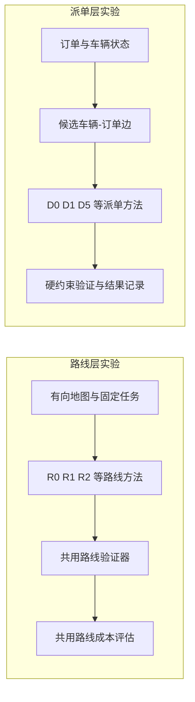

# 无人网约车 EI 论文阶段性可写稿

**初稿日期：2026-10-24；最近更新：2026-10-27（R4 task9 pilot通过准入并启动正式批次）**
**稿件状态：阶段稿；中文版；不是可直接投稿的全文。**  
**暂定题目：**《无人网约车接驾路线评估与动态派单的分层仿真研究》
> **最新续监快照（截至 2026-10-27 12:22 CST）：**
>
> **Porto R2 修正版传统矩阵：** `porto_r2_traditional_20261027T025652Z` 已完成并通过完整只读审计：20/20格、2,000/2,000订单完成、4,000/4,000路线腿通过验证、0模型调用。对同一10个seed做事后配对 bootstrap（10,000次，未作多重校正）：`LOWEST_ENERGY−FASTEST` 的净能耗代理差−9.627 kWh（95%区间[−9.930,−9.336]），车队完成时间+260.596秒（[+157.143,+353.959]），距离−17.205 km（[−18.892,−15.632]）。能耗为 SUMO 轨迹驱动的 `ev_longitudinal_v2/generic_reference_ev_v1` 代理，不是实车测量；时间—费用综合分仍受缺票价和预设候选池门禁阻断。审计与配对文件位于该批次目录。
>
> **R4：** progress-v2 按批准的最多25次、零重试口径单独记账，22个turn后停在18步合法前缀，未到pickup/dropoff。另一个68步 ephemeral continuation 因停机标记保持独立未完成状态。fresh `r4-step-v3 / ephemeral_per_request` task9 pilot 已通过方案准入：113个方向动作通过validator，路线到达pickup和dropoff，无重试、工具事件、未知请求或usage缺口；距离11.3 km、模拟路程时间1,257.260秒、EV v2估算1.286286 kWh。累计1,857,583 input（cached 449,280为子集）、39,449 output tokens；费率卡等值8.449625 Standard credits / API参考$0.337985，CLI未报告账户实扣。该单任务只验证执行门槛，不是正式效果比较。R4正式批次v2已启动，150项冻结任务中129项可路由、21项预检跳过；截至12:22为23次请求、第24次在途，首个任务仍运行。批次未完成前不报告总体结果。
>
> **NYC：** 隔离 seed4 有178次启动、176次结束（164 complete、12 failed_no_retry），另有10个blocked、67个复用完成和7个ablation_pair_unavailable记录；当前为 `EV_20240611_211000_q75/F2/D8_live`，整批尚未审计，不并入官方seed0–3。EV v2 lexicographic seed0 有30次启动、29次结束，当前为 `EV_20240321_220000_q50/F1/D6_D7_replay`；90格矩阵尚未完成。两者只记录进度。
>
> **本阶段边界：** Porto 修正版传统路线矩阵可作为范围明确的仿真基线；R4单任务pilot仅作完整执行和准入证据，正式R4、NYC矩阵完成并审计前不写总体效果。所有费用仅在CLI提供记录时才视为实际扣费，费率卡估值另行标注。
>
> **历史续监快照（截至 2026-10-27 11:33 CST；非当前进度）：**
>
> **Porto 修正版传统矩阵：** porto_r2_traditional_20261027T025652Z 已有 14/20 格终态、0 次模型调用，矩阵仍运行。端点 Link 能耗权重修正后的结果单独记账，不能与旧实现矩阵合并。
>
> **NYC：** seed4 隔离复跑有 134 个 job starts、132 个 finishes（120 complete、12 failed_no_retry）；最新 EV_20240509_210000_q75/F2/D5_live 正在运行。该批仍未完成整批审计，不并入官方 seed0–3。另有独立 EV v2 lexicographic seed0 评估运行，17 个 job starts、16 个 finishes，最新 EV_20240312_200000_q25/F2/D0_D1 正在运行；整体审计未完成。
>
> **R4 progress-v2 task9：** 用户批准最多 25 次请求、零重试、零传统回退；实际完成 22 次模型 turn，另有 1 次本地 Schema 路径设置错误（没有 turn.started，不计模型请求）。第 22 次被 validator 以 one_way_direction 拒绝；本批 4 个段被拒，3 次结构化反馈额度已用尽，运行器因此停止，剩余 3 次授权请求未发送。累计 18 步合法前缀至 node_63_33，1.8 km、269.456 s、ev_longitudinal_v2 估算 0.220588 kWh；pickup/dropoff 未到，乐观剩余下界 111 步。usage 为 778,130 input（cached 604,800 为其子集）、20,481 output tokens；费率卡等值 1.78348 Standard credits / API 参考 $0.071339，账户实扣未知。v9 仍独立停机。R4 不是完整路线或性能结果。
>
> **章节可写范围：** 继续报告已完成且审计通过的范围受限模拟结果。Porto 修正版矩阵、NYC 两个运行批次须完成并审计后再下结论；R4 仅写调用账本、validator 拒绝和未完成前缀，不写路线优势、完整任务效果或跨 seed 结论。
>
> **能耗口径（2026-10-26，离线复算审计完成）：** NYC 原派单批次使用固定 `0.18 kWh/km`；现已对冻结分派路线做 `ev_longitudinal_v2` / `generic_reference_ev_v1` 事后能耗核算，共验证 2,048 份已有结果（seed 0/1/2/3 分别为 629/630/628/161），独立完整性审计通过。该核算没有重跑策略或调用模型；D1/D2/D5/D6/D7/D8 的选择可能受旧能耗影响，因此新能耗值不能证明这些方法按 v2 作出相同分配，seed 0–3 仍有缺失格，seed 3 另有一格混合代码单元排除。NYC 行程使用区域 OD 距离与合成质心接驾段，缺少逐秒车速、坡度、信号及随时间变化的拥堵观测；接驾段按虚拟平路估计，通用参考车参数未按实车校准。结果属于代理能耗估计，不是实车测量或 v2 感知策略结果。Tesla 站点电价不是车辆能耗模型。

> **历史实验状态快照（2026-10-27 00:41 CST）：** 用户已授权 NYC 新 seed 与 R4 同端点路线实验，新增 Codex CLI 累计额度不设限。NYC seed 4 已按旧矩阵协议启动，复用与 seed 1–3 哈希一致的冻结排序器；截至本次快照，首个 F1 确定性 D0/D1 单元仍在计算，尚无 seed 4 模型调用或完整配对格。R4 task9 固定端点 pilot 已按同一地图、Qwen 端点、先接后送/无重访约束和 EV v2 评估器完成：传统两段 Dijkstra 找到 111 边路线（11.1 km、1,152.442 s、1.252638 kWh）；Codex 纯 LLM 单次响应报告 `no_directed_path`，用量 15,970 输入/538 输出 token，费率卡估值 0.095990 credits；R4 segment-v1 达到单任务 25 请求上限，25 次均有回执、22 个动作通过 validator、3 段被拒，仍未到 pickup。该 R4 合法前缀为 2.2 km、333.511 s、0.276394 kWh，不与完整路线比较；用量 6,673,924 输入（其中 5,580,032 为缓存输入子集）/101,783 输出 token，费率卡估值 11.312966 credits。两种 Codex 方法合计费率卡估值 11.408956 credits（API 参考等值 $0.456358），账户实扣未知。输入哈希、调用账本、validator、25 条 trace 和非正式结果边界通过完整性审计；此单任务 pilot 不能支撑统计或总体效果结论。产物见 `outputs/route_layer/r4_fair_task9_pilot_20261027_v2/` 与其 `integrity_audit.json`。R4 `_v1` 相对 schema 路径错误发生在模型 turn 前，usage 为零，已单独保留。

> **续监状态（2026-10-27 00:52 CST）：** NYC seed 4 的首个 F1 D0/D1 单元仍运行，已持续约28分钟，CPU约95%–99%，进度日志每分钟更新但子进程日志仍为0字节，结果文件尚未生成。同格 seed 1–3 的完成时间分别为18.05、20.06、20.04秒；三份结果的场景指纹相同（`d491f335ba2b51a99604f42c5c9fc7fc0c4da36380c0d0f920691fe24a5186a`），均为452单、12车、473轮，故本次记为异常执行待定位，不能作为seed 4结果。macOS采样仅能确认Python在计算，未能解析具体Python函数；未产生模型请求。Porto既有独立授权批次 `porto_r2_llm_20261026T162350Z` 仍运行；00:51快照为108次调用、24,208,471 tokens、119.917714 Standard credits费率卡估值，3/20格终态，账户实扣未知。Porto额度仍按该批次原有上限执行。

> **历史续监快照（2026-10-27 00:55 CST；执行进度，不是总体效果结论）：** Porto 当前正式纯 LLM run `porto_r2_llm_20261026T162350Z` 仍在运行，manifest 与调用账本一致记录 112 次请求、25,028,168 输入、91,918 输出 tokens（共 25,120,086），费率卡估值 124.434316 Standard credits；Codex CLI 未报告账户实扣。20 格中 3 格已形成终态摘要：seed 0 的 FASTEST 和 LOWEST_ENERGY 各完成 20/100 单，均记有 10 单非法有向转向失败、70 单因固定车辆序列受阻；seed 1 / FASTEST 完成 27/100 单并记录 10 次规划失败。seed 1 / LOWEST_ENERGY 正在运行，尚无 batch summary。用户对该正式矩阵已明确“不设限”，但活动 runner 启动参数仍配置 2,000 次调用、1,000,000,000 tokens、10,000 credits 和单请求 300,000 估算输入门禁；未修改活动进程或冻结输入，若门禁早于20格终态触发，只继续未完成的必要矩阵工作，不重复已完成格。NYC seed 4 的首个 F1 D0/D1 仍在确定性计算，progress 最新记录为 1,745.6 s、30 条进度事件，进程约占用一个 CPU 核，未生成结果文件。R4 task9 v3 在冻结的 `grid-100x100-seed-0` 单任务上已到达指定 pickup `node_25_66` 和 dropoff `node_42_43`：115 个本地校验通过的动作、116 次 CLI invocation，路线 11.5 km；共享 `ev_longitudinal_v2` 仿真估算 1,290.777 s、1.310073 kWh。最终审计仍标记 `tool_audit_complete=false`，请求 43 和 59 的用量/工具事件未知；已知 usage 为 1,873,645 input（缓存 191,360 为子集）、45,648 output tokens，费率卡等值 9.876545 Standard credits，实际账户账单未报告。请求 43 的动作已由本地恢复记录验证，请求 59 投递状态未知；两次均不能补写为零用量。最终审计和回放仍待路线对话复核，因此该结果只作为单任务完成记录，不与其他协议作效果排名。

## 1. 现有材料能支持到什么程度

> **历史续监快照（2026-10-27 01:01 CST）：** NYC seed 4 的首个 F1 D0/D1 子任务已运行约36分钟，CPU约96%，进度日志仍每分钟更新，子进程日志为0字节，暂无结果；同格 seed 1–3 用时18–20秒。该单元仍为异常确定性执行，尚无模型请求，不能计为完成。Porto独立纯LLM批次 `porto_r2_llm_20261026T162350Z` 的17:00 UTC manifest 显示134次调用、30,100,967 tokens、149.168318 Standard credits费率卡估值，4/20格终态；模型账号实扣未知，无总体矩阵结果。

> **历史续监快照（2026-10-27 01:05 CST；执行进度，不是总体效果结论）：** Porto 当前正式纯 LLM run `porto_r2_llm_20261026T162350Z` 仍运行，manifest 与调用账本记录 155 次模型调用、34,719,634 tokens、费率卡估值 172.006149 Standard credits，账户实扣未报告；20 格中已有 4 格终态摘要。seed 0 的 FASTEST 与 LOWEST_ENERGY 各完成 20/100 单、各有 10 次非法有向转向失败和 70 单后续阻塞；seed 1 两目标各完成 27/100 单、各有 10 次规划失败和 63 单后续阻塞。其余 16 格未形成终态汇总，整批尚无 batch summary。用户已授权此正式矩阵不设固定调用数或 credits 上限，但只限完成该矩阵，不增设额外实验；当前 runner 内部启动门禁未改，若其早于20格终态触发，只续做必要未完成格且不重放已完成格。NYC seed 4 首个 F1 D0/D1 确定性单元的 progress 到 17:05:03 UTC 已记录 2,407.9 s、41 条事件；进程仍约占一个 CPU 核，暂无结果文件或模型调用。R4 task9 v3 已完成一次固定端点接送路线，但 `final_audit.json` 仍标记 `tool_audit_complete=false`，请求43与59的用量/工具审计待闭合；路线和能耗只作单任务描述，不作总体效果结论。

> **历史续监与边界快照（2026-10-27 01:15 CST；运行审计，不作效果结论）：** Porto 同图纯 LLM 正式批次的 manifest/账本记录 197 次模型调用、44,062,711 个 tokens、218.211890 Standard credits 费率卡估值，账户实扣未报告；6/20 格已终态，六格分别完成 20、20、27、27、19、19/100 单，共 132 单完成、60 单失败、408 单阻塞。六格共有 60 次规划失败，其中 59 次为非法有向转向、1 次为中间路线端点 alias 错误；尚无 batch summary，不能报告整体路线质量或方法差异。
>
> NYC seed 4 的首个 F1 D0/D1 确定性单元于 01:12:14 CST 以 return code -2 / failed_no_retry 结束，运行 2,838.86 秒；两个结果文件均缺失。日志显示在 energy-model config fingerprint 的 dataclasses.asdict 序列化路径中抛出 KeyboardInterrupt；中断来源尚未查明。该格未产生模型调用或评价结果，本轮未重试。
>
> 路线层 task9 续跑的最新用户指示为只监控和写稿、不授权 128 次请求，并要求审计此前 3 次；只读核验发现 state 已登记 34 次成功调用，全部有 usage 与合法动作记录，合计 15,009,234 输入（缓存输入 10,739,840 为其子集）和 56,030 输出 tokens，费率卡估值 28.397790 Standard credits / API 参考等值 1.135912 美元，实际账单未知。另有 step 35 响应 JSON，但没有对应事件 trace、usage 或 state 接受记录；不能计入有效动作或完整用量。发现后已停止本地自动续跑。该续跑不是正式路线比较，不纳入论文性能结果。

> **历史续监快照（2026-10-27 01:23 CST；运行审计，不作效果结论）：** Porto 同图纯 LLM 正式批次当前 manifest/账本记录 231 次模型调用、51,648,442 个观察 tokens、255.601187 Standard credits 费率卡估值，账户实扣未报告；7/20 格终态，分别完成 20、20、27、27、19、19、15/100 单，合计 147 单完成、70 单失败、483 单阻塞。七格共 70 次规划失败，其中 69 次为非法有向转向、1 次为中间路线端点 alias 错误；无 batch summary，不能报告整体路线质量或方法差异。NYC seed 4 首个 F1 D0/D1 确定性单元在 01:12:14 CST 以 -2 结束，结果文件缺失；日志在 energy-model config fingerprint 序列化路径记录 KeyboardInterrupt，来源未查明，本轮没有重试。R4 task9 续跑按最新用户范围停止，本地可核对34次已接受请求；step 35 响应无 usage trace/state 接受记录，不作为有效路线动作或论文结果。

> **历史续监快照（2026-10-27 02:15 CST；运行审计，不作效果结论）：** Porto 当前正式纯 LLM 矩阵 `porto_r2_llm_20261026T162350Z` 记录 434 次已接受模型 turn、96,514,585 个输入及输出 tokens，Standard credits 费率卡估值 477.248999；16/20 格形成终态摘要，累计 254/1,600 单完成、160 单失败、1,186 单阻塞。失败日志为 157 次 `illegal_directed_turn` 和 3 次中间路线端点 alias 错误；整批仍无 `batch_summary.json`，零距离 fallback 自环疑点仍待逐格、逐订单审计，账户实扣未报告。NYC 官方 seed 4 首格仍为 `failed_no_retry` 且无结果；隔离复核与官方目录分离，progress 为 59 个 job 启动、58 个结束（46 个完整、12 个失败），当前到 `EV_20240401_200000_q25/F4/D2`，输入/代码指纹与恢复结果仍待完整审计。R4 获准审计的三次请求共 51,878 输入、1,307 输出 tokens，费率估值 0.298600 credits，仅形成三个合法动作。之后 fresh-v3 各运行分开记录：v1有14次已接受、#15投递/usage未知；v2有21次已接受、#22在模型turn前中止；v3零请求；v4一次CLI在模型turn前因缓存解析错误退出；v5有11次已接受（184,946输入、3,962输出，1.043590 credits估值），#12的final JSON（方向W）无JSONL/usage/state接受；v6有8次已接受（134,533输入、2,780输出，0.716321 credits估值），路线停在node_65_45，#9仅有prompt/schema、无final/JSONL。v5和v6调用链均已终止并留存中断sidecar；不重放。fresh-v3运行合计54次已接受步进、至少49次发生在用户明确限制新增请求之后，均不属于获准审计的三次，也不纳入论文效果结论；实际账户账单未知。

> **历史续监快照（2026-10-27；只读运行审计，不作效果结论）：** 用户针对 Porto 当前正式同图纯 LLM 矩阵直接回复“不设限，减少不必要测试”。该授权只覆盖现有冻结矩阵的完成，不增加场景、种子、smoke 或重复调用。当前 run `porto_r2_llm_20261026T162350Z` 的 manifest 与调用账本一致记录 477 次已接受请求，477 次均有 usage 事件，共 105,948,043 tokens，费率卡估值 524.462779 Standard credits；账户实扣未报告。20 格中 18 格已有终态摘要，涉及 1,800 个订单：294 完成、180 失败、1,326 阻塞；另 2 格尚未形成终态摘要，无 `batch_summary.json`。manifest 仍保留每批 2,000 次调用、1,000,000,000 tokens、10,000 credits 及单次估算输入 300,000 tokens 的运行门禁；如门禁阻止冻结矩阵剩余单元，后续仅续未终态单元，不重放终态结果。18 份终态 summary 的 `zero_distance_legs` 合计为 0，但此前发现的 fallback 自环疑点仍需逐条路线产物审计，不能仅据该字段写模型路线已有效。NYC seed 4 官方批次仍独立为 `failed_no_retry`；隔离复核当前记录 71 个 job 启动、70 个结束（58 完整、12 失败），另有 1 个 job 运行中，尚未完成输入/代码/结果完整性审计。R4 task9 独立 v7 pilot 已接受第 1 个合法动作（`node_69_41`→`node_69_42`），状态为等待下一步；未完成接送路线，不作路线质量或方法比较。以上是运行状态；实际效果章节只采用完整、同协议、通过审计的实验结果。

| 论文部分 | 当前判断 | 可用材料与限制 |
|---|---|---|
| 题目、摘要 | 题目暂定；摘要可写成阶段候选稿，暂不定稿 | 已有合成路网、NYC 区域级代理派单、Porto 两套动态路线协议的结果，但任务和计量口径不同；摘要需分支呈现，不可据此写真实运营或端到端优势。 |
| 引言 | 可以形成审慎的阶段稿 | 研究对象、等待时间目标及 Agent—优化器边界已有确认；当前模拟事件时钟未计入墙钟决策耗时，结果等待指标与目标定义尚未对齐，创新差异仍需按最终实验范围复核。下文提供可继续改的正文。 |
| 相关工作 | 已并入阶段稿；来源主稿仍单独保留 | 本稿新增完整相关工作章节，沿用《相关工作_正式稿_20261006.md》的主题综合与来源链接；引文仍采用本节独立编号，合稿时须统一编号、去重并复核研究差异。 |
| 方法 | 问题定义、传统路线方法、分段 R4 候选协议离线验证、路线级分段经济核算方法均可写；端到端 Agent—优化器方法只能按设计描述 | 时间—金钱权重定义已版本化为 `route_time_money_segment_v2`，但合成路线缺票价、NYC 缺电价/算力分摊和备选路线集、Porto 固定订单包也缺票价与完整候选池，三处均不能报告加权选路或盈利结果。R4 v5 有零调用离线协议核验；先前 task9 pilot 曾抵达固定下车点，但最终用量/工具审计未闭合。获准审计的三次步进和各 fresh-v3 运行均与正式结果分开。最新 v7 停在 23 个本地验收动作；第 24 次 turn 虽有原始响应和 usage，但没有 final 文件或 state 验收。R4 v7 未完成接送路线，不支持方法比较或效果主张。|
| 实验设置 | 三条实验分支的冻结协议和已完成基线可写；当前批次状态按运行审计更新 | 合成路线、NYC区域级派单、Porto固定车队路线仿真分支报告。Porto传统矩阵和同图纯LLM+fallback矩阵均20/20格终态；LLM组318/2,000单完成且636条路线均由fallback执行。NYC隔离seed4继续推进但整批未审计，官方seed4仍失败。R4新请求额度已在本地state/manifest置0；对话回合仍活跃，故只写审计边界，不写性能结果。
| 实验结果 | 已完成分支内基线和离线统计可写；未完成矩阵按分母、阻断和限制报告 | 可报告合成网格工作量、NYC seed0–2旧能耗策略的回顾性模拟差异、Porto传统矩阵的实现版本下观察，以及纯LLM+fallback运行失败链和fallback行为。R4 v9承接前缀后有16步获validator接受，但pickup/dropoff未完成；累计#46响应/usage未知，属于执行审计，不是路线结果。
| 讨论与局限 | 可以先写已知边界 | 可明确不同数据分支不合并统计、历史行程不是网约车在线订单、合成图结果不能外推到真实道路。总体机制效果仍待补。 |
| 结论 | 暂不定稿 | 当前不支持“Agent 友好地图提升路线/派单效果”或“端到端方法优于基线”的总括结论。 |

目前至少有三个互不等价的实验分支：合成网格路线规划、NYC TLC 区域级需求代理下的调度模拟、Porto OSM 路网与历史出租车轨迹驱动的固定车队路线执行模拟。Porto 的 SUMO 信号和背景交通仍为仿真条件；三条分支不能混在一张汇总表里做跨数据源排名。建议暂以“路线评估与动态派单的分层仿真研究”作为工作题目；最终是否合并为一篇论文，需由统一研究问题及派单独立留出结果决定。

**已核验实验基线（工作区进度，非论文结果；快照截至 2026-10-27 00:12 CST）：** NYC seed 0–2 的 D8–D2 主比较为 270/270 配对有效、七方法完整格 267/270；策略按旧能耗口径生成，尚未做 EV v2 策略重跑。离线组件对照覆盖 D2−D1、D6−D2、D7−D6、D8−D7 四组，1,887/1,887 个来源结果哈希已核验；这是事后配对分析，不是组件因果证明。Porto v1.10 传统矩阵 20/20 格、1,996/2,000 单完成；v1.11 共享 Link 传统矩阵 20/20 格、1,994/2,000 单完成，3,996/3,996 条已生成路线腿验证通过，九组完整配对统计已完成。v1.12 `_05` 零调用预检覆盖 2,000/2,000 请求及路线腿，最大输入估算 291,129 tokens，全部仍超原 75,000-token 门槛。纯 LLM 批次 `porto_r2_llm_20261026T154047Z` 有19次调用；其后两个独立批次 `porto_r2_llm_20261026T160115Z` 和 `porto_r2_llm_20261026T160352Z` 分别有4次和22次调用。最后一个批次累计4,911,843输入、16,935输出tokens（合计4,928,778），费率卡估值24.603009 Standard credits，账户实扣未知；没有cell summary或路线validator结果。R4 task9 v3 stateless continuation当前记录58个本地合法动作、5.8 km、622.881 s和0.660034 kWh共享仿真前缀估值，停在 `node_34_64`、未到pickup `node_25_66`。第43步从已保存响应本地验证后记入状态，但usage缺失；第44–58步15次请求均有本地合法性记录。三批模型请求和R4前缀均是不完整执行审计，不是路线效果结果。R4正式矩阵、NYC新独立seed、EV v2派单策略重跑和关键模块多seed复现实验仍不齐备。

**历史实验对话监控快照（2026-10-27 00:12 CST；工作区进度，非论文结果）：** Porto 与路线层对话在本轮监控间隔内再次自动启动执行；截至此快照，对应的runner进程已退出，但两条线程仍活动。NYC调度对话也仍活动，暂无新的完整可审计结果。后台心跳每分钟检查一次，并继续按用户范围只监控、审计和写稿。

**前次续监与授权快照（2026-10-27 00:26 CST；工作区进度，非论文结果）：** 用户回复“不设限，减少不必要测试”，授权 Porto 传统矩阵完成后运行正式纯 LLM 矩阵；执行沿用已配置硬上限，不增加 smoke、重试或重复预检。新批次 `porto_r2_llm_20261026T162350Z` 使用完整零调用预检 `_05`，截至本快照账本记录 8 次已接受调用（1,795,353 输入、6,698 输出 tokens；费率卡估值 8.927721 Standard credits），运行仍在 `seed_0/FASTEST`，尚无单元摘要或批次摘要；模型账户实扣未知。早先 19、4、22 次调用批次仍分别保留，不并入此 run，也不算正式效果结果。路线层与 NYC 对话仍活动，最近快照未见新的可审计完成结果。

**续监快照（2026-10-27 00:40 CST；工作区进度，非论文结果）：** Porto 获准的正式批次 `porto_r2_llm_20261026T162350Z` 仍在运行，共 57 次调用（FASTEST 30、LOWEST_ENERGY 27），累计 12,844,110 输入、44,459 输出 tokens，费率卡估值 63.840144 Standard credits；账户实扣未知。`seed_0/FASTEST` 已形成终态 cell summary：100 单中 20 完成、10 失败、70 因前序失败阻塞；30 次模型调用生成 40 条计划路线腿。10 个规划失败均记为 `ValueError:illegal_directed_turn`；路线审计日志记录 40 次共享 Link fallback 和 40 条选择审计。`seed_0/LOWEST_ENERGY` 已有 27 次账本请求但尚无 cell summary；整个矩阵无 batch summary，故不能报告 LLM 与传统方法的效果差。路线层 task9 v3 对话在用户要求“只监控并写稿”后仍续发：当前 `state.json` SHA-256 `542e0787f30fa568727658d778240ab98f08517126bdf3565df5a55705865804`，含 93 个本地合法动作、94 条尝试记录，pickup 已到、dropoff 未完成；step59 delivery/usage未知，后续35条有用量记录合计576,248输入、12,453输出 tokens、费率卡估值2.842990 credits。以上是越界执行审计，不作为论文路线结果；是否允许我向路线对话发送暂停指示仍待用户答复。NYC线程最新报告新 seed4/R4 pilot，但产物审计仍未完成，不进入论文结果。

**后续执行审计（2026-10-27 00:04 CST；超出当前范围的自动续跑，非论文结果）：** v1.12 预检 `_05` 最终写出 2,000/2,000 个请求和路线腿、2,000/2,000 条路线腿通过、0 失败、0 模型调用；预检摘要 SHA-256 `70bbe658a775f87e015a3b6c32084073ecd5319eb16668baf362be969bf479c0`，但 2,000 项仍全部超过 75,000-token 门槛。随后启动的独立批次 `porto_r2_llm_20261026T160115Z` 在本轮被发现并停止于4次模型调用：4条调用记录均有已完成 turn 与 usage event，共891,075输入、3,049输出（合计894,124）tokens，费率卡估值4.475421 Standard credits；账户实扣未知。manifest SHA-256 `a63da9c6f447adfa3b876fb6b24be703157c04488d14b9702675283e31ee0d14`，调用账本 SHA-256 `066c7857470c0566ca8c2af8871f832763089f3341bbaf0ee350e31480735ba7`。该目录没有 FASTEST cell summary 或路线 validator 结果；账本只有 cell started 记录，故四次调用的路线结果不作为通过、失败或方法效果。`call_0004` 只有 prompt/schema 文件，没有调用 JSONL 记录，不计作模型调用。此运行与先前19次调用批次分开，不合并或续跑。后续继续只监控、只读审计和写稿。

**后续进度审计（2026-10-27 00:12 CST；两条运行再次自动续跑，非论文结果）：** Porto 新独立批次 `porto_r2_llm_20261026T160352Z` 账本记录22次模型调用、4,911,843输入和16,935输出tokens（合计4,928,778），费率卡估值24.603009 Standard credits；账户实扣未知。manifest SHA-256 `a6bf27075440309af8fd75c676da783b476a9d755ecc9c23fd682c11a3ebbf55`，调用账本 SHA-256 `89a101aef755cbfeb932df790d2aae7f9e34abf8b1be477908108233d25295b1`。审计时没有cell summary、路线规划日志或validator结果；manifest 的 `llm_budgeted_running` 为残留状态，不作为正式路线结果。R4 task9 v3 记录从42个动作增长至58个本地合法动作；保存的 step43 响应后来被本地验证并加入状态，但该步usage未知；step44–58有15条逐步请求与本地validator记录。当前前缀为5.8 km、622.881 s、0.660034 kWh共享仿真代理，在 `node_34_64`，未到pickup `node_25_66`。state SHA-256 `84832359ee7ba72adffbc3786cdf397335e52bbc221695a29650a08f6bdd6743`；已知累计用量为933,716输入、22,911输出（不含step43），CLI未报告账户实扣。此处只说明请求与合法前缀，不是完整接送任务、正式R4矩阵或路线性能比较。进程复核时两个指定runner均未活动，但实验对话仍活跃，继续依照用户“只监控并写稿”范围跟进。

**新增执行审计（2026-10-26 23:56 CST；工作区进度，非论文结果）：** Porto 共享 Link 纯 LLM 批次的 `seed_0/FASTEST` 收到 10 次模型调用后形成 0/100 单完成、10 单失败、90 单阻塞、0 条计划路线腿；失败分别为 8 次 `TypeError: object of type 'int' has no len()` 和 2 次 `ValueError: illegal_directed_turn`。随后 `seed_0/LOWEST_ENERGY` 已发起 9 次调用，但没有 cell summary、validator 或终态账本。19 条调用记录的 manifest SHA-256 为 `acb94c867e5ae72602ce485fb6fd2a4404f66c56a19705972bae270482acb5b5`，调用账本 SHA-256 为 `33dc2275739f2f8211a93264023c0c9c7a9d01d9b4f027503fab7ec560f7b213`；因此不把这次部分执行当作有效 LLM 基线。R4 task9 v3 stateless continuation 另有 42 次完整调用记录、42 个本地合法动作、累计 4.2 km、454.472 s、共享仿真能耗代理 0.473273 kWh，停在 `node_46_60`，尚未到 pickup `node_25_66`；`state.json` SHA-256 `73fd7bb475a3a753419d1f793d2567c64753f3c002905a2dea6d0022f3f551b2`。step 43 的 `final.json`（SHA-256 `f238f2025b62ea9aeb1c4055daacc2bb80ce663853b5c0bc9edefcaac642cbd3`）没有对应 attempt、raw JSONL usage 或本地状态更新，故不得将该响应计作已接受动作。后续只做状态监控、只读审计和写稿。

**状态复核（2026-10-27 00:10 CST；只读）：** `porto_r2_llm_20261026T154047Z` 与独立批次 `porto_r2_llm_20261026T160115Z` 均无对应 Python runner、Codex CLI 或 SUMO 进程，也都没有 `batch_summary.json`。第二批 4 次请求均有 usage 回执，累计 891,075 输入、3,049 输出 tokens；`call_0004` 只有 prompt/schema 文件，没有请求 JSONL，不能算调用。两批 manifest 都残留 `llm_budgeted_running`，不是活动状态。第一批 manifest 记录的 runner SHA-256 为 `c54cc0b5…`，当前工作区 runner 为 `a31709b0…`，未找到与第一批运行哈希相同的源码快照，限制该批故障的精确复现。`EI论文实验跟进与续写` heartbeat 当前为 ACTIVE，配置只允许监控、只读审计和写稿；本次没有新模型调用。定位首批错误时曾在临时目录用已保存响应做单请求 SUMO 诊断回放；没有写入正式运行目录，也不纳入结果。该执行超出只监控、只读审计和写稿的范围，后续不再做。

**新增监控快照（2026-10-26 19:17 CST；Porto 只读预检，不是路线实验结果）：** 新共享图文件 `porto_r2_v111_shared_link_preflight_20261026_05/preflight/shared_candidate_link_graph.json` 已落盘，SHA-256 `9811d6509608788e598e1a76861bb9bc37b0898d744bc01eed2bf7fefb346017`；其元数据记载 30 个候选点、870/870 个有向点对可达、1,716 条 Link，静态自由流 Dijkstra 仅作共同参考与兜底，不作为选路约束。该目录的请求清单目前为 168/2,000 行（seed 0、两个目标各 84 个订单），路线腿清单 168 行且静态可达检查全部通过；168 个请求的估算输入为 271,918–325,177 tokens，P50/P95/均值为 286,605/306,347/288,761.90，全部被 75,000-token 门禁拦截，逐行调用记录为 0。批次 manifest 仍是 `preflight_running`，不构成完整 2,000 请求预检或模型结果。纯文本图超出门槛后正在尝试无损紧凑表示，尚未核验完成。NYC 派单、EV v2 sidecar 和路线层离线诊断对话仍在运行；本快照未观察到可替代现有派单比较的终态报告。
**后续核验（2026-10-26 19:22 CST；EV v2 网格成本 sidecar）：** 路线时间—金钱评分与分段成本脚本已在传统网格既有结果上生成20份独立 sidecar，覆盖10个种子、150项任务；审计为450个方法—任务决策、390个单一可行候选、60个无可行路线，两个权重配置共900条输出。780条为单候选、120条无候选；因此该复算没有可供权重改变的替代路线。390个载客候选均缺少票价，保留收入为 null，只能按已知运营成本记录，不能声称盈利。原始路线结果未修改。
**后续核验（2026-10-26 19:28 CST；R4 分段 task9 v4 兼容性预检）：** 冻结的 100×100 seed 0 地图保持 10,853/10,853 条有向边语义一致；一个本地 111 步可行见证被分为 12 段（每段至多 10 步），12/12 段经本地验证器接纳并到达下车点。见证未进入 prompt/schema，模型请求为 0，正式批次未启动。此项只验证地图重建、分段协议与本地验证器兼容，不说明模型能规划完整路线，也不是性能或 token 成本结果。
**后续核验（2026-10-26 19:31 CST；Porto v1.11 全量共同输入预检）：** `_07` 的 manifest 已到 `preflight_only_complete`，summary 标为 `completed_zero_model_calls`、`formal_experiment=false`。共享图哈希 `9811d6509608788e598e1a76861bb9bc37b0898d744bc01eed2bf7fefb346017` 被2,000/2,000个唯一请求引用；30个候选点间870/870个有序点对可达，Link并集1,716条，预检摘要将其记录为实验开始前提供给所有方法的共同静态参考/兜底图。2,000/2,000条请求结构和2,000/2,000条路线腿静态可达检查通过，调用数为0；但所有请求仍超75,000-token门槛，估算输入P50/P95/最大/均值为215,042/250,233/291,129/217,894.58 tokens。可写完整的输入/可达性预检和预算阻断，不可写LLM/R4路线效果或共同输入下的正式三方法比较。

路线 task9 v2 的正式本地终审报告记录 91 个通过本地有向边校验的动作、9.1 km 合法前缀、1,159.17 s 模拟时长与 1.6914 kWh 共享仿真能耗代理，未到 pickup 或 dropoff；其会话为 `ephemeral_per_request`，不满足正式 R4 所需的 `persistent_per_task`。随后 v3 续跑从该前缀继续，状态文件记录新增 9 次请求、9 个合法动作，累计 100 个已接受动作，停在 `node_23_51`；未完成接送任务，因授权预算不足而停止。周用量守卫记录 10%→10%、信用余额检查未见变化。此后 v4 从 100 步合法前缀另行续跑，终审记录新增 36 次请求、36 个本地合法动作，累计 136 步、13.6 km、1,703.96 s 与 `energy_v1` 仿真能耗代理 2.52415 kWh；在 `node_28_42` 停止，尚未到 pickup `node_25_66` 或 dropoff `node_42_43`。状态为 `partial_legal_prefix_not_complete`，3 次模型自检与本地事实不一致但动作均通过本地校验；0 次重试、0 工具事件。该运行使用 `ephemeral_per_request`，仍是单任务诊断，不是正式 R4 结果或完整路线能耗。终审 `outputs/route_layer/r4_codex_task9_stateless_run_20261026_v4/final_audit.json`，SHA-256 `e09c157a41e5eb731dc4ee77789c49ad9c6aa39c65c5e8d084a706026b60ffeb`。v5 最终审计记录本轮新增 80 次请求、80 个本地合法动作，累计 216 步、21.6 km、2,854.17 s 和 4.00345 kWh energy_v1 前缀代理；停止在 node_15_33，未到 pickup node_25_66 或 dropoff node_42_43，最短还需 167 步。8 次模型自检不一致未导致非法动作；无重试和工具调用。停止记录显示周用量 11%，第 80 次已完成、第 81 次未启动且无在途请求，账户实扣金额未由 CLI 报告。用户最新指示为只监控、写稿和审计，不扩额；本次审计按实际运行记录列出请求数，不将该未完成前缀当作正式 R4 或完整路线性能结果。终审 outputs/route_layer/r4_codex_task9_stateless_run_20261026_v5/final_audit.json，SHA-256 97eae863d4289bdf0b42d1f8c8f05fccd8e1b8f1d7e9f235f2734940e509caa9。

Porto R2 传统算法动态矩阵已审计通过（20/20 格、2,000/2,000 单、4,000/4,000 路线腿），不含模型调用。此前一次 LLM pilot 发生 `unknown_link_alias` 且未生成有效路线段；旧版预检与预算探针也曾在模型调用前阻断。后续唯一授权 pilot 使用进一步缩短的输入：静态估算 55,198 输入 tokens，含输出预留为 58,270 tokens / 0.36815 standard credits。实际产生 1 个模型 turn，调用账本接受该响应；原始输出通过 JSON schema，但独立路线校验发现 vehicle-to-pickup 有 10 次非法有向转向，pickup-to-dropoff 有 41 次非法转向、54 次重复 Link，并在 96-Link 上限处结束且未抵达目标。没有路线腿通过校验，首个订单因 `ValueError:illegal_directed_turn` 失败。另有运行器汇总异常 `KeyError: predicted_signal_wait_s`；20 格中其余 19 格因 `model_call_cap_reached` 阻断。该 pilot 的 2,000 单完成数为 0，未形成乘客车辆路线或行程；SUMO 仅推进了 21.305 s 的规划延迟，车辆能耗值没有观测到，须记为“未记录/不可得”，不能填零或称为模型实耗。该调用记录 53,216 tokens（50,966 输入、2,250 输出），费率卡等值 0.32233 standard credits，Codex CLI 未报告账户实扣。该结果只能支持一次模型响应的 schema 接受、路线约束失败和运行器异常记录，不是路线性能结果。一次性 pilot 授权已用完，正式 LLM 矩阵仍未获授权。最终哈希对齐版预检 porto_r2_successor_preflight_20261026_04 的 manifest 与协议文件 SHA-256 38579739bb8d4e48ad9ac1403aa8fd47a613ed1e4a99d7b1e11acd2c41b50de3 匹配；零调用检查覆盖 2,000 个请求、4,000 张路线腿图和 5,551,144 个合法转向，序列化审计通过，模型调用数为 0。967/2,000 个请求的输入估算仍高于 75,000 tokens。首单静态预算估算为 54,678 输入 + 4,096 输出预留，共 58,774 tokens / 0.39627 standard credits；状态明确要求取得新的模型调用授权。该预检只支持输入结构与静态预算结论，不说明模型遵循能力或路线质量。随后按先前单次授权运行的 pilot 只产生 1 个 Codex CLI invocation / 1 个 model turn，未重试；JSON 结构通过，但实际路线索引端点不匹配，0 条路线腿通过校验，0/2,000 单完成。本次 28,414 tokens（27,693 输入、721 输出），费率卡等值 0.160095 standard credits，账户实扣未报告；没有可用车辆行程或能耗观测。随后仅作零模型调用的 v1.6 endpoint-anchored 预检：2,000/2,000 请求和路线腿均可构造，4,000/4,000 动态端点 Schema 通过，覆盖 5,551,144 个合法转向；估算输入 P50/P95/最大/均值为 34,970/60,769/93,967/37,231.36 tokens，22/2,000 超过 75,000-token 门槛。候选首单估算 27,179 输入 + 4,096 输出预留 = 31,275 tokens，费率卡等值 0.258775 credits；pilot 授权已用尽，必须重新授权。此项只支持 endpoint 约束与输入门禁检查，不是新的模型或路线结果。

Porto R1 固定延迟矩阵仍为 19/20 格完成，FASTEST seed 4 失败保留在分母；R1/R2 只能按各自模拟协议分别描述。合成图 R0/R1/R2 的十种子路线对照已有审计数据。以上分支具有不同任务、地图、车队和计量协议，不汇总成跨分支性能排名；目前也没有真实运营结果或完整端到端 Agent—优化器对照。

**seed 2 三十格官方检查点（审计时间 2026-10-25 12:48:02 CST；仅作执行审计）：** 新增 2024-06-24/F1、F2、F4 后，30/90 个配对格、210/630 份格内方法结果完整，覆盖十个服务日期的 F1/F2/F4；输入哈希、策略回放和逐轮 validator 均通过。审计时共有 213 份结果文件，另三份为下一日期 `EV_20240608_225000_q50/F1` 的 D0/D1/D2。D8 有 28/30 个策略被接受、2 个无效，分别为 2024-03-12/F4 和 2024-06-24/F4；两格均按协议触发 D6 live fallback，D7 回放该响应。D5 有 512 次 live 调用，506 次接受、6 次未接受，另有 14,761 个无可行候选轮次未发起请求。D6 两次 live fallback、28 次回放；D7 三十格均回放。trace ledger 有 545 个完成 turn、10,499,864 tokens、0 个工具事件、CLI 错误/重连或损坏行；含下一日期 F1 未完成格的 D8 trace，不是 30 格独立用量，也非账户实扣。官方审计 `outputs/dispatch_layer/nyc_tlc_hvfhv_2024/results/dispatch_formal_multimonth_replicates_v1/analysis_seed2_checkpoint_20261025_0448_utc/run_audit.json`，SHA-256 `a81eb8ccdc3981a4c5d37ae42becbdb9321f6b2b6f2976f324b4932810f12f5f`。退出码 2 表示总体 90 格矩阵未完成；本次 30 格通过审计。该快照不用于方法效果估计。

**seed 2 三十三格官方检查点（审计时间 2026-10-25 13:03:21 CST；仅作执行审计）：** 新增 2024-06-08/F1、F2、F4 后，33/90 个配对格、231/630 份格内方法结果完整，覆盖十一个服务日期下的 F1/F2/F4；输入哈希、策略回放和逐轮 validator 均通过。审计时共有 234 份结果文件，另三份为下一日期 `EV_20240611_211000_q75/F1` 的 D0/D1/D2。D8 有 31/33 个策略被接受、2 个无效，分别为 2024-03-12/F4 和 2024-06-24/F4；两格均触发 D6 live fallback 并由 D7 回放对应响应。D5 有 564 次 live 调用，555 次接受、9 次未接受，另有 16,255 个无可行候选轮次未发起请求。D6 两次 live fallback、31 次回放；D7 三十三格均回放。trace ledger 记录 600 个完成 turn、11,575,171 tokens、0 个工具调用、CLI 错误/重连或损坏行；其中含下一日期 F1 未完整格的一条 D8 trace，非 33 格独立用量，亦非账户实扣。官方审计 `outputs/dispatch_layer/nyc_tlc_hvfhv_2024/results/dispatch_formal_multimonth_replicates_v1/analysis_seed2_checkpoint_20261025_0503_utc/run_audit.json`，SHA-256 `8a34527e84c2e7b3a0ecbc86158621343c72782ee726a6018e6d812e4a3202c3`。退出码 2 表示总体 90 格矩阵尚未完成；本次 33 格通过审计。该快照不用于方法效果估计。

**seed 2 三十五格官方检查点（审计时间 2026-10-25 13:10:23 CST；仅作执行审计）：** 新增 `EV_20240611_211000_q75/F1` 与 `F2` 后，35/90 个配对格、245/630 份格内方法结果完整，覆盖十二个服务日期下的 F1/F2/F4；两个新格的七种方法输入哈希、场景指纹、seed 与 D6/D7 回放均匹配，逐轮 validator 全部通过，D8 策略接受。审计时共 246 份结果文件，额外一份为同日期/F4 的 D0 基线；该 F4 单元尚不完整。全 35 格的 D8 有 33 个策略接受、2 个无效，仍为 2024-03-12/F4 与 2024-06-24/F4；两格均由 D6 live fallback、D7 回放。D5 共 582 次实际调用，573 次接受、9 次未接受，另有 17,292 个无可行候选轮次没有请求模型；D6 为两次 live fallback 与 33 次回放，D7 三十五格均回放。trace ledger 记录 619 个完成 turn、11,888,246 tokens、0 个工具事件、CLI 错误/重连或损坏行；这是该时点 trace 目录统计，不是账户实扣。官方审计 `outputs/dispatch_layer/nyc_tlc_hvfhv_2024/results/dispatch_formal_multimonth_replicates_v1/analysis_seed2_checkpoint_20261025_0510_utc/run_audit.json`，SHA-256 `70979886281ba496b54880306677e6d4f20852b72ae1badfc50895e39bac2ce6`。审计退出码 2 表示 90 格矩阵未完成；已检查的 35 格通过。此检查点只作完整性与策略调用审计，不用于总体方法效果估计。

**seed 2 三十六格官方检查点（审计时间 2026-10-25 13:19:04 CST；仅作执行审计）：** 新增 `EV_20240611_211000_q75/F4` 后，36/90 个配对格、252/630 份格内方法结果完整，覆盖十二个服务日期下的 F1/F2/F4；新增 F4 与同日期 F1/F2 的七种方法输入哈希、场景指纹、seed 和 D6/D7 回放均匹配，逐轮 validator 全部通过，D8 策略接受。审计时共有 255 份结果文件，另外三份是下一日期 `EV_20240702_213000_q25/F1` 的 D0/D1/D2。D8 在 36 格中有 34 个策略接受、2 个无效，仍为 2024-03-12/F4 与 2024-06-24/F4；两格均由 D6 live fallback、D7 回放。D5 共 610 次实际调用，601 次接受、9 次未接受，另有 17,819 个无可行候选轮次没有请求模型；D6 为两次 live fallback 与 34 次回放，D7 三十六格均回放。trace ledger 记录 649 个完成 turn、12,519,188 tokens、0 个工具事件、CLI 错误/重连或损坏行；这是该时点 trace 目录统计，不是账户实扣。官方审计 `outputs/dispatch_layer/nyc_tlc_hvfhv_2024/results/dispatch_formal_multimonth_replicates_v1/analysis_seed2_checkpoint_20261025_0518_utc/run_audit.json`，SHA-256 `959130e3169ff83f7817239e20d8a92abf1bba4c34d16abc2aed925d61094ec2`。审计退出码 2 表示 90 格矩阵未完成；已检查的 36 格通过。此检查点只作完整性与策略调用审计，不用于总体方法效果估计。

**seed 2 三十八格官方检查点（审计时间 2026-10-25 13:25:05 CST；仅作执行审计）：** 新增 `EV_20240702_213000_q25/F1`、`F2` 后，完整配对格增至 38/90，覆盖十三个服务日期：此前十二个服务日期各含 F1/F2/F4，本日新增 F1/F2 两格。266/266 份完整格内方法结果的场景指纹、输入哈希、seed、D6/D7 回放及逐轮 validator 均通过；两个新格的 D8 策略均 accepted。审计时共 267 份结果文件，额外一份为同日期/F4 的 D0 基线；该 F4 单元尚未完整。D8 有 36/38 个策略接受、2 个无效，仍为 2024-03-12/F4 与 2024-06-24/F4；两格均由 D6 live fallback、D7 回放。D5 共 634 次实际调用，624 次接受、10 次未接受，另有 18,731 个无可行候选轮次未请求模型；D6 为两次 live fallback 与 36 次回放，D7 三十八格均回放。trace ledger 记录 674 个完成 turn、12,920,856 tokens、0 个工具事件、CLI 错误/重连或损坏行；其中含下一日期未完成格的一条 D8 trace，不是 38 格独立用量或账户实扣。官方审计 `outputs/dispatch_layer/nyc_tlc_hvfhv_2024/results/dispatch_formal_multimonth_replicates_v1/analysis_seed2_checkpoint_20261025_0524_utc/run_audit.json`，SHA-256 `726c6a1895c05f4e27e3681f3ba7c46db9d5560f4993596a3cbd25246e3b76c4`。审计退出码 2 表示 90 格矩阵未完成；已检查的 38 格通过。此检查点只作完整性与策略调用审计，不用于总体方法效果估计。

**seed 2 三十九格官方检查点（审计时间 2026-10-25 13:32:31 CST；仅作执行审计）：** 新增 `EV_20240702_213000_q25/F4` 后，39/90 个配对格、273/630 份格内方法结果完整，覆盖十三个服务日期且每个日期均包含 F1/F2/F4；已完成格通过输入、场景指纹、seed、D6/D7 回放和逐轮 validator 审计。审计时共有 276 份结果文件，另三份为下一日期 `EV_20240725_211000_q50/F1` 的 D0/D1/D2。D8 有 37 个策略接受、2 个无效，仍为 2024-03-12/F4 与 2024-06-24/F4；两格均由 D6 live fallback、D7 回放。D5 共 666 次实际调用，656 次接受、10 次未接受，另有 19,188 个无可行候选轮次未请求模型；D6 两次 live fallback、37 次回放，D7 三十九格均回放。trace ledger 有 708 个完成 turn、13,565,709 tokens、0 个工具事件、CLI 错误/重连或损坏行；含下一日期未完成格的一条 D8 trace，非 39 格独立用量或账户实扣。官方审计 `outputs/dispatch_layer/nyc_tlc_hvfhv_2024/results/dispatch_formal_multimonth_replicates_v1/analysis_seed2_checkpoint_20261025_0532_utc/run_audit.json`，SHA-256 `218e275d24f42b6fce44b7e661bfec78517f9de193f35a8fb8ac1a44a76afa0a`。退出码 2 表示 90 格矩阵尚未完成；本次 39 格通过。该检查点不作方法效果估计。

**seed 2 四十二格官方检查点（审计时间 2026-10-25 13:47:52 CST；仅作执行审计）：** 新增 2024-07-02/F1、F2、F4 后，42/90 个配对格、294/630 份格内结果完整，覆盖十四个服务日期下的 F1/F2/F4；所有完整格通过输入哈希、场景指纹、seed、D6/D7 回放和逐轮 validator 审计。审计时共有 297 份结果文件，另三份为下一日期 `EV_20240718_210000_q75/F1` 的 D0/D1/D2。D8 有 39/42 个策略被接受、3 个无效，分别为 2024-03-12/F4、2024-06-24/F4、2024-07-25/F4；三个无效格均按协议执行 D6 live fallback，由 D7 回放。D5 有 722 次 live 调用，712 次接受、10 次未接受，另有 20,658 个无可行候选轮次未请求模型。D6 三次 live fallback、39 次回放；D7 四十二格均回放。trace ledger 记录 768 个完成 turn、14,691,630 tokens、0 个工具事件、CLI 错误/重连或损坏行；其中含下一日期 F1 未完成格的一条 D8 trace，故不是 42 格独立用量或账户实扣。官方审计 `outputs/dispatch_layer/nyc_tlc_hvfhv_2024/results/dispatch_formal_multimonth_replicates_v1/analysis_seed2_checkpoint_20261025_0548_utc/run_audit.json`，SHA-256 `010c487d45a49102afc163e356677347c1db66b00bfae03d471c0a5b5a7138c8`。退出码 2 表示 90 格矩阵未完成；本次 42 格通过审计，不作方法效果推断。

## seed 2 四十三格官方检查点（审计时间 2026-10-25 13:50:04 CST）

新增 2024-07-18/F1 后，完整配对格增至 43/90，覆盖十五个服务日期下的 F1/F2/F4。301/301 份完整格内方法结果的输入哈希、场景指纹、seed、D6/D7 回放及逐轮 validator 均通过。审计时共 303 份结果文件，另两份是下一日期 2024-07-18/F2 的 D0/D1；F2 的 D2 在审计后完成。

43 格中 D8 有 40 个策略接受、3 个无效，分别为 2024-03-12/F4、2024-06-24/F4 和 2024-07-25/F4；三格均按协议触发 D6 live fallback，由 D7 回放。D5 累计 729 次实际调用，719 次接受、10 次未接受，另有 21,143 个 no-feasible-candidate 轮次未发起调用；D6 为三次 live fallback 与 40 次回放，D7 四十三格均回放。此处只描述执行完整性和策略有效性，不作方法效果推断。

Codex CLI trace ledger 记录 775 个完成 turn、14,827,026 tokens、0 个工具事件、CLI 错误/重连和损坏行；token 统计不是账户实扣。官方审计文件 outputs/dispatch_layer/nyc_tlc_hvfhv_2024/results/dispatch_formal_multimonth_replicates_v1/analysis_seed2_checkpoint_20261025_0549_utc/run_audit.json，SHA-256 6acae9c84b93148ce5d66ca3a9f6272e1fb4fcd20addf2e37bab03e6628fadd3。审计退出码 2 表示总体 90 格矩阵尚未完成；本次 43 格通过。本检查点不更新总体方法效果估计。

## seed 2 四十四格官方检查点（审计时间 2026-10-25 13:53:59 CST）

新增 2024-07-18/F2 后，完整配对格增至 44/90，覆盖十五个服务日期下的 F1/F2/F4。308/308 份完整格内方法结果的输入哈希、场景指纹、seed、D6/D7 回放及逐轮 validator 均通过。审计时共 308 份结果文件，均属于这 44 个完整格。

44 格中 D8 有 41 个策略接受、3 个无效，分别为 2024-03-12/F4、2024-06-24/F4 和 2024-07-25/F4；三格均按协议触发 D6 live fallback，由 D7 回放。D5 累计 741 次实际调用，731 次接受、10 次未接受，另有 21,633 个 no-feasible-candidate 轮次未发起调用；D6 为三次 live fallback 与 41 次回放，D7 四十四格均回放。此处仅描述执行完整性和策略有效性，不作方法效果推断。

Codex CLI trace ledger 记录 788 个完成 turn、15,074,732 tokens、0 个工具事件、CLI 错误/重连和损坏行；token 统计不是账户实扣。官方审计文件 outputs/dispatch_layer/nyc_tlc_hvfhv_2024/results/dispatch_formal_multimonth_replicates_v1/analysis_seed2_checkpoint_20261025_0553_utc/run_audit.json，SHA-256 d6a6b411892a4f1f5b9dd8cd2bfa7ef988a23af350a48197428eceb8ae11f194。审计退出码 2 表示总体 90 格矩阵尚未完成；本次 44 格通过。本检查点不更新总体方法效果估计。

## seed 2 四十五格官方检查点（审计时间 2026-10-25 14:02:57 CST）

新增 2024-07-18/F4 后，完整配对格增至 45/90，覆盖十五个服务日期下的 F1/F2/F4。315/315 份完整格内方法结果的输入哈希、场景指纹、seed、D6/D7 回放及逐轮 validator 均通过。审计时共 321 份结果文件；多出的六份来自下一日期 2024-08-21/F1 的 D0、D1、D2、D6、D7、D8，D5 尚未完成。

45 格中 D8 有 42 个策略接受、3 个无效，仍为 2024-03-12/F4、2024-06-24/F4 和 2024-07-25/F4；三格均按协议触发 D6 live fallback，由 D7 回放。D5 累计 765 次实际调用，755 次接受、10 次未接受，另有 22,132 个 no-feasible-candidate 轮次未发起调用；D6 为三次 live fallback 与 42 次回放，D7 四十五格均回放。本检查点只描述执行完整性和策略有效性，不作方法效果推断。

Codex CLI trace ledger 记录 819 个完成 turn、15,717,929 tokens、0 个工具事件、CLI 错误/重连和损坏行；其中含下一未完成 F1 单元的 trace，token 统计不是账户实扣。官方审计文件 outputs/dispatch_layer/nyc_tlc_hvfhv_2024/results/dispatch_formal_multimonth_replicates_v1/analysis_seed2_checkpoint_20261025_0602_utc/run_audit.json，SHA-256 809b5af09d63bf02a15df388eea262c87b71e9a49a3c0018d1c2d98fa8715f36。审计退出码 2 表示总体 90 格矩阵尚未完成；本次 45 格通过。本检查点不更新总体方法效果估计。

## seed 2 四十七格官方检查点（审计时间 2026-10-25 14:07:58 CST）

新增 2024-08-21/F1、F2 后，完整配对格增至 47/90，覆盖十六个服务日期下的 F1/F2/F4。329/329 份完整格内方法结果的输入哈希、场景指纹、seed、D6/D7 回放及逐轮 validator 均通过。审计时共 331 份结果文件；多出的两份来自同日期 F4 的 D0、D1。

47 格中 D8 有 44 个策略接受、3 个无效，仍为 2024-03-12/F4、2024-06-24/F4 和 2024-07-25/F4；三格均按协议触发 D6 live fallback，由 D7 回放。D5 累计 786 次实际调用，776 次接受、10 次未接受，另有 23,002 个 no-feasible-candidate 轮次未发起调用；D6 为三次 live fallback 与 44 次回放，D7 四十七格均回放。本检查点仅报告执行完整性与策略有效性，不作方法效果推断。

Codex CLI trace ledger 记录 836 个完成 turn、15,998,056 tokens、0 个工具事件、CLI 错误/重连和损坏行；token 统计不是账户实扣。官方审计文件 outputs/dispatch_layer/nyc_tlc_hvfhv_2024/results/dispatch_formal_multimonth_replicates_v1/analysis_seed2_checkpoint_20261025_0607_utc/run_audit.json，SHA-256 f70f4b479d78f8a66eb7c7cc8a35be88a6da8517c1c8fb84b0c48beb10e4c8dd。审计退出码 2 表示总体 90 格矩阵尚未完成；本次 47 格通过。本检查点不更新总体方法效果估计。

## 2. 建议的论文结构

1. 引言：无人网约车一对一动态派单问题、研究边界、文献定位、分层研究方案。
2. 相关工作：沿用正式稿，围绕网约车匹配与派单、多智能体调度、地图与路线表示、LLM 与优化器协同组织。
3. 问题定义与方法：先定义等待时间和硬约束，再分别描述路线层基线、路线评估器及派单层方法；总体 Agent 工作流只能按已实现模块陈述。
4. 实验设计：合成路网、区域级调度模拟、真实地理路网预检和固定车队执行模拟分开说明数据、控制变量和评价指标。
5. 结果与分析：分别报告合成路线、NYC seed 0 的七方法矩阵与 D8–D2 逐对比较、Porto R1 动态矩阵，以及 v1.10、v1.11 和 2026-10-27 端点成本修正版三个独立协议的传统 R2 结果；纯 LLM+fallback 矩阵只报告审计通过的失败链与回退行为。NYC 新批次和 R4 正式批次完成后再增补，不把不同数据分支或协议批次合并排名。
6. 讨论、局限与结论：阶段稿已有；待 NYC seed 4、EV v2 lexicographic 批次及 R4 正式 pilot/正式矩阵完成审计后，按任务边界收束最终结论。

## 3. 可继续修改的正文草稿

### 摘要（阶段候选稿；不可用于投稿）

本文分别评估无人网约车接驾路线规划与一对一动态派单，并将合成路网、NYC区域级需求代理和Porto道路网仿真作为不同实验分支。在100×100合成路网上，传统R0、R1、R2在10个种子下均完成100/100条路线；局部A*相较局部Dijkstra平均少扩展约55.1%的节点，但未显示明确的任务耗时优势。Porto端点Link能耗权重修正后的传统矩阵完成20/20格和2,000/2,000单；10个冻结seed的事后配对bootstrap显示，LOWEST_ENERGY相对FASTEST的EV v2净能耗代理差为−9.627 kWh（95%区间[−9.930,−9.336]），车队完成时间差为+260.596 s（[+157.143,+353.959]）。该分析未预注册、没有p值且未作多重校正，反映的是固定SUMO仿真下的描述性差异。同图纯LLM+fallback矩阵虽20格均有终态，但仅318/2,000单完成；636条执行路线均采用共享fallback，模型提案严格优于fallback为0次。NYC seed 0–2的派单差异来自旧能耗策略批次；R4正式路线矩阵仍待完成。因此，现有结果不支持总体端到端优势、真实运营收益或地图可读性的因果主张。

**关键词（阶段候选）：** 无人网约车；一对一动态派单；接驾路线规划；受约束优化；仿真评估。

**摘要提纲：** 分层评估任务与数据边界；合成路网搜索工作量；Porto 两个协议分开的传统路线目标矩阵；同图纯 LLM+fallback 矩阵20/20格终态但仅318/2,000单完成、0/636条路线选择模型提案，故只报告方法运行状态及 fallback 结果；NYC seed 0–2 旧能耗策略回顾性估计；R4多次pilot均未构成完整可比的正式路线结果。真实运营、总体路线优势和地图可读性的因果主张均不成立。

**主张—证据映射：** 合成路线完成率和搜索扩展量对应 traditional_experiment_v1/manifest.json 与路线结果稿；Porto传统矩阵对应冻结输入、完成审计、配对sidecar及 `batch_manifest.json` 中与冻结 route_problem 源码一致的SHA；该实现的部分端点Link全长计权限制了LOWEST_ENERGY效果解释。NYC回顾性差值与留出标签一致性对应 pooled audit 和 heldout_ranker_audit.json，且都基于旧策略能耗口径。Porto纯LLM+fallback矩阵对应 `batch_manifest.json`、`batch_summary.json`、`llm_call_ledger.jsonl`、`shared_link_llm_postrun_audit.json` 和 `shared_link_llm_postrun_audit.md`；采用518次调用，另有6次旧调用归档，20格终态，318/2,000单完成，636/636条路线选择共享fallback、模型严格改进0条。R4各run的状态和未知调用分别对应stop/reconciliation sidecar；只作执行审计，不作效果排名。

**自检：** 摘要区分 Porto 两个传统协议、纯LLM+fallback终态矩阵和 NYC 回顾性结果。Porto纯LLM矩阵虽有20/20格终态，但只完成318/2,000单且实际路线选择全用共享fallback，不写成模型路线效果或方法优势；传统 LOWEST_ENERGY 数值只作冻结实现下的模拟观察，不作能耗最优性证据。6次归档调用与518次最终采用调用分开报告。R4各run中的离线合法、state已提交、turn完成和usage未知分别表述；不把未知记成零，不将费率卡估值写成实扣，也不把仿真结果称为实车运营或地图因果证据。

### I. 引言

> 下列段落功能为编辑标记，合并成论文正文时删除。

**（段落功能：研究任务与边界）**
无人网约车平台需要在订单持续到达、车辆状态不断变化的条件下，为每笔订单选择一辆可服务车辆，并规划车辆抵达乘客指定上车点的路线。本文关注一对一服务：每辆车同一时刻服务一名乘客，完成当前订单后才可承接后续订单。移动出行按需服务研究已涉及匹配与接驾决策[1]。按本文当前的问题定义，乘客等待时间包括派单计算时间与车辆驶向指定上车点的接驾时间；最大等待时间作为硬约束，平均等待时间按优先目标处理。当前模拟器的事件时钟没有计入墙钟派单耗时，因此现有等待结果与这一总等待定义尚未对齐。

**（段落功能：文献定位与待检验问题）**
相关研究分别从在线匹配与车辆调位、多目标派单、多智能体学习、地图表示与导航，以及大语言模型和数学优化器协同等方向研究移动出行服务[2–8]。这些方向涉及不同的输入信息和决策层级。对本文而言，需要进一步检验的问题是：单车侧的上车点可达性和接驾代价如何形成统一、可核验的候选信息，并用于车队层的车辆—订单决策。该问题描述的是本文的研究焦点，不据此断言既有文献没有处理类似接口；具体差异将在相关工作中按任务和机制逐项比较。

**（段落功能：研究方案与方法流程）**
为使该问题可验证，本研究将路线评估与车队派单分层开展模拟比较。路线层在共享道路图、任务和验证器下比较传统图搜索及其他路线决策实现；派单层在共享订单、车辆状态、候选表和硬约束下比较派单策略。研究设计中的车辆 Agent 负责处理本车状态、地图查询和候选评估，全局数学优化器负责冲突消解和车辆—订单匹配；LLM 不直接替代全局优化器。路线层、调度层和真实地理路网目前使用不同实验输入，结果将分别报告，不跨分支合并计算。

**（段落功能：研究重点与证据边界）**
本文的研究重点包括：第一，在指定上车点的一对一服务设定下，构造可复现的路线任务、统一验证与路线成本评估流程；第二，明确车辆 Agent 与全局派单优化器的输入、输出和决策边界；第三，分别用合成路网、区域级历史需求代理和真实地理路网预检材料检验方法实现的适用范围。上述内容构成当前的研究目标和实验设计；Agent-readable 地图是否改善路线判断、Agent—优化器协同是否改善派单结果，仍须由后续配对实验支持，本文不预设其优势。

### II. 相关工作（阶段整合稿）

> 本节沿用正式相关工作稿的内容和独立引文编号；与引言及全文合并时再统一编号、去重。

本文讨论动态到达订单条件下的无人网约车一对一派单：同一时刻，一辆车至多执行一名乘客的接送任务。相关研究已从静态车辆—订单匹配扩展到匹配时机、未来供需、多车协同以及运营目标的表达。现有网约车文献多数以有人驾驶平台为背景，其订单匹配模型仍可提供比较基础；司机接单行为等机制则不能未经调整直接移用于无人车。以下按决策问题与技术路线梳理已有工作，并区分一对一派单与允许同车承载多个订单的拼车。

#### A. 动态派单与运筹优化

一对一派单通常先依据接驾距离、预计行程时间和车辆可用性构造可行的车辆—订单边，再通过二分图匹配或整数规划确定无冲突的分配。系统综述将派单视为网约车运营的一环，并指出其效果还受供需分布、司机行为、定价和车辆调位影响[[1]](https://doi.org/10.1016/j.trb.2019.07.009)。因此，仅以单轮最短接驾距离评估派单，可能低估当前决策对后续运力分布的影响；但这并不意味着运筹优化方法只能处理静态场景。

在线匹配研究将匹配时间间隔与接驾半径作为控制变量，考察等待以积累更多候选与及时响应订单之间的权衡[[2]](https://doi.org/10.1016/j.trb.2019.11.005)；强化学习被用于自适应匹配时机，并在单人乘车设定下评估策略[[3]](https://doi.org/10.1016/j.trc.2021.103239)；城市尺度模型还结合路网状态追踪车辆与乘客状态转移[[4]](https://doi.org/10.1016/j.trc.2023.104158)。这些工作表明，派单质量既取决于如何分配，也取决于何时分配以及哪些车辆可参与匹配。

近期研究进一步把匹配触发时机与具体的车辆—订单分配区分开来。*A timely match* 用强化学习根据等待订单和可用车辆状态选择匹配时刻，并在 NYC 行程数据校准的仿真器中分别评估网约车与拼车任务[[25]](https://doi.org/10.1016/j.trc.2026.105644)。工业匹配系统还研究逐个车辆—订单对的 hold 决策：EXHOLD 将体验分级与受服务约束的 hold 时长优化拆为两阶段，并报告在巴西生产系统中进行随机 A/B 测试[[26]](https://arxiv.org/abs/2607.09090)，后续预印本 ALIGN-HOLD 使用多视角行为偏好训练体验奖励模型，并报告线上随机试验[[27]](https://arxiv.org/abs/2609.09685)。这些方法优化匹配何时触发或候选对等待多久；本文的窗口级调度与路线比较涉及不同的决策变量，不能将它们的结果当作同协议基线。

另一类方法将预测或学习得到的未来价值纳入当期优化：历史数据可用于估计车辆不同状态的长期价值，再对车辆—订单对评分并求解组合分配[[5]](https://www.kdd.org/kdd2018/accepted-papers/view/large-scale-order-dispatch-in-on-demand-ride-sharing-platforms-a-learning-a)；强化学习也可与组合优化结合，以兼顾策略适应和分配冲突消解[[6]](https://doi.org/10.1109/TKDE.2021.3127077)。在需求不确定条件下，匹配与空车调位还可通过鲁棒优化联合考虑[[7]](https://doi.org/10.1016/j.trb.2021.05.015)。因此，资源效率不足不能笼统归因于“传统算法”；比较时应明确目标、信息、约束及计算预算。

近年的研究继续覆盖动态在线运营中的不同任务：模块化优化联合处理订单匹配与车辆调位[[19]](https://doi.org/10.1016/j.tre.2024.103600)；面向无人服务车辆的多目标派单同时考察等待、行驶距离和供需平衡[[20]](https://doi.org/10.1016/j.cie.2024.110385)；联邦多智能体强化学习则研究分布式车辆策略与全局模型协同[[21]](https://doi.org/10.1016/j.eswa.2024.125792)。这些结果说明，在线优化、多目标派单和多智能体学习都已进入动态网约车研究；本文据此比较具体的信息接口和任务边界，不预设某类方法不能处理动态需求。

#### B. 多智能体协同与时空状态表示

多智能体方法尝试将大规模车队决策分解为多个局部决策。OVDM 将车辆作为智能体，以联合策略评价引导分散执行，并将派单后的车辆分布纳入考量[[8]](https://doi.org/10.1145/3357384.3357799)。CoRide 则以区域网格而非单辆车作为智能体，利用地理层级同时处理派单与车队管理[[9]](https://doi.org/10.1145/3357384.3357978)。两者的智能体粒度与决策对象不同，因而不能仅凭“多智能体”这一标签直接比较。HCRide 将乘客公平性和司机偏好纳入多智能体派单，进一步表明系统效率并非唯一目标[[10]](https://doi.org/10.24963/ijcai.2025/1143)。司机偏好并非无人驾驶车队的直接约束，但其乘客公平性评价仍有参考价值。这些研究的共同难点是局部动作可能争抢同一订单，且局部收益与全局服务质量未必一致；具体协调机制必须与任务约束一起说明。

空间表示同样影响决策。规则网格便于汇总供需，但会压缩道路连通关系及跨区域接驾差异；道路图与图神经网络已被用于多智能体车队管理[[11]](https://arxiv.org/abs/2011.06175)，语义地图也支持智能体通过语言查询空间目标[[12]](https://vlmaps.github.io/)。相邻研究还包括基于道路网络推荐候选上车点[[22]](https://doi.org/10.1109/TMC.2022.3208566)、构建供规划与控制使用的矢量道路地图[[23]](https://doi.org/10.1109/LRA.2025.3544456)，以及将拓扑地图用于视觉语言导航规划[[24]](https://doi.org/10.1109/TPAMI.2024.3386695)。这些任务分别关注上车点选择、地图构建或单体导航，并不等同于车辆驶向乘客已指定上车点后的多车派单。对于已知道路网的一对一派单，仍需明确如何把可达性、道路属性、车辆状态和订单时限组织为 Agent 可查询的状态，同时保留优化器需要的数值成本与硬约束；表示是否有用，应通过候选可行性和调度结果检验。

#### C. 语言模型参与的调度与混合求解

语言模型进入决策系统后，可以承担目标解释、候选生成或直接决策等不同职责。一般规划领域的 LLM+P 将自然语言问题转成形式化规划描述，再由规划器求解，为“语言接口与约束求解分层”提供了先例[[13]](https://arxiv.org/abs/2304.11477)。在出行场景，RideAgent 将车队运营者的自然语言要求转为数学目标，并用特征驱动优化模型处理电动出租车的车辆预分配和定价；它研究的不是逐单在线派车[[14]](https://doi.org/10.1109/TASE.2026.3685621)。因此，目标翻译的有效性不能直接等同于动态派单性能。

更接近在线运营的 LLM-ODDR 以语言模型参与订单价值修正、公平派单与车辆调位，并报告模型推理带来的额外计算成本[[15]](https://arxiv.org/abs/2505.22695)。已有层级优化研究则用语言模型演化高层目标，由数学优化器执行受约束决策[[16]](https://proceedings.neurips.cc/paper_files/paper/2025/file/dc8f650f21f1a0c5dc4f7f8ade889de8-Paper-Conference.pdf)。这类工作表明，语言模型与优化器的组合及分层工作流已有先例。离线生成可复用策略的研究还覆盖了允许多人共乘的拼车任务，其车辆容量、订单组合和绕行约束不同于本文的一对一派单[[17]](https://arxiv.org/abs/2609.02250)。相关思想可供参考，但其效果数据不能直接作为一对一派单的对照结论。

上述研究也提示“可解释”需要限定含义。优化器可以记录候选成本、约束与求解状态；语言模型生成的文字理由却不必然忠实反映其实际决策依据，相关实验已观察到这种不一致[[18]](https://proceedings.neurips.cc/paper_files/paper/2023/hash/ed3fea9033a80fea1376299fa7863f4a-Abstract.html)。因此，调度系统的可复核性应落在输入快照、候选筛选原因、目标与约束版本、最终分配以及实际执行结果上，而不能仅由自然语言解释来证明。

#### D. 研究定位

已有工作已覆盖在线匹配时机与候选对 hold 控制、未来价值估计、多智能体协同、道路图表示和语言模型辅助优化。本文拟研究的交叉问题是：在明确的一对一动态派单设定下，如何让多个决策单元读取一致的路网与实时状态、提出可行的局部候选，再由数学优化器完成全局无冲突分配，并使决策依据可追溯。本文将该流程作为待验证的具体方法设计，而不将“多智能体”“语义地图”或“LLM 加优化器”的简单叠加视为现成的创新结论。当前实验没有把匹配触发时刻或 hold 时长设为方法变量，因此不能声称改进了这类在线控制。研究差异最终需要由相同任务设定下的消融和对照实验支持，比较订单服务率、乘客等待及其分布、空驶成本、约束违反、计算时延和模型调用成本。学习式、优化式与语言模型方法应各选具有可比输入和约束的代表基线，避免以弱化的对照制造性能优势。

#### 本节参考文献（当前独立编号；全文合并时统一编号并去重）

[1] Wang H, Yang H. Ridesourcing systems: A framework and review. *Transportation Research Part B: Methodological*, 2019, 129: 122–155. [DOI](https://doi.org/10.1016/j.trb.2019.07.009).

[2] Yang H, Qin X, Ke J, Ye J. Optimizing matching time interval and matching radius in on-demand ride-sourcing markets. *Transportation Research Part B: Methodological*, 2020, 131: 84–105. [DOI](https://doi.org/10.1016/j.trb.2019.11.005).

[3] Qin G, Luo Q, Yin Y, Sun J, Ye J. Optimizing matching time intervals for ride-hailing services using reinforcement learning. *Transportation Research Part C: Emerging Technologies*, 2021, 129: 103239. [DOI](https://doi.org/10.1016/j.trc.2021.103239).

[4] Ramezani M, Valadkhani A H. Dynamic ride-sourcing systems for city-scale networks – Part I: Matching design and model formulation and validation. *Transportation Research Part C: Emerging Technologies*, 2023, 152: 104158. [DOI](https://doi.org/10.1016/j.trc.2023.104158).

[5] Xu Z, Li Z, Guan Q, et al. Large-scale order dispatch in on-demand ride-sharing platforms: A learning and planning approach. *Proceedings of KDD*, 2018. [会议论文页](https://www.kdd.org/kdd2018/accepted-papers/view/large-scale-order-dispatch-in-on-demand-ride-sharing-platforms-a-learning-a).

[6] Tong Y, Shi D, Xu Y, et al. Combinatorial optimization meets reinforcement learning: Effective taxi order dispatching at large-scale. *IEEE Transactions on Knowledge and Data Engineering*, 2023, 35(10): 9812–9823. [DOI](https://doi.org/10.1109/TKDE.2021.3127077).

[7] Guo X, Caros N S, Zhao J. Robust matching-integrated vehicle rebalancing in ride-hailing system with uncertain demand. *Transportation Research Part B: Methodological*, 2021, 150: 161–189. [DOI](https://doi.org/10.1016/j.trb.2021.05.015).

[8] Zhou M, Jin J, Zhang W, et al. Multi-agent reinforcement learning for order-dispatching via order-vehicle distribution matching. *Proceedings of CIKM*, 2019. [DOI](https://doi.org/10.1145/3357384.3357799).

[9] Jin J, Zhou M, Zhang W, et al. CoRide: Joint order dispatching and fleet management for multi-scale ride-hailing platforms. *Proceedings of CIKM*, 2019. [DOI](https://doi.org/10.1145/3357384.3357978).

[10] Jiang L, Yang Y, Wang G. HCRide: Harmonizing passenger fairness and driver preference for human-centered ride-hailing. *Proceedings of IJCAI*, 2025: 10289–10297. [DOI](https://doi.org/10.24963/ijcai.2025/1143).

[11] Kim J, Kim K. Optimizing large-scale fleet management on a road network using multi-agent deep reinforcement learning with graph neural network. arXiv:2011.06175, 2021. [论文页](https://arxiv.org/abs/2011.06175).

[12] Huang C, Mees O, Zeng A, Burgard W. Visual language maps for robot navigation. *Proceedings of ICRA*, 2023. [作者项目页](https://vlmaps.github.io/).

[13] Liu B, Jiang Y, Zhang X, et al. LLM+P: Empowering large language models with optimal planning proficiency. arXiv:2304.11477, 2023. [论文页](https://arxiv.org/abs/2304.11477).

[14] Jiang X, Zhang H, Sha M, Jiao Z, He L, Zhang J, Qi W. RideAgent: An LLM-Enhanced Optimization Framework for Automated Taxi Fleet Operations. *IEEE Transactions on Automation Science and Engineering*, 2026, 23: 8533–8544. [DOI](https://doi.org/10.1109/TASE.2026.3685621); [2025年预印本](https://arxiv.org/abs/2505.06608).

[15] Lyu T, Feng S, Liu H, Yang H. LLM-ODDR: A Large Language Model Framework for Joint Order Dispatching and Driver Repositioning. *IEEE Transactions on Intelligent Transportation Systems*, 2026, 27(9): 11102–11123. [DOI](https://doi.org/10.1109/TITS.2026.3692449); [公开预印本](https://arxiv.org/abs/2505.22695).

[16] Zhang Y, Long Y, Ni Y, et al. Hierarchical optimization via LLM-guided objective evolution for mobility-on-demand systems. *Advances in Neural Information Processing Systems*, 2025. [会议论文](https://proceedings.neurips.cc/paper_files/paper/2025/file/dc8f650f21f1a0c5dc4f7f8ade889de8-Paper-Conference.pdf).

[17] Zhao Z, Li S, Tong X, Yuan M. RideSkill: A hierarchical algorithm for generalized ride sharing with LLM-driven automatic evolution. arXiv:2609.02250, 2026. [论文页](https://arxiv.org/abs/2609.02250).

[18] Turpin M, Michael J, Perez E, Bowman S. Language models don't always say what they think: Unfaithful explanations in chain-of-thought prompting. *Advances in Neural Information Processing Systems*, 2023. [会议论文页](https://proceedings.neurips.cc/paper_files/paper/2023/hash/ed3fea9033a80fea1376299fa7863f4a-Abstract.html).

[19] Gao C, Lin X, He F, Tang X. Online relocating and matching of ride-hailing services: A model-based modular approach. *Transportation Research Part E*, 188, 103600, 2024. [DOI](https://doi.org/10.1016/j.tre.2024.103600).

[20] Guo Y, Li W, Xiao L, Choudhary A, Allaoui H. Enhancing efficiency and interpretability: A multi-objective dispatching strategy for autonomous service vehicles in ride-hailing. *Computers & Industrial Engineering*, 194, 110385, 2024. [DOI](https://doi.org/10.1016/j.cie.2024.110385).

[21] Jing Y, Guo B, Li N, Ding Y, Liu Y, Yu Z. Scalable order dispatching through Federated Multi-Agent Deep Reinforcement Learning. *Expert Systems with Applications*, 264, 125792, 2025. [DOI](https://doi.org/10.1016/j.eswa.2024.125792).

[22] Liu et al. Data-Driven Pick-Up Location Recommendation for Ride-Hailing Services. *IEEE Transactions on Mobile Computing*, 23(2), 1001–1015, 2024. [DOI](https://doi.org/10.1109/TMC.2022.3208566).

[23] Chen et al. Online Temporal Fusion for Vectorized Map Construction in Mapless Autonomous Driving. *IEEE Robotics and Automation Letters*, 10(4), 3948–3955, 2025. [DOI](https://doi.org/10.1109/LRA.2025.3544456).

[24] ETPNav: Evolving Topological Planning for Vision-Language Navigation in Continuous Environments. *IEEE Transactions on Pattern Analysis and Machine Intelligence*, 47(7), 5130–5145, 2025. [DOI](https://doi.org/10.1109/TPAMI.2024.3386695).

[25] Bao Y, Gao J, He J, Oliehoek F A, Cats O. A timely match for ride-hailing and ride-pooling services using a deep reinforcement learning approach. *Transportation Research Part C: Emerging Technologies*, 2026, 187: 105644. [DOI](https://doi.org/10.1016/j.trc.2026.105644).

[26] Liu X, Wan K, Lu Z. EXHOLD: Experience-Aware Real-Time Hold Control for Large-Scale Ride-Hailing Matching at DiDi. In: *Proceedings of the 32nd ACM SIGKDD Conference on Knowledge Discovery and Data Mining (KDD '26)*, vol. 2, pp. 7691–7702, 2026. [DOI](https://doi.org/10.1145/3770855.3818402); [论文预印本](https://arxiv.org/abs/2607.09090).

[27] Zhang Z, Liu X, Wan K, Lu Z, Ma L, Li S. ALIGN-HOLD: Experience Alignment for Real-Time Hold Control in Large-Scale Ride-Hailing Matching at DiDi. arXiv:2609.09685, 2026. [预印本](https://arxiv.org/abs/2609.09685).

### III. 方法：问题定义及已验证模块

#### 3.1 动态派单问题定义与等待时间口径

**（段落功能：形式化研究对象与约束）**
设第 $t$ 次派单决策时可服务车辆集合为 $V_t$，等待订单集合为 $O_t$。车辆 $i$ 与订单 $j$ 只有在候选路线能够到达订单指定的上车点、且满足车辆现有承诺及时间约束时，才构成可选匹配边 $(i,j)\in C_t$。令 $x_{ij}\in\{0,1\}$ 表示是否把订单 $j$ 分配给车辆 $i$。每辆车在一个派单轮次至多接受一个新订单，每个订单至多分配给一辆车：

\[
\sum_{j:(i,j)\in C_t}x_{ij}\leq 1,\quad i\in V_t;\qquad
\sum_{i:(i,j)\in C_t}x_{ij}\leq 1,\quad j\in O_t.
\]

本文将订单产生至车辆到达指定上车点的时间作为接驾等待时间目标，最大等待阈值为 300 s，作为所有方法共同遵守的硬约束。车辆到达后乘客上车等待的 180 s 取消计时单独处理，不并入接驾阈值。研究目标的优先级是先降低平均接驾等待，再考虑模型调用与计算开销、空驶距离和估算能耗；这些成本量纲不同，分别报告，不直接加权求和。

**（段落功能：实现口径与结果解释边界）**
当前派单模拟器尚未把墙钟决策耗时纳入上述等待定义。候选等待时间按预计接驾时刻减订单到达时刻计算，使用车辆可用时刻和接驾路线时长；模拟结果中的平均接驾等待由上车到达事件时刻减订单到达时刻得到。调度耗时另记为 total_decision_time_ms，但不会推进模拟事件时钟，回放记录的决策耗时还可能为空。因此，当前结果只能称为模拟事件时钟下的接驾等待，不能直接解释为包含模型/API 响应和求解时延的完整乘客等待；300 s 硬筛选目前也未计入墙钟决策时延。最终比较前需统一补记或纳入该部分，或明确把研究评价指标限定为模拟行程等待与单独报告的决策耗时。

#### 3.2 路线任务与共享评估

给定种子为 $s$ 的有向道路图 $G_s=(V_s,E_s)$，每条路线任务包括车辆起点 $o$、乘客指定上车点 $p$ 和下车点 $d$。规划器依次求解 $o\rightarrow p$ 与 $p\rightarrow d$ 两段路径。节点包含坐标、上下车点合法性及实验所需的地标信息；有向边包含长度、基础速度、拥堵等级和固定信号等待。规划结果进入同一确定性验证器，检查起终点、边方向、路径连通性和场景禁行边。只有通过验证的路线才进入公共成本评估器。

为避免各规划器内部的距离和时间实现差异混入对照，公共评估器按原始道路边重新计算有效路线成本。这样可以分别比较路线是否有效、搜索工作量和统一口径下的路线时间，而不把规划器自报的不同口径直接相加。

对道路边 $e$，记长度、基础速度、拥堵等级、信号等待为 $l_e,v_e,c_e,s_e$，拥堵倍率为 $m(c_e)$。边时间和路线运行时间分别按下式计算：

\[
t_e=\frac{l_e}{v_e m(c_e)}+s_e,\qquad T(P)=\sum_{e\in P}t_e,
\]

其中 $m(0)=1.0$、$m(1)=0.8$、$m(2)=0.6$。该计算使用固定拥堵倍率和信号等待，不模拟实时车流或信号相位。

车辆能耗估算采用版本化的纵向模型 `ev_longitudinal_v2`，参数档为通用参考车辆 `generic_reference_ev_v1`，并非 Tesla、Kia 或实测车队的校准值。对质量 $m$（车身质量加乘客负载）、旋转质量 $m_{rot}$、速度 $v$、加速度 $a$、坡度 $\theta$，轮端力按加速、空气阻力、滚阻与坡度项求和：

\[
F_{wheel}=(m+m_{rot})a+\tfrac12\rho C_d A v^2+C_{rr}mg\cos\theta+mg\sin\theta,\qquad P_{wheel}=F_{wheel}v.
\]

正轮端功率按传动效率换算为电池牵引用电；负功率按再生效率和 50 kW 功率上限回收；移动、信号等待和显式怠速期间均计入 800 W 辅助用电。因此净能耗由牵引用电减回收电量再加辅助用电构成。网格与派单适配器按拥堵倍率调整边速度上限，并重建含信号停车、起步和终点减速的有界速度曲线；不添加未观测的排队车辆数。缺少逐秒速度轨迹时，结果标记为 `estimated_from_route_edge_conditions`；缺少坡度时按平路估算并在元数据中标记。早期固定 `0.18 kWh/km` 及其他线性能耗式仅属旧口径，相关历史派单指标已转为 legacy / 待重算。电价只在 kWh 估算完成后另行换算成本；Tesla 站点价是历史参考电价，不是车辆能耗参数。

该模型参数和算法版本见 `docs/ev_energy_model_v2.md`，profile SHA-256 为 `b4878499ec45879552a35f56978cedcfeb78df4ab841a3514ec1741833eb7bee`。离线确定性重算没有重新运行路线算法：传统网格材料已有 390 个路线—方法组合更新、60 个未评估；R4 清单含 3 条已完成路线、16 个合法前缀及 3 个预检前缀的能耗重算。它们改变的是能耗估计，不是路线选择或路线完成状态。网格材料没有逐秒速度轨迹，故 v2 数值仍是通用车辆假设下的路段条件估算；NYC 调度新模型的正式完整矩阵尚未审计完成，旧批次的能耗及可能受能耗成本影响的派单输出不能替代新口径结果。

Porto R1/R2 使用独立的时间依赖路线执行协议及 SUMO 逐 Link 仿真量；其模拟等待、距离和能耗代理应按 Porto 批次定义报告，不能与本节网格/派单适配器估值混用。

**Porto 三方法共同输入约束（设计修订，待实现与审计）：** 候选点之间的全连接有向 Link 是传统算法、纯 LLM 和 R4 共享的静态基准路网知识，必须在正式实验前冻结并完整提供给三种方法，不得从任何一组输入中删去。该图为 LLM/R4 提供 Dijkstra 兜底，但不限定其实际路线选择；二者仍可在同一合法路网上依据动态交通、时间和费用选择其它路线。实验页应把候选点兜底 Link 与实际选中的订单路线分开呈现。地图预览所示 812/870 可达点对只作可视化核对，不能替代 SUMO 实验实际使用的有向 Link 清单。用户更正后，旧 v1.11 零调用预检暂停于请求清单 1,811/2,000 行、路线腿清单 1,812 行；其 manifest 虽仍写 `preflight_running`，但现场没有对应 runner，且未形成完整终审。故该预检不能支持输入协议通过，也不能作为三方法实验结果；这项新约束也未被现有传统 EV v2 矩阵的结果自动证明。

**后续共同图构建核验（2026-10-26 19:17 CST；仍属部分零调用预检）：** `_05` 目录中的图工件确实包含 30 个候选点及全部 870 个有序点对，图文件 SHA-256 为 `9811d6509608788e598e1a76861bb9bc37b0898d744bc01eed2bf7fefb346017`，路网 SHA-256 为 `9481618cfdc0f0fa2a4300a38db6fe7f13321dfc22c554feb1cf91b4f8aa7387`。当前生成的 168 条请求行均引用同一图哈希、`codex_calls_made=0`，配套 168 条路线腿静态可达状态均为 `passed`。但输入估算 P50 为 286,605 tokens、最大 325,177 tokens，168/168 超过 75,000 门槛；请求清单只覆盖 seed 0 两个目标各 84 单，manifest 仍未终态。因而可写图构建算法与输入预算门禁，不能写作“共同输入预检通过”、正式 LLM/R4 运行或效果结果；紧凑编码及跨 seed 冻结映射仍待审计。

**后续全量预检（2026-10-26 19:31 CST；Porto v1.11）：** 独立运行 `_07` 完成了 2,000 个唯一请求和 2,000 条路线腿的零调用预检；图工件的 30 个候选点、870 个有序点对均可达、1,716 条 Link 的并集在所有请求行中以同一 SHA 引用。图元数据保存了统一候选点吸附规则，并标记共同图在实验启动前可供所有方法使用；`hotspot_-5_6` 在该全局图中也有明确绑定。全部静态路线腿检查通过，输入清单零结构失败，模型调用为 0。另一方面，2,000/2,000 项输入估算仍超过 75,000 tokens，故此批次是 `completed_zero_model_calls` 而非正式实验完成；模型行为、路线质量及三方法的因果比较仍无证据。`summary.json` SHA-256 `200fbc67f18ef29281f3573cb1e4cf480b69de0ce897e570eb1f54c3f80cc7a5` 与 batch manifest 的 `preflight_report_sha256` 一致。

**当前监控快照（2026-10-26 19:40 CST；工作区进度，非论文结果）：** Porto R2 已从 `_07` 全量零调用预检启动独立传统算法矩阵 `porto_r2_traditional_20261026T113519Z`。本次只读检查时 manifest 状态为 `traditional_matrix_running`，20 格中 2 格已启动、2 格终态，`llm_model_calls=0`；尚无批次终审，不能写成矩阵完成。NYC 对话仍在审计同一候选集与票价/成本字段；路线层对话正在核对分段执行器与正式 `persistent_per_task` 门槛，均未带来新的正式效果结果。task9 请求账本需按运行目录区分：v6 独立续跑正好记录并已逐次审计 3 次新请求；另一个较早的 v4 目录记录 36 次请求，二者不可合并。用户最新回复确认只监控、写稿并审计已发生的三次，不授权 70/128 次续跑或新增模型请求；当前 v6 有 3 份 attempt，未见新增第 4 次记录，未决调用状态不得重试。

**状态更新（2026-10-26 19:45 CST；Porto 后续运行仍在进行）：** 同一传统矩阵 manifest 已更新为 4/20 格终态，`llm_model_calls=0`，整批尚未结束。其目录内的 `launch_llm_after_shared_traditional.sh` 会在 manifest 转为 `traditional_matrix_complete` 后自动切换到纯 LLM 模式；脚本参数为最多 2,000 次请求、1,000,000,000 累计 tokens、10,000 Standard credits，以及 300,000 输入估算门槛。该批准确调用数与预算上限尚待用户确认；在确认前，此条仅记录排队状态，不视为纯 LLM 实验已获准或已开始。路径：`data/real_map_dispatch/.worktrees/porto_r2_execute_20261025/derived/experiments/r2_dynamic_sumo_v1/porto_r2_traditional_20261026T113519Z/`。

**进度复核（2026-10-26 19:50 CST）：** 上述传统矩阵现为 7/20 格终态，`llm_model_calls=0`，条件式纯 LLM 启动脚本仍存活等待。用户对精确调用数和 10,000 Standard credits 预算上限的确认尚未返回；该批结果尚未启动，现阶段只继续监控传统矩阵与离线审计。

**状态更新（2026-10-26 19:53 CST）：** 另一实验对话已停止仅负责等待矩阵完成的 shell 启动器，保留传统矩阵和 `caffeinate`；本地进程复核未再发现该启动器。传统矩阵仍在运行，当前 manifest 为 8/20 格终态、`llm_model_calls=0`。此暂停只阻止条件式纯 LLM 批次自动启动，不代表用户已决定取消该批；根对话已询问是否授权其 2,000 次请求与 10,000 Standard credits 上限，待回复后再决定是否恢复。

**共同输入门禁当前状态（2026-10-26 19:07 CST；未完成）：** 冻结端点绑定文件 data/real_map_dispatch/porto_hybrid_v1/derived/scenarios/v3_3/frozen_inputs_v1_3/shared_endpoint_bindings_seed_{0..9}.json 中，Top 30 候选点 hotspot_-5_6 在 seed 3、seed 7 没有道路 Link 绑定（两份文件的该点绑定数为 0；其余八个 seed 各为 1）。相应的候选点共享图预检因此尚未通过跨 seed 绑定门禁。该缺项需按冻结 passenger 路网规则确定并记录唯一映射，或据此调整并重新冻结输入；不能从其它 seed 借用映射后声称已经完成一致性检查。当前对话还在核对候选点专用道路映射；未产生新模型调用。seed 3/7 文件 SHA-256 分别为 19598250755991724e144705a4bb49cc3e2e05ac46657fe651e3f525f708511e 与 d5198713e26ee1491b68c3ecd6a8cf28cc5abafb5bbfb994d30e941fc1e1694e。

#### 3.2.1 时间—金钱路线选择与分段经济核算（离线扩展）

候选路线先经过可达性、端点、方向合法性和路线验证等硬约束筛选；不可行路线不进入评分。版本 `route_time_money_segment_v2` 按 Link 记录行驶时间、EV 分段能耗以及可核验的运营成本与收入。净经济成本定义为 $C_r=O_r-R_r$，其中 $O_r$ 仅在电价、模型用量和计算费率等必要口径冻结后计算；空驶段收入为已知零，载客段采用与该订单匹配的观测票价作为代理或预先冻结的费率。历史票价只是源订单的需求记录代理，不是模拟车辆实际收到的收入；`driver_pay` 单独保留，不作为乘客票价。若任一必要货币输入缺失，$C_r$ 保持 null，该候选不得进入净经济成本评分，也不推断盈利。

仅对同一派单轨迹、同一车辆—订单、同一决策时点与交通快照、同一硬约束下的完整计价可行备选路线集评分；不得拼接不同派单方法或已分化的交通状态。对完整计价候选分别 min–max 归一化 $T_r$ 与 $C_r$，常量维度贡献为零，两个预设方案为 $S_r=0.6\tilde T_r+0.4\tilde C_r$ 和 $S_r=0.4\tilde T_r+0.6\tilde C_r$，分数较低者优先；并列时依次比较原始行驶时间、原始成本和候选 ID。现有 sidecar 已实现逐 Link 成本账本与缺项门禁，但网格、NYC 和 Porto 资料均未提供足以执行上述加权选择的完整备选集与货币输入，因此当前只有核算/阻断结果，没有权重改变路径的实验结论。

**当前监控快照（2026-10-26 23:23 CST；工作区进度，非论文结果）：** Porto R2 共享 Link 图下的传统矩阵 `porto_r2_traditional_20261026T113519Z` 为 16/20 格终态，1,594/1,600 单完成，未完成的 6 单集中在 seed 4/FASTEST；manifest 仍为 `traditional_matrix_running`，`llm_model_calls=0`，传统 SUMO runner 仍在运行。自动切换到纯 LLM 的等待启动器已停止，以遵守本轮仅监控、写稿的范围；停止启动器未中断传统矩阵。NYC 调度与路线层对话仍在运行。路线层现有持久 task9 运行目录已有 86 次合法动作及未完成原因审计，详见 §4.3；当前 v6 分支仍按用户指示仅审计已发生的 3 次请求，不续跑。该快照只描述执行状态，不构成方法效果。

**进度更新（2026-10-26 23:27 CST；工作区进度，非论文结果）：** 同一 Porto 传统矩阵已推进到 18/20 格终态，1,794/1,800 单完成，未完成的 6 单仍集中在 seed 4/FASTEST；`llm_model_calls=0`，SUMO runner 继续运行。后继 `launch_v112_after_traditional.sh` 等待进程已停止；v1.12预检及纯LLM运行均未启动，也未中断传统矩阵。NYC 调度和路线层对话仍在运行。本段为执行监控信息，不是实验结果。
#### 3.3 传统图搜索对照

实验设置三种传统路线方法。R0 在完整道路图上运行 Dijkstra，作为全图参考；R1 先依据任务端点构造局部路线输入包，再在局部图上运行 Dijkstra；R2 使用与 R1 相同的局部图和边权，以 A* 替换搜索优先级。A* 的启发式取曼哈顿距离乘以每格 100 m，再除以输入图中的最大基础速度，以自由流最高速度估计剩余时间下界。精确节点任务直接读取端点；语义地点任务由固定的 `graph_only` 解析器映射，不读取道路特征协议实体或评估器保存的真值端点。解析失败、端点非法和不可达任务均记录为失败，不由评估器补造路线。

R1、R2 的局部输入包初始边界裕量为 10 个网格单位；搜索失败时每次扩大 5 个网格单位，最多扩大 3 次。R0 不构建局部输入包，因此其路线搜索时间不与 R1、R2 作端到端绝对时间排名。R1 与 R2 均包含相同语义端点解析及局部输入包构建计时，公共评估和可视化生成不计入路线算法时间。

#### 3.4 路线层与派单层的接口边界

本文的系统设计把单车路线评估和车队派单分为两个决策层。路线层输出指定上车点的可达性、候选路线时间及资源代价；派单层汇总车辆—订单候选，并在最大等待时间和既有服务承诺等硬约束下选择匹配。该接口是研究设计中的边界定义。当前已完成的 R0/R1/R2 实验只比较路线规划器，不能作为车辆 Agent 或全局派单优化器有效性的证据；派单层的完成情况须按独立实验批次另行报告。

**方法流程图草图（两条实验线分开；不表示完整端到端系统已完成）**

**R4 分段协议候选（K=10，尚未进入正式模型对照）：** 将逐步路线输出切成每段至多 10 个有向移动，并在本地逐段校验方向边、端点顺序、边界与重复节点等约束；仅通过校验的移动才可进入后续路线状态。独立的 v5 零调用离线预检已将会话模式对齐到 `persistent_per_task`，并通过假响应与本地见证的完整执行链；这证明协议、会话复用及校验器可运行，但不代表模型能规划完整路线。该实现保留冻结的 RoadFeature 输入，仍是尚未冻结的路线层候选方法，不代表完整的车载 Agent—全局派单系统已运行。

#### 3.5 派单层学习排序器与独立日期评估设计

D8 使用 pairwise MLP 为候选车辆—订单边排序，监督标签来自 D1 最小费用优化器在较早日期窗口上的分配。输入包含 12 项候选边特征：局部订单密度、空闲车辆密度、供需比、承诺余量、候选接驾时间、时间上下文、车辆状态、预计等待比例、接驾距离、行程距离与时长比例，以及下一单衔接信息。模型训练使用 10 个早期日期窗口；训练配置、样本规模和训练内拟合读数在实验结果节分别报告。该模块只学习 D1 标签上的配对排序，不替代负责全局冲突消解的优化器。

评估按日期划分训练期与留出期：留出部分包含 30 个服务日期，并在 F1、F2、F4 三种合成车队规模下比较 D0、D1、D2、D5、D6、D7 和 D8。各方法共享冻结的日期窗口、订单、车辆状态、区域成本输入和逐轮约束验证器。D8 每个日期—车队单元发出一次共享上下文请求；提示完全一致时，D6 和 D7 回放该响应，不重复调用模型；D5 独立进行实时直接派单。NYC TLC 已完成行程提供需求代理，车辆状态和区域接驾成本含合成设定。

主分析按 D8 与每个基线逐对检查结果完整性、seed、场景指纹、输入哈希和 validator；主效应按 intention-to-treat 纳入预定回退。全方法矩阵完整性单独报告，单个消融方法缺项不会删除其余有效的逐对比较。D6/D7 的组件效应另在 D8 策略成功接受、提示一致且回放有效的子集中分析，并将该子集结果标为可能存在选择偏差。区间按日期与 seed 双重成簇重采样，同一日期下不同车队规模保持在同一簇内。

为区分对 D1 优化器偏好标签的模仿与服务表现，另对冻结排序器开展离线留出诊断：在 30 个未参与训练的日期、F1/F2/F4 三种车队规模及 3 个运行种子形成的 270 个候选图上，计算配对偏好标签一致率和所选 top edge 一致率；日期等权汇总，95% 区间采用日期与 seed 双重成簇 bootstrap（10,000 次）。该诊断不使用乘客结果作为排序准确率，也不作为服务收益指标。
### IV. 实验设计与已完成模拟结果

#### 4.1 合成路网传统路线基线

路线基线使用 100×100 合成有向网格图和随机种子 0–9。每个种子包含 10 条车辆—订单路线任务，其中 7 条为精确节点任务、3 条为语义地点任务；同一种子下，各方法共享地图、任务和成本参数。每个种子另含可行、边界、绕行、非法端点和不可达五类检查场景。结果按种子先计算每任务均值，再汇总十个种子的均值与标准差；当前为描述性统计，未作显著性检验。

**表 1　合成路网中传统路线方法的结果**

| 方法 | 问题定义、传统路线方法、分段 R4 候选协议离线验证、路线级分段经济核算方法均可写；端到端 Agent—优化器方法只能按设计描述 | 时间—金钱权重定义已版本化为 `route_time_money_segment_v2`，但合成路线缺票价、NYC 缺电价/算力分摊和备选路线集、Porto 固定订单包也缺票价与完整候选池，三处均不能报告加权选路或盈利结果。R4 v5 有零调用离线协议核验；先前 task9 pilot 曾抵达固定下车点，但最终用量/工具审计未闭合。获准审计的三次步进和各 fresh-v3 运行均与正式结果分开。最新 v7 停在 23 个本地验收动作；第 24 次 turn 虽有原始响应和 usage，但没有 final 文件或 state 验收。R4 v7 未完成接送路线，不支持方法比较或效果主张。|
|---|---:|---:|---:|
| R0 全图 Dijkstra | 100 | 9,366.96 ± 922.09 | 37.88 ± 1.75† |
| R1 局部 Dijkstra | 100 | 6,075.52 ± 758.68 | 199.08 ± 17.71 |
| R2 局部 A* | 100 | 2,724.99 ± 498.94 | 195.01 ± 18.54 |

注：数值为均值 ± 标准差。† R0 不含局部输入包构建；其时间与 R1、R2 的计时范围不同，不能直接比较。

在当前合成图和启发式设置下，R2 的平均扩展节点数比 R1 少约 55.1%；R2 与 R1 的平均任务时间分别为 195.01 ms 和 199.08 ms，差约 2.0%。因此，结果支持“该 A* 配置减少了扩展节点数”的描述性结论，尚不支持“显著缩短运行时间”。三种传统方法均完成 100 条混合订单任务；五类正式场景也按预期完成可行、边界和绕行案例，并将非法端点、不可达案例记为失败。

之后按 `ev_longitudinal_v2` / `generic_reference_ev_v1` 对冻结网格结果作确定性能耗重算，未重新运行搜索算法。审计更新了 390 个路线—方法组合，60 个未评估组合保留为空；manifest 中路线算法未重跑、路线选择哈希未变。三个方法各有 130 个已评估路线，能耗总和分别为全图 Dijkstra 189.5457 kWh、局部 A* 189.5536 kWh、局部 Dijkstra 189.5457 kWh；该汇总没有覆盖每种方法的另 20 个未评估项目，不能当作全任务集的能耗排名。由于输入没有逐秒速度轨迹且坡度缺失按平路处理，新能耗数字仍是基于边速与拥堵条件的通用参考车估算，不是实车测量。可复核清单为 `outputs/route_layer/traditional_experiment_v1_energy_v2/manifest.json`（SHA-256 `c3c5ef3181e9a014c642ea4f49603448bdb9f1b042b255783cba5149f0661d75`）。

**网格时间—金钱分段账本（2026-10-26；v2 离线 sidecar，不重跑路线）：** 20 份源文件覆盖 150 项任务、450 个方法—任务决策；可行路线有 390 条、无可行路线 60 项，按两套权重生成 900 个配置输出。v2 按 50,471 条 Link 分解成本，路线级能耗汇总与分段加总无差异；但 390 条载客候选均缺观测票价/冻结费率，完整净经济成本候选为 0，780 个权重—候选评分被门禁阻断。所用电价仅为有站点和时段边界的深圳超级充电服务价参考情景，不是普适市场价；侧车未改写源结果，未调用模型。该结果证明分段核算与缺项阻断链可审计，不证明路线选择变化、盈利或方法优劣。`audit.json` SHA-256 `d38040295fa56a70cc00488961712cc93ea15b45cb43adaa224a8a553078e890`。

#### 4.2 NYC 多月派单模拟结果与适用边界

已有 D0 贪心与 D1 最小费用流离线实验各运行 10 个匹配种子。两种方法的订单服务率均为 29.40% ± 3.53%，模拟事件时钟口径的平均接驾等待均为 193.69 ± 20.31 s；2,311 个派单轮次中没有出现可行的多车—多单竞争。该等待指标不含单独记录的墙钟决策耗时，故不能直接视作完整乘客总等待。因此，这组结果可用于描述基线和压力场景不足，不能据此声称全局优化器提升了派单效果。

NYC TLC 2024 High Volume FHV 早期三方法试验已有 50 组输入匹配记录；该小批使用五个冻结场景的重复运行，不是多月独立日期样本，且已由新版留出矩阵扩展。新版矩阵正式审计和描述统计已完成，token 用量按唯一 CLI trace 计数；实际账户账单未知，不能将价目等值写成实扣金额。

新版多月评估包以 2024 年 NYC TLC High Volume FHV 行程数据构造 40 个互不重叠日期的 5 分钟需求窗口，其中 10 个较早窗口用于训练，30 个后续日期窗口用于留出评估；窗口订单分别为 5,515 和 14,701 单，训练集与留出集的订单 ID 交集为零。官方区域边界没有多边形的区域记录已排除；所需 1,882 个起终点区域对中，1,881 对有观测成本，另 1 对使用明确标记的区域质心估算。数据切分、D1 标签构造和 D8 神经排序器训练已完成。全量确定性阶段的 90 个日期—车队单元及 270 个 D0/D1/D2 结果均通过审计。D1 的可行轮次共 1,528 次机会（F1/F2/F4 分别为 221/437/870），只用于估计 D5 工作量。正式留出审计显示共有 629/630 份完整方法结果，D0/D1/D2/D5/D6/D8 各 90 份、D7 为 89 份；七方法完整矩阵 89/90 个单元通过输入、场景指纹及逐轮 validator 审计，而 D8–D2 逐对比较 90/90 对通过独立准入。唯一缺项 `EV_20240411_200000_q50/F2/D7` 源于 D8 和 D6 补充策略响应均无效，按零重试规则不再发起请求。清单状态、描述统计及复审后的逐对区间见 `outputs/dispatch_layer/nyc_tlc_hvfhv_2024/results/dispatch_formal_multimonth_v1/experiment_manifest.json`、`run_audit.json` 与 `paired_statistics.csv`。

D8 的 pairwise MLP 以 D1 最小费用优化器在 10 个较早日期窗口生成的配对偏好为监督信号。训练报告包含 128 个订单、208 个候选配对样本和 120 个 epoch；训练内配对准确率为 98.56%。该数值衡量模型对训练标签的拟合，不代表留出集泛化或派单服务收益。逐个日期—车队单元的结果已移入工作附录，主文不据单格表现判断方法优势。

**多月留出评估覆盖与运行审计**

截至 2026-10-24 19:22:19 UTC（2026-10-25 03:22:19 Asia/Shanghai）的配对统计复审确认：D0/D1/D2/D5/D6/D8 各有 90 份完整结果，D7 有 89 份，共 629/630 份。D5 完成 90/90 个单元，D8 有 82 个有效策略输出、8 个无效输出；8 个无效单元中 7 个有 D6/D7 回退配对，最后一个因 D8 与 D6 补充策略都无效而缺少 D7。七方法完整矩阵有 89/90 个单元通过场景指纹、输入哈希及逐轮校验；按 D8–D2 独立逐对审计，90/90 对有效。

| 方法 | 问题定义、传统路线方法、分段 R4 候选协议离线验证、路线级分段经济核算方法均可写；端到端 Agent—优化器方法只能按设计描述 | 时间—金钱权重定义已版本化为 `route_time_money_segment_v2`，但合成路线缺票价、NYC 缺电价/算力分摊和备选路线集、Porto 固定订单包也缺票价与完整候选池，三处均不能报告加权选路或盈利结果。R4 v5 有零调用离线协议核验；先前 task9 pilot 曾抵达固定下车点，但最终用量/工具审计未闭合。获准审计的三次步进和各 fresh-v3 运行均与正式结果分开。最新 v7 停在 23 个本地验收动作；第 24 次 turn 虽有原始响应和 usage，但没有 final 文件或 state 验收。R4 v7 未完成接送路线，不支持方法比较或效果主张。|
|---|---:|---|
| D0 / D1 / D2 | 90 / 90 / 90 | 确定性基线覆盖完整 |
| D5 | 90 | 90/90 个单元完成；30 个服务日期的 F1/F2/F4 均已完成模型运行 |
| D6 / D7 | 90 / 89 | 82 个有效 D8 单元有同响应回放；7 个无效 D8 单元有 D6/D7 回退配对；4 月 11 日 F2 的 D8 与 D6 补充策略均无效，故无 D7 可回放 |
| D8 | 90 | 82 个策略有效，8 个参数无效 |

本轮文件清单共 629 份，均为完整模拟；90 个 D5 文件累计 45,527 轮审计，validator、硬约束和一车一单校验通过，承诺违规为 0。D5 累计 1,541 次实际 CLI 调用中 1,526 次响应被接受、15 次响应被判无效；CLI 非零退出和重试均为 0。D8 有 90 次 live 调用，D6 有 8 次补充调用；唯一 JSONL 调用追踪共 1,639 个已完成 turn，损坏行 0。对 82 组有效 D8 配对核对同单元输入哈希、提示、响应、trace 和逐轮候选表哈希，未见不一致。上述审计确认结果文件、配对输入和逐轮约束记录的完整性；方法差异另按日期簇配对统计报告。

本节表格和日期簇区间仅基于首轮正式矩阵 seed 0。追加 seed 1–4 的重复实验用于估计相同日期—车队窗口下的运行波动。截至 2026-10-25 06:33 CST，seed 1 的 46/90 个日期—车队单元七方法结果文件齐备；该完整性计数不表示所有策略均有效。最近完成的 `EV_20240821_200000_q25/F1` 七份结果均为 seed 1、`partial_run=false`，共享输入哈希集合和场景指纹；七方法各有 441 条 round audit，共 3,087 条，validator 全部 valid，硬约束错误、一车一单违规、`round_validation_errors` 和服务承诺违规均为 0。D5 有 7 次 CLI 调用且均被接受，直接模型错误为 0，累计 107,250 tokens（输入 106,318、输出 932）；按该批次费率配置折算的 API 等值为 0.00641528 美元，Codex 标准额度等值为 0.160382，账户实际计费未报告。D8 策略响应有效；D6/D7 回放相同提示哈希 `93a8972531029625fa558f0c13722b630eeb7bca019bebd74a15a18dcaaa9885`、trace 哈希 `c1c033f346da4f9c8e0c8fc1dc261d80a2aabddd6a52c4c3f6c73700cbf9a215` 和最终响应哈希 `c6127c6b040dc82795bf38d62d5e4dd623b952199609c2464bc2fae9f0e8c44d`，回放阶段未发起新模型调用。此前已完成的 `EV_20240718_210000_q75/F4` 等重复单元也只作文件与约束完整性审计，不进入效果估计。当前 `EV_20240821_200000_q25/F2` 的 D8 与 D6/D7 回放已完成，D5 正在运行；seed 1 批次清单中的冻结模型哈希/复用字段仍待种子结束后补齐，补录与复核前不合并重复估计。原 seed 0 结果不改写。

截至 2026-10-25 06:35 CST，seed 1 已有 47/90 个日期—车队单元七方法结果文件齐备。新完成的 `EV_20240821_200000_q25/F2` 七份结果均为 seed 1、`partial_run=false`，共享场景指纹 `eea26e319ab9d27f4d27f45c3271394de0ed10f391ec6d66f1da8b41868fab0d` 和输入哈希集合；D0/D1/D2/D5/D6/D7 各有 450 条、D8 有 451 条 round audit，共 3,151 条，validator 全部 valid，硬约束错误、一车一单违规、`round_validation_errors` 和承诺违规均为 0。D5 有 16 次 CLI 调用且全部接受，无重试或 CLI 非零退出；累计 266,044 tokens（输入 263,991、输出 2,053），API 费率等值为 0.01876644 美元、Codex 标准额度等值为 0.469161，账户实际计费未报告。D8 策略响应为 accepted；D6/D7 回放相同提示哈希 `11508403c13b071e60aa47c6e256cb11aead90498bd2a3c1b0aa176c8bd5347b`、trace 哈希 `b254b2804a64b246ccf2f03918442516c0fa3f9aab96b30de51eec6e4611e2ed` 和最终响应哈希 `a9fcdff5e19a24cd57ad9436813ffb33dc3372416bb65981a0eb6b1638d34902`，回放未发起新模型调用。该单元仅作完整性审计，不纳入重复种子效果估计。下一单元 `EV_20240821_200000_q25/F4` 的 D0/D1 已完成，D2 正在运行；seed 1 清单的冻结模型哈希/复用字段仍待批次结束后补齐与复核。

截至 2026-10-25 06:42 CST，seed 1 已有 48/90 个日期—车队单元七方法结果文件齐备。随后完成的 `EV_20240821_200000_q25/F4` 七份结果均为 seed 1、`partial_run=false`，共享场景指纹 `3dfdac63b8cac07618f14f4e46eacf9143421ba9e575f78ac9c01b5d6ee806b4` 和输入哈希集合；D0 有 472 条、D1/D2/D6/D7 各 471 条、D5/D8 各 473 条 round audit，共 3,302 条，validator 全部 valid，硬约束错误、一车一单违规、`round_validation_errors` 和承诺违规均为 0。D5 有 32 次 CLI 调用且全部接受，无 CLI 非零退出、重试、工具调用或 JSONL 解析错误；累计 663,829 tokens（输入 659,476、输出 4,353），API 费率等值为 0.06640904 美元、Codex 标准额度等值为 1.660226，账户实际计费未报告。D8 策略响应为 accepted；D6/D7 回放相同提示哈希 `b53d07cb9328d0a542b78c485eded6b57a6d77fa171d071e6b5adb07e4ca4bb1`、trace 哈希 `c892a53f5a6327ebb50786f555a0f5f794c05aa1a2eed04fd3c31221e38c0a22` 和最终响应哈希 `091aa19fcab9edec7c303e74ae623dc4123cb9f29e13b646474ab7ae155137b1`，回放未发起新模型调用。该单元仅作完整性审计，不纳入重复种子效果估计。当前 `EV_20240817_225000_q50/F1` 的 D0/D1/D2 已完成，D8 正在运行；seed 1 清单中的冻结模型哈希/复用字段仍待批次结束后补齐和复核。

截至 2026-10-25 06:44 CST，seed 1 已有 49/90 个日期—车队单元七方法结果文件齐备。新完成的 `EV_20240817_225000_q50/F1` 七份结果均为 seed 1、`partial_run=false`，共享场景指纹 `874c211336b41034d09cfd7a4dc013e106de7435d1a4c86a73555f15809a9ee0` 和输入哈希集合；七种方法各有 462 条 round audit，共 3,234 条，validator 全部 valid，硬约束错误、一车一单违规、`round_validation_errors` 和承诺违规均为 0。D5 有 8 次 CLI 调用且全部接受，无重试或 CLI 非零退出；累计 147,177 tokens（输入 146,105、输出 1,072），API 费率等值为 0.01225972 美元、Codex 标准额度等值为 0.306493，账户实际计费未报告。D8 策略响应为 accepted；D6/D7 回放相同提示哈希 `d28df27cae21b08c56f92cf9de4f07e966201e019fa6983a7d9fefcf00adeae2`、trace 哈希 `eedd5495e5c454c173a7f0a31ff7e423d9aa73a2f26df7321cebfd196954883b` 和最终响应哈希 `9dcd1af0d8d74f1bd10ef4625d676648ddd0fc1e2395def17112f70d26703061`，回放未发起新模型调用。该单元仅作完整性审计，不纳入重复种子效果估计。下一单元 `EV_20240817_225000_q50/F2` 的 D0/D1/D2 已完成，D8 正在运行；seed 1 清单中的冻结模型哈希/复用字段仍待批次结束后补齐和复核。

截至 2026-10-25 06:48 CST，seed 1 已有 50/90 个日期—车队单元七方法结果文件齐备。新完成的 `EV_20240817_225000_q50/F2` 七份结果均为 seed 1、`partial_run=false`，共享场景指纹 `69a0fa90c57783423808b46bd09460745f049dd8e77747a5e2c51293329d45e1` 和输入哈希集合；七种方法各有 472 条 round audit，共 3,304 条，validator 全部 valid，硬约束错误、一车一单违规、`round_validation_errors` 和承诺违规均为 0。D5 有 17 次 CLI 调用且全部接受，无重试、CLI 非零退出、工具调用或 JSONL 解析错误；累计 308,436 tokens（输入 306,351、输出 2,085），API 费率等值为 0.02499588 美元、Codex 标准额度等值为 0.624897，账户实际计费未报告。D8 策略响应为 accepted；D6/D7 回放相同提示哈希 `324d587d0867d3cda372ca3c79a3e1b7b8172e4a7cd1e0a2863e102c3ddb2f35`、trace 哈希 `5df405c1b111424fa6a9f73b64cdf4e6136211a96942d473f3f401b2c927dd6e` 和最终响应哈希 `06e731ae9a8da90f361e1d6d55d94b5f058249861ce54c8a554d5371ba86a5db`，回放未发起新模型调用。该单元仅作完整性审计，不纳入重复种子效果估计。下一单元 `EV_20240817_225000_q50/F4` 的 D0/D1 正在运行；seed 1 清单中的冻结模型哈希/复用字段仍待批次结束后补齐与复核。
截至 2026-10-25 06:56 CST，seed 1 已有 51/90 个日期—车队单元七方法结果文件齐备。新完成的 `EV_20240817_225000_q50/F4` 七份结果均为 seed 1、`partial_run=false`，共享场景指纹 `b81cd992fa51063810b28360cf63335a8c477239c1a3ba708508e0a1e6a254d0` 和输入哈希集合；七种方法各有 495 条 round audit，共 3,465 条，validator 全部 valid，硬约束错误、一车一单违规、`round_validation_errors` 和承诺违规均为 0。D5 有 31 次 CLI 调用且全部接受，无重试、CLI 非零退出、工具调用或 JSONL 解析错误；累计 636,986 tokens（输入 632,899、输出 4,087），API 费率等值为 0.0630554 美元、Codex 标准额度等值为 1.576385，账户实际计费未报告。D8 策略响应为 accepted；D6/D7 回放相同提示哈希 `ba9bceb6b65e0c9a83a2fce660951fbf841897e6ae6d2768c9e3e94275a9c7e6`、trace 哈希 `911611f3f82dd606eee28c73185f7083ce9e42c4a32ec2776782870d1b8f9b6b` 和最终响应哈希 `8bbdab51211a108b772fdb2db1c7279c8d5005c24cc83b253609534e70e9ac26`，回放未发起新模型调用。D5 退出码为 0、用时 228.80 秒。该单元仅作完整性审计，不纳入重复种子效果估计。下一单元 `EV_20240828_213000_q75/F1` 的 D0/D1/D2 已完成，D8 正在运行；seed 1 清单中的冻结模型哈希/复用字段仍待批次结束后补齐和复核。

截至 2026-10-25 06:57 CST，seed 1 已有 52/90 个日期—车队单元七方法结果文件齐备。新完成的 `EV_20240828_213000_q75/F1` 七份结果均为 seed 1、`partial_run=false`，共享场景指纹 `f572014ddb53ca9e235ca3f4036ca1713dd6fdec9dacb8f852b81153d821b37d` 和输入哈希集合；七种方法各有 496 条 round audit，共 3,472 条，validator 全部 valid，硬约束错误、一车一单违规、`round_validation_errors` 和承诺违规均为 0。D5 有 6 次 CLI 调用且全部接受，无重试、CLI 非零退出、工具调用或 JSONL 解析错误；累计 93,007 tokens（输入 91,981、输出 1,026），API 费率等值为 0.00594164 美元、Codex 标准额度等值为 0.148541，账户实际计费未报告。D8 策略响应为 accepted；D6/D7 回放相同提示哈希 `c8152120ea8d80c4fe1a3e71195cd5d7106cf664f748c05e93d6028c777271bb`、trace 哈希 `d0e55019232ed4c3f8beac11aa5c5d83cb2bcb4fd3d2fd6ee70cd68e8edfd306` 和最终响应哈希 `1b492823d65979573a5a64eac9e919d3b4b330034b03d2921b3b49ffbd13fbd5`，回放未发起新模型调用。D5 退出码为 0、用时 48.14 秒。该单元仅作完整性审计，不纳入重复种子效果估计。下一单元 `EV_20240828_213000_q75/F2` 的 D0/D1 正在运行；seed 1 清单中的冻结模型哈希/复用字段仍待批次结束后补齐和复核。

截至 2026-10-25 07:02 CST，seed 1 已有 53/90 个日期—车队单元七方法结果文件齐备。新完成的 `EV_20240828_213000_q75/F2` 七份结果均为 seed 1、`partial_run=false`，共享场景指纹 `53104e079990be219384f572f462ca72555328fa8466ea1d4d9e974b9f99d7aa` 和输入哈希集合；七种方法各有 502 条 round audit，共 3,514 条，validator 全部 valid，硬约束错误、一车一单违规、`round_validation_errors` 和承诺违规均为 0。D5 有 16 次 CLI 调用且全部接受，无重试、CLI 非零退出、工具调用或 JSONL 解析错误；累计 264,800 tokens（输入 262,879、输出 1,921），API 费率等值为 0.01838564 美元、Codex 标准额度等值为 0.459641，账户实际计费未报告。D8 策略响应为 accepted；D6/D7 回放相同提示哈希 `430ff8082f70e6501bdc58f8aa2a373bdf5c33b7f45542cff2bd9af8c0e83607`、trace 哈希 `5456f754bf8c881ae2b63b85abe332e9e3ee9fcc8e36bb7b10be0a43b0cee64a` 和最终响应哈希 `51e881a3eace1375631a5c5745720b7459c3e35bf154df1cdd277d834ee0424f`，回放未发起新模型调用。D5 退出码为 0、用时 130.48 秒。该单元仅作完整性审计，不纳入重复种子效果估计。下一单元 `EV_20240828_213000_q75/F4` 的 D0/D1 正在运行；seed 1 清单中的冻结模型哈希/复用字段仍待批次结束后补齐和复核。

截至 2026-10-25 07:10 CST，seed 1 已有 54/90 个日期—车队单元七方法结果文件齐备。新完成的 `EV_20240828_213000_q75/F4` 七份结果均为 seed 1、`partial_run=false`，共享场景指纹 `851eaf4cc3018ec519402656322e70107a1db64e79a3e77452376efbde45ee1e` 和输入哈希集合；七种方法各有 522 条 round audit，共 3,654 条，validator 全部 valid，硬约束错误、一车一单违规、`round_validation_errors` 和承诺违规均为 0。D5 有 31 次 CLI 调用且全部接受，无重试、CLI 非零退出、工具调用或 JSONL 解析错误；累计 646,054 tokens（输入 641,735、输出 4,319），API 费率等值为 0.065101 美元、Codex 标准额度等值为 1.627525，账户实际计费未报告。D8 策略响应为 accepted；D6/D7 回放相同提示哈希 `2e99288b5bc10c511fa5caf165a0145d81309ba801fb120d0f36cf11b460e5c9`、trace 哈希 `59980835ec166f619414fbc91a6f1e5c5eda5d87bd6834d6004fb740ed760483` 和最终响应哈希 `ff4186bddb64b92eabda4f4c9032e8c05e50884dd9c0408b88ba3f2446f0e0b1`，回放未发起新模型调用。D5 退出码为 0、用时 238.83 秒。该单元仅作完整性审计，不纳入重复种子效果估计。下一单元 `EV_20240926_214000_q25/F1` 的 D0/D1 已完成，D2 正在运行；seed 1 清单中的冻结模型哈希/复用字段仍待批次结束后补齐和复核。

截至 2026-10-25 07:13 CST，seed 1 已有 55/90 个日期—车队单元七方法结果文件齐备。新完成的 `EV_20240926_214000_q25/F1` 七份结果均为 seed 1、`partial_run=false`，共享场景指纹 `a0fdb153501ab0f5123538829456da424ca28a6f6c3d58155f678becf8b51bad` 和输入哈希集合；七种方法各有 471 条 round audit，共 3,297 条，validator 全部 valid，硬约束错误、一车一单违规、`round_validation_errors` 和承诺违规均为 0。D5 有 11 次 CLI 调用且全部接受，无重试、CLI 非零退出、工具调用或 JSONL 解析错误；累计 180,183 tokens（输入 179,069、输出 1,114），API 费率等值为 0.01206004 美元、Codex 标准额度等值为 0.301501，账户实际计费未报告。D8 策略响应为 accepted；D6/D7 回放相同提示哈希 `3e5e55a12be55a3ee49ab5be1bdc686fadafdd7f1dc6fc88f750151ca88d3c9b`、trace 哈希 `b553e077cc5bae008bed8dc0016070a1374980c4df16fb5d864038fb2e9d7afd` 和最终响应哈希 `e386e81662930536d8aa0054ac812410913a4b84113f4db95baa5cfca9396a78`，回放未发起新模型调用。D5 退出码为 0、用时 76.25 秒。该单元仅作完整性审计，不纳入重复种子效果估计。下一单元 `EV_20240926_214000_q25/F2` 的 D0/D1 已完成，D2 正在运行；seed 1 清单中的冻结模型哈希/复用字段仍待批次结束后补齐和复核。

截至 2026-10-25 07:16 CST，seed 1 已有 56/90 个日期—车队单元七方法结果文件齐备。新完成的 `EV_20240926_214000_q25/F2` 七份结果均为 seed 1、`partial_run=false`，共享场景指纹 `1fb57d37ac9b20db95d607f81211e77556febe37db4c8edf1b71716da49cd093` 和输入哈希集合；D0/D1/D2/D5/D6 各有 485 条、D7/D8 各有 486 条 round audit，共 3,397 条，validator 全部 valid，硬约束错误、一车一单违规、`round_validation_errors` 和承诺违规均为 0。D5 有 16 次 CLI 调用且全部接受，无重试、CLI 非零退出、工具调用或 JSONL 解析错误；累计 280,348 tokens（输入 278,107、输出 2,241），API 费率等值为 0.02181524 美元、Codex 标准额度等值为 0.545381，账户实际计费未报告。D8 策略响应为 accepted；D6/D7 回放相同提示哈希 `b0326be139fe743259b2e0bed0ba3323b407c8619d732c77df46141f0f2aa47a`、trace 哈希 `c012d73a92f5ed064c972e9e417b33ae87f3f6431dd13e31b3e987fcaf03cb9e` 和最终响应哈希 `c61f802b44e7a2a425b1970e1de3f245b132508595ef639bf9d9a7252e253b70`，回放未发起新模型调用。D5 退出码为 0、用时 118.39 秒。该单元仅作完整性审计，不纳入重复种子效果估计。下一单元 `EV_20240926_214000_q25/F4` 的 D0/D1 正在运行；seed 1 清单中的冻结模型哈希/复用字段仍待批次结束后补齐和复核。

截至 2026-10-25 07:24 CST，seed 1 已有 57/90 个日期—车队单元七方法结果文件齐备。新完成的 `EV_20240926_214000_q25/F4` 七份结果均为 seed 1、`partial_run=false`，共享场景指纹 `b6016041a094e2786b4865beee400b08455f8e6bd4eee3508ab447b3895380c9` 和输入哈希集合；D0/D1/D2/D6/D7 各有 501 条、D5 有 503 条、D8 有 502 条 round audit，共 3,510 条，validator 全部 valid，硬约束错误、一车一单违规、`round_validation_errors` 和承诺违规均为 0。D5 有 27 次 CLI 调用且全部接受，无重试、CLI 非零退出、工具调用或 JSONL 解析错误；累计 539,661 tokens（输入 535,639、输出 4,022），API 费率等值为 0.05036828 美元、Codex 标准额度等值为 1.259207，账户实际计费未报告。D8 策略响应为 accepted；D6/D7 回放相同提示哈希 `dec726811c5c2571635071742802bef3961141ebfa3359340f99c6eb16743530`、trace 哈希 `34993abf8bda9e6b5b3ae282f5f5976bb2b9e09f4bc93eeb26c624458e46a792` 和最终响应哈希 `0df538a7f14292942555fe623cd89166b59133601787a7c885308facd4fdd39d`，回放未发起新模型调用。D5 退出码为 0、用时 212.72 秒。该单元仅作完整性审计，不纳入重复种子效果估计。下一单元 `EV_20240913_221500_q50/F1` 的 D0/D1 已完成，D2 正在运行；seed 1 清单中的冻结模型哈希/复用字段仍待批次结束后补齐和复核。

截至 2026-10-25 07:26 CST，seed 1 已有 58/90 个日期—车队单元七方法结果文件齐备。新完成的 `EV_20240913_221500_q50/F1` 七份结果均为 seed 1、`partial_run=false`，共享场景指纹 `0aa4e37e9833772eb5ee95b3d0e3aedf41fec63fe2177da7b21c12b2e8906d81` 和输入哈希集合；D0 有 472 条、其余六种方法各有 471 条 round audit，共 3,298 条，validator 全部 valid，硬约束错误、一车一单违规、`round_validation_errors`、直接模型错误和承诺违规均为 0。D5 有 7 次 CLI 调用且 7 次均接受，无重试；累计 133,567 tokens（输入 132,455、输出 1,112），API 费率等值为 0.01185868 美元、Codex 标准额度等值为 0.296467，账户实际计费未报告。D8 策略响应为 accepted；D6/D7 回放同一提示哈希 `6d6c7de7688d9aa9941605e6cbe7ed25e26a8dcc682d14516876cd716ccb4ed8` 和最终响应哈希 `6924e14c2e5e03b9006c71e513e5ea4d983a3105af1b0f2737b3bcade7c197e8`，进度账本标记回放阶段 `live_model_call_possible=false`。该单元仅作完整性审计，不纳入重复种子效果估计。下一单元 `EV_20240913_221500_q50/F2` 的 D0/D1 已完成、D2 已开始运行；seed 1 清单中的冻结模型哈希/复用字段仍待批次结束后补齐和复核。

截至 2026-10-25 07:30 CST，seed 1 已有 59/90 个日期—车队单元七方法结果文件齐备。新完成的 `EV_20240913_221500_q50/F2` 七份结果均为 seed 1、`partial_run=false`，共享场景指纹 `b4838111800121f09fbd6b14c2ecc3260729814aab7eec372e9ec13d64fbff7e` 和输入哈希集合；D0/D2/D6 各有 482 条、D1/D5/D7 各有 483 条、D8 有 484 条 round audit，共 3,379 条，validator 全部 valid，硬约束错误、一车一单违规、`round_validation_errors`、直接模型错误和承诺违规均为 0。D5 有 15 次 CLI 调用且 15 次均接受，无重试；累计 275,182 tokens（输入 273,131、输出 2,051），API 费率等值为 0.022873 美元、Codex 标准额度等值为 0.571825，账户实际计费未报告。D8 策略响应为 accepted；D6/D7 回放同一提示哈希 `69e206792e8b56474b1c6c5cfba6700477b8b68e9812efdb67f119b2dd818d1c` 和最终响应哈希 `b0f4cc5e22c6a464a9ee5b1a137ffd971131c68bb1567638fba2e7251def8e09`，进度账本标记回放阶段 `live_model_call_possible=false`。该单元仅作完整性审计，不纳入重复种子效果估计。下一单元 `EV_20240913_221500_q50/F4` 的 D0/D1 已开始运行；seed 1 清单中的冻结模型哈希/复用字段仍待批次结束后补齐和复核。

截至 2026-10-25 07:38 CST，seed 1 已有 60/90 个日期—车队单元七方法结果文件齐备。新完成的 `EV_20240913_221500_q50/F4` 七份结果均为 seed 1、`partial_run=false`，共享场景指纹 `88671b466b4711e3b2c94ba78991bcdc8461bb959474b12a3cb51b128a1c61b9` 和输入哈希集合；D0/D2/D6 各有 504 条、D1/D5 各有 506 条、D7 有 506 条、D8 有 509 条 round audit，共 3,539 条，validator 全部 valid，硬约束错误、一车一单违规、`round_validation_errors`、直接模型错误和承诺违规均为 0。D5 有 30 次 CLI 调用且 30 次均接受；累计 659,275 tokens（输入 655,037、输出 4,238），API 费率等值为 0.0676642 美元、Codex 标准额度等值为 1.691605，账户实际计费未报告。D8 策略响应为 accepted；D6/D7 回放同一提示哈希 `fb1ef1fb3a94ccd5cb6a0cb9be60f8630e0dfc6161d58400c4aa81914db2fb76` 与最终响应哈希 `9c51f951dd13d4f7abf522c131fb6b5a274baf79d8796dc853a1483eb93a8caf`，回放标记为复用既有调用。该单元仅作完整性审计，不纳入重复种子效果估计。下一单元 `EV_20240904_200000_q75/F1` 的 D0/D1 已开始运行；seed 1 清单中的冻结模型哈希/复用字段仍待批次结束后补齐和复核。

截至 2026-10-25 07:40 CST，seed 1 已有 61/90 个日期—车队单元七方法结果文件齐备。新完成的 `EV_20240904_200000_q75/F1` 七份结果均为 seed 1、`partial_run=false`，共享场景指纹 `69537878ea5d9de40ee18e02b2bc9ff7e4210b631cd8966feeb20f6567320d17` 和输入哈希集合；七种方法各有 510 条 round audit，共 3,570 条，validator 全部 valid，硬约束错误、一车一单违规、`round_validation_errors`、直接模型错误和承诺违规均为 0。D5 有 7 次 CLI 调用且 7 次均接受，无重试；累计 131,392 tokens（输入 130,359、输出 1,033），API 费率等值为 0.01362564 美元、Codex 标准额度等值为 0.340641，账户实际计费未报告。D8 策略响应为 accepted；D6/D7 回放同一提示哈希 `bea397e5949942e4911e126ac26059b2c9a03e9d5ede1b08a3200cc3c8bd9f88` 与最终响应哈希 `36c27b220310254d3d0d3aa3613de11180b1507f571152cba1da08ddc0bbea12`，均复用既有调用。该单元仅作完整性审计，不纳入重复种子效果估计。下一单元 `EV_20240904_200000_q75/F2` 的 D0/D1 已开始运行；seed 1 清单中的冻结模型哈希/复用字段仍待批次结束后补齐和复核。

截至 2026-10-25 07:45 CST，seed 1 已有 62/90 个日期—车队单元七方法结果文件齐备。新完成的 `EV_20240904_200000_q75/F2` 七份结果均为 seed 1、`partial_run=false`，共享场景指纹 `44884883b10b988ee6156ccc9189376a8be79ab9c03268871159b8e9c5255c4c` 和输入哈希集合；七种方法各有 519 条 round audit，共 3,633 条，validator 全部 valid，硬约束错误、一车一单违规、`round_validation_errors`、直接模型错误和承诺违规均为 0。D5 有 15 次 CLI 调用且 15 次均接受，无重试；累计 298,589 tokens（输入 296,375、输出 2,214），API 费率等值为 0.0277174 美元、Codex 标准额度等值为 0.692935，账户实际计费未报告。D8 策略响应为 accepted；D6/D7 回放同一提示哈希 `3bd090296ad68670bffaf4ccb706c230ed2b283f86b08a17fe476a9bf19d18c2` 与最终响应哈希 `c9e09e24cc1f139a2e5cdad48041d1c7205a3b0964895e97ef946e52d840b1fa`，均复用既有调用。该单元仅作完整性审计，不纳入重复种子效果估计。下一单元 `EV_20240904_200000_q75/F4` 的 D0/D1 已开始运行；seed 1 清单中的冻结模型哈希/复用字段仍待批次结束后补齐和复核。

截至 2026-10-25 07:54 CST，seed 1 已有 63/90 个日期—车队单元七方法结果文件齐备。新完成的 `EV_20240904_200000_q75/F4` 七份结果均为 seed 1、`partial_run=false`，共享场景指纹 `1291f8e70a84ea26a52c73b6101c5935bc35fc39d6ef88cc60e69e02e035e325` 和输入哈希集合；D0/D1/D2/D5/D6/D7 各有 537 条、D8 有 538 条 round audit，共 3,760 条，validator 全部 valid，硬约束错误、一车一单违规、`round_validation_errors`、直接模型错误和承诺违规均为 0。D5 有 31 次 CLI 调用且全部接受，无重试；累计 697,919 tokens（输入 693,480、输出 4,439），API 费率等值为 0.07331304 美元、Codex 标准额度等值为 1.832826，账户实际计费未报告。D8 策略响应为 accepted；D6/D7 回放同一提示哈希 `d8f2f5ba7153aef6fec022133920241d464a4e95334eb79d5dfd2fde91811c39` 与最终响应哈希 `4e4b8f275e014bd80adbc7e836ca3313406e7152b55bf9c6b104ff4a69657d50`，均复用既有调用。该单元仅作完整性审计，不纳入重复种子效果估计。下一单元 `EV_20241021_200000_q25/F1` 的 D0/D1 已完成，D2 正在运行；seed 1 清单中的冻结模型哈希/复用字段仍待批次结束后补齐和复核。

截至 2026-10-25 07:56 CST，seed 1 已有 64/90 个日期—车队单元七方法结果文件齐备。新完成的 `EV_20241021_200000_q25/F1` 七份结果均为 seed 1、`partial_run=false`，共享场景指纹 `4193c8ab5f6892c5cd4aa8cfb1fdc1556ace0ef78037c07a3fe4a72c4c30aa44` 和输入哈希集合；D0/D1/D2/D6/D7 各有 485 条、D5 有 486 条、D8 有 487 条 round audit，共 3,398 条，validator 全部 valid，硬约束错误、一车一单违规、`round_validation_errors`、直接模型错误和承诺违规均为 0。D5 有 6 次 CLI 调用且全部接受，无重试；累计 93,789 tokens（输入 92,603、输出 1,186），API 费率等值为 0.00625804 美元、Codex 标准额度等值为 0.156451，账户实际计费未报告。D8 策略响应为 accepted；D6/D7 回放同一提示哈希 `bda3b2dbd7011adc0638cc0710898fbb590436ed6c6ab34c943ecaff50a59d4d` 与最终响应哈希 `ae5c80424caa87561ea089ced8a5b618b87c6fb5fa2d64ce76ee4f06076898b0`，均复用既有调用。该单元仅作完整性审计，不纳入重复种子效果估计。下一单元 `EV_20241021_200000_q25/F2` 的 D0/D1 已完成、D2 正在运行；seed 1 清单中的冻结模型哈希/复用字段仍待批次结束后补齐和复核。

截至 2026-10-25 08:00 CST，seed 1 已有 65/90 个日期—车队单元七方法结果文件齐备。新完成的 `EV_20241021_200000_q25/F2` 七份结果均为 seed 1、`partial_run=false`，共享场景指纹 `520ff2958358b3a679e512e9cf509ee38fd710662e55714b9b4e9e335767338c` 和输入哈希集合；D0/D1/D2/D5/D6/D7 各有 494 条、D8 有 493 条 round audit，共 3,457 条，validator 全部 valid，硬约束错误、一车一单违规、`round_validation_errors`、直接模型错误和承诺违规均为 0。D5 有 13 次 CLI 调用且 13 次均接受，无重试；累计 223,600 tokens（输入 221,624、输出 1,976），API 费率等值为 0.01704352 美元、Codex 标准额度等值为 0.426088，账户实际计费未报告。D8 策略响应为 accepted；D6/D7 回放同一提示哈希 `9e8a3ac3d4b3860af9dbc6c9544aedca92c7e9c613eb11998f38fcfabf13fcdd` 与最终响应哈希 `1d27c9c1f090d39d09abc3ed89b9ca3bf5233895a6f345ea71881313f487d11e`，均复用既有调用。该单元仅作完整性审计，不纳入重复种子效果估计。下一单元 `EV_20241021_200000_q25/F4` 的 D0/D1 已开始运行；seed 1 清单中的冻结模型哈希/复用字段仍待批次结束后补齐和复核。

截至 2026-10-25 08:08 CST，seed 1 已有 66/90 个日期—车队单元七方法结果文件齐备。新完成的 `EV_20241021_200000_q25/F4` 七份结果均为 seed 1、`partial_run=false`，共享场景指纹 `49ea854cffff095fe5657c38494210f563f5d5cfcfd461c387af6fe592da7291` 和输入哈希集合；D0/D1/D2/D5/D6/D7 各有 515 条、D8 有 517 条 round audit，共 3,607 条，validator 全部 valid，硬约束错误、一车一单违规、`round_validation_errors`、直接模型错误和承诺违规均为 0。D5 有 28 次 CLI 调用且 28 次均接受，无重试；累计 564,616 tokens（输入 560,001、输出 4,615），API 费率等值为 0.05367132 美元、Codex 标准额度等值为 1.341783，账户实际计费未报告。D8 策略响应为 accepted；D6/D7 回放同一提示哈希 `599ccf0af12f7a670ac479b704d5710914e1408b2d4899f7693d2d964b796dc3` 与最终响应哈希 `fd7e42a86b2baf38cf12f4be782f01a58cd34b7d9cc37f4dc92e6d0739dbf922`，均复用既有调用。该单元仅作完整性审计，不纳入重复种子效果估计。下一日期 `EV_20241030_210000_q50` 的 F1 已开始运行；seed 1 清单中的冻结模型哈希/复用字段仍待批次结束后补齐和复核。

截至 2026-10-25 08:10 CST，seed 1 已有 67/90 个日期—车队单元七方法结果文件齐备。新完成的 `EV_20241030_210000_q50/F1` 七份结果均为 seed 1、`partial_run=false`，共享场景指纹 `6a4aa233e944da414b6efb73e7f1fa0b3a9b7233a0ecc589c5eac3a196a6bcae` 和输入哈希集合；七种方法各有 508 条 round audit，共 3,556 条，validator 全部 valid，硬约束错误、一车一单违规、`round_validation_errors`、直接模型错误和承诺违规均为 0。D5 有 8 次 CLI 调用且 8 次均接受，无重试；累计 125,953 tokens（输入 124,833、输出 1,120），API 费率等值为 0.00806292 美元、Codex 标准额度等值为 0.201573，账户实际计费未报告。D8 策略响应为 accepted；D6/D7 回放同一提示哈希 `a0cea2c3f419971df2a2e11f5cedefdcafe847ed359ad5b3613d89a8bf6c402d` 与最终响应哈希 `b2a570c92f6b8c550ff9bb409b2225ed51a51460ed093a8c381092ade2185d94`，均复用既有调用。该单元仅作完整性审计，不纳入重复种子效果估计。下一单元 `EV_20241030_210000_q50/F2` 的 D0/D1 已开始运行；seed 1 清单中的冻结模型哈希/复用字段仍待批次结束后补齐和复核。

截至 2026-10-25 08:14 CST，seed 1 已有 68/90 个日期—车队单元七方法结果文件齐备。新完成的 `EV_20241030_210000_q50/F2` 七份结果均为 seed 1、`partial_run=false`，共享场景指纹 `b0a3ed06e2bd1533fb1d47d71ef104f4de43faed83cc3f7ac5d18394c3aabd94` 和输入哈希集合；D0 有 519 条、其余六种方法各有 517 条 round audit，共 3,621 条，validator 全部 valid，硬约束错误、一车一单违规、`round_validation_errors`、直接模型错误和承诺违规均为 0。D5 有 15 次 CLI 调用且 15 次均接受，无重试；累计 280,024 tokens（输入 277,975、输出 2,049），API 费率等值为 0.0238394 美元、Codex 标准额度等值为 0.595985，账户实际计费未报告。D8 策略响应为 accepted；D6/D7 回放同一提示哈希 `2ad39cab7af7e5026f8b219cd21a81cd3eccab4cf0ecf68e70907b5664ef9c8b` 与最终响应哈希 `dccaf69f004b4b16efec7ac30c1b1dfb65804e89780f5cac893fcc82f8526c70`，均复用既有调用。该单元仅作完整性审计，不纳入重复种子效果估计。下一单元 `EV_20241030_210000_q50/F4` 的 D0/D1 已开始运行；seed 1 清单中的冻结模型哈希/复用字段仍待批次结束后补齐和复核。

截至 2026-10-25 08:24 CST，seed 1 已有 69/90 个日期—车队单元七方法结果文件齐备。新完成的 `EV_20241030_210000_q50/F4` 七份结果均为 seed 1、`partial_run=false`，共享场景指纹 `f33b8c789a65877443306c44fe1eed90e1e6c470616643971884653fdd69a23b` 和输入哈希集合；D0 有 544 条、D1/D2/D5/D6/D7 各有 542 条、D8 有 540 条 round audit，共 3,796 条，validator 全部 valid，硬约束错误、一车一单违规、`round_validation_errors`、直接模型错误和承诺违规均为 0。D8 返回 `invalid_policy_parameters`（`policy_values_out_of_bounds`），无重试；批次随后发起一次 D6 实时回退调用，成功后 D7 使用该响应回放。D5 有 29 次 CLI 调用且均接受；累计 603,636 tokens（输入 599,077、输出 4,559），API 费率等值为 0.05913836 美元、Codex 标准额度等值为 1.478459，账户实际计费未报告。该单元的文件完整性与回退过程记录不代表 D8 策略有效，也不进入重复种子效果估计。下一日期 `EV_20241005_225000_q75` 的 F1 已完成 D0/D1/D2/D8 和 D6/D7 回退回放，D5 正在运行；seed 1 清单中的冻结模型哈希/复用字段仍待批次结束后补齐和复核。
截至 2026-10-25 08:26 CST，seed 1 已有 70/90 个日期—车队单元七方法结果文件齐备。新完成的 `EV_20241005_225000_q75/F1` 七份结果均为 seed 1、`partial_run=false`，共享场景指纹 `0662a22b0135e74a9a108121145066f77a1448830408f3096607c4ba58d59cb1` 和输入哈希集合；七种方法各有 526 条 round audit，共 3,682 条，validator 全部 valid，硬约束错误、一车一单违规、`round_validation_errors`、直接模型错误和承诺违规均为 0。D5 有 5 次 CLI 调用且 5 次均接受，无重试；累计 80,377 tokens（输入 78,995、输出 1,382），API 费率等值为 0.00833356 美元、Codex 标准额度等值为 0.208339，账户实际计费未报告。D8 策略响应为 accepted；D6/D7 回放同一提示哈希 `37bdb492ad39e93304af945ea55bc47bd560f6970b1a601fdfe869320e5319a5` 与最终响应哈希 `9ba6eb62e5bac5c74641e414c78c78f3183b223cbddb71d59456375ad5c427fd`，均复用既有调用。该单元仅作完整性审计，不纳入重复种子效果估计。下一单元 `EV_20241005_225000_q75/F2` 的 D0/D1 已开始运行；seed 1 清单中的冻结模型哈希/复用字段仍待批次结束后补齐和复核。

**全窗口描述统计**

表中数值是按窗口等权的均值；D7 使用 89 个结果窗口，其余方法各使用 90 个。平均接驾等待采用模拟事件时钟，不含模型或优化器墙钟决策时间。估算能耗来自代理车辆参数。

| 方法 | 问题定义、传统路线方法、分段 R4 候选协议离线验证、路线级分段经济核算方法均可写；端到端 Agent—优化器方法只能按设计描述 | 时间—金钱权重定义已版本化为 `route_time_money_segment_v2`，但合成路线缺票价、NYC 缺电价/算力分摊和备选路线集、Porto 固定订单包也缺票价与完整候选池，三处均不能报告加权选路或盈利结果。R4 v5 有零调用离线协议核验；先前 task9 pilot 曾抵达固定下车点，但最终用量/工具审计未闭合。获准审计的三次步进和各 fresh-v3 运行均与正式结果分开。最新 v7 停在 23 个本地验收动作；第 24 次 turn 虽有原始响应和 usage，但没有 final 文件或 state 验收。R4 v7 未完成接送路线，不支持方法比较或效果主张。|
|---|---:|---:|---:|---:|---:|---:|---:|
| D0 贪心 | 90 | 5.9963 | 112.66 | 280.93 | 14.87 | 34.15 | 22.44 |
| D1 优化器 | 90 | 5.9983 | 113.51 | 282.58 | 14.96 | 34.12 | 22.79 |
| D2 Agent—优化器 | 90 | 6.0004 | 112.71 | 281.42 | 14.84 | 34.18 | 24.76 |
| D5 纯 LLM 直接派单 | 90 | 5.9965 | 113.58 | 282.38 | 15.02 | 34.05 | 142.84 |
| D6 情境策略—优化器 | 90 | 6.0004 | 112.64 | 281.38 | 14.84 | 34.18 | 23.97 |
| D7 容量保护—优化器 | 89 | 6.0157 | 113.79 | 282.94 | 15.01 | 34.16 | 23.87 |
| D8 学习排序—容量保护优化器 | 90 | 5.9961 | 114.41 | 281.72 | 15.16 | 34.24 | 36.88 |

**D8 相对 D2 的日期簇配对差异**

以下差值为 D8 减 D2。逐对审计得到 90 个有效日期—车队单元，覆盖 30 个服务日期和一个运行 seed。按日期与 seed 双重成簇进行 10,000 次 bootstrap，同一日期下的三种车队规模共同保留；由于当前只有 seed 0，区间不估计跨 seed 的运行波动。

| 指标 | 配对均值差 | 日期/seed 聚类 bootstrap 95% 区间 |
|---|---:|---:|
| 服务率 | −0.000043 | [−0.000107, 0.000000] |
| 平均模拟接驾等待 | +1.70 s | [+0.65, +2.73] s |
| P95 等待 | +0.31 s | [−1.68, +2.18] s |
| 空驶距离 | +0.319 km | [+0.167, +0.480] km |
| 估算能耗 | +0.061 kWh | [−0.096, +0.217] kWh |
| 累计决策时间 | +12.13 s/窗口 | [+11.69, +12.55] s/窗口 |

在本次选定窗口的 seed 0 结果中，D8 没有显示相对 D2 的服务率或平均等待优势；平均模拟等待和空驶距离的差值为正，P95 与估算能耗差异区间包含 0。D8 的平均决策时间为 36.88 s/窗口，D2 为 24.76 s/窗口；D5 为 142.84 s/窗口。上述耗时单独报告，不计入模拟等待指标。该 seed 0 估计保留作分种子结果；其区间随后由 4.2 节的 seed 0–2 合并回顾性分析补充，后者仍不是 EV v2 决策结果。

**在线调用及无效响应**

唯一 Codex CLI JSONL 记录共 1,639 个已完成 turn、31,225,629 个 token（输入 30,973,582，其中缓存输入 19,395,968；输出 252,047），损坏行 0。D5 有 1,541 次调用，1,526 次接受、15 次错误或无效响应；D8 有 90 次调用，82 次接受、8 次策略参数无效；D6 有 8 次补充调用，7 次接受、1 次无效。运行器没有重新提交失败调用的记录；校正后的 JSONL 审计在 seed 0 的 `EV_20240312_200000_q25/F4/D5/round_0001` turn 中发现两条 CLI 内部自动重连错误事件，所在 turn 随后完成，故将其作为传输事件单独报告，不计为额外完成 turn。D6/D7 对已接受策略响应的回放不重复计入用量。账户实扣金额未知，实验后 22% 的全局周额度快照包含其他活动，不能归因于本实验。

**seed 0–1 调用追踪复审（校正解析器；2026-10-25 10:38:24 CST）：** 两个 seed 的 JSONL 共 3,273 个完成 turn、62,698,135 tokens、0 个真实工具调用、0 行格式错误。seed 0 为 1,639 turn、31,225,629 tokens，含 2 条位于同一 turn 的 CLI 错误/重连事件；seed 1 为 1,634 turn、31,472,506 tokens，无 CLI 错误或重连事件。对应结果目录共 1,259/1,260 份方法文件、179/180 个完整配对格：seed 0 为 89/90，seed 1 为 90/90；缺项仍是 seed 0 的 `EV_20240411_200000_q50/F2/D7`，不改变 seed 0 已完成的 D8–D2 逐对分析。该审计只校正调用与传输事件分类，不合并两个 seed 的效果估计。复核文件 `outputs/dispatch_layer/nyc_tlc_hvfhv_2024/results/dispatch_formal_multimonth_replicates_v1/analysis_seed01_usage_reaudit_20261025_0236_utc/run_audit.json`，SHA-256 `ced7c561aa58dbc99db09183fc32d9092425ffa1167ca93feb8ce4c76ca2df0c`。

各日期—车队单元的结果摘要、逐轮核验线索及结果文件哈希已移至工作附录 `output/paper/NYC调度留出单元审计备查_20261025.md`。这些记录用于追溯单次模拟；主文仅依据完整矩阵审计、窗口级汇总和预先定义的逐对统计解释方法差异。

**seed 1 重复运行单元审计（完整性与单格描述，不作总体效果估计；2026-10-25）：** 已逐文件、逐轮审计十六格：`EV_20241111_200000_q25/F4`、`EV_20241107_214500_q50/F1`、`EV_20241107_214500_q50/F2`、`EV_20241107_214500_q50/F4`、`EV_20241115_224000_q75/F1`、`EV_20241115_224000_q75/F2`、`EV_20241115_224000_q75/F4`、`EV_20241222_205500_q25/F1` 、`EV_20241222_205500_q25/F2` 、`EV_20241222_205500_q25/F4` 、`EV_20241202_210000_q50/F1` 、`EV_20241202_210000_q50/F2` 、`EV_20241202_210000_q50/F4` 、`EV_20241214_224500_q75/F1` 、`EV_20241214_224500_q75/F2` 和 `EV_20241214_224500_q75/F4`。每格 D0、D1、D2、D5、D6、D7、D8 均记录 seed 1 且 `partial_run=false`，格内场景指纹和场景、订单、区域成本输入哈希一致；共 57,314 条逐轮审计，最终 validator、硬约束、一车一单、轮级验证及承诺错误均为 0。D5 调用分别为 34、8、13、28、7、14、27、10、17、31、11、18、31、4、10、22 次；除 `EV_20241107_214500_q50/F4` 有 1 次 `selected_candidate_not_hard_feasible` 拒绝、`EV_20241202_210000_q50/F1` 有 1 次 `llm_error_or_invalid_response` 外，其余实际调用均接受；零重试、零 CLI 非零退出。此前十五格的 D8 策略均接受，D6/D7 回放对应 D8 响应且未另行发出策略请求；新增 q75/F4 的 D8 策略无效，D6 另发一次 live fallback，D7 回放 D6 响应，故该配对单列。新增 F1 中七种方法均服务 12/348 单，D0/D1/D2/D6/D7/D8 平均模拟等待均为 92.612 s，D5 为 124.204 s；F2 中均服务 25/348 单，D0 平均等待为 125.509 s，其余六种方法为 129.487 s；F4 中均服务 49/348 单，D0/D1/D7 平均等待为 101.486 s，D2/D6 为 101.506 s、D5 为 100.743 s、D8 为 104.280 s。新增 q50/F1 中七种方法均服务 12/527 单，D0/D1/D2/D6/D7/D8 平均模拟等待为 121.586 s，D5 为 121.753 s；新增 q50/F2 中七种方法均服务 25/527 单，平均模拟等待均为 104.377 s；新增 q50/F4 中均服务 49/527 单，平均等待 D0/D1 为 99.252 s、D2/D6 为 96.421 s、D5 为 95.130 s、D7 为 97.771 s、D8 为 96.612 s；新增 12/14 q75/F1 中服务 12/623 单，六种方法平均等待为 154.743 s、D8 为 156.709 s。 新增 12/14 q75/F2 中服务 24/623 单，D0/D1/D7 平均等待为 132.267 s，D2/D6 为 132.308 s，D5 为 144.294 s，D8 为 140.471 s。 新增 q75/F4 中七种方法结果均服务 48/623 单，D0/D1/D6/D7 平均等待为 92.355 s，D2 为 92.376 s，D5 为 94.710 s；D8 原始记录为 104.800 s，但策略无效，不解释为有效 D8 结果。以上均为单格读数，不作效果判断。单格指标及哈希见留出单元备查表；模拟等待不含墙钟决策耗时，也不用于总体方法排序、日期泛化或效果估计。

**seed 2 执行检查点（仅完整性审计，不更新方法效果估计；2026-10-25 10:20:45 CST）：** 官方审计覆盖 `EV_20240312_200000_q25/F1` 与 `/F2` 两格，14/14 份 D0/D1/D2/D5/D6/D7/D8 结果均完整；每格的七方法共享场景指纹和输入哈希，seed 与逐轮 validator 检查通过，D8 策略接受且 D6/D7 按共享提示回放。两格共 6,709 条 round audit，validator 无效轮次、硬约束错误、一车一单违规、轮级错误和承诺违规均为 0。单格共服务 12/452 与 24/452 单，订单数和结果稀疏度说明不宜据此写成总体方法比较。D5 共 19 次 live 调用，18 次策略被接受、1 次无效响应；唯一 trace ledger 有 21 个已完成 turn、346,661 tokens、损坏行 0，账户实际账单未知。正式审计文件 `outputs/dispatch_layer/nyc_tlc_hvfhv_2024/results/dispatch_formal_multimonth_replicates_v1/analysis_seed2_checkpoint_20261025_0220_utc/run_audit.json` 的 SHA-256 为 `eb1df5e52990a6de9fdc3b77c83e1f9e83ebaccf43bbe459617e1163d32b221a`。seed 2 的其余日期—车队单元仍在运行，不能将 2/90 检查点当作完整重复实验。

**seed 2 首个服务日完整配对检查点（仍不作总体效果估计；官方审计时间 2026-10-25 10:28:39 CST）：** `EV_20240312_200000_q25` 的 F1、F2、F4 三格均有七方法完整结果，输入哈希一致、逐轮 validator 通过，D6/D7 的提示回放审计有效。F4 的 D8 策略状态为 `invalid_policy_parameters`，错误 `policy_values_out_of_bounds`，零重试；D6 发出一次新请求并以有效策略回退，D7 回放该响应。该格虽然纳入有效的完整模拟配对矩阵，但 D8 策略接受率为 0，D6/D7 只能标作 fallback 配对，不能视为有效 D8 策略下的机制消融。该检查点仅覆盖 1 个服务日、3 个车队格；单格结果见工作附录，不并入多日期或多 seed 效果估计。官方 audit：`outputs/dispatch_layer/nyc_tlc_hvfhv_2024/results/dispatch_formal_multimonth_replicates_v1/analysis_seed2_checkpoint_20261025_0228_utc/run_audit.json`，SHA-256 `7da201eddbfe8736f310e4738cbb336bf4ae53699726d1546c1fca93ee53741f`。当时 seed 2 累计 3/90 个完整配对格、24 份已出现的结果文件（其中下一格 F1 的 D0/D1/D2 已落盘，尚未构成完整格）；随后已开始第二个日期的 F1 运行。

**seed 2 第二服务日检查点（五格完整配对，仍只作重复运行审计；2026-10-25 10:35:55 CST）：** 官方审计覆盖 `EV_20240312_200000_q25` 的 F1/F2/F4，以及 `EV_20240321_220000_q50` 的 F1/F2，共 5/90 个完整配对格。方法结果共享同格输入与场景指纹，逐轮 validator 通过。D5 累计 60 次实际调用、59 次接受、1 次无效；D8 的 5 个策略请求中 4 个接受，F4 的一次返回 `policy_values_out_of_bounds`。D6 有 1 次新 live fallback 和 4 次已接受策略回放，D7 的 5 条均为回放；因此无效 D8 的 F4 仍须单列。trace ledger 记录 66 个完成 turn、1,172,616 tokens、0 次真实工具调用、0 条 CLI 错误、0 条重连提示及 0 条损坏记录；费用不等同于账户账单。该检查点只包含两个日期的 seed 2 结果，未用于更新总体效应或跨 seed 区间。官方审计文件：`outputs/dispatch_layer/nyc_tlc_hvfhv_2024/results/dispatch_formal_multimonth_replicates_v1/analysis_seed2_checkpoint_20261025_0235_utc/run_audit.json`，SHA-256 `a77f150c9f3edc15e5465402656bcdeab55c2bcda37e3fd394d5848d1c29c661`。

**seed 2 五格检查点后的局部进度（截至 2026-10-25 10:38:55 CST；未重新审计）：** `EV_20240321_220000_q50/F4` 的 D8 live 结果以及 D6/D7 回放均已完成；D5 live 随后启动。由于七方法格尚未全部完成并复审，仍以 5/90 作为最后一个官方完整配对检查点，不据此增加样本数或报告格级方法效果。

**seed 2 六格官方检查点（截至 2026-10-25 10:43:35 CST；执行审计，不作总体效果估计）：** 新增 `EV_20240321_220000_q50/F4` 后，两个服务日期各有 F1/F2/F4 三格完整，共 6/90 格、42/42 份结果；输入与场景指纹匹配，逐轮 validator 均通过。六格累计 D8 策略 5 次接受、1 次无效；D5 有 88 次实际调用、87 次接受，另有 2,869 个无可行候选轮次未请求模型；D6 为 1 次 live fallback 加 5 次回放，D7 六次均为回放。trace ledger 有 96 个完成 turn、1,752,446 tokens、0 个工具调用、0 个 CLI 错误/重连或损坏行。该检查点只作执行完整性与策略有效性审计，不更新方法效果或跨 seed 估计。审计文件 `outputs/dispatch_layer/nyc_tlc_hvfhv_2024/results/dispatch_formal_multimonth_replicates_v1/analysis_seed2_checkpoint_20261025_0243_utc/run_audit.json`，SHA-256 `ec4ec2b96c0f8c254a93725dadf3befc7efa3800357342c72cbd414cd7c1f052`。

**seed 2 八格官方检查点（截至 2026-10-25 10:49:53 CST；执行审计，不作总体效果估计）：** 第三服务日 `EV_20240330_200500_q75` 的 F1/F2 加入完整配对后，覆盖三个服务日期、F1/F2/F4 三种车队规模，共 8/90 格、56/56 份结果通过输入匹配、D6/D7 回放及逐轮 validator 审核。D8 有 7 次接受、1 次无效；D5 有 109 次 live 调用、108 次接受，另有 3,871 个无可行候选轮次未发模型请求；D6 为 1 次 live fallback 与 7 次回放，D7 八格均为回放。trace ledger 记录 118 个完成 turn、2,198,948 tokens、0 个工具调用、CLI 错误/重连或损坏行。该快照只用于覆盖和调用审计，不能估计总体方法效果。审计文件 `outputs/dispatch_layer/nyc_tlc_hvfhv_2024/results/dispatch_formal_multimonth_replicates_v1/analysis_seed2_checkpoint_20261025_0249_utc/run_audit.json`，SHA-256 `1376a27704eb26fb34fa47c77ce4f93a53d7239e786a154ad59194c6c2773fc3`。

**seed 2 九格官方检查点（截至 2026-10-25 10:59:18 CST；执行审计，不作总体效果估计）：** 第三服务日 `EV_20240330_200500_q75` 的 F4 加入后，覆盖 2024-03-12、03-21、03-30 三个日期、三种车队规模，共 9/90 格、63/63 份结果；输入匹配、D6/D7 回放和逐轮 validator 均通过。D8 累计 8 次接受、1 次无效；D5 累计 136 次实际调用、135 次接受，另有 4,376 个无可行候选轮次未请求模型；D6 有 1 次 live fallback 和 8 次回放，D7 九格均为回放。trace ledger 有 147 个完成 turn、2,874,235 tokens、0 个工具调用、CLI 错误/重连或损坏行。该检查点仅用于完整性与策略有效性审计，不更新方法效果估计。审计文件 `outputs/dispatch_layer/nyc_tlc_hvfhv_2024/results/dispatch_formal_multimonth_replicates_v1/analysis_seed2_checkpoint_20261025_0259_utc/run_audit.json`，SHA-256 `b0c9efe5bc79040a5d47d772c57032aaa2455f6217b504d248f0c560d7f10aec`。

**seed 2 十二格官方检查点（截至 2026-10-25 11:13:58 CST；执行审计，不作总体效果估计）：** 增加 2024-04-01 的 F1/F2/F4 后，覆盖四个服务日期、三种车队规模，共 12/90 格、84/84 份结果通过输入匹配、D6/D7 回放及逐轮 validator 审核。D8 有 11 次接受、1 次无效；D5 有 200 次实际 live 调用、199 次接受，另有 5,783 个无可行候选轮次未请求模型；D6 为 1 次 live fallback 与 11 次回放，D7 十二格均为回放。trace ledger 记录 214 个完成 turn、4,120,337 tokens、0 个工具调用、CLI 错误/重连或损坏行。该检查点用于完整性与策略有效性审计，不更新总体效果或跨 seed 估计。审计文件 `outputs/dispatch_layer/nyc_tlc_hvfhv_2024/results/dispatch_formal_multimonth_replicates_v1/analysis_seed2_checkpoint_20261025_0313_utc/run_audit.json`，SHA-256 `d5a7333e1e6ada4b74bb6dcc5999dd0240f7abae2af779b87cbf1a319b609af2`。

**seed 2 十五格官方检查点（截至 2026-10-25 11:31:13 CST；执行审计，不作总体效果估计）：** 新增 2024-04-11 的 F1/F2/F4 后，完整配对格为 15/90，覆盖五个服务日期；105/105 份格内方法结果完整，输入、seed、回放和逐轮 validator 审计均通过。审计时共发现 108 份结果文件，另三份为下一日期 `EV_20240427_223500_q75/F1` 的 D0/D1/D2。D8 有 14/15 个策略被接受、1 个无效；D5 有 252 次实际 live 调用、251 次接受、1 次未接受，另有 7,369 个 `no_feasible_candidates` 轮次没有发起调用；D6 为 1 次 live fallback 与 14 次回放，D7 十五格均为回放。trace ledger 记录 269 个完成 turn、5,148,866 tokens、0 个工具调用、CLI 错误/重连或损坏行；其中一条 trace 来自下一日期 F1 的进行中 D8 请求，故 trace 用量不等同于 15 个完整格单独用量。账户实扣未知。审计程序退出码为 2，表示预期 90 格矩阵尚未完整；这 15 个已完成格均通过本次完整性审计。审计文件 `outputs/dispatch_layer/nyc_tlc_hvfhv_2024/results/dispatch_formal_multimonth_replicates_v1/analysis_seed2_checkpoint_20261025_0330_utc/run_audit.json`，SHA-256 `340d159a38c9002583d241e29bbd99c1e3a5324d0a936a4a9eb16cf7cc09cd2f`。检查点后 `EV_20240427_223500_q75/F1` 的 D8 与 D6/D7 完成，D5 正在运行。证据类型：已完成实验单元与官方完整性、策略调用和 trace 审计；不作方法效果结论。

**seed 2 十八格官方检查点（截至 2026-10-25 11:47:48 CST；执行审计，不作总体效果估计）：** 新增 2024-04-27 的 F1/F2/F4 后，完整配对格为 18/90，覆盖六个服务日期；126/126 份格内方法结果完整，输入、seed、回放和逐轮 validator 审计均通过。审计时共有 129 份结果文件，另三份为下一日期 `EV_20240528_210000_q25/F1` 的 D0/D1/D2。D8 有 17/18 个策略被接受、1 个无效；D5 有 305 次实际 live 调用、304 次接受、1 次未接受，另有 8,942 个 `no_feasible_candidates` 轮次没有发起调用；D6 为 1 次 live fallback 与 17 次回放，D7 十八格均为回放。trace ledger 记录 325 个完成 turn、6,300,409 tokens、0 个工具调用、CLI 错误/重连或损坏行；其中一条 trace 来自下一日期 F1 的进行中 D8 请求，故该用量不等同于 18 个完整格的单独用量。账户实扣未知。审计退出码 2 表示 90 格整体矩阵尚未完成；这 18 个完整格均通过检查。官方审计 `outputs/dispatch_layer/nyc_tlc_hvfhv_2024/results/dispatch_formal_multimonth_replicates_v1/analysis_seed2_checkpoint_20261025_0347_utc/run_audit.json`，SHA-256 `53a7db3fbb712ddd78b97d03357451c2111ac82b4dc270a3ce41839fd28a15db`。检查点后，5 月 28 日/F1 的 D8 完成，D6/D7 回放正在运行。证据类型：已完成实验单元与官方完整性、策略调用和 trace 审计；不作方法效果结论。

**NYC seed 1 全矩阵完整性与策略响应审计（独立于 seed 0 效果估计）。** 官方审计确认 90/90 个日期—车队单元、630/630 份方法结果完整，输入匹配且逐轮验证通过；其中 D8 策略 86/90 被接受、4/90 因参数越界无效。D6 的 90 条策略记录均有效，其中 86 条回放有效 D8 响应、4 条为对无效 D8 单元的 live fallback；D7 90/90 均为接受的回放。D5 有 1,540 次实际调用，其中 1,524 次接受、16 次无效。唯一调用追踪含 1,634 个已完成 turn，共 31,472,506 tokens，损坏行 0；账户实际账单未报告。以上用于报告该 seed 的覆盖、响应和用量，不与 seed 0 合并估计方法效果；该轮审计时尚无合并效果估计；此状态由 2026-10-26 seed 0–2 pooled audit 更新，详见本节后文。审计文件：`outputs/dispatch_layer/nyc_tlc_hvfhv_2024/results/dispatch_formal_multimonth_replicates_v1/analysis_seed1_audit_20261025_0214_utc/run_audit.json`。

**NYC seed 2 后续重复运行检查点（官方执行审计，未更新效果估计）：** 截至 2026-10-26 03:54:58 UTC，83/90 个日期—车队配对格、581/630 份有效格内方法结果完整，覆盖 29 个服务日期，F1/F2/F4 分别为 29/27/27 格。新增通过格为 2024-12-22/F1、F2、F4，以及 2024-12-02/F1；均通过场景指纹、输入哈希、seed、D8 接受、D6/D7 回放和逐轮 validator 检查。审计目录共有 595 份完整单方法结果，14 份位于未配对格；仍有 7 个配对格不完整。85 份完整 D5 输出包含 1,469 次调用（1,442 accepted、27 nonaccepted）和 41,355 个 no-feasible-candidate 轮次；D8 为 77 accepted/8 invalid。trace ledger 有 1,563 个 started、1,549 个 completed turns，29,526,036 tokens、0 工具事件、212 个 CLI error events（198 个自动重连提示）和 0 损坏行；token 不是账户实扣。该检查点仅证明代理模拟覆盖和执行完整性，不更新方法效果或跨 seed 推断。审计 `outputs/dispatch_layer/nyc_tlc_hvfhv_2024/results/dispatch_formal_multimonth_replicates_v1/analysis_seed2_checkpoint_20261026_0354_utc/run_audit.json`，SHA-256 `7ffbb7da74d1b61e7ca8173a3be8c58a8d6ef03cc11c971542dd27678f961482`。下一个单元 2024-12-02/F2 的 D0/D1、D2 已完成，D8/D6/D7 回放已完成，D5 live 于 03:56:16 UTC 启动；该格仍未审计。

**NYC seed 2 八十四格官方检查点（2026-10-26 12:01:30 CST / 04:01:30 UTC；执行完整性审计，不作总体效果估计）：** 官方报告确认 84/90 个有效配对格、588/630 份有效格内方法结果，覆盖 29 个服务日期，F1/F2/F4 分别为 29/28/27 格。相较 83 格检查点，新增 2024-12-02/F2；该格七种方法结果均完整，场景指纹、输入哈希、seed、D8 接受、D6/D7 回放与逐轮 validator 均通过。审计记录 600 份现存方法结果文件、30 个预期方法结果缺失或不完整，尚有 6 格未配对。86 份完整 D5 输出共有 1,487 次 live 调用（1,460 accepted、27 nonaccepted），另有 41,857 个无可行候选轮次未发起模型请求；86 份 D8 输出为 78 accepted/8 invalid。Trace ledger 有 1,581 个 started、1,567 个 completed turns、29,847,830 tokens（输入 29,610,406，缓存输入 17,959,552，输出 237,424）、0 工具事件、212 个 CLI error events（198 个自动重连提示）和 0 损坏行；token 不是账户实扣。该检查点只证明代理模拟覆盖与执行完整性，不更新 seed 2 或总体效果估计。官方审计 `outputs/dispatch_layer/nyc_tlc_hvfhv_2024/results/dispatch_formal_multimonth_replicates_v1/analysis_seed2_checkpoint_20261026_0400_utc/run_audit.json`，SHA-256 `a1a71dcd2b68440f3a477eb038402f04a038d1fe6ddb35043b2ceee155c3b2e9`。截至 04:02:51 UTC，运行器已启动 2024-12-02/F4 的 D8 live；该格尚未完成审计。

**NYC seed 2 八十六格官方检查点（2026-10-26 12:19:21 CST / 04:19:21 UTC；执行完整性审计，不更新效果估计）：** 官方报告确认 86/90 个有效配对格、602/630 份有效格内方法结果，覆盖 29 个服务日期，F1/F2/F4 分别为 30/28/28 格。相较 84 格检查点，新通过 `EV_20241202_210000_q50/F4` 与 `EV_20241214_224500_q75/F1`；两格均通过完整方法结果、同场景指纹、输入哈希、seed、D8 接受、D6/D7 回放和逐轮 validator 检查。审计登记 620 份现存结果文件、10 个预期方法结果缺失或不完整，仍有 4 格未配对。88 份完整 D5 方法结果累计 1,522 次 CLI 调用；D8 有 89 份完整结果。Trace ledger 记录 1,625 个 started、1,611 个 completed turns、30,696,862 tokens（输入 30,451,883，缓存输入 18,410,880，输出 244,979，reasoning 107,698）、0 工具事件、212 个 CLI error events（198 个自动重连提示）及 0 损坏行；token 不等于账户实扣。11 月 15 日/F4 的 D5 汇总 token/费用字段仍缺失。该快照仅支持代理模拟的覆盖和执行审计，不支持 seed 2 效果或跨 seed 结论。报告 `outputs/dispatch_layer/nyc_tlc_hvfhv_2024/results/dispatch_formal_multimonth_replicates_v1/analysis_seed2_checkpoint_20261026_0415_utc/run_audit.json`，SHA-256 `353c5aa0a233e1f0fc3133cabf6a34d0af128f03f1a4d76ca829af531be689b4`。审计后 12 月 14 日/F2 的 D5 已于 04:20:15 UTC 完成，运行器进入 F4 的 D0/D1；未形成新的完整格。

**NYC seed 2 结束官方检查点（2026-10-26 12:33:06 CST / 04:33:06 UTC）：** seed 2 runner 已退出。官方审计确认 88/90 个有效配对格、616/630 份有效格内方法结果，覆盖 30 个服务日期，F1/F2/F4 分别 30/29/29 格。较 86 格检查点新增 `EV_20241214_224500_q75/F2` 和 `F4`；两格通过同场景、输入哈希、seed、D8 策略接受、D6/D7 回放与逐轮 validator。其余两格 `EV_20241021_200000_q25/F2` 与 `EV_20241005_225000_q75/F4` 均缺 D7：前者 D8 调用失败且 D6 回退未接受，后者 D8 与 D6 回退都未形成可接受响应；按计划保留缺失，没有补跑。当前 90 份 D5 输出记录 1,554 次 CLI invocation；D8 响应为 82 accepted、6 invalid，另有两格未形成可用 D7 回放。Trace ledger 有 1,652 个 started、1,638 个 completed turns、31,229,012 tokens（输入 30,978,885，缓存输入 18,719,360，输出 250,127，reasoning 110,170）、0 工具事件、212 个 CLI error events（198 个自动重连提示）、0 损坏行；token 不等于账户实扣。审计 `outputs/dispatch_layer/nyc_tlc_hvfhv_2024/results/dispatch_formal_multimonth_replicates_v1/analysis_seed2_completion_20261026_0432_utc/run_audit.json`，SHA-256 `0b1d5223bf3b966b195b927ce5551c0386c3e0ef03a468a7cc1fa4fb6ba31592`。同一矩阵结束后的再审计 `analysis_seed2_checkpoint_20261026_0433_utc/run_audit.json` 得到相同格数。seed 3 随后自动启动；seed 3–4 及跨 seed 效果估计仍未完成。本结果仅支持 NYC 代理模拟下的执行覆盖与有效性报告，不支持总体方法效果、真实运营或城市总体推断。

**NYC seed 2 新能耗离线核算（2026-10-26）：** 对留出源扫描中的 628 份完整单方法结果按 `ev_longitudinal_v2` 做事后能耗核算，628/628 可重算，无不可重算项；manifest SHA-256 为 `edc3979691102dc9f025ed9907d1d015c5199b1c9fb07f3ffb48e325ea293811`。这一处理没有重放派单策略或调用模型，只更新保存结果的能耗估算；派单选择、等待时间和服务率仍属于旧模型执行结果，不能作为 v2 决策性能证据。原 seed 2 仍为 88/90 个完整配对格、616/630 份完整格内方法结果，两格缺 D7，缺项未补跑；不纳入的 1,420 个历史未索引输出仍留在目录但不计入本次核算。

**NYC seed 0–2 回顾性合并结果（旧能耗决策批次）：** 将三个运行种子按日期—车队配对后，官方审计确认 267/270 个七方法单元完整，缺失的 3 份结果均为 D7；D8–D2 的主配对比较仍有 270/270 个有效单元。双重成簇 bootstrap（日期与 seed，10,000 次）显示，D8 相对 D2 的平均模拟接驾等待差为 +1.714 s（95% 区间 +0.689 至 +2.737），服务率差为 −0.0000427（95% 区间 −0.0001068 至 0），P95 接驾等待差为 +0.305 s（95% 区间 −1.730 至 +2.196）。主比较按预先规定的回退流程保留无效 D8 策略单元；不因单个 D7 缺项删除有效 D8–D2 配对。
这些值来自旧固定能耗成本下完成的策略选择；现有 ev_longitudinal_v2 文件只是对已保存路线的离线事后重算，未重放派单或重新训练/选择策略。因此，该合并分析只能作为选定代理日期、模拟车队与事件时钟下的历史描述，不能解释为 EV v2 感知派单效果。30 个日期按分位分层选取而非从全年日期随机抽样，亦不代表纽约全市表现。审计与配对统计见 outputs/dispatch_layer/nyc_tlc_hvfhv_2024/results/dispatch_formal_multimonth_replicates_v1/analysis_seed012_pooled_20261026_v1/run_audit.json、paired_statistics.csv 和 comparison_report.md。
**D8 排序器的离线留出标签一致性：** 固定 MLP 在 30 个留出日期、3 个车队规模和 3 个运行种子构成的 270/270 个冻结 D1 候选图上完成回放。其与 D1 配对偏好标签的一致率为 83.54%（日期/seed 双重成簇 bootstrap 95% 区间 80.45%–86.18%）；最终所选边与 D1 优化器选择的一致率为 90.31%（95% 区间 84.44%–95.33%）。这说明排序器在固定候选图上部分复现 D1 的偏好标签，不说明它优于 D1、改善乘客服务或具有真实运营有效性。审计核对了 270/270 个 D1 运行，training_report_sha256 与训练报告文件匹配；结果见 outputs/dispatch_layer/nyc_tlc_hvfhv_2024/results/dispatch_formal_multimonth_replicates_v1/nn_holdout_seed012_20261026_v2/heldout_ranker_audit.json 和 heldout_ranker_summary.csv。

**多方法组件配置的离线配对对照（事后探索）：** 使用原冻结seed0–2数据对D2−D1、D6−D2、D7−D6、D8−D7做逐格比较。1,887/1,887个来源结果SHA重新核验；D7相关对照267个有效配对，未填补3个缺项。区间使用与正式审计相同的日期/seed双重聚类bootstrap（10,000次），未经多重比较校正。

| 对照 | 有效配对 | 服务率差（95% CI） | 平均接驾等待差，秒（95% CI） | P95等待差，秒（95% CI） |
|---|---:|---|---|---|
| D2−D1（Vehicle Agent + optimizer vs optimizer） | 270 | +0.000021 [+0.000000, +0.000063] | −0.80 [−1.61, −0.16] | −1.17 [−2.84, +0.30] |
| D6−D2（增加 Codex 情境策略） | 270 | +0.000000 [+0.000000, +0.000000] | +0.02 [−0.19, +0.29] | +0.03 [−0.15, +0.35] |
| D7−D6（增加容量保护） | 267 | −0.000021 [−0.000063, +0.000000] | +0.91 [+0.32, +1.70] | +1.08 [−0.31, +2.72] |
| D8−D7（增加MLP排序，配置级ITT） | 267 | −0.000022 [−0.000065, +0.000000] | +0.78 [−0.14, +1.70] | −0.81 [−2.43, +0.44] |

当前样本中D2相对D1的平均等待较低；D6相对D2接近零差异；容量保护组平均等待较高而服务率差接近零；D8相对D7没有显示清晰服务率、平均等待或P95优势。比较对象是完整实现配置，策略失败回退按主运行流程保留，不能单独归因于某个软件组件；这是三seed、选定日期窗口的探索性结果。机器可读结果与脚本见 `outputs/dispatch_layer/nyc_tlc_hvfhv_2024/results/dispatch_formal_multimonth_replicates_v1/design_ablation_supplement_20261026_v1/`。

**NYC TLC 票价回连与时间—金钱准入侧车（离线审计，不改变原派单）：** 2024 年 HVFHV 原始行程与 20,216 条冻结订单逐一按来源文件/月和源行号匹配，20,216/20,216 均匹配，时间及上下车区域无不一致。`base_passenger_fare` 与 `driver_pay` 均保留；后者不作为乘客收入。源数据有 1 条负票价，但当前分派中没有负票价订单。对能耗 v2 侧车已纳入的 2,048 份结果文件，59,041 个派单指派展开为 118,082 段（空驶与载客各 59,041），没有票价缺项；乘客票价是历史需求记录代理，不是仿真收入。由于电价和 API/算力分摊未冻结，118,082 段的净经济成本均保持 null。当前每个车辆—订单只有一条最短时间路线，缺少同一决策下的备选路线集，因此不能作时间—金钱路线选择；也不得跨派单方法合并路线或声称盈利。源 EV v2 包含预期缺项，这项 sidecar 不重跑派单、不改变旧能耗成本下的策略选择。证据：`time_money_fare_reconciliation_v1/fare_reconciliation_summary.json` SHA-256 `c7ccc0e1e8062fd0ab2fe8d7d79627b2dd124750d4bf89b209d30f77bcfbd0fb`；协议 `dispatch_time_money_route_choice_protocol_v1.json` SHA-256 `7efc502f6c75c9a9856636eb271aafb5eeeb04d95d8d2cc794fe6ac751a6a5cf`。

#### 4.3 路线层逐步规划的全量预检

针对 100×100 合成图的逐步路线方法，已对 10 个种子的 150 个冻结任务完成零模型调用预检，其中包括 100 个订单任务和 50 个正式场景。129 个任务通过端点及路线链可达性检查；另有 10 个非法端点场景、10 个预期无路径场景，以及 1 个语义端点解析失败订单被单独记录。按“每个可接受移动至少一次模型请求”的协议下界，完成 129 个可路由任务至少需要 17,072 次逐步请求，且模型拒绝动作可能继续增加请求数。本轮没有启动正式模型批次，故这些数字仅用于说明执行可行性和资源门槛，不能当作路线性能结果。材料见 `outputs/route_layer/r4_codex_all_frozen_tasks_preflight_20261024_v1/summary.json`。

路线生成前的语义端点环节另有一项已完成的本地配对审计：固定 Qwen3-4B-Instruct-2507-4bit，在 10 个种子的 30 个语义订单上，分别输入 graph-only 或 `RoadFeatureInputProtocol v1`，共完成 60 次本地推理、0 次 API 请求。两端点均精确匹配真值的任务数，road-feature 条件为 14/30，graph-only 条件为 6/30；配对结果中 8 项仅 road-feature 条件精确命中、0 项仅 graph-only 命中、6 项两者均命中、16 项均未命中。road-feature 条件有 29/30 项通过候选合法性校验，graph-only 为 30/30。探索性精确 McNemar 检验为 p=0.0078；样本来自固定的三类合成语义任务（附近地标、相对方位、道路特征位置），不能外推为一般语言理解能力。结果支持在该固定任务集上报告端点解析差异，但该审计没有生成路线，不能说明路线完成率、路径成本、交通效果或能耗。结果文件为 `outputs/route_layer/r4_qwen_intent_local_batch_v3/summary.json`，方法与限制见 `docs/route-layer-r4-local-intent-paired-audit-2026-10-22.md`。

路线实验方案中的 R4-A/R4-B 仍是旧版 DeepSeek/整路线定义，与当前 Codex 逐步 R4 协议不一致；两者尚未形成同协议对照。针对 100×100 合成图的 R4 十种子正式模型批次仍未启动，预检下界为 17,072 次请求，因此不得将该批次写成已完成模型实验。

另一个经单独授权的 100×100 seed 0 task9 `persistent_per_task` 试跑实际发出 86 次模型请求（当时授权上限 128），86 个返回动作均通过本地有向边校验；模型自检差异、重试和工具事件均为 0。最终状态为 `partial_legal_prefix_not_complete`。第 86 步后停在 `node_26_66`；执行器在启动第 87 次 API 请求前检查到，若向西一步抵达 pickup `node_25_66`，之后仍至少需要 42 步完成整单，但剩余可用调用为 41，因此停止。该状态是路线预算门禁触发，不是模型未返回，也不是非法动作；pickup `node_25_66` 与 dropoff `node_42_43` 均未到达。该前缀长 8,600 m，运行记录时长 1,126.81 s；事后 `ev_longitudinal_v2` sidecar 按 86 条边估算电耗为 1.035423 kWh，缺少坡度观测并按平路处理，均不是完整行程或实车结果。86 次调用的 API 费率卡等值为 $5.436918（135.922943 Standard credits），Codex CLI 未报告账户实扣。路线时间—金钱门禁因路线未完成、无完整同任务备选集、缺电价和乘客票价而阻断两组权重评分。证据：`outputs/route_layer/r4_codex_stepwise_formal_task9_persistent_run_20261025_v1/final_audit.json`（SHA-256 `092f0d1785f9379a1888e59e24bda80f270e77b600b892071791483d27d778c8`）、`route_time_money_segment_v2_gate.json`（SHA-256 `a5d87fd9a61cdc6075f1b358e77671de49d5ea2ca937ce27a0dd6f901e43bef3`）及其能耗重算文件。

对同一固定任务的早期语义端点审计显示，R4 本地解析器能读到 `sign_08` 并将指定上、下车点解析至真值，但该任务既往 Codex 单步演示只完成了 100 m 的一个合法动作；本次独立续跑完成 86 个合法动作后仍未到达指定上车点。两个版本都未完成接驾路线，不与传统方法的完整路径比较，也不据此推断路线质量或能耗优势。

另一项经单独授权的无状态 task9 pilot 按每步重新建立模型调用，共发出 9 次请求，前 8 步通过路线校验；接受前缀为 800 m、105.42 s，`energy_v1` 能耗代理为 0.1483 kWh。第 9 次模型选择从 `node_68_42` 向西移动，并报告 `unable_to_construct_route`，同时把“有向边合法”和“目标未访问”自检标为 false；本地确定性检查却确认该候选边合法且未重访。协议因自检矛盾停止，候选动作没有执行，其 0.018 kWh 估值不计入车辆消耗。该 pilot 只显示了单步响应一致性问题；车辆未到指定 pickup，不作为完整路线、能耗或方法优劣结果。最终审计见 `outputs/route_layer/r4_codex_task9_stateless_run_20261026_v1/final_audit.json`。

其后按独立授权开展的无状态 task9 v2 诊断试跑，在最多 144 次逐方向请求的约束下实际发出 91 次请求；91 个动作均通过本地确定性道路校验，路线连续性违规、非法动作、重试和工具事件均为 0。模型自检有 6 次字段与本地事实不一致，但这些动作仍通过本地校验并被接受。试跑在 `node_27_56` 停止，距上车点与下车点均未完成；终审记录最短剩余路线 52 步、剩余授权调用 53 次，并将停止原因标为授权余量不足。合法前缀为 9.1 km、1,159.17 s，共享仿真能耗代理 1.6914 kWh；该能耗只对应已接受前缀。已知 1,479,832 输入与 89,279 输出 tokens，费率卡等值 9.36617 standard credits，账户实扣未报告。该单任务诊断既不是 R4 正式十种子批次，也不是完整路线或与传统算法的公平性能对照。其 `ephemeral_per_request` 会话方式与正式 R4 的 `persistent_per_task` 门禁不一致；即使补完此路线，也仍只能作为独立诊断。终审 `outputs/route_layer/r4_codex_task9_stateless_run_20261026_v2/final_audit.json`，SHA-256 `0ac50c323feccb1556e798d397f2bb6e577e0a26a288661251a319649a76507e`；用量对账 `codex_usage_cost_reconciliation.json`。更新后的终审包含 `account_usage_guard`（周用量 10%→10%、13% 停止线、Full reset 未使用），`usage_snapshots.json` 目前可解析；路线实验对话仍在做逐文件交叉核对，用量账本最终闭合前不标为审计完成。

**task9 无状态 v6 三次续跑请求审计（2026-10-26）：** 逐次 attempt 与原始 Codex JSONL 记录 3 次请求，均返回单方向提议并通过本地有向边校验：`node_15_33→node_15_34`、`node_15_34→node_16_34`、`node_16_34→node_16_35`。本轮新增 3 个合法动作，累计前缀 219 步、21.9 km；共用 51,878 输入和 1,307 输出 tokens，按已存费率卡等值为 0.29860 Standard credits / $0.011944 API 参考值，Codex CLI 未报告账户实扣。车辆仍未到 pickup `node_25_66` 或 dropoff `node_42_43`；共享 ev_longitudinal_v2 按 219 条边估算为 2.786284 kWh（路段条件估算，坡度缺失按平路）。用户本轮已澄清，要求解释失败原因的消息不构成最多 70 次续跑授权；当前范围是仅监控、写稿并审计已发生的 3 次请求，不授权扩到 128 次或发起其他后续请求。因此，这三步只作为既有诊断轨迹审计，不作为模型效果证据。该批是 `ephemeral_per_request` 单路线诊断，不是正式 R4 或路线性能对照。

第 4 次只有 prompt/schema 文件，没有 `attempt_04.json`、CLI JSONL、响应或 usage；本地记录无法判断请求是否已到服务端，因此不重发。当前 `state.json`、`manifest.json`、`final_audit.json`、cost reconciliation、三份 attempt 与原始 trace 均记录本轮 3 次已完成请求；v6 当前状态仍为 `partial_legal_prefix_not_complete`，不是第 1 次之后的旧汇总。第 4 次状态另存于 `unresolved_invocation_0004.json`，不得据此推定零用量或发起验证请求。详见逐请求审计 `output/paper/R4_task9_v6_三次请求审计_20261026.md`。
**task9 v3 持久会话六步续跑的调用边界与前缀能耗审计（2026-10-26）：** 对运行目录 outputs/route_layer/r4_codex_task9_progress_feedback_v3_pilot_20261026_v2/ 中的 state.json、6 份 attempt 和 6 份原始 JSONL trace 做只读核对。六次调用分别提出 W、N、W、W、N、N，落点依次为 node_68_41、node_68_42、node_67_42、node_66_42、node_66_43、node_66_44；6/6 步均通过确定性本地有向边验证，未出现模型失败码、非法动作、重试或工具调用。trace 内用量与 attempt 一致，6 个 trace SHA-256 均与各自 attempt 中记录值匹配。按持久会话 turn.completed 累计 usage 做相邻轮差分后，合计为 105,079 input tokens（其中 33,792 为 cached input 子集，不重复相加）和 865 output tokens；state 与 attempt 已按 persistent_session_cumulative_delta 更正。此前对六轮累计值直接求和会重复计数。Codex CLI 未报告账户实扣。共享仿真能耗模型仅对这 600 m 合法前缀给出 69.2509787 s 和 0.0761750 kWh 估计；车辆尚未到 pickup node_25_66 或 dropoff node_42_43，不能写成完整路线或实车耗电。运行在六步后按最新无新增调用要求冻结；本次不是模型失败，而是未完成路线。首次核查时 manifest 沿用了零调用预检状态；路线线程复核后已把 manifest.status 与 final_audit.json 更正为 partial_legal_prefix_not_complete，actual_model_requests=6。manifest.preflight_status=offline_preflight_passed_no_model_request 和 api_calls_made_by_this_preflight=0 只描述零调用预检。原始 trace 的用量快照是持久会话累计值，按相邻轮差分后与 state/attempt 的 105,079 input、33,792 cached input 子集和 865 output 一致。final_audit.json SHA-256 为 9832f0c6d925eba9a8939b8bf88166a8e2899011677ace5ecea4e4010e4c7a01；审计后 state.json.status=stopped_by_user_instruction，manifest.user_authorization_status=superseded_by_later_read_only_boundary，未发现活动续跑进程。该分支的授权标记不能覆盖用户后来明确的“只监控并写稿”及“不授权 128 次”指示，因此六次调用单独作为边界事件保存，不与 v6 的 3 次审计合并，也不作为正式 R4 效果结果。逐请求审计见 output/paper/R4_task9_v3_六次请求审计_20261026.md。

**R4 完成门槛审计（2026-10-26）：** 十种子输入对齐和固定 150 项分母已通过离线核对，其中 129 项可路由、21 项为预先分类保留；正式 persistent_per_task task9 完整路线试跑缺失，十种子正式矩阵未启动，最低方向请求量为 17,072。纯 LLM v8 使用 DeepSeek 一次性整路线输出，R4 使用 Codex 逐步方向提议，二者不构成可归因地图表示效果的严格对照；还需同后端、同逐步协议的 graph-only 控制。该审计期间模型请求为 0，用户最新指示为只监控与写稿，三次已记录请求之外不发新请求；第 4 次送达状态未知且不重试。门槛逐项记录见 outputs/route_layer/r4_experiment_completion_audit_20261026_v1/README.md。

**R4 分段 task9 v4 预检（零模型调用）：** 在固定 100×100 seed 0 地图上，预检核对 10,853 条有向边，重建后的地图语义与冻结地图逐边一致；本地 Dijkstra 可行见证含 111 个移动，由 12 段（11 段各 10 步、末段 1 步）构成，分段验证全部通过并到达下车点。见证没有进入模型 prompt 或 schema，`model_requests=0`、`formal_batch_started=false`。它验证的是地图/协议/validator 的离线兼容性，不是 LLM 路线结果、质量或成本。报告 `outputs/route_layer/r4_codex_segment_task9_preflight_v4/preflight.json`（SHA-256 `60aeb82247447eae7e9286f44c9ba6a812504ace4261b09c84d4d3ddb8cbafa6`）及 `offline_witness_segment_audit.json`（SHA-256 `d8f480a2ff824e0c4bd72ddc30d6609bc085598a9d43b78647934163421c63a0`）。

**R4 分段 task9 v5 离线准入复核（零模型调用）：** 新版预检将 runner 会话标记为 `persistent_per_task`，每段最多 10 步、最多 25 次模型请求；冻结 seed-0 地图的 111 步本地见证被拆成 12 段，12/12 段经本地校验并到达下车点，见证未输入模型。完整执行链用假客户端完成，`model_requests=0`、`formal_batch_started=false`；独立报告记录全仓 269 项离线测试通过、持久会话复用测试通过、回放页面滑块交互通过且零页面错误。该分支修复了 v4 预检中会话模式未对齐正式门槛的问题，但它仍是离线协议候选，不是模型路线试验、质量或成本证据，且 `persistent_per_task` 实际 token 计量仍须用真实 CLI 回执核对。证据：`outputs/route_layer/r4_codex_segment_task9_preflight_v5/preflight.json`（SHA-256 `18da80fd945df9aadea4c67ec1c403d5ba3f1bb2aeadb4a02e95eb6374a2ae11`）、`offline_verification_report.json`（SHA-256 `b5daa4b7c4b16d66b3ed85dbdf16c9eaa9a654a15e8f0d4de4a680b39d9d4481`）、`offline_witness_segment_audit.json`。

**已保存纯 LLM 网格输出的事后能耗核算：** 对纯 LLM v1、v4–v8 的 596 条现存记录按统一 `ev_longitudinal_v2` 参考车辆模型生成 sidecar；逐文件行数与 manifest 一致，六个 sidecar 的 SHA-256 均匹配。596 条记录中，1 条为有效路线的能耗重算，123 条为失败提案的完整假设能耗估算，1 条为部分提案估算，471 条因无可恢复路线而不可估。失败提案能耗与合法前缀分开标记；它们不是执行路线或实车能耗。本次没有重跑模型、路线选择或搜索算法，因而该核算仅说明既有输出的可估性与缺失范围，不构成路线成功率、能耗排名或模型性能证据。模型参数和局限见 `route_experiment/energy_model.py`；核算清单 `outputs/route_layer/pure_llm_grid_energy_v2_recalculation_20261026/manifest.json`（SHA-256 `62baafc5430cfc972f63f9fb13b65ee6299f66306cd2c189b7ece90e1ba5456a`）。

**R4 无状态 task9 v3 单任务路线完成（2026-10-27；终审待闭合）：** 在冻结的 `grid-100x100-seed-0` 地图上，逐步路线运行到达指定上车点 `node_25_66` 并继续到达下车点 `node_42_43`。`final_audit.json` 记录 115 个通过本地有向边和任务约束校验的动作，路径长度 11.5 km、模拟路线时长 1,290.777 s、`ev_longitudinal_v2` 共享模型能耗估值 1.310073 kWh；中途没有路线连续性违规或节点重访。两次模型自检把 `target_node_is_new` 标为 false，但本地确定性校验仍通过并接纳了动作，因此需将模型自检差异与实际路线合法性分开报告。该任务是单一合成地图任务，最后两步含合法绕行；相较同端点的 111 步离线 Dijkstra 可行见证，多 4 步（400 m）、138.335 s 和 0.057435 kWh。该见证不是最短性证明，这些差异仅为单任务描述，不构成方法排名、统计优势或真实车辆能耗证据。

该运行记录 116 次 CLI invocation，其中 115 次形成合法动作；第 43 次的原始 JSONL usage 缺失但保存的响应经本地校验后恢复进路线，第 59 次投递及用量状态未知。已知调用合计 1,873,645 input（其中 cached input 191,360）与 45,648 output tokens，费率卡估值为 9.876545 Standard credits；完整用量和账户实扣未知。当前 `final_audit.json` 的 `tool_audit_complete` 为 false，仍待独立对话完成工具事件核对与回放终审。证据路径：`outputs/route_layer/r4_stepwise_v3_stateless_task9_preflight_20261026_v1/` 下的 `state.json`、`final_audit.json`、`attempt_*.json`、`traces/` 和 `replay.html`。

#### 4.4 真实地理路网材料的阶段边界

Porto 分支已取得历史出租车轨迹与候选 OSM 路网材料。较早的静态 Dijkstra pilot 使用 10 辆车、每车固定 10 单；按预定规则重采 4 个不可达订单端点后，200 条路线腿均找到静态路径，汇总路径约 380.016 km、自由流估算约 10.127 车小时。该早期结果不包含 SUMO 动态仿真、信号相位、排队拥堵、车辆互相影响或逐 Link 实际通行时间。

场景 v3.1 的原预检曾报告 10 个种子 2,000/2,000 条静态路线腿可达，但随后发现程序只按道路边筛选 `passenger` 权限，没有筛掉仅允许 `bus` 的边到边连接；该版本的通过结果不能作为乘用车合法路径证据，旧输入只保留作开发记录。

v3.2 的严格路权门禁已纳入道路边和外部 edge-to-edge connection 的乘用车权限，但后续核查发现还需检查 SUMO `<connection via="...">` 指向的内部 via-lane 权限。部分内部车道只允许公交车或自行车，旧图构建仍将这些移动加入路线图；seed 3、4 暴露了这一遗漏。因此，v3.2 汇总中 2,000 条路线腿全部可达的静态结果、3,776 边/5,142 connection 的路线核心，以及基于同一图生成的 FASTEST seed 0 动态运行都不能作为乘用车合法路线或性能证据；旧运行仅留作诊断。

v3.3 将外部 connection 与内部 via-lane 的乘用车权限同时纳入路由图。10 个种子、1,000 单的带哈希冻结输入包 `data/real_map_dispatch/porto_hybrid_v1/derived/scenarios/v3_3/frozen_inputs_v1_3/manifest_v3_3.json` 状态为 `inputs_frozen_strict_passenger_preflight_passed_dynamic_simulation_pending`。严格预检中，3,755 条核心道路边和 5,116 个合法连接支持 2,000/2,000 条路线腿静态可达，汇总见 `data/real_map_dispatch/porto_hybrid_v1/derived/scenarios/v3_3/preflight_passenger_lane_v1/summary.json`。这只证明冻结任务在乘用车规则下可路由，不是路线质量或动态交通效果。v3.2 的旧动态结果不并入新版本；先前 v2/v3/v3.1 的端点与路权诊断仍保留为开发记录，不合并计算。

在 v3.3 冻结乘用车路网下，R1 时间依赖 Dijkstra 正式动态批次按协议 v3 比较同一执行器的 `FASTEST` 与 `LOWEST_ENERGY` 选路目标。仿真采用 SUMO 1.28.0，10 辆固定实验车、每个种子 100 单、每小时 90 辆且持续 2 小时的合成背景车流，仿真上限 24 小时；不含派单或车辆重新分配。协议将各订单实测规划延迟回放到 SUMO 仿真时钟，并另行记录规划器 wall time。正式矩阵包含种子 0–9 × 两个目标共 20 格，无重试，失败运行保留在计划分母中。以下均值 ± 样本标准差只在各目标成功完成的运行上计算：

| 选路目标 | 完成运行 | 完成率 | 任务完成时间（s） | 累计等待时间（s） | 净能耗（kWh） |
|---|---:|---:|---:|---:|---:|
| FASTEST | 9/10 | 90% | 4,341.1 ± 355.2 | 2,680.9 ± 398.9 | 86.42 ± 3.11 |
| LOWEST_ENERGY | 10/10 | 100% | 5,400.3 ± 460.3 | 3,951.8 ± 369.1 | 71.95 ± 2.11 |

在两种目标均完成的 9 个共同种子（0、1、2、3、5、6、7、8、9）上作描述性配对比较，`LOWEST_ENERGY` 相对 `FASTEST` 的种子内平均净能耗变化为 −16.59%（均值差 −14.350 kWh），任务完成时间为 +25.46%（+1,100.1 s），累计实际等待时间为 +49.81%（+1,272.5 s），实际距离为 −3.40%（−15.203 km）。配对统计排除了 FASTEST 未完成的 seed 4，必须与 9/10 对 10/10 的完成率同时解释；此处没有显著性检验，也不能把成功样本均值当作含失败运行的无条件排名。结果只说明在这组冻结任务、固定延迟回放和合成背景车流设定下，两个选路目标呈现能耗与时间/等待之间的描述性权衡；它不是 LLM、Agent 工作流或全局派单优化的对照结果。

正式矩阵中 FASTEST seed 4 以 `FAILED_EXIT_1` 结束并达到 24 小时仿真上限；该次输出包含 148 条实验车辆 tripinfo，其中 144 条到达、4 条未完成，另有 2 条背景车行程未完成。正式批次没有重试该单元。计入正式矩阵前的两次固定延迟 seed 4 FASTEST 试跑产生逐项相同的 322 条行程记录（148 条实验行程中 144 条到达、4 条未完成），提供了该失败现象的重复性证据，但不替代正式矩阵结果。v2 初步批次与 v3 固定延迟正式矩阵不拼接；v2 中 seed 8 的失败也未在 v3 重现。OSM 提供真实道路几何，信号和交通是 SUMO 模拟；90 辆/小时是按历史出租车热点权重构造的合成压力假设；净 kWh 按未校准到 Porto 实车的 Kia Soul EV 代理参数计算。结果不代表实地交通、当地车队能耗或货币成本，也不能说明 AI 地图可读性效果。聚合及逐种子材料见 `data/real_map_dispatch/porto_hybrid_v1/derived/experiments/r1_dynamic_sumo_v1/formal_v3_fixed_delay/aggregate_summary.json`、`results_by_seed.csv`、`paired_success_metrics.csv`、`failed_run_details.csv`；冻结清单见同级 `run_manifest.json`，重复性审计见 `pilot_v3_fixed_delay/pilot_reproducibility_audit.json`，协议见 `data/real_map_dispatch/porto_hybrid_v1/derived/experiments/protocols/r1_dynamic_sumo_protocol_v3.json`。

作为独立的纯模型路线诊断，Porto R2 首次对 seed 0 的订单 1 发出一次全图输入 Codex 请求，共输出两段路线；两段均达到 512 条 Link 输出上限，终点不匹配，分别包含 70 和 124 个非法转向，硬校验拒绝且未进入 SUMO、未重试。此后对冻结的 10 个种子、2,000 条路线腿完成零模型调用的端点局部图剖析 v2：图输入包含子图内全部诱导合法转向及适用信号控制，所有 2,000 条路线腿均通过传统硬校验找到静态 FASTEST 路径；其中 1,573 条使用 250 m 裁剪范围，394 条使用 500 m，33 条使用 750 m。局部 Link 数中位数 994、P95 为 2,140；紧凑 JSON 图字节数中位数 61,517.5、P95 为 135,767。该零调用剖析只支持冻结任务下的静态可达性和输入规模描述，不是模型结果、动态结果或方法比较；JSON 字节数不能可靠换算成 token 或费用。v1 把带信号控制的转向数误记为全部合法转向数，其字节统计已被 v2 更新，不再作为正式规模值。单次局部图模型诊断记录 65,007 输入 token、1,783 输出 token；生成两段路线，`vehicle_to_pickup` 段含 1 个非法转向，`pickup_to_dropoff` 段终点不匹配，硬校验拒绝整单，零重试、未回退到 Dijkstra、未进入 SUMO。这比此前全图单次请求的 182,104 输入 token 少，但单次调用仍无有效路线，不能证明裁剪提高了路线质量或完成率。另以该单次调用的实测输入 token 与紧凑图字节数校准，离线估算 1,000 个冻结订单在一个选路目标下约有 565 个请求会超过 75,000-token 单次预检门槛；若两个目标各请求一次，对应约 1,130/2,000 个请求。该估算只用于批次规模筛查，来自单次校准而非实际用量；75,000 是单次 pilot 门槛，不是正式实验预算或账户额度。因裁剪范围由传统可达性门禁选取，任何后续方法比较都须共用冻结的逐任务子图和动态状态，并补做同子图基线；不得与当前全图 R1 动态矩阵直接配对。材料见 `data/real_map_dispatch/porto_hybrid_v1/derived/experiments/r2_context_profile_v2/profile_summary.json`、`order_pair_input_size_estimate.json`、`data/real_map_dispatch/porto_hybrid_v1/derived/experiments/r2_codex_cli_v1/pilot_seed0_order0001_fastest_local_crop_v4/`、首次全图试跑目录 `data/real_map_dispatch/porto_hybrid_v1/derived/experiments/r2_codex_cli_v1/pilot_seed0_order0001_fastest_v3/` 及设计稿 `data/real_map_dispatch/porto_hybrid_v1/fixed_fleet_route_experiment_design_v11_20261024.md`。

为排查模型是否利用原始 Link ID 排序，另对同一订单构造随机置换别名的局部图请求，Link、转向与信号均按别名重新排序，且模型提示中不含原始道路 ID。单次请求仍未通过硬校验：车辆至上车点路线输出 512 个 Link，但只有 17 个不同 Link，终点错误；上车点至下车点路线输出 22 个 Link，终点匹配但含 1 个非法转向。该诊断有 65,009 输入、4,349 输出 token，零重试、无工具、未回退到传统路径、未进入 SUMO。它只能说明随机别名这一单次输入处理没有产生有效路线，不能判定别名排序是否导致此前失败。审计见 `data/real_map_dispatch/porto_hybrid_v1/derived/experiments/r2_codex_cli_v1/pilot_seed0_order0001_fastest_local_crop_alias_shuffle_v3/offline_route_postmortem.json`。

**Porto R2 v1.9 EV v2/schema 零调用预检（2026-10-26）：** 对冻结的 2,000 个请求与 2,000 段路线腿完成协议预检；每条路线腿均通过静态可达检查，schema/请求行失败为 0，估算输入 token 超过 75,000 的请求为 0（P50 28,658、P95 48,287、最大 73,790、均值 30,421.52）。逐项核对后，2,000 个 request key 唯一，零行记录模型调用；请求清单、路线腿清单和 summary 的 SHA-256 均与 summary/manifest 一致。Codex CLI 及所需调用功能检查通过，但模型 ID 与模型配置可用性未由 CLI 验证。summary 明确将该产物标为 `formal_experiment=false`、`completed_zero_model_calls`，纯 LLM 批次门禁为等待明确的调用与用量上限。因此它只支持输入、schema、静态可达和资源门槛描述，不支持模型遵循、路线成功率、动态行驶时间或能耗表现。清单 `data/real_map_dispatch/.worktrees/porto_r2_execute_20261025/derived/experiments/r2_dynamic_sumo_v1/porto_r2_v19_schema_preflight_20261026_01/batch_manifest.json`（SHA-256 `4c90a8a31338081066cfdf265984981dd304ebf9f4fc22c323cf03dd76f8b9ee`）；summary SHA-256 `5066f29aeb220140245405d8c7ea3c40d06730cc507fe3e63b9520d06a01efc2`。**

#### 4.5 Porto R2：传统路线目标的动态仿真结果

在通过乘用车通行规则预检并冻结的 Porto v3.3 路网和任务上，R2 使用时间依赖路线代价运行 SUMO 1.28.0 动态仿真。矩阵包含 10 个冻结种子与 `FASTEST`、`LOWEST_ENERGY` 两个路线目标，共 20 格；每格使用 10 辆固定实验车和 100 个固定订单，不进行在线派单或车辆重分配。实验按协议把路线规划墙钟延迟计入仿真事件时间，并从逐单、逐路线和逐 Link 记录进行后审计。最终 20/20 格通过审计，2,000/2,000 个订单完成，4,000/4,000 段实际路线通过冻结路网校验；该批没有实际 LLM 调用。 本表对应历史批次 porto_r2_traditional_20261025T113320Z，协议 SHA-256 为 67932bcfce6ba3507d3b9cb7bf0622c400fa6c8826e5f67a3d73eb8f18bb138b，属于旧协议，不能视作当前 ev_longitudinal_v2 匹配基线。

**表 2　Porto R2 动态 SUMO 实验中两个传统路线目标的结果（10 个种子，均值 ± 样本标准差）**

| 路线目标 | 车队完成时间（s） | 路线规划墙钟合计（s） | 车辆运行时间合计（s） | 实际等待合计（s） | 实际距离（km） | 净能耗代理（kWh） |
|---|---:|---:|---:|---:|---:|---:|
| FASTEST | 4,497.7 ± 376.8 | 7.35 ± 0.43 | 37,403.4 ± 1,183.1 | 3,430.6 ± 237.8 | 441.90 ± 12.07 | 84.73 ± 2.68 |
| LOWEST_ENERGY | 5,262.5 ± 455.7 | 4.39 ± 0.24 | 43,426.6 ± 1,602.1 | 3,726.0 ± 393.6 | 433.02 ± 13.43 | 73.58 ± 2.55 |

`LOWEST_ENERGY` 相对 `FASTEST` 的逐种子配对描述性均值差为：车队完成时间 +764.71 s、路线规划墙钟时间 −2.96 s、车辆运行时间 +6,023.23 s、实际等待 +295.43 s、实际距离 −8.89 km、净能耗代理 −11.16 kWh。该批没有进行显著性检验；相邻实验格的交通状态和规划延迟也会变化。结果支持在本协议下描述路线目标之间的时间、等待与能耗权衡，不构成 LLM/Agent 对照，也不能说明 Agent-readable map 对路线质量的因果影响。信号、背景交通和能耗均含模拟或代理设定，不代表 Porto 实时交通或实车能耗。早期候选请求预检已被后续按腿 alias 约束的 schema 与更新后的预算估算替代；最新的零调用预检结果和限制见下段。

#### v1.11 共享候选 Link 图下的传统矩阵（单独报告，不与 v1.10 合并）

后续批次 `porto_r2_traditional_20261026T113519Z` 在所有路线方法开始前载入同一候选 Link 图。全量零调用预检显示，30 个候选点的 870 个有向点对全部可达，共 1,716 条 Link；但 2,000 个纯 LLM 请求的输入估算均超过 75,000-token 单次门槛，因此没有启动模型批次。仅传统 FASTEST 与 LOWEST_ENERGY 两个目标继续完成 SUMO 矩阵：20/20 格达到终态，1,994/2,000 单完成，0 单失败或阻断；未完成的 6 单均在 seed 4 / FASTEST，触及 86,400 s 仿真上限。3,996 条已生成路线腿的 validator 记录全部通过。该实验固定 10 辆车及订单序列，不作在线派单或车辆重分配；交通与信号由 SUMO 模拟，能耗为 `ev_longitudinal_v2` 通用参考车估值。

按完整订单种子 0–3、5–9 进行的事后探索配对分析如下，差值定义为 LOWEST_ENERGY−FASTEST。

**表 3　共享候选 Link 图传统目标的九组完单配对差值**

| 指标 | 均值差 | 95% 配对 t 区间 | 种内相对变化均值 | Holm 校正 p |
|---|---:|---:|---:|---:|
| 净能耗估值（kWh/cell） | −9.860 | [−10.587, −9.133] | −9.55% | .0156 |
| 车辆运行时间（s/cell） | +2,187.967 | [+1,757.107, +2,618.827] | +5.10% | .0156 |
| 车队完成时间（s） | +307.665 | [+176.500, +438.829] | +6.08% | .0156 |
| 行驶距离（km/cell） | −17.249 | [−19.646, −14.852] | −3.93% | .0156 |

每项精确双侧 sign-flip 原始 p=.0039；置信区间为 df=8 的双侧配对 t 区间，四指标作 Holm 校正。能耗、车辆运行时间和距离均为每个 100 单元的聚合量。分析未预注册，仅有九组完单配对；seed 4 的六个未完成订单仍留在 2,000 单主分母中，只从配对估计中排除。该后继批次采用共享 Link 协议，和 v1.10 冻结快照分开报告；两批都只有传统方法，不能用于 LLM/R4 效果或地图可读性因果判断。电价仅按 €0.30/kWh 作情景代理，因缺乘客票价和同一任务下完整预声明候选池，时间—金钱加权净成本仍被门禁阻断。结果与源文件 SHA-256 见该批次的 `paired_seed_statistics_20261026_v1/` sidecar。

**v1.12 共享候选 Link 图下的纯 LLM 正式矩阵（2026-10-27 01:27 CST；中间执行审计）。** 该轮使用全量零调用预检通过的共享候选 Link 图，在固定车队和固定订单序列下运行 SUMO 动态交通，不进行在线车辆重分配。截至 01:27，20 格中有 8 格终态：seed 0 两目标各完成 20/100 单，seed 1 两目标各完成 27/100 单，seed 2 两目标各完成 19/100 单，seed 3 两目标各完成 15/100 单。八格合计 162 单完成、80 单失败、558 单阻塞。每格记录 10 次规划失败，合计 79 次非法有向转向和 1 次中间路线端点 alias 错误。

manifest 与调用账本记录 245 次模型调用、54,768,965 个观察 tokens，费率卡估值 270.981634 Standard credits；Codex CLI 未报告账户实扣。其余 12 格尚未终态，也没有 batch summary。这些中间数字只说明执行进度和失败方式，不能用来估计整体路线质量或和传统组做统计比较。

manifest 和调用账本记录 231 次模型调用、51,648,442 个观察 tokens，费率卡估值 255.601187 Standard credits；Codex CLI 未报告账户实扣。其余 13 格尚未终态，也没有 batch summary。这些中间数字只说明执行进度和失败方式，不能用来估计整体路线质量或和传统组做统计比较。

**纯 LLM 路线可行性与输入门禁。** 单次 pilot 返回未通过路线构造，未得到可执行路线；因此不报告 LLM 路线时间、距离或能耗，也不与传统算法比较。后续 v5 预检以 `vNNNN` 和 `pNNNN` 分别标记两条路线腿，2,000/2,000 个请求与路线腿通过本地结构校验，2,000/2,000 个 schema 哈希与请求清单一致，角色前缀交叉校验开启；0 请求/路线腿失败，0 模型调用。估算输入 P50/P95/最大/均值为 80,572/144,762/206,569/85,316.79 tokens，1,133/2,000 个请求超过 75,000-token 门槛。按未缓存输入及每请求 8,192-token 输出预留，完整矩阵费率卡估算约 1,344.687890 standard credits；这不是账户账单，也不是输出硬上限。首请求探针估算 66,321 输入 tokens、预留总计 74,513 tokens、0.577365 credits；旧授权上限为 76,024 tokens 与 0.406 credits，故在 CLI 前被拒绝，未产生模型请求。预检验证冻结输入、schema 和预算门禁；模型是否遵循新前缀仍未实际验证，该批也不是正式路线实验。其后 v1.5 successor run04 与当前协议哈希一致，2,000/2,000 请求和 4,000/4,000 路线腿图通过零调用结构审计，但 967/2,000 请求仍超过 75,000-token 门槛。之后获准的一次 pilot 已用尽；它产生 1 个 model turn、28,414 tokens 和 0.160095 standard credits 费率卡等值，但因 endpoint_link_mismatch 得到 0 条有效路线腿。该结果只用于诊断输入接口和端点硬校验，不是路线性能比较。随后 v1.6 endpoint-anchored 零调用预检检查 4,000/4,000 个动态端点 Schema，通过了全部 2,000 项请求/路线腿构造及 5,551,144 个合法转向核对；输入估算 P50/P95/最大/均值为 34,970/60,769/93,967/37,231.36 tokens，22/2,000 项仍超过 75,000-token 门槛。候选首单输入估算为 27,179 tokens，加 4,096 输出预留共 31,275 tokens / 0.258775 standard credits；该预检不授权新调用，也不验证模型遵循端点 Schema。之后 v1.9 EV v2/schema 零调用预检完成了 2,000/2,000 请求与路线腿检查，0 请求超过 75,000-token 门槛；其后 v1.10 首个匹配传统矩阵因路线目标实现不匹配中止，修正版 `_02`、`_03` 预检又分别因冻结 Link 成本未对齐和 runner 来源哈希变化中止。新的传统矩阵快照预检已通过2,000/2,000请求与路线腿，当前传统EV v2矩阵为12/20格终态：seed0–5六组配对均完成；seed6/FASTEST已启动但尚未终态summary。纯LLM正式矩阵仍需明确调用和用量上限。零调用预检均不证明模型行为或路线质量，pure-LLM 正式矩阵仍需明确调用和用量上限。审计见 `data/real_map_dispatch/.worktrees/porto_r2_execute_20261025/derived/experiments/r2_dynamic_sumo_v1/porto_r2_endpoint_preflight_20261026_01/preflight/endpoint_anchor_preflight_audit.json`，SHA-256 `fd2fc7c0eb01c32797efdcc53472d81796a61ddf719bbec5358dd90f95cdf5f4`。v1.5 审计见 `data/real_map_dispatch/.worktrees/porto_r2_execute_20261025/derived/experiments/r2_dynamic_sumo_v1/porto_r2_compact_preflight_20261026_05/post_pilot_preflight_audit.json`，SHA-256 `023bf44569c253b63dda21f01f5e4661b8705fd76e12b87c919e939a6a3bd7fc`。

**v1.7 预检及非预期正式调用审计（2026-10-26）：** base36 压缩协议的零调用预检核对 2,000/2,000 个请求、2,000/2,000 条路线腿及全部请求文件哈希；动态 schema alias 范围通过，38 条起终点同 link 的行程可按协议返回空中间路段。预检估算输入 61,359,440 tokens、预留输出 16,384,000 tokens，公开费率投影为 798.3172 standard credits；该金额不是账户账单。尽管此前一次 pilot 授权已用完且当前指示是只监控和写稿，formal runner 仍启动并发出 1 次 Codex CLI 请求；服务端以 HTTP 400 拒绝 strict schema 中的 `routes.items.oneOf`，未产生路线，usage 字段未报告（0 tokens observed），账户实扣未知。该批次 0/2,000 单完成、1 单失败、9 单因同车序列阻断、1,990 单预算门禁阻断；不构成路线结果，且该调用属于未获授权的协议偏差。manifest 的 `llm_raised_input_gate_user_authorized=true` 与会话中的用户授权状态不一致，不能据此视为已获授权。请求与调用记录：`data/real_map_dispatch/.worktrees/porto_r2_execute_20261025/derived/experiments/r2_dynamic_sumo_v1/porto_r2_llm_20261026T064525Z/`；manifest SHA-256 `8f62c488e01a3d8e82f0f958607511d7523eda708a631f3d0f13fced6461dcd5`，summary SHA-256 `b7f75469a39c5a41aa737ec04c7f7c2a7c12375460a2c94c9cfdac2958593090`，`call_0000.jsonl` SHA-256 `32be2f43841388db34ff0074e79c3fc1515deaf5bc40178360d4411237c4e0eb`。这次输出只支持记录 schema 拒绝和运行中止，不支持模型路线质量或性能判断。根据用户最新指示，后续不得重试或继续该矩阵。
**v1.11 共同候选 Link 图部分预检（2026-10-26 19:17 CST；零模型调用）：** `_05` 批次已生成静态共享图工件，记录 30 个候选点、870/870 个有向点对可达、1,716 条 Link；SHA-256 为 `9811d6509608788e598e1a76861bb9bc37b0898d744bc01eed2bf7fefb346017`，底层网络 SHA-256 为 `9481618cfdc0f0fa2a4300a38db6fe7f13321dfc22c554feb1cf91b4f8aa7387`。当前只完成 seed 0、两个目标各 84 单的 168 条请求与 168 条路线腿清单，静态可达行均通过；但 168 条请求估算输入均超过 75,000-token 门槛，P50/P95/最大/均值分别为 286,605/306,347/325,177/288,761.90 tokens。manifest 仍为 `preflight_running`，调用数为 0。该材料只支持候选图构造、静态可达和输入预算门禁的阶段性描述；图的紧凑编码、完整 2,000 请求预检、跨 seed 映射冻结及任何模型路线结果仍未完成。

**v1.11 全量共同 Link 输入预检（2026-10-26 19:31 CST；completed zero model calls）：** `porto_r2_v111_shared_link_preflight_20261026_07` 在冻结 SUMO 乘用车网络（SHA-256 `9481618cfdc0f0fa2a4300a38db6fe7f13321dfc22c554feb1cfbf4f8aa7387`）上，为30个候选点构建静态自由流有向 Dijkstra 参考图。870/870个有序点对均可达，路线 Link 并集为1,716条；输入摘要标记该图在实验开始前对所有方法可用，且对 LLM/R4 仅作为兜底参考，允许其在同一合法网络上另选路线。全量预检检查2,000/2,000个唯一请求和2,000/2,000条路线腿，结构失败0、静态可达失败0、模型调用0；传统路线目标双腿 smoke 通过。尽管图以紧凑索引表示，估算输入 P50/P95/最大/均值仍为215,042/250,233/291,129/217,894.58 tokens，2,000/2,000请求均被75,000-token门禁阻断。故该材料支持共同图构造、路线可达和资源门禁的报告，不支持模型跟随、完成率、动态行驶时间/能耗或三方法比较。`summary.json` SHA-256 `200fbc67f18ef29281f3573cb1e4cf480b69de0ce897e570eb1f54c3f80cc7a5`；目录 `data/real_map_dispatch/.worktrees/porto_r2_execute_20261025/derived/experiments/r2_dynamic_sumo_v1/porto_r2_v111_shared_link_preflight_20261026_07/`。

审计材料：`data/real_map_dispatch/.worktrees/porto_r2_execute_20261025/derived/experiments/r2_dynamic_sumo_v1/porto_r2_traditional_20261025T113320Z/postrun_audit_summary.md`、`postrun_audit_summary.json`、`batch_manifest.json`、`batch_summary.json`；后审计状态为 `passed`。审计 JSON SHA-256：`df9cd8fedca15bcbe0077c5b8c3c97c733dc7dfeed16be8065472e12acde1771`。

**EV v2 矩阵中期检查点（截至 2026-10-26 18:10 CST，随后终态见下）：** v1.9/v1.10及修正版_02/_03的旧批次或预检问题仍单独归档。冻结快照预检2,000/2,000请求及路线腿通过、双腿smoke通过、超75,000-token门槛0、模型调用0。传统矩阵当时逐格ledger记录15/20格终态：seed0–5六组完整配对，seed6 FASTEST为96/100单且4单触及24小时上限，seed7/FASTEST已完成，seed7/LOWEST_ENERGY仍在运行；后续完成状态、最终配对统计与完整性审计见本节下文。此中期记录不代表当前状态。

##### 已中止的旧 v1.10 批次：seed 0/FASTEST 孤立单格（不并入当前矩阵）

以下记录来自早期批次 porto_r2_traditional_20261026T082057Z，不属于本次冻结快照运行。该旧批次seed 0/FASTEST完成100/100单，summary记录44,746.2 s车辆运行时间、4,838.759 s车队完成时间和104.97055 kWh净能耗估值；随后LOWEST_ENERGY分支暴露路线目标实现与协议不一致，整批中止。保留该单格作为旧实现诊断，不与新快照的FASTEST或LOWEST_ENERGY拼接；旧summary SHA-256 0c025b2c7f516e6573e284339214809b04afaa91a718e9fbb9211d5bb74c78c6。

##### 当前冻结快照 EV v2 传统矩阵：seed 0–5、7–9 完整配对，seed 6 FASTEST 含删失单（20/20 格）

冻结快照 porto_r2_v110_frozen_preflight_20261026_01 的 2,000/2,000 请求与路线腿预检、传统低能耗双腿 smoke 均通过；失败 0，最大单请求输入估算 73,790 tokens，模型调用 0。传统矩阵 porto_r2_traditional_20261026T091042Z 已完成 20/20 格，批次汇总为 1,996/2,000 单完成、0 路线规划失败、0 前序阻塞、4 单达到 86,400 秒仿真上限；4 单均在 seed 6 / FASTEST。矩阵有 3,998 条已生成路线腿验证记录，全部通过。冻结订单、车辆绑定、路网、协议、runner 和参考 EV 参数哈希均在同 seed 配对间一致。正式完整性审计与快照副本哈希核对通过；证据见 formal_experiment_completion_audit_20261026_v5.md。

seed0–5、seed7–9的两种目标均各完成100/100单，200/200条路线腿验证均通过，失败、阻断和规划失败均为0。seed6的FASTEST/LOWEST_ENERGY两格使用同一冻结输入与实现哈希，分别完成96/100与100/100单；FASTEST未完成的4单保留为删失结果，不计作零耗能或零等待，198条已生成路线腿验证记录全部通过。车辆运行时间、等待、距离与净能耗来自SUMO运动轨迹；净能耗由ev_longitudinal_v2通用参考电动车模型估算，并非实车电表值；按€0.30/kWh换算的金额仅是情景电费代理。

**已完成单元指标（seed0–5、7–9 完整配对；seed6 完单不匹配）**

| Seed | 路线目标 | 订单完成 | 路线验证 | 规划墙钟时间（s） | 车辆运行时间合计（s） | 车队完成时间（s） | 实际等待合计（s） | 距离（km） | 净能耗估值（kWh） | 电费代理（€） |
|---:|---|---:|---:|---:|---:|---:|---:|---:|---:|---:|
| 0 | FASTEST | 100/100 | 200/200 | 90.009 | 44,727.2 | 4,941.009 | 3,443.1 | 451.580 | 105.088 | 31.526 |
| 0 | LOWEST_ENERGY | 100/100 | 200/200 | 64.239 | 47,013.2 | 5,460.439 | 3,556.1 | 436.325 | 95.254 | 28.576 |
| 1 | FASTEST | 100/100 | 200/200 | 92.785 | 42,468.0 | 4,876.685 | 3,343.7 | 426.434 | 100.859 | 30.258 |
| 1 | LOWEST_ENERGY | 100/100 | 200/200 | 67.141 | 44,594.9 | 5,540.041 | 3,605.4 | 410.718 | 91.244 | 27.373 |
| 2 | FASTEST | 100/100 | 200/200 | 99.051 | 44,956.5 | 4,919.751 | 3,409.9 | 450.820 | 104.747 | 31.424 |
| 2 | LOWEST_ENERGY | 100/100 | 200/200 | 69.949 | 48,333.2 | 5,367.949 | 3,746.1 | 440.314 | 95.966 | 28.790 |
| 3 | FASTEST | 100/100 | 200/200 | 101.454 | 43,241.8 | 5,164.154 | 3,070.4 | 441.832 | 104.823 | 31.447 |
| 3 | LOWEST_ENERGY | 100/100 | 200/200 | 71.827 | 45,291.0 | 5,344.127 | 3,242.0 | 426.196 | 96.540 | 28.962 |
| 4 | FASTEST | 100/100 | 200/200 | 96.006 | 43,051.6 | 4,987.906 | 2,705.5 | 435.224 | 101.223 | 30.367 |
| 4 | LOWEST_ENERGY | 100/100 | 200/200 | 71.550 | 45,664.6 | 5,186.350 | 2,929.2 | 418.490 | 92.743 | 27.823 |
| 5 | FASTEST | 100/100 | 200/200 | 99.520 | 43,439.8 | 5,020.720 | 3,155.8 | 445.660 | 105.518 | 31.655 |
| 5 | LOWEST_ENERGY | 100/100 | 200/200 | 67.446 | 45,341.5 | 5,396.746 | 3,239.6 | 425.502 | 94.665 | 28.400 |
| 6 | FASTEST | 96/100（4未完） | 198/200 | 101.097 | 291,496.1 | 86,400.097（24h上限） | 249,169.7 | 458.061 | 161.390 | 48.417 |
| 6 | LOWEST_ENERGY | 100/100 | 200/200 | 62.746 | 48,203.5 | 5,773.046 | 3,395.6 | 442.015 | 98.077 | 29.423 |
| 7 | FASTEST | 100/100 | 200/200 | 83.632 | 42,201.7 | 5,009.532 | 2,605.8 | 424.544 | 98.590 | 29.577 |
| 7 | LOWEST_ENERGY | 100/100 | 200/200 | 55.576 | 44,062.2 | 5,035.576 | 2,708.7 | 403.780 | 89.402 | 26.821 |
| 8 | FASTEST | 100/100 | 200/200 | 81.947 | 43,112.8 | 5,329.947 | 3,370.2 | 437.378 | 102.593 | 30.778 |
| 8 | LOWEST_ENERGY | 100/100 | 200/200 | 59.300 | 44,143.6 | 5,149.900 | 3,216.7 | 416.396 | 92.382 | 27.715 |
| 9 | FASTEST | 100/100 | 200/200 | 82.677 | 43,271.2 | 6,121.177 | 3,503.2 | 439.072 | 102.803 | 30.841 |
| 9 | LOWEST_ENERGY | 100/100 | 200/200 | 57.505 | 45,407.7 | 6,308.605 | 3,821.5 | 419.978 | 93.140 | 27.942 |

seed6 FASTEST 的4个未完成订单均触及24小时仿真上限；汇总能耗包含上限前已发生的部分行驶与等待能耗，逐单整单时长和费用留空。LOWEST_ENERGY该格完成100单，不将这两格的总能耗、总等待和完成时间直接作同分母配对解释，也不把未完成单记为零。seed0–5及seed7–9的九组配对均为完单匹配。
在 seed 0–5、7–9 的九个完单匹配种子中，按 seed 等权计算的 `LOWEST_ENERGY` 相对 `FASTEST` 平均变化为：净能耗估值 −9.17%（各 seed −10.29% 至 −7.90%）、车辆路线运行时间 +4.95%（+2.39% 至 +7.51%）、距离 −3.93%（−4.89% 至 −2.33%）、路线规划墙钟时间 −29.35%（−33.55% 至 −25.47%）。等待时间的种内相对变化均值为 +5.11%（−4.55% 至 +9.86%），车队完成时间为 +5.38%（−3.38% 至 +13.60%）；后二者的方向在种子间不一致。新补的统计是事后探索分析：九组配对的净能耗估值差为 −9.434 kWh（95% 配对 t 区间 −10.076 至 −8.792），车辆路线运行时间差为 +2,153.478 s（+1,671.411 至 +2,635.545），车队完成时间差为 +268.761 s（+68.681 至 +468.842），距离差为 −17.205 km（−19.823 至 −14.587）。四项指标的双侧精确 sign-flip 检验 p 值分别为 .0039、.0039、.0156、.0039；Holm 校正后均为 .0156。该分析未预注册且只有九组配对，故作为探索性样本内证据，不外推至十种子总体、真实交通或实车节能。seed 6 / FASTEST 的 4 个删失订单仍留在 2,000 单主分母，只从完单配对估计中排除。规划墙钟只计本地确定性搜索，不代表模型推理耗时。审计工件 `paired_seed_statistics_20261026_v1/paired_statistics.json`（SHA-256 `47083a60350a0ecee0849243d8511f0a76a828feeeb26f469449af65341a43e7`）记录了输入来源哈希；22/22 个源文件哈希已核对匹配。

**纯 LLM EV v2 批次状态（仅执行审计，不作性能比较）：** 最新批次 porto_r2_llm_20261026T102302Z 的manifest记录15次模型请求、606,459个输入token与14,159个输出token（合计620,618），费率卡估值3.314217 standard credits；Codex CLI 未报告账户实扣。seed0 / FASTEST单元中10个订单的失败码均为 ValueError:illegal_directed_turn，0/100单完成、10单失败、90单被阻塞，路线validator记录为0；调用账本另有5次被CLI接受的请求归属第二单元，但该单元没有终态摘要或validator文件。runner退出码130，manifest仍标记llm_budgeted_running，故最终账本和中断原因仍待核对；当前不得恢复、重试或把部分批次写成模型效果。

**旧纯 LLM 批次的输入协议审计：** `preflight/request_manifest.jsonl` 中 2,000 个 request key 均唯一且字段结构一致；每条只含 `vehicle_to_pickup` 与 `pickup_to_dropoff` 两段订单级局部裁剪图，没有候选点共享 Link 图字段。首单 `s0:FASTEST:ord_0001` 的提示只描述这两段局部图（704 与 973 个 Link，裁剪边界 250 m 与 500 m；解压提示 SHA-256 `a4bc4c69be248bc8a09e22c843370ce8cd7b8d4cb9acc96c94a18326c38e8ebc`，压缩文件 SHA-256 `85edc03d66b3dd94307d73cffecdf48c71f81ef02412331700fb1ea3469e9b25`）。因此该 15 次调用批次属于旧的逐订单裁剪输入协议，不是用户现确认的三方法共享候选点路网协议。首格 10 次 CLI 调用均有响应记录，但路径构造报告 `ValueError:illegal_directed_turn`，没有路线通过 validator，也没有可报告的车辆路线能耗；能耗应记为不可得，而非零。现有材料无法区分非法转向究竟由提示边界、局部图表示、长序列决策或其交互导致，需在修订后的共同输入下重新做诊断或消融；不得单因这些失败归责于提示边界设计。审计源：`/private/tmp/porto_r2_v110_frozen_snapshot/derived/experiments/r2_dynamic_sumo_v1/porto_r2_llm_20261026T102302Z/preflight/request_manifest.jsonl`（SHA-256 `f91756535ef8ed9e37f45415bcaa07bd1fc311c2b0e317ce35edba9e4e880cc2`）及其首单压缩提示。
证据位于 `/private/tmp/porto_r2_v110_frozen_snapshot/derived/experiments/r2_dynamic_sumo_v1/porto_r2_traditional_20261026T091042Z/`。每格 summary/逐腿 validator SHA-256：seed0 FASTEST `85861c4e2e7cd4cacaab181b1f098e391752992da3432b7729049926f9052ff1` / `4e97c2a3bf1ceeab283f13e36e76a5e96da1d78cf911d226fe01aa9df2e36f29`; seed0 LOWEST_ENERGY `7d4b5c17d7fe365c0321e8285e7f9df56e4ace5fea00f06d33f4fad8d5c0d834` / `83c3da203c14083b2cbe12bfd0fda18c2af4412f6b44bfa6594a160fcffb6d83`; seed1 FASTEST `d6e5fc285c7d5330a890c6e029ae3ce61960ba6f97bf0b7b5afe2073294678e7` / `d061f47e9985b8d07129303903d804021636e703a999bb76f10990212e6599e5`; seed1 LOWEST_ENERGY `b943cbeb6c99562628e2710040f0b53ef60dca2fb35ffafdf1e37c4b7a8b1b0f` / `0202bd590457025e6e93b665db61241d797dc383b95d32729ce438ea338c07a7`; seed2 FASTEST `0544f350ef2b8a8e5f54b8921b9a4204fd4e11fd24ed698a4565973edacc53ae` / `83218b5ad52454a2f8871b70865e0c0cad32a9a815c237ac6d3e09615315945f`; seed2 LOWEST_ENERGY `c6c178fd0928ddef96198acea13cf72857b610a14161dbb03b2667de1b3253b0` / `fa7508d601e845dd5a85447041adb45ae1657b440ca81a049dfb70a0181e041e`. seed3 FASTEST `7ae00156cd08496bf4cf1bc3446cbaf596d6c5e2a0f529d5a853fcade9d74d5a` / `ddf7e34e4b8b02dfffae731b5a731ccd4b1af033f83fb0a1d06cb0bf8022ac25`; seed3 LOWEST_ENERGY `78ceeaf4f6bcb025aaf9f3fbf279cc7ba382433186c11661c178c2f6bc9ae3de` / `5a0ef4b1d4d30cfa3de8fc07550707fd62c597029270e16cce9cfa1121ad3adc`. seed4 FASTEST `ece12e5f8215ff2b804dcf1b62832183776aaad0ee1eb4804a3625b4d45ba08d` / `49c61828a340521797cf49c4a5b2231ecec915e646b60a3b361f35e95e286664`; seed4 LOWEST_ENERGY `7332137519e6ea9464c28ec8778c338162bab70882045a9efb0c281d3c96f608` / `008f4ffd16c9fbaad025f3cb70c66748673f405733adaedc03ee2bba4fb7671a`.
完整性审计：formal_experiment_completion_audit_20261026_v5.md（SHA-256 cbbad3082ac279a611a7cff66f0273b3f01489a74ab35903dc037a4ba927f901）；batch manifest SHA-256 50533c8d116cd2a57b347dd09367aac8f2b88d9ffb4452ba519e53137b0126eb；batch summary SHA-256 a6e9ca0b1c296647b61958d88d764d3f281d03f0406f607f501ac93a2b1e2a7b。seed8和seed9 summary及validator哈希见正式审计和对应文件。

**共享 Link 图 v1.11 传统矩阵（完成审计）：** `porto_r2_traditional_20261026T113519Z` 共20/20格终态、1,994/2,000单完单、0路线规划失败、0前序阻塞。seed4/FASTEST六单触及86,400秒上限，仍计入全矩阵分母；逐腿验证3,996/3,996通过。v1.11零调用预检覆盖2,000/2,000请求及路线腿；30个候选点的870/870有向点对均可达，1,716条Link组成共享静态参考/兜底图，传统算法运行前已加载。

seed0–3及seed5–9九个完单配对的事后探索统计：LOWEST_ENERGY相对FASTEST净能耗估值−9.860 kWh/单元（95% paired-t CI −10.587至−9.133；精确sign-flip p=.003906，四指标Holm p=.015625；种内相对变化−9.55%）；车辆路线时间+2,187.967 s（95% CI +1,757.107至+2,618.827；Holm p=.015625；+5.10%）；车队完成时间+307.665 s（95% CI +176.500至+438.829；Holm p=.015625；+6.08%）；距离−17.249 km（95% CI −19.646至−14.852；Holm p=.015625；−3.93%）。统计未预注册，n=9；它是传统算法在合成交通、SUMO信号及通用参考EV假设下的描述性权衡，不证明LLM/R4或地图可读性收益。可复核审计：`formal_experiment_completion_audit_20261026_v1.md`；逐seed统计、源hash与脚本：`paired_seed_statistics_20261026_v1/`。

#### Porto R2：端点 Link 成本修正后的传统路线目标矩阵

为核验起点和终点位于部分 Link 时的能耗权重，研究在同一冻结路网、共享候选 Link 图和固定订单输入上独立重跑传统路线矩阵 `porto_r2_traditional_20261027T025652Z`。该矩阵包含 10 个冻结 seed 与 `FASTEST`、`LOWEST_ENERGY` 两个目标；每格固定 10 辆车和 100 个订单，不进行在线派单或车辆重分配。修正后的实现按实际起终点位置计入端点 Link 成本，并在 SUMO 中执行规划路线。完整性审计通过：20/20 格完成，2,000/2,000 单完成，4,000/4,000 条路线腿通过冻结路网验证，0 单失败、阻塞或超时；Codex 模型调用为 0。

**表 4　Porto R2 端点成本修正矩阵的描述性结果（10 个 seed，均值 ± seed 间样本标准差）**

| 路线目标 | 车队完成时间（s） | 路线规划墙钟合计（s） | 车辆运行时间合计（s） | 实际等待合计（s） | 实际距离（km） | EV v2 净能耗代理（kWh） |
|---|---:|---:|---:|---:|---:|---:|
| FASTEST | 5,200.1 ± 405.2 | 49.87 ± 1.76 | 43,167.9 ± 1,254.2 | 3,264.6 ± 336.5 | 438.61 ± 11.12 | 103.00 ± 2.64 |
| LOWEST_ENERGY | 5,460.7 ± 361.3 | 70.51 ± 2.60 | 45,287.6 ± 1,349.2 | 3,258.8 ± 392.9 | 421.40 ± 11.57 | 93.37 ± 2.54 |

在相同 seed 内配对后进行 10,000 次 percentile bootstrap，`LOWEST_ENERGY−FASTEST` 的净能耗代理差为 −9.627 kWh（95%区间[−9.930, −9.336]），车队完成时间差为 +260.596 s（[+157.143, +353.959]），规划墙钟差为 +20.636 s（[+19.331, +21.970]），实际距离差为 −17.205 km（[−18.892, −15.632]）。实际等待时间差为 −5.810 s（[−191.876, +184.672]），区间包含 0。该配对分析在矩阵运行后完成，属于事后探索性描述；未报告 p 值，也未作多重比较校正。

能耗由 SUMO 运动轨迹和 `ev_longitudinal_v2 / generic_reference_ev_v1` 参数估算，不是车辆遥测。交通、信号和固定订单端点来自仿真输入；结果不能证明真实 Porto 运营收益或地图可读性的因果效果。实验也没有比较 LLM 路线提案：模型调用数为 0。时间—费用加权净成本仍因缺少乘客票价和完整预声明候选路线池而被门禁阻断。审计、决策函数核对及配对数据见 `data/real_map_dispatch/.worktrees/porto_r2_execute_20261025/derived/experiments/r2_dynamic_sumo_v1/porto_r2_traditional_20261027T025652Z/`。

#### 4.6 Porto R2：共享候选 Link 图下的纯 LLM 与 fallback 矩阵（运行后审计通过；LLM runner 源码复现仍有缺口）

该批次使用与传统组相同的冻结路网、30 个候选点和 1,716 条共享候选 Link 图，按 10 个 seed、`FASTEST` 与 `LOWEST_ENERGY` 两个目标组成 20 格。车辆和订单序列固定，不进行在线派单或重分配。共享图 SHA-256 为 `9811d6509608788e598e1a76861bb9bc37b0898d744bc01eed2bf7fefb346017`；后审计确认其出现在 2,000/2,000 条预检请求与最终采用的 518/518 次模型调用中。

首轮运行因单次输入门禁停在 19/20 格。按用户对当前冻结矩阵的授权，只续跑唯一阻断格 `seed_9/LOWEST_ENERGY`，将单次估算门禁由 300,000 提高到 350,000；其余 19 格未重跑。阻断前的 6 次旧调用另存于 `llm_archived_attempt_1.jsonl`，未并入最终矩阵的路线输出。终态 `batch_summary.json` 与独立 `shared_link_llm_postrun_audit.json` 均通过：最终矩阵采用 518 次调用，零重试，观察到 115,186,243 tokens，费率卡估值 570.571041 Standard credits；含 6 次归档调用的累计用量为 524 次调用、116,546,687 tokens、577.418400 credits。Codex CLI 未报告账户实扣。

20/20 格均达到终态，2,000 单都有终态标签：318 单完成（15.9%），200 单路线规划失败（10.0%），1,482 单因固定同车订单序列中的前序失败而阻塞（74.1%）；预算阻断与仿真上限未完成均为 0。这里的“矩阵完成”表示所有格和订单均有终态记录，不表示全部订单服务成功。后审计逐项核对 636 条路线选择记录：模型路线严格优于共享 Link fallback 的次数为 0/636，最终选择 fallback 为 636/636；实际路线段 636/636，记录 35,965 次路段通过事件，零距离路线段为 0。结果说明这批运行中 LLM 提案没有改变被执行的路线，不能将模拟能耗或时间归因于模型规划质量。

**表 5　共享 Link fallback 下按目标汇总的 SUMO 运行结果（每个目标 10 个 seed；单元均值 ± 标准差）**

| 目标 | 车队完成时间（s） | 规划墙钟时间（s） | 车辆运行时间（s） | 等待时间（s） | 距离（km） | 净能耗估值（kWh） | 电费代理（€） |
|---|---:|---:|---:|---:|---:|---:|---:|
| FASTEST | 1,999.446 ± 719.003 | 377.765 ± 87.581 | 6,181.110 ± 2,597.898 | 636.270 ± 302.608 | 60.986 ± 26.721 | 14.681 ± 6.587 | 4.404 ± 1.976 |
| LOWEST_ENERGY | 2,033.057 ± 770.445 | 398.917 ± 127.213 | 6,208.240 ± 2,600.472 | 658.330 ± 300.621 | 60.986 ± 26.723 | 14.661 ± 6.599 | 4.398 ± 1.980 |

表内统计是当前批次的描述性 SUMO 结果；路线选择审计显示，636条执行路线均来自共享fallback，因此这些运行指标不能作为LLM生成路线的效果估计。按本批后审计的路线腿汇总，EV v2净能耗估值为293.425 kWh，按固定€0.30/kWh计算的电费代理为€88.03；两者均属仿真代理，且€88.03是逐路线腿口径，不是逐订单账单。时间—金钱加权净成本仍因缺少乘客票价和完整预声明候选池而被阻断。另一个冻结实现快照的静态代码核对发现，`route_nonnegative_energy`对起点和终点Link使用整条Link的能耗权重，虽然后续实际路线段只按端点部分距离评分；起终点位于同一Link时也累计整边代价。该快照的route-problem和runner SHA分别为`9da6db98d8cfea1cc7bd0ab3957d877390b8148a907a979e0076bdb1f4188162`与`73da70e0b5aec09ac0b3d0200c3915ad0d69848162934ca6a1e78678b573eb79`，均不同于纯LLM批次manifest记录的`r2_runner_sha256`与`last_continuation_runner_sha256`；所以暂将其作为代码版本核对项，不直接归因本批已运行结果。相同快照中的逐订单费用先合并两腿净能耗再截断为零，而逐路线腿费用逐腿截断，可能造成明细不一致。历史矩阵未按更正后的代码重跑；在精确源码匹配和重新评估前，不据此声称能耗最优或节能效果。

**2026-10-27 10:35 CST 续监状态：** Porto 矩阵终态和后审计已完成。NYC 隔离 seed 4 progress 为 88 starts、86 finishes，67 个结果复用、10 个 blocked；当前在 `EV_20240427_223500_q75/F4/D0_D1`。此前q75/F2/D5已结束；较早的 `EV_20240411_200000_q50/F4/D5_live` 仍缺 finish 事件与结果文件，作为未知且不重跑。官方 seed 4 仍独立为 `failed_no_retry`。R4 停止与对账见本稿顶部和对应 run sidecar；未知调用不重放，也不纳入正式路线比较。

**2026-10-27 10:38 CST 监控更新：** NYC当前隔离复核为88 starts / 86 finishes，最近结束`EV_20240427_223500_q75/F2/D5_live`，后续开始`EV_20240427_223500_q75/F4/D0_D1`；这些仍是隔离执行进度，不是seed4整体结果。R4 v8 及persistent-resume的停止审计路径已分别记录；无活动R4进程。

### V. 当前可写结论与待验证主张

| 论文部分 | 当前可写程度 | 证据边界 |
|---|---|---|
| 引言、相关工作、问题定义、系统与方法 | 可继续形成完整阶段稿 | 研究对象、任务边界、分层路线/派单架构及文献定位已有材料；合并全文时统一引文编号。 |
| 实验设置与传统基线 | 可写各分支独立协议和已完成基线 | 合成网格、Porto R1/R2、NYC回顾性派单的任务、地图、目标和计量口径不同，不合并排名。 |
| 实验结果与讨论 | 可写已审计结果并附限制 | 合成网格、Porto R1、三个分开报告的传统 R2 协议、共享图 LLM+fallback 及 NYC seed 0–2 回顾性结果均有可复核材料。修正版 R2 支持固定仿真下的描述性路线目标权衡；LLM+fallback 只支持失败链与回退行为。 |
| 正在运行或停机的实验 | 只能写进度/执行审计 | Porto修正版传统矩阵20/20格并通过审计；NYC隔离seed4与EV v2矩阵仍在运行；R4各task9记录均未形成可比较的完整路线结果。 |
| 摘要、总体贡献和最终结论 | 暂不能定稿 | 当前没有同一冻结协议下完整、可比较的端到端结果，也没有真实运营证据。 |

现有结果不证明地图表示、LLM路线规划或 Agent—优化器协同带来端到端收益。Porto 修正版传统矩阵在端点 Link 成本修正后仍呈现较低净能耗代理、较短距离与较长车队完成时间的方向性权衡；该结果只适用于当前固定订单和 SUMO 设定，不能作为地图表示或 LLM 方法收益。

### VI. 讨论与局限（阶段稿，随留出评估继续更新）

现有路线层结果说明，路线有效性、搜索工作量和计算时间需要分别评价。在 100×100 合成网格上，局部 A* 相对局部 Dijkstra 平均少扩展约 55.1% 的节点，但两者平均任务时间接近；且两种局部方法包含输入包构建计时，全图 Dijkstra 不包含该步骤。因此，当前证据支持搜索扩展量下降，不支持总体运行时间显著改善。另一项固定合成任务的语义端点配对审计中，road-feature 输入条件双端点精确命中为 14/30，graph-only 为 6/30；该结果提示道路属性可能有助于解析指定地点，但没有后续路线完成率、路径成本或动态交通结果验证这种差异能否传递到路线层表现。

`route_time_money_segment_v2` 已提供可审计的逐 Link 能耗与票价账本，并能在货币口径不全时阻断加权选路。网格侧车有 390 条可行路线，但没有载客票价，因而没有任何完整净经济成本候选；NYC 侧车成功回连历史票价，但电价、模型费用分摊和同一决策下的替代路线仍缺；Porto 当前运行仍是 FASTEST 与 LOWEST_ENERGY 两个分开执行的目标矩阵，冻结订单无票价，门禁允许比较时间与能源费用代理而阻断净经济权重。上述材料支持方法准入条件、数据完整性与阻断原因，不支持加权路线选择或盈利结论。后续若开展选路比较，应在固定车辆—订单与交通快照下产生多个可行路线候选，预先冻结票价、电价及 API/算力分摊口径。

Porto 固定延迟 R1 动态矩阵呈现选路目标间的模拟权衡。在两个目标均完成的 9 个共同种子中，LOWEST_ENERGY 相对 FASTEST 的净模拟能耗低 16.59%，任务完成时间高 25.46%，累计等待高 49.81%；同时 FASTEST 完成 9/10，LOWEST_ENERGY 完成 10/10。该结果应连同 FASTEST seed 4 的未完成情况解释，不能仅按成功运行均值排列优劣。道路几何来自 OSM，但信号和背景车流由 SUMO 模拟，车队能源参数也未经 Porto 实车校准，故该权衡只适用于当前冻结任务与模拟假设。

Porto R2 历史 v1.0 传统矩阵呈现 `LOWEST_ENERGY` 与 `FASTEST` 的描述性权衡，20 格均完成审计；该结果不能视作当前 EV v2 匹配基线。v1.9 矩阵已由 v1.10 取代，旧 v1.10 实现不匹配批次及 _02/_03 预检失败均单独归档。v1.10 EV v2 传统矩阵为 20/20 格、1,996/2,000 单完成，seed 6 / FASTEST 有 4 单删失；九组完单配对的事后统计显示净能耗估值差 −9.434 kWh、路线运行时间差 +2,153.478 s、车队完成时间差 +268.761 s、距离差 −17.205 km，四项 Holm 校正 p 均为 .0156。后续 v1.11 共享候选 Link 图传统矩阵也完成 20/20 格，1,994/2,000 单完成，seed 4 / FASTEST 有 6 单删失；其九组配对结果方向相同，净能耗差 −9.860 kWh、车辆运行时间差 +2,187.967 s、车队完成时间差 +307.665 s、距离差 −17.249 km，四指标 Holm 校正 p 均为 .0156。两批协议不同且分别作事后分析，不合并成一个样本；未预注册、小样本和 SUMO/参考 EV 估值限制其为探索性模拟证据。共享 Link 批次没有 LLM 调用，预检中的全部 2,000 个 LLM 请求超出 token 门槛。旧协议纯 LLM 运行有 15 次调用记录但未完成对照审计；所有数值仍不能代表实车运营。

共享 Link 图下的后继批次为传统路线目标提供另一协议检查，不是对 v1.10 的独立数据集复现：九个完整配对种子仍呈现较低净能耗估值、较短距离与较长车辆运行及车队完成时间。由于六单删失、事后小样本分析、协议版本变化和固定车队序列，这一方向性不能扩展为稳健性或地图表示因果证据。同图纯LLM+fallback矩阵现已20/20格终态并通过后审计，318/2,000单完成，200单规划失败、1,482单因前序失败受阻；636条路线选择均使用共享fallback，0条模型提案严格优于fallback。批次门禁曾从300,000提高至350,000以完成唯一阻断格，且6次旧调用另行归档。该结果是完整执行记录，但不是完整成功矩阵；实际路线指标描述的是fallback执行结果，不构成LLM路线效果或与传统组的配对差异证据。
NYC seed 0–2 的回顾性合并分析覆盖 30 个分位抽样日期、3 种车队规模和 3 个运行种子；D8–D2 的 270 个主配对均有效，而完整七方法矩阵为 267/270，缺失 3 个 D7 单元。D8 策略 250/270 次被接受，其余单元保留预定回退；平均模拟接驾等待差 +1.714 s（95% 区间 +0.689 至 +2.737），服务率差 −0.000043（区间上界为 0），P95 差 +0.305 s（区间跨零）。这些策略仍由旧固定能耗口径作出，故只报告为历史回顾估计，不作为 EV v2 策略比较。D8 MLP 在同一留出集上对 D1 配对标签的一致率为 83.54%，top-edge 一致率为 90.31%；这属于离线模仿诊断，不能推出服务提升。NYC 行程和车辆状态均为代理，模拟等待不计模型及求解器墙钟耗时；选定日期按分位抽样，不能外推为真实运营或全市泛化结论。

此外，派单层的等待时间定义与当前实现口径尚未一致。代码中候选等待量不含决策执行耗时，模拟器按事件时间推进；average_pickup_wait_sec 只计算订单到达到车辆抵达上车点的模拟时间，total_decision_time_ms 单独记录且不会推进模拟时钟，离线回放的决策耗时可能为空。因此本稿不把这些平均等待数值解释为完整乘客等待，也不声称现有 300 s 筛选已经覆盖模型响应延迟。需要在最终实验协议中统一计时或限定指标定义后，才能形成对应的端到端等待结论。

解释范围还受实验分支不一致的限制。合成网格、NYC区域级需求代理和Porto固定车队路线使用不同任务与评价边界，不能合并排名。NYC seed0–2结果仍是旧能耗策略下的回顾性估计；D8留出只衡量对D1标签的模仿。Porto v1.11的LOWEST_ENERGY端点Link全边权重问题已在新冻结批次修正并单独复跑；修正版矩阵截至11:26有11/20格终态，历史结果不追溯更改。纯LLM+fallback矩阵20/20格有终态，但只有318/2,000单完成且636条执行路线均选fallback。NYC隔离seed4截至11:25为125 starts、123 finishes（111 complete、12 failed_no_retry），整批仍未审计。R4两批记录需区分：v9停机快照有28个已验收新增动作和未决#29/#46/#59；progress-v2已记录3次被validator拒绝的单行道方向，但运行只完成16步、停于`node_63_31`。后者提示方向枚举未绑定当前节点的合法有向边，模型自检不能替代本地校验；此发现限于该协议，不单因果外推到其他批次。没有完整pickup/dropoff路线或运营证据，不能报告R4方法收益。

综合来看，可继续写成正文的是研究对象和文献定位、问题定义、方法与实验协议，以及已有完整分支的范围受限结果。Porto纯LLM+fallback的20格运行只有318/2,000单完成，636条执行路线均由共享fallback提供；修正后的传统矩阵截至11:26为11/20格，不能用旧矩阵替代。NYC隔离seed4截至11:25有111/125个job完成，尚未通过整批审计。R4 progress-v2共记录3次单行道方向违规提议并被validator拒绝，模型自检未能可靠判断有向边合法性；其16步合法前缀未完成接送任务。先前v9停机调用中的#29/#46/#59仍未知。最终摘要、总体贡献和结论应等修正版矩阵、NYC隔离批次和结果审计完成后再决定，不宣称端到端收益、真实运营效果或地图因果优势。

**2026-10-27 10:42 CST 续监状态：** NYC seed4隔离复核progress账本累计90 starts、88 finishes（76 complete、12 failed_no_retry）；`EV_20240427_223500_q75/F4/D8_live`在运行，整体复核仍未通过输入、代码和结果审计，官方seed4继续保持`failed_no_retry`。R4全部新增请求额度保持0，向路线实验对话再次发送了停止与离线审计指令，当前无R4模型进程。Porto纯LLM矩阵后审计虽通过，静态代码复核发现LOWEST_ENERGY起终点Link整边代价及逐单电费汇总缺陷，已在4.6节和证据审计中标注。
**2026-10-27 10:47 CST 续监状态：** NYC隔离seed4 progress累计92 starts、90 finishes（78 complete、12 failed_no_retry），`EV_20240427_223500_q75/F4/D5_live`已记录180.3秒progress、尚无finish。路线对话依据较早继续意图启动v9；核实时已终止runner并保留两次turn：第30次合法步已写至node_53_54，第31次响应和usage已知但无final/validator/state接纳；v8第29次未知调用仍未重放。v9与v7 manifest现已对齐为新增额度0，当前无R4进程。Porto静态实现快照审查问题与纯LLM批次记录的runner hash不一致，正文已按版本待核对事项表述。
**2026-10-27 10:51 CST 续监状态：** NYC隔离seed4累计98 starts、96 finishes（84 complete、12 failed_no_retry），当前F2/D0_D1运行；F1/D5有单方法JSON，仍待完整性与usage审核。官方seed4仍failed_no_retry。路线层对话仍在核对v9第31次响应，但本地state/manifest保持停机、无R4进程；若响应通过离线validator，仅记入audit sidecar，不进入权威路线状态或续跑。
### VII. 阶段性结论（非最终稿）

在已完成的100×100合成路网任务中，传统R0、R1、R2均完成100/100条路线；局部A*在当前配置下降低扩展量，但未显示明确任务耗时优势。Porto v1.11传统矩阵20/20格和1,994/2,000单的统计仅代表旧冻结实现下的描述性模拟；端点Link计权修正后的独立矩阵截至11:26完成11/20格，仍待审计。共享图纯LLM+fallback矩阵20/20格有终态，但318/2,000单完成、200单路线规划失败、1,482单前序阻塞，且636条执行路线全由fallback提供。NYC seed0–2结果来自旧能耗策略下的回顾性模拟；隔离seed4尚未完成整批审计。R4 progress-v2的第2、4、19次提议被validator以单行道方向错误拒绝；已验收路线为16步、1.6 km、0.190865 kWh估算前缀，未到pickup，非法提议没有可用车辆能耗记录。v9另有未知调用未决。没有完整路线能耗、正式R4比较、真实运营效果或地图因果收益证据。

### 2026-10-27 11:25–11:26 CST：R4进程停机审计及实验进度

R4 progress-v2在当前仅监控/审计/写稿范围下又发出14次续跑请求（累计20次）。request #2、#4、#19的`W`提议被本地validator以`one_way_direction`拒绝，均无合法edge；模型自检却将`allowed_directed_edge`标为true。提示记录说明方向字段使用JSON Schema枚举，未把每步方向限制到当前节点的精确有向出边。故该批次可支持“边级约束未充分编码、validator拦截了三次违规”的协议诊断；不把此结论外推至其他运行器。三次拒绝均未执行车辆移动，没有可估的单步能耗；统一标成不可得/未模拟，不赋予0 kWh。合法路线前缀为16步、1.6 km、233.648 s、EV v2估算0.190865 kWh，不含拒绝动作，尚未到达pickup。第20次trace有`turn.completed`、N响应和usage（26,923 input、cached 26,112、127 output），但本地停止后CLI退出码-15，未见validator或路线状态提交；不得计为移动。

| 累计请求 | 失败/中断原因 | validator与动作 | 能耗 |
|---|---|---|---|
| #2 | 单行道不允许`W` | `one_way_direction`；拒绝执行 | 无已执行路段；该提议能耗不可得，不填0。 |
| #4 | 单行道不允许`W` | `one_way_direction`；拒绝执行 | 无已执行路段；该提议能耗不可得，不填0。 |
| #19 | 单行道不允许`W` | `one_way_direction`；拒绝执行 | 无已执行路段；该提议能耗不可得，不填0。 |
| #20 | 用户停机导致CLI以-15退出；原始trace已有turn.completed | raw响应为`N`，没有本地validator或state提交 | 不计路线移动；不把前缀能耗分配给该提议。 |

停机快照：`outputs/route_layer/r4_progress_v2_user_stop_snapshot_20261027_1125/`；审计sidecar `r4_progress_v2_user_stop_audit_20261027_1125.json`，SHA-256 `874a1d1e797ba25693cde80e37015db87fda5dcb528d83a44ac1fee406152536`。调用总量按19次账本和第20次trace核对为722,845 input（缓存551,680为子集）、20,348 output tokens；实际账户扣费未报告。

截至11:25，Porto修正版传统矩阵为11/20格、0模型调用，seed5/LOWEST_ENERGY在跑；NYC隔离seed4为125 starts、123 finishes（111 complete、12 failed_no_retry），最新job为`EV_20240509_210000_q75/F1/D2`。两项都仍待完整审计。

## 4. 证据索引与主张状态

| 主张 | 证据位置 | 状态 |
|---|---|---|
| 研究对象是一对一无人网约车，路线层和派单层须区分 | `研究记忆库.md` 第 1–4 节；`引言初稿_20261007.md` | 用户确认的范围，可写 |
| R0/R1/R2 完成 100/100 条路线，R2 扩展节点少于 R1 | `outputs/route_layer/traditional_experiment_v1/manifest.json`；`路线层方法_实验设计与传统基线结果稿_20261018.md` | 支持当前合成图的描述性结果 |
| v2 车辆能耗模型已形成正式实车能耗结论 | `docs/ev_energy_model_v2.md`；`outputs/route_layer/traditional_experiment_v1_energy_v2/manifest.json`；`outputs/route_layer/r4_energy_v2_recalculation_manifest.json` | 不支持实车能耗结论。`ev_longitudinal_v2` 的 `generic_reference_ev_v1` 是未校准参考参数；网格路段条件估算缺逐秒速度轨迹且缺坡度按平路处理。离线重算覆盖 390 个网格路线—方法组合、60 个未评估；R4 已完成 3 条路线、16 个合法前缀、3 个预检前缀的确定性能耗重算，未重跑路线算法。Tesla 仅是参考电价来源。 |
| R2 显著缩短路线计算时间 | R1/R2 均值约差 2%，未作显著性检验 | 不支持，删除“显著” |
| 纯 LLM 路线组完成了有效路线 | `outputs/route_layer/pure_llm_experiment_v7/manifest.json`；`failure_energy_audit.json`；`研究记忆库.md` 更新记录（2026-10-24） | v7 共 150 次响应、0 条有效路线；作为该版地图与提示协议下的失败诊断报告，不与传统基线直接排名 |
| Porto R2 纯 LLM 请求产生可执行路线 | `data/real_map_dispatch/.worktrees/porto_r2_execute_20261025/derived/experiments/r2_dynamic_sumo_v1/porto_r2_llm_20261026T052151Z/pilot_postrun_audit.json`；`data/real_map_dispatch/.worktrees/porto_r2_execute_20261025/derived/experiments/r2_dynamic_sumo_v1/porto_r2_llm_20261026T060535Z/batch_summary.json`；`llm_call_ledger.jsonl`；`seed_0/FASTEST/route_plan_log.jsonl` | 不支持：两次单次 pilot 均未产生有效路线。第二次获准 pilot 有 1 次 CLI invocation、1 个 model turn、retry_count=0；JSON 通过 schema，但接驾和送驾两段均为 endpoint_link_mismatch，0 条路线腿通过校验、0/2,000 单完成。费率卡估值 0.160095 standard credits，账户实扣未知；无车辆行程和能耗观测。正式矩阵未运行，不能推断路线性能。|
| Porto R2 v1.7 纯 LLM 矩阵产生可执行路线或已获得用户授权 | `data/real_map_dispatch/.worktrees/porto_r2_execute_20261025/derived/experiments/r2_dynamic_sumo_v1/porto_r2_llm_20261026T064525Z/batch_manifest.json`；`batch_summary.json`；`codex_requests/call_0000.jsonl`；`llm_call_ledger.jsonl` | 不支持。零调用预检的 2,000/2,000 请求构造和 hash 审计通过；formal runner 随后实际发出 1 次未获授权的 CLI 请求，因 strict JSON schema `oneOf` 被 HTTP 400 拒绝，0 usage tokens reported，账户实扣未知，未产生路线、0/2,000 单完成。20 个格均未完成；该事件记为协议偏差，不纳入路线性能比较，也不得重试。费率投影 798.3172 credits 是全矩阵预估，不是此次实扣。|
| Porto R2 v1.9 EV v2/schema 预检已形成正式路线结果 | `data/real_map_dispatch/.worktrees/porto_r2_execute_20261025/derived/experiments/r2_dynamic_sumo_v1/porto_r2_v19_schema_preflight_20261026_01/batch_manifest.json`；`preflight/summary.json`；两份 JSONL manifest | 不支持路线或模型效果。当前预检已完成：2,000/2,000 请求、2,000/2,000 路线腿通过，0 失败、0 个请求超 75,000-token 门槛、0 次模型调用；summary 标记 `formal_experiment=false`，纯 LLM 批次仍待用户明确调用与用量上限。哈希核对通过；这是离线输入/协议准入证据，不是正式路线矩阵。|
| 合成网格纯 LLM 记录支持能耗性能比较 | `outputs/route_layer/pure_llm_grid_energy_v2_recalculation_20261026/manifest.json`；六个版本 sidecar | 不支持总体能耗或路线性能结论：596 条既有记录中 1 条有效路线重算、123 条失败提案假设估算、1 条部分提案估算、471 条不可估；sidecar 行数与哈希核对通过。没有模型或算法重跑，假设估算不能视为可执行路线或实车能耗。|
| Porto 端点局部图完整覆盖合法转向并提高纯模型路线有效率或效果 | `data/real_map_dispatch/porto_hybrid_v1/derived/experiments/r2_context_profile_v2/profile_summary.json`；`order_pair_input_size_estimate.json`；`pilot_seed0_order0001_fastest_local_crop_v4/route_validation.json`；`pilot_seed0_order0001_fastest_local_crop_alias_shuffle_v3/offline_route_postmortem.json` | v2 支持 2,000/2,000 条冻结路线腿静态可达及图规模描述；输入 token 数是单次调用校准的离线估算。两次局部图路线诊断均被硬校验拒绝；随机别名是否影响失败仍未验证；裁剪门禁须在后续各方法间共享 |
| 派单等待定义和硬约束 | 研究记忆库第 4 节与 2026-10-09 用户确认记录；dispatch_experiment/agent.py、dispatch_experiment/runner.py、scripts/replay_nyc_tlc_codex_dispatch.py | 300 s 接驾上限和等待时间目标可作为问题定义；但当前候选筛选和结果指标未纳入墙钟决策耗时，现有等待结果不支持完整乘客总等待主张 |
| D1 全局优化器提升了派单性能 | `outputs/dispatch_layer/traditional_experiment_v1/D0_greedy_seed_*.json`、`D1_optimizer_seed_*.json` | 当前样本两方法结果相同且无多车多单竞争，不支持 |
| NYC TLC 调度实验代表 NYC 真实运营水平 | `traditional_baselines_complete_v1/analysis_summary.json` 的限制字段；D5 `experiment_audit_summary.json` | 不支持；订单、车辆位置及接驾成本含合成代理 |
| D8 MLP 在冻结留出候选图上复现 D1 的配对偏好标签 | outputs/dispatch_layer/nyc_tlc_hvfhv_2024/results/dispatch_formal_multimonth_replicates_v1/nn_holdout_seed012_20261026_v2/heldout_ranker_audit.json；heldout_ranker_summary.csv | 支持受限的离线模仿诊断：270/270 个 D1 候选图完成核验，配对偏好一致率 83.54%（95% 区间 80.45%–86.18%），top-edge 一致率 90.31%（84.44%–95.33%）；不代表乘客服务或真实运营收益 |
| NYC D8 相对 D2 带来新能耗策略服务优势 | analysis_seed012_pooled_20261026_v1/paired_statistics.csv；dispatch_formal_multimonth_energy_v2_offline_20261026/integrity_audit.json | 不支持 v2 策略优势：旧策略批次的 270 个 D8–D2 配对显示平均模拟等待 +1.714 s、服务率 −0.000043；事后 EV v2 复算没有重跑派单选择。
| 100×100 逐步 R4 已完成正式十种子模型评估 | `outputs/route_layer/r4_experiment_completion_audit_20261026_v1/README.md`；`r4_codex_formal_batch_v1/manifest.json`；`r4_codex_stepwise_formal_task9_persistent_run_20261025_v1/manifest.json`、`final_audit.json` | 不支持：十种子输入离线一致性通过，固定分母 150 项中 129 项可路由、21 项分类保留；正式十种子批次没有结果，方向请求下界为 17,072。现有持久 task9 单任务运行获得 86/86 个本地合法动作后由整单完成预算门禁停止，未到 pickup/dropoff；它是执行诊断，不是完整路线或基线比较。R4 和纯 LLM v8 的模型后端及交互协议不同，不能将差异归因于地图表示。|
| R4、R4-A、R4-B 已构成同协议的三方法比较 | `output/paper/路线层实验方案_20261009.md` 与逐步 R4 预检记录 | 不支持；R4-A/R4-B 尚未与当前逐步 R4 定义对齐 |
| Porto v3.3 路网下的动态目标比较已有固定延迟正式结果 | `data/real_map_dispatch/porto_hybrid_v1/derived/experiments/r1_dynamic_sumo_v1/formal_v3_fixed_delay/aggregate_summary.json`；`results_by_seed.csv`；`paired_success_metrics.csv`；`failed_run_details.csv` | 固定延迟 v3 正式矩阵 20 格已结束；FASTEST 9/10、LOWEST_ENERGY 10/10，配对 n=9；FASTEST seed 4 达到 24h 上限，失败留在分母。仅支持该冻结模拟设定下的描述性权衡，不代表实地运行或 AI 地图效果 |
| Porto v3.1 原预检的 2,000 条路线腿符合乘用车通行规则 | `data/real_map_dispatch/porto_hybrid_v1/derived/scenarios/v3_1/preflight_v3_1_canonical/summary.json`、v2/v3 预检代码 | 不支持；遗漏 bus-only connection 权限，结果已被 v3.2 更新 |
| Porto v3.3 的 2,000 条路线均通过乘用车静态可达性预检 | `data/real_map_dispatch/porto_hybrid_v1/derived/scenarios/v3_3/frozen_inputs_v1_3/manifest_v3_3.json`、`preflight_passenger_lane_v1/summary.json` | 支持输入可达和冻结状态；不支持路线质量或动态效果 |
| Porto FASTEST seed 0 的 v3.2 动态数据构成正式性能结果 | `data/real_map_dispatch/porto_hybrid_v1/derived/experiments/r1_dynamic_sumo_v1/strict_v3_2/seed_0/FASTEST_attempt6/summary.json` | 不支持；该批使用后来发现漏检 via-lane 限制的旧图，仅作诊断 |
| R4 task9 已完成完整路线规划 | `outputs/route_layer/r4_codex_stepwise_formal_task9_persistent_run_20261025_v1/final_audit.json`；`energy_v2_recalculation.json` | 不支持：86 个动作均合法，接受前缀 8.6 km、记录时长 1,126.81 s。原始 audit 的 `energy_v1` 前缀估值为 1.5994 kWh；事后 `ev_longitudinal_v2` sidecar 更新估值为 1.035423 kWh（缺坡度，按平路处理）。第 87 次 API 请求未发出，预算门禁因再走一步后至少需 42 步完成整单、剩余 41 次调用而停止；未到上车或下车点，全程耗能未知。|
| R4 无状态 task9 pilot 已完成路线或可与传统算法比较 | `outputs/route_layer/r4_codex_task9_stateless_run_20261026_v1/final_audit.json`；`codex_usage_cost_reconciliation.json` | 不支持：9 次请求、8 个已接受动作，前缀 800 m、105.42 s、能耗代理 0.1483 kWh；第 9 次响应自检与本地检查矛盾而未执行，pickup/dropoff 均未完成。0.018 kWh 是未执行候选估值，不是车辆实际消耗。|
| R4 分段 task9 离线预检证明模型可完成路线或提升路线质量 | `outputs/route_layer/r4_codex_segment_task9_preflight_v4/` 与 `r4_codex_segment_task9_preflight_v5/` | 不支持模型效果：v5已对齐 `persistent_per_task`，269项离线测试、12段假响应见证和回放交互检查通过，模型请求0、正式批次未启动。仅支持候选协议和校验链的离线可运行性；没有真实模型输出、路线质量或 token/成本结果。|
| R4 无状态 task9 v2 完成接驾及送达路线 | `outputs/route_layer/r4_codex_task9_stateless_run_20261026_v2/final_audit.json`；`state.json`；（当前终审 SHA-256 `0ac50c323feccb1556e798d397f2bb6e577e0a26a288661251a319649a76507e`） | 不支持：91 个通过本地道路校验的动作形成 9.1 km 合法前缀，但未到 pickup 或 dropoff；6 次模型自检字段不一致。1.6914 kWh 仅为前缀仿真代理。新终审已含 `account_usage_guard`；`ephemeral_per_request` 不符合正式 R4 的 `persistent_per_task` 门禁。|
| R4 无状态 task9 v4 续跑完成路线 | `outputs/route_layer/r4_codex_task9_stateless_run_20261026_v4/final_audit.json`；SHA-256 `e09c157a41e5eb731dc4ee77789c49ad9c6aa39c65c5e8d084a706026b60ffeb` | 不支持：36 次新增请求得到 36 个合法动作，累计 136 步、13.6 km、1,703.96 s、2.52415 kWh 仿真代理；仍未到 pickup/dropoff，预算可行性门禁停止。该代理只覆盖合法前缀；运行仍无状态，非完整路线或正式 R4 对比。|
| R4 task9 v6 续跑完整路线或完成用户要求的 3 次请求审计 | `outputs/route_layer/r4_codex_task9_stateless_run_20261026_v6/attempt_01.json`–`attempt_03.json`；`traces/r4_step_0001`–`0003.jsonl`；`state.json` | 不支持完整路线。原始 trace 显示 3 次模型 turn，各产生 1 个本地合法动作，0 重试/工具；合计 51,878 输入、1,307 输出 tokens，费率卡等值 0.29860 Standard credits / $0.011944 API 参考价，账户实扣未报告。累计 219 个合法动作、21.9 km，未到 pickup/dropoff；v2 对 219 条合法边的能耗估算为 2.786284 kWh，但路线未完成。第 4 次只有 prompt/schema、无 CLI 回执/trace/usage，进程被本地监视器终止；是否实际到达服务端未知，禁止重发。v6 为单任务诊断，不是正式路线效果结果。|
| R4 task9 v3 六步续跑完成完整路线或构成正式 R4 效果结果 | outputs/route_layer/r4_codex_task9_progress_feedback_v3_pilot_20261026_v2/state.json、attempt_01–06.json、traces/r4_step_0001–0006.jsonl；output/paper/R4_task9_v3_六次请求审计_20261026.md | 不支持：六步均合法，但仅形成 600 m 前缀，未到接送端点；0.076175 kWh 是共享模拟模型对前缀的估算，非车辆实测。旧 manifest 的零调用状态与原始记录相矛盾。六次请求按最新用户指示作为边界事件排除，不与 v6 三次用量合并。|
| Porto 三方法比较已使用共同且冻结的候选点全连接有向 Link 输入 | 用户确认的共同输入约束；v1.12 `_01` 预检；`porto_r2_traditional_20261026T113519Z` 批次与逐格 validator；纯 LLM 两次中断批次 | **支持共同图和传统 R2 双目标实验，不支持三方法效果比较**：30 个候选点、870/870 个有序点对可达、1,716 条 Link；v1.11 传统批次 20/20 格终态、1,994/2,000 单完成、3,996/3,996 条路线腿通过 validator。v1.12 的 2,000/2,000 请求和路线腿预检在 300,000-token 单请求门槛下通过；随后两次同图纯 LLM 运行共记录 23 次调用，但首批首格 0/100 单完成，次批无终态单元，无可比较路线结果。不能据此报告 LLM 路线效果或地图可读性因果。
| R4 task9 clean-pilot 分支完成路线或产生正式 R4 效果结果 | `outputs/route_layer/r4_codex_task9_progress_feedback_v3_clean_pilot_20261026_v1/final_audit.json`（SHA-256 `6f620b435b453d1f37fefc424334756d0dc36cfb74a4ebb87a449ccf129e8719`）；`attempt_01–07.json` 与 `traces/r4_step_0001–0007.jsonl` | 不支持：7 次模型请求各产生一个本地合法动作，0 重试/工具调用；只形成 700 m、78.834 s、0.084967 kWh 的能耗模型前缀，停在 node_65_44，距 pickup 的最短下界仍有 102 步。累计用量 124,645 input（17,280 cached 子集）、931 output tokens；费率卡等值 0.573395 Standard credits / $0.0229358，账户实扣未知。该次续跑在停止边界后发生，最终状态 `stopped_by_user_instruction`、后续请求授权为 0；作为独立边界审计事件，不与 v6 指定的三次请求、早先六次运行或正式 R4 效果合并。|
| R4 task9 第8步续跑完成完整路线或支持正式效果比较 | `outputs/route_layer/r4_codex_task9_progress_feedback_v3_resume_from_7_20261026_v1/final_audit.json`（SHA-256 `23508271066acb5812fedf80e516e280166471704dca6d70502d9800036f9a74`）；`attempt_01.json`、`traces/r4_step_0001.jsonl`、`authorization_boundary_audit_20261026.md`、`diagnosis_addendum_20261026.md` | 不支持：第8次动作合法，但发生时有效新增授权为0；累计8步、800 m、88.834 s、0.093724 kWh 前缀估值，未到 pickup/dropoff，尚需101步。恢复器把历史候选预算512当作运行预算，未检查state中的有效额度0和授权false。合并费率卡用量0.67036 credits / $0.0268144，不是账户实扣。该请求是边界事件，不是完整路线或正式R4效果。|
| Road-feature 输入在固定合成任务集上提高了语义端点精确匹配 | `outputs/route_layer/r4_qwen_intent_local_batch_v3/summary.json`；`docs/route-layer-r4-local-intent-paired-audit-2026-10-22.md` | 30 项配对审计为 14/30 对 6/30，探索性精确 McNemar p=0.0078；仅支持该合成任务集的端点解析差异，不支持路线质量或能耗结论 |
| seed 0 task9 的传统路线、纯 LLM v8 与 R4 输出可直接按路线长度比较 | `outputs/route_layer/r4_codex_task9_stateless_run_20261026_v6/semantic_endpoint_comparability_audit_20261026.json`（SHA-256 `539f3956d1e62ed64b4d41ebf3325177643017546f85af6e4c3ce01f74b80fe4`） | 不支持：传统 `local_dijkstra` 的 33 边路线到的是错误解析端点 `node_68_41`；纯 LLM v8 在寻路前 `pickup_unresolved`，0 边；R4 的 feature parser 命中冻结 pickup `node_25_66`。真值端点下 109 边路径跨腿重访 5 节点；111 边 no-revisit 路径是离线可行见证，不是模型结果或最优证明。应分开评估端点解析和路线搜索，并冻结共同端点。|
| NYC seed 2 重复运行的当前完整性与策略有效性 | `outputs/dispatch_layer/nyc_tlc_hvfhv_2024/results/dispatch_formal_multimonth_replicates_v1/analysis_seed2_completion_20261026_0432_utc/run_audit.json`；seed 2 `progress.jsonl` | 最新已核实官方检查点为 88/90 个有效配对格、616/630 份有效格内方法结果，覆盖 30 个服务日期；覆盖和策略调用有效性不等于方法效果或跨 seed 稳健性；EV v2 离线核算另见 `outputs/dispatch_layer/nyc_tlc_hvfhv_2024/results/dispatch_formal_multimonth_energy_v2_offline_20261026/manifest.json`，只更新 628 份保存结果的能耗估算，不代表策略重跑。|
| Porto R2 传统路线目标动态仿真结果 | `data/real_map_dispatch/.worktrees/porto_r2_execute_20261025/derived/experiments/r2_dynamic_sumo_v1/porto_r2_traditional_20261025T113320Z/postrun_audit_summary.json`、`batch_summary.json` | 支持 10 个种子、20/20 格、2,000 单和 4,000 段路线通过审计；LOWEST_ENERGY 对 FASTEST 的配对均值呈现能耗/距离与时间/等待权衡。没有显著性检验；传统方法对照不证明 LLM 效果或地图因果效果。|
| Porto R2 one-shot LLM pilot 产生可评价路线及能耗 | `data/real_map_dispatch/.worktrees/porto_r2_execute_20261025/derived/experiments/r2_dynamic_sumo_v1/porto_r2_llm_20261026T052151Z/pilot_postrun_audit.json`、`batch_summary.json`、`llm_call_ledger.jsonl` | 不支持：响应 schema 接受，但路线校验发现 10/41 次非法有向转向、后段 54 次重复 Link 并触及 96-Link 上限；0 条路线腿通过校验、0/2,000 单完成。另有运行器 `KeyError:predicted_signal_wait_s`，19/20 格被调用上限阻断。无乘客车辆行程，能耗未观测（不能记为零）；不可报告路线性能或实耗。|
| Porto R2 的零调用预检足以支持纯 LLM 正式矩阵结果 | `data/real_map_dispatch/.worktrees/porto_r2_execute_20261025/derived/experiments/r2_dynamic_sumo_v1/porto_r2_successor_preflight_20261026_04/preflight/summary.json`；`data/real_map_dispatch/.worktrees/porto_r2_execute_20261025/derived/experiments/r2_dynamic_sumo_v1/porto_r2_endpoint_preflight_20261026_01/preflight/endpoint_anchor_preflight_audit.json` | 不支持正式矩阵已完成。v1.6 预检通过 2,000/2,000 请求、4,000/4,000 动态端点 Schema 和 5,551,144 个合法转向的离线检查；22/2,000 项仍超 75,000-token 门槛。候选首单估算为 27,179 输入 + 4,096 输出预留，共 31,275 tokens / 0.258775 standard credits，但既有单次 pilot 授权已用完，仍需新授权。仅支持离线端点 Schema 与输入门禁，不证明模型遵循、路线有效性或正式矩阵结果。|
| 时间—金钱权重已改变路线选择或证明盈利 | 网格 `outputs/route_layer/traditional_experiment_v1/route_decision_segment_v2_sidecar_20261026/audit.json`；NYC `.../time_money_fare_reconciliation_v1/dispatch_time_money_route_choice_protocol_v1.json`；Porto `.../route_time_money_segment_v2_gate.json`；R4 task9 `outputs/route_layer/r4_codex_stepwise_formal_task9_persistent_run_20261025_v1/route_time_money_segment_v2_gate.json` | 不支持：网格 390 个可行候选全部缺票价而被阻断；NYC 20,216 条订单已回连历史票价，但净成本仍因电价/API 分摊缺失而为 null，且没有多路线候选集；Porto 与 R4 当前也没有完整的同任务计价候选集。R4 另缺完整接送路线、票价与电价，v2 两组权重均被阻断。证据支持账本、输入审计和阻断口径，不支持权重改变路线或盈利。|
| Porto R2 修正端点 Link 成本后的路线目标权衡 | `data/real_map_dispatch/.worktrees/porto_r2_execute_20261025/derived/experiments/r2_dynamic_sumo_v1/porto_r2_traditional_20261027T025652Z/postrun_audit_summary.json`、`decision_function_energy_audit_20261027_v1.json`、`paired_seed_bootstrap_20261027.json` | 支持固定 SUMO 输入下的事后描述性权衡：20/20 格、2,000/2,000 单和 4,000/4,000 条路线腿通过审计；LOWEST_ENERGY−FASTEST 净能耗代理差 −9.627 kWh、车队完成时间差 +260.596 s。10-seed bootstrap 未报告 p 值且未作多重校正；不支持真实运营、地图可读性因果效果或 LLM 路线收益。 |
| Agent-readable 地图带来性能提升 | 目前无同一输入下完整 Agent 对照结果；Porto 新矩阵只比较传统路线目标 | 不支持因果效果，仍需配对地图表示/Agent 对照 |

| Porto EV v2 v1.10 匹配 20 格矩阵支持 FASTEST 与 LOWEST_ENERGY 的正式权衡比较 | data/real_map_dispatch/.worktrees/porto_r2_execute_20261025/derived/experiments/r2_dynamic_sumo_v1/porto_r2_traditional_20261026T082057Z/batch_manifest.json；ledger.jsonl；seed_0/FASTEST/summary.json；seed_0/LOWEST_ENERGY/cell_failure.json | 不支持：manifest 状态为 aborted_due_implementation_mismatch（20 格预期、3 格启动、2 格终态、0 次模型调用）。唯一完整格为 seed 0/FASTEST 的 100/100 单和 200/200 条验证路线；LOWEST_ENERGY 实际调用了仍允许再生能量抵扣的 R1 净电耗寻路，与 v1.10 非负牵引能耗规划目标不匹配，单元在 KeyboardInterrupt 后于 TraCI 清理时记录 KeyError:80；seed 1/FASTEST 只有部分 SUMO 文件，无 summary/终态审计。需先离线修复目标实现并重新通过零调用预检，不能从当前矩阵推断方法表现。|
| Porto EV v2 v1.11 共享 Link 图传统矩阵支持 FASTEST 与 LOWEST_ENERGY 权衡 | `data/real_map_dispatch/.worktrees/porto_r2_execute_20261025/derived/experiments/r2_dynamic_sumo_v1/porto_r2_traditional_20261026T113519Z/batch_manifest.json`、`batch_summary.json`、20 格 `summary.json` 与 `route_validation.jsonl`；`paired_seed_statistics_20261026_v1/paired_statistics.json`；`implementation_snapshot/scripts__porto_r2_route_problem_v1.py` | **仅能作为实现版本下的探索性模拟观察，不能作为正确的 LOWEST_ENERGY 优化效果证据**：矩阵为20/20格终态，1,994/2,000单完成，seed 4 / FASTEST六单在86,400 s上限删失；3,996条已生成路线腿通过validator。配对统计原报九组完单差值，但冻结route_problem源码SHA `9da6db98…` 与batch manifest一致；代码用起点/终点整条Link能耗权重，未按实际部分Link距离计权。观察到的SUMO结果可留作描述，但能耗下降不能解释为实现正确的最低能耗路线效果。未预注册、小样本且只有传统方法；不能支持LLM/R4、真实运营、净经济权重或地图因果主张。|
| Porto EV v2 当前传统矩阵支持两个传统路线目标的权衡 | `data/real_map_dispatch/.worktrees/porto_r2_execute_20261025/derived/experiments/r2_dynamic_sumo_v1/porto_r2_traditional_20261026T091042Z/`；完整性审计 `formal_experiment_completion_audit_20261026_v5.md`；配对 sidecar `paired_seed_statistics_20261026_v1/paired_statistics.json` 与 `paired_seed_values.csv` | 支持 20/20 格终态、1,996/2,000 单完成、3,998/3,998 条已生成路线验证记录通过；seed 6 / FASTEST 的 4 单在 24 小时上限删失。seed 0–5、7–9 共 9 组完单配对：能耗估值差 −9.434 kWh（95% CI −10.076 至 −8.792）、路线运行时间差 +2,153.478 s（+1,671.411 至 +2,635.545）、车队完成时间差 +268.761 s（+68.681 至 +468.842）、距离差 −17.205 km（−19.823 至 −14.587）；四项 Holm 校正 p=.0156。统计为未预注册的小样本事后分析；只支持当前合成 SUMO 与参考 EV 假设下的探索性配对差，不支持 LLM/R4 效果或 Agent-readable 地图因果主张。|
| Porto EV v2 纯 LLM 批次可支持跨方法效果比较，或证明提示边界导致非法转向 | `/private/tmp/porto_r2_v110_frozen_snapshot/derived/experiments/r2_dynamic_sumo_v1/porto_r2_llm_20261026T102302Z/` 的 `batch_manifest.json`、`llm_call_ledger.jsonl`、`preflight/request_manifest.jsonl`、首单 prompt、`seed_0/FASTEST/summary.json` | 不支持：15次调用有620,618个观察token，首格0/100单完成、10单失败、90单阻塞；10个失败均为 `ValueError:illegal_directed_turn`。2,000条旧请求清单仅有逐订单 `vehicle_to_pickup`、`pickup_to_dropoff` 两段局部裁剪图，没有候选点共享 Link 图，不符合修订后的共同输入契约。首单无有效路线验证和可用的车辆行驶能耗记录；第二单元的5次调用无终态摘要。此批不与传统矩阵比较，也不能把失败单独归因于提示边界或推断总体 LLM 失败率；账户实扣未报告。|
| Porto EV v2 seed 5 配对格完成 | seed5 FASTEST summary/validator SHA-256 `d9fda8479b1cbf9f4d202c56c47eec86c2ddccdf0dded526ed43d87a20f77ce0` / `8d600b995205bfb0143e26310fb87980372950c98b3283730ce2507979e23fd5`；LOWEST_ENERGY summary/validator SHA-256 `7af68c9738844dad88c23d925bd5f1189f986330d16e854d17588118c471019a` / `33e296d5b1b9d50298e4a7b2073cb758d0ef41bb2e2d0612f65dc5ab55712164` | seed5两格均100/100单完成、200/200路线腿通过，冻结订单、车辆绑定、路网、协议、runner及EV profile哈希一致。LOWEST_ENERGY相对FASTEST净能耗估值−10.29%、距离−4.52%、车辆运行时间+4.38%、等待+2.66%、车队完成时间+7.49%、规划墙钟−32.23%。这是配对仿真观察，不含显著性检验；SUMO交通和通用EV能耗均为模拟/代理。矩阵本次核对为15/20格终态、无模型调用；seed6有4单未完成，seed7/FASTEST未配对。|

| R4 v3 task9 在冻结端点下完成单次接送路线 | `outputs/route_layer/r4_stepwise_v3_stateless_task9_preflight_20261026_v1/final_audit.json`、`state.json`、逐步 attempt/trace | 支持一次任务到达 pickup 与 dropoff：115 个本地合法动作、11.5 km、1,290.777 s、`ev_longitudinal_v2` 模拟估值 1.310073 kWh。最终工具审计未闭合，43/59 请求用量/工具信息不全，实际账单未知；单任务不支持性能比较。该条更正旧快照中“未完成前缀”的当前状态，不改写历史记录。|
| Porto 同图纯 LLM+fallback矩阵支持完成率及模型路线改进结论 | `data/real_map_dispatch/.worktrees/porto_r2_execute_20261025/derived/experiments/r2_dynamic_sumo_v1/porto_r2_llm_20261026T162350Z/batch_summary.json`、`llm_call_ledger.jsonl`、`shared_link_llm_postrun_audit.json` 与 `.md` | 支持20/20格和2,000单均有终态、318单完成、200单规划失败、1,482单前序受阻；最终采用518次调用，另6次归档。636条路线选择记录全部采用共享fallback，模型严格改进0条。支持本协议下的完成率、失败链与fallback行为报告，不支持LLM生成路线的质量或相对传统组总体优势。所有交通/能耗均为SUMO与参考EV代理，实际账户扣费未报告。|
| | R4 task9 持久续跑形成完整路线或正式效果比较 | `outputs/route_layer/r4_codex_stepwise_formal_task9_persistent_resume_20261027_v1/state.json`、`traces/r4_step_0034.jsonl`、`traces/r4_step_0035.final.json`、`user_stop_audit_latest_20261027.json` | 不支持：34次新增请求均有usage并对应合法动作，累计120条已接纳边（含既有前缀）、15,009,234 input（cached 10,739,840为子集）/56,030 output tokens，费率卡估值28.397790 credits。#35只有final JSON，无trace、usage、validator或state接纳；投递/费用未知，不重放。停机审计后有效新增额度为0。路线未到dropoff，不是正式效果结果。|
| R4 v9 停机与请求对账 | `outputs/route_layer/r4_codex_task9_fresh_r4_step_v3_pilot_20261027_v9/user_stop_audit_followup_20261027_1059.json`、`user_stop_snapshot_20261027_1059/`、state/manifest及逐步trace | 只支持调用和执行审计：承接v8的28条边后，v9已观察到16个完成turn和usage，16个动作均通过validator，新增16条边，累计44边、位置`node_45_61`；未到pickup/dropoff。累计输入270,123、缓存输入26,496为子集、输出5,836 tokens，账户实扣未报告。累计#46仅有`thread.started`，投递/usage未知、无动作且不重放；父链#29仍未知。未执行SUMO，完整路线能耗不可估。用户停机后本地state/manifest新增额度均为0，但Codex对话仍活跃，需UI Stop完成回合中断。该run不进入路线质量比较。|
| NYC seed 4 评价矩阵已完成 | 官方 `seed_4/experiment_manifest.json`、`progress.jsonl` 及独立 `seed_4_legacy_replicate_20261027_v1/progress.jsonl` | 不支持完成：官方seed4仍为`failed_no_retry`；隔离复核最新账本98 starts、96 finishes（84 complete、12 failed_no_retry），当前`EV_20240528_210000_q25/F2/D0_D1`运行中。`EV_20240528_210000_q25/F1/D5_live`已有单方法结果JSON但未做七方法格/usage完整性审计；早前`EV_20240411_200000_q50/F4/D5_live`无finish事件和结果文件。隔离输出未通过整体输入/代码/逐格审计，不与官方矩阵合并，也不重放未知调用。|

## 5. 研究论文写作技能自检

**段落提纲（反向检查）**

- 引言第 1 段：定义研究对象、等待时间和一对一边界。
- 引言第 2 段：指出本文关心的路线信息—全局派单接口，并把文献差异留给相关工作。
- 引言第 3 段：说明两层分开评估及 Agent/优化器的决策边界。
- 引言第 4 段：列研究重点，并明确效果仍待实验验证。
- 方法第 3.1–3.5 节：定义派单约束、路线评估、时间—金钱评分、K=10 分段 R4 候选协议、传统搜索、层间接口及学习排序器评估协议；侧算器的单候选限制单独注明。
- 实验第 4.1–4.5 节：分别报告合成路线及离线经济 sidecar、NYC 派单、路线层预检（含 R4 分段零调用兼容性检查）、Porto R1 固定延迟结果和 Porto R2 动态传统基线及其边界。

**审稿人视角自检（2026-10-27 续审）**

1. **贡献：主线仍待收敛，方法主张需补实验。** 当前材料来自合成路线搜索、Porto 固定延迟驾驶仿真和 NYC 区域级派单代理三个不同边界，尚无同一任务链上的端到端对照。阶段稿可如实报告各设定下的过程与观察，但还不能把“Agent-readable 地图”或 Agent—优化器协同写成已证实的方法贡献；若保留这些主张，需要同输入配对消融、强基线和可复现的效果证据。现阶段不写“首次”或总体优越性。
2. **清晰度：需在终稿前核对。** 稿件已指出目标等待时间与模拟事件时钟口径不一致；部分分析另记录墙钟决策耗时，但离线回放字段可能缺失。终稿仍需按实现核对“接驾等待”“计算时间”“路线运行时间”“服务率”等术语、单位及是否计入决策延迟。
3. **实验强度：仍需补足。** NYC seed0–2有270个D8–D2回顾性配对和排序器留出诊断，但策略仍基于旧能耗口径，完整七方法格为267/270。Porto两组传统矩阵各20/20格；共享图LOWEST_ENERGY冻结实现存在端点Link全边计权限制，后续修正尚未用于历史重跑。纯LLM+fallback矩阵虽20/20格终态，但318单完成、200单失败、1,482单前序受阻，636条路线均选fallback。NYC seed4隔离复核截至11:01为107 starts、105 finishes（93 complete、12 failed_no_retry），仍在运行且未完成整批审计。R4 v9是未完成前缀，新增额度已在本地置0；完整路线、路线能耗和性能比较仍缺。
4. **评价完整性：仍待总体审计。** Porto传统矩阵20格均有终态summary，route_problem冻结源码SHA与batch manifest一致，发现部分端点Link按全长计权；路线腿实际电费sidecar与EV v2逐腿核算一致，但不修复寻路目标问题。纯LLM矩阵运行后审计覆盖输出、账本、路线选择和fallback行为，runner实现快照对应关系仍有缺口。NYC seed4官方失败格与隔离复核分开，q75/F4单格输入、逐轮validator、调用账本审计已通过，其余格仍待逐格核验；R4 v7/v8/v9等原始turn、usage、state验收差异按sidecar保留。未知调用不补写为零、不重放。
5. **方法合理性：边界仍须统一说明。** NYC 候选等待未计入墙钟决策耗时；Porto 的 SUMO 交通、信号和 EV 能耗均为模拟/代理量；Codex CLI 费率估值不是账户实扣。用户已取消当前 Porto 冻结矩阵的额外项目级调用/credits 上限，但要求减少非必要测试：只完成既定矩阵，不增加种子、smoke、重跑终态格。NYC 与 R4 的额度授权单独适用；所有实验均遵循零重试和结果未知不重放原则。

**审稿人视角自检增量（2026-10-27）：** Porto R2 端点 Link 成本修正版已完成并通过独立审计，故“修正尚未用于重跑”只适用于 v1.10/v1.11 历史矩阵。新矩阵的配对区间属于事后探索性模拟结果，不能替代同一地图输入下的 Agent/LLM 对照。用户随后授权按实验方案完成全部必要的 R4 实验，省略不必要项目且不设请求上限；正式门槛指定的 fresh `r4-step-v3 / ephemeral_per_request` task9 pilot 正在执行，只有通过 pilot 和冻结门禁后才能报告正式批次结果。此前同一 task9 的 68 步合法前缀已审计并停止，不得与正式 pilot 拼接。

## 6. 合并全文前的编辑任务

- 以 `相关工作_正式稿_20261006.md` 为当前相关工作稿；引言、相关工作和路线方法稿的文献编号目前独立，合并全文时统一编号和去重。
- 根据三个正在跟进的实验对话更新结果章节；逐项记录运行状态、样本来源、输入哈希、失败情况和成本口径。
- 在最终结果明确后决定论文主线是否覆盖路线层、派单层和真实地理路网三个分支；不同数据源的结果保持分表和分段讨论。
- 补充运行环境、软件依赖版本、数据切分和统计检验细节；仅在能够由实验记录复核时写入正文。
- 最后再定稿摘要、贡献表述、讨论和结论，并逐条核对摘要/引言主张与表格证据。

## 7. 已有文稿与结果材料

- 相关工作主稿：`output/paper/相关工作_正式稿_20261006.md`
- 引言初稿：`output/paper/引言初稿_20261007.md`
- 路线方法、实验设计与传统结果：`output/paper/路线层方法_实验设计与传统基线结果稿_20261018.md`
- 调度实验主目录：`outputs/dispatch_layer/nyc_tlc_hvfhv_2024/three_method_benchmark_v1/`
- Porto 静态路线预检：`outputs/route_layer/porto_traditional_preflight_20261023_v7/`
- Porto R2 传统算法动态仿真与后审计：`data/real_map_dispatch/.worktrees/porto_r2_execute_20261025/derived/experiments/r2_dynamic_sumo_v1/porto_r2_traditional_20261025T113320Z/`
- R4 task9 单任务逐步试跑：`outputs/route_layer/r4_codex_stepwise_formal_task9_pilot_v1/`

- NYC 多月派单单格审计备查（工作附录，不作为投稿正文）：`output/paper/NYC调度留出单元审计备查_20261025.md`

- 2026-10-25（NYC TLC 多月留出重复运行 seed 1：第 71 个严格完整单元通过完整性审计；截至 08:32 CST / 00:32 UTC）：`EV_20241005_225000_q75/F2` 的 D0/D1/D2/D5/D6/D7/D8 七份结果均记录 seed 1、`partial_run=false`；三项输入哈希与场景指纹一致。D0 有 535 条 round audit，其余六种方法各 536 条，共 3,751 条；validator 全部 valid，`round_validation_errors`、硬约束错误、一车一单违规、直接 LLM 错误和承诺违规均为 0。D5 有 10 次实际 CLI 调用，10 次均接受、零重试、无非零退出；共 177,373 tokens（输入 175,252、输出 2,121），API 费率等值 0.014786 美元、Codex 标准额度等值 0.369650；实际账户账单未报告。D8 的策略请求被接受；D6/D7 使用同一提示哈希 `e45edd4275d904850adfb3b85cfb3063f600fd59bc4d1417303b4d7dc2c6e88d` 回放该响应，没有新增模型调用；D8 策略文件 SHA-256 为 `d62d3224ed918c87a5781d563f3338264e7546611a93811ae2fe736aa0a00cb7`。该单元只作为代理模拟的配对、完整性与策略回放审计，不用于方法效果估计。至此 seed 1 严格完整单元为 71/90；第 72 个单元 `EV_20241005_225000_q75/F4` 已开始，D0/D1 完成、D2 运行中。来源：`outputs/dispatch_layer/nyc_tlc_hvfhv_2024/results/dispatch_formal_multimonth_replicates_v1/seed_1/evaluation/EV_20241005_225000_q75/F2/` 七种方法结果 JSON、`codex_context_policy_traces/D8_agent_codex_nn_capacity_shield_optimizer/context_policy_0001.final.json`、`seed_1/progress.jsonl` 及对应 execution logs；调度实验线程 `01a152cd-36e1-7140-bd7e-469aa582e25a`。证据类型：已完成实验（代理模拟）和本地逐文件、逐轮及策略回放审计；非效果结论。

- 2026-10-25（NYC TLC 多月留出重复运行 seed 1：第 72 个严格完整单元通过完整性与模型调用审计；截至 08:42 CST / 00:42 UTC）：`EV_20241005_225000_q75/F4` 的 D0/D1/D2/D5/D6/D7/D8 七份文件均记录 seed 1、`partial_run=false`，输入哈希及场景指纹一致。D0/D1/D2/D6/D7 各有 549 条 round audit、D8 有 550 条、D5 有 552 条，共 3,847 条；逐轮 validator 全部 valid，硬约束错误、一车一单违规、`round_validation_errors` 和承诺违规均为 0。D5 共 26 次实际 CLI 调用：24 次 accepted、2 次因 `order_selected_twice` 被判为无效响应；没有重试、非零退出或工具调用。D5 共 562,906 tokens，API 费率等值 0.0603232 美元、Codex 标准额度等值 1.508080；实际账户账单未报告。注意 `round_audit.direct_llm_error_count` 是累计错误列表长度，跨轮求和会重复计数，不能当作独立错误数；调用级记录才显示 2 次无效响应。D8 策略响应 accepted；D6/D7 回放同一提示哈希 `1442b6ee0da2e54331304b026df9268b1300d82670d0695be2a27be4ea502e68`，D8 最终策略文件 SHA-256 为 `1d10438c460bd91b71067aa673ba71f68bde8ca8880527a5645ac9bfb5bab67f`，无新增回放调用。该单元是代理模拟的完整性及响应有效性审计，不进入效果估计。seed 1 严格完整计数升至 72/90；第 73 个单元 `EV_20241111_200000_q25/F1` 已开始，D5 正在运行。来源：`outputs/dispatch_layer/nyc_tlc_hvfhv_2024/results/dispatch_formal_multimonth_replicates_v1/seed_1/evaluation/EV_20241005_225000_q75/F4/` 七种方法结果 JSON、D8 policy trace、`seed_1/progress.jsonl`、对应 execution logs；字段语义核对 `dispatch_experiment/runner.py` 与 `dispatch_experiment/llm.py`；调度实验线程 `01a152cd-36e1-7140-bd7e-469aa582e25a`。证据类型：已完成实验（代理模拟）与本地逐文件、逐轮和调用级审计；非效果结论。

- 2026-10-25（NYC TLC 多月留出重复运行 seed 1：第 73 个严格完整单元通过完整性审计；截至 08:44 CST / 00:44 UTC）：`EV_20241111_200000_q25/F1` 的 D0/D1/D2/D5/D6/D7/D8 七份文件均记录 seed 1、`partial_run=false`，输入哈希与场景指纹一致。七种方法各有 476 条 round audit，共 3,332 条；逐轮 validator 全部 valid，硬约束错误、一车一单违规、`round_validation_errors`、直接 LLM 错误和承诺违规均为 0。D5 的 8 次实际 CLI 调用全部 accepted，无重试、非零退出或工具调用；总计 125,716 tokens，API 费率等值 0.00794852 美元、Codex 标准额度等值 0.198713；实际账户账单未报告。D8 策略响应 accepted；D6/D7 使用同一提示哈希 `8067606f5841692dedb8b007421d71031b2cc45db08bd8deba83e229dcb7ebc2` 回放既有响应，没有新增调用；D8 最终策略文件 SHA-256 为 `b2b536418d9943ad1163f51745c10a37cd68c9703ef6e3dcf2fa40d9aa52b2a3`。该单元只作为代理模拟的完整性与回放审计，不用于方法效果估计。seed 1 严格完整计数升至 73/90；第 74 个 `EV_20241111_200000_q25/F2` 已开始，D6/D7 回放中、D5 尚未运行。来源：`outputs/dispatch_layer/nyc_tlc_hvfhv_2024/results/dispatch_formal_multimonth_replicates_v1/seed_1/evaluation/EV_20241111_200000_q25/F1/` 七种方法结果 JSON、D8 policy trace、`seed_1/progress.jsonl`、对应 execution logs；调度实验线程 `01a152cd-36e1-7140-bd7e-469aa582e25a`。证据类型：已完成实验（代理模拟）和本地逐文件、逐轮及回放审计；非效果结论。

- 2026-10-25（Porto 真实地图实验工作流选择；用户确认）：跳过新增 9 份通用模板文档，沿用已有 Porto 仓库上下文继续实验。对话已恢复运行，正在推进实验方案、运行器与本地零调用预检；该用户选择是工作流决定，不是实验结果。来源：实验线程 `01a15dd7-f14f-7e73-a915-590626b699be`。证据类型：用户确认。

- 2026-10-25（NYC TLC 多月留出重复运行 seed 1：第 74 个严格完整单元通过完整性审计；截至 08:47 CST / 00:47 UTC）：`EV_20241111_200000_q25/F2` 的 D0/D1/D2/D5/D6/D7/D8 七份结果均记录 seed 1、`partial_run=false`，输入哈希与场景指纹一致。七种方法各有 490 条 round audit，共 3,430 条；validator 全部 valid，硬约束错误、一车一单违规、`round_validation_errors`、直接 LLM 错误和承诺违规均为 0。D5 的 18 次实际 CLI 调用全部 accepted，无重试、非零退出或工具调用；总计 303,115 tokens，API 费率等值 0.02172572 美元、Codex 标准额度等值 0.543143；实际账户账单未报告。D8 策略 accepted；D6/D7 回放同一提示哈希 `380e08239cc3a2044b754760c16323d5ce7c54677631a3a4e2c082701b42d211`，D8 最终策略文件 SHA-256 为 `c7422add447d4983e58a5699e04e92b53c760e1b3563e9c4f47aa1e1ec81732c`，没有新增回放调用。该单元只作为代理模拟的完整性与策略回放审计，不用于方法效果估计。seed 1 严格完整计数升至 74/90；第 75 个 `EV_20241111_200000_q25/F4` 已启动，D0/D1 正在运行。来源：`outputs/dispatch_layer/nyc_tlc_hvfhv_2024/results/dispatch_formal_multimonth_replicates_v1/seed_1/evaluation/EV_20241111_200000_q25/F2/` 七种方法结果 JSON、D8 policy trace、`seed_1/progress.jsonl` 与对应 execution logs；调度实验线程 `01a152cd-36e1-7140-bd7e-469aa582e25a`。证据类型：已完成实验（代理模拟）与本地逐文件、逐轮及策略回放审计；非效果结论。

## seed 2：六十四格官方检查点（审计时间 2026-10-25 11:28:18 UTC；仅作执行审计）

新增 `EV_20241021_200000_q25/F1` 后，seed 2 达到 64/90 个完整配对格、448/630 份完整方法结果，覆盖 22 个服务日期。该检查点中已完成格均通过同格输入哈希、场景指纹、seed、D6/D7 回放与逐轮 validator 核对。

64 格中 D8 有 59 个有效策略和 5 个无效策略。D5 在完整配对格内累计 1,094 次 CLI 调用，其中 1,082 次输出通过接受检查、12 次未接受；另有 31,088 个无可行候选的调度轮次没有调用模型。D6 有 5 次 live fallback 和 59 次回放，D7 有 64 次回放。该组数字描述调用与回放审计，不是效果比较。

`EV_20241021_200000_q25/F2` 未通过配对审计：D8 返回的策略参数为 `policy_values_out_of_bounds`；D6 虽有 live 输出，但审计没有接受它作为计划回放产物；D7 结果文件缺失，因此该格不计入 64 个有效格。其 D5 文件记录 495 轮、13 次模型调用及 222,300 tokens；不并入有效格汇总。此后 F4 的 D8 和 D6/D7 已完成、D5 正在运行，待全方法文件齐备后重跑官方审计。

同期 trace ledger 统计 1,178 个物理 trace 文件、1,177 个完成 turn、22,584,683 tokens、16 个 CLI 错误事件和 15 个重连提示；工具事件与损坏行均为零。错误与重连来自上述 F2 的 D5、D6、D8 三条 trace。trace/token 记录不代表账户账单。官方报告 `outputs/dispatch_layer/nyc_tlc_hvfhv_2024/results/dispatch_formal_multimonth_replicates_v1/analysis_seed2_checkpoint_20261025_1126_utc/run_audit.json`，SHA-256 `63941ac4fd852304ec7e74a5fb1856449a8c6adfd52ece0b65a63bd789122a84`。检查点仅支持覆盖与执行完整性，不作方法效果或日期泛化推断。

截至 2026-10-25 19:32 CST，下一 `EV_20241021_200000_q25/F4` 单元的 D0/D1/D2、D8 与 D6/D7 已结束，D5 live 正在运行；未计入完整格。

## seed 2：六十六格官方检查点（审计时间 2026-10-25 12:04:04 UTC；仅作执行审计）

新增 `EV_20241021_200000_q25/F4` 与 `EV_20241030_210000_q50/F1` 后，seed 2 增至 66/90 个完整配对格、462/630 份完整方法结果，覆盖 23 个服务日期。官方审计核验了完整格的输入哈希、场景指纹、seed、D6/D7 回放和逐轮 validator。

66 格中 D8 有 60 个有效策略、6 个无效策略；无效项包括此前五格及新增的 2024-10-30/F1。D5 累计 1,130 次调用：1,118 次 accepted、12 次 `llm_error_or_invalid_response`；另有 32,076 个无可行候选轮次未调用模型。D6 为 6 次 live fallback 与 60 次回放，D7 六十六格均回放。该组记录仍是执行与策略有效性审计，不是方法效果比较。

trace ledger 统计 1,218 个唯一 trace 文件、1,217 个完成 turn、23,327,369 tokens、59 个 CLI error events 和 58 个 reconnect notices；工具事件、损坏行均为零。错误事件分布在 13 条 trace，包含 2024-10-21/F2 的未完成 D5/D6/D8 trace，以及 2024-10-21/F4、2024-10-30/F1 的部分 CLI trace。诊断文本出现 TLS handshake EOF 后重连；事件数不是请求数。有效格 D5 调用记录的 retry_count 合计为零，token 仍非账户实扣。

新增的 2024-10-21/F4 和 2024-10-30/F1 七方法结果均通过配对及逐轮校验。10-30/F1 的 D8 响应无效，但已有 D6 fallback 和 D7 回放；10-21/F2 仍未配对，因 D8 参数越界、D6 输出未成为审计接受的 replay artifact、D7 文件缺失。

官方报告 `outputs/dispatch_layer/nyc_tlc_hvfhv_2024/results/dispatch_formal_multimonth_replicates_v1/analysis_seed2_checkpoint_20261025_1202_utc/run_audit.json`，SHA-256 `b9aca26eb2bb7d7946de2280bf1b2eaa7529d68ca416e8c1c53bc4073ddf402e`。退出码 2 表示 90 格矩阵尚未完成；66 格通过配对与完整性审计。本节不作方法效果、真实运营或日期总体泛化推断。

截至 2026-10-25 20:10 CST，下一 `EV_20241030_210000_q50/F2` 的 D0/D1/D2、D8、D6/D7 已完成，D5 live 正在运行；该格尚未审计。

**seed 2 六十九格官方检查点（2026-10-25 20:38 CST；执行与数据完整性审计，不作总体效果估计）：** 新增 `EV_20241030_210000_q50/F4` 后，官方审计确认 69/90 个完整配对格、483/630 份完整方法结果，覆盖 23 个服务日期；当前审计目录共 492 份结果文件，其余为未完成格的部分文件。69 格均通过同场景指纹、输入哈希、seed、D6/D7 回放和逐轮 validator 校验。D8 有 63 个策略响应有效、6 个无效；完整格中的 D5 累计 1,180 次实际调用，其中 1,167 次接受、13 次无效响应，另有 33,613 个无可行候选的轮次没有请求模型。CLI trace ledger 有 1,271 个 trace、1,270 个完成 turn、24,359,957 tokens、0 个工具事件和 0 行损坏记录；71 个 CLI error events 对应 70 条自动重连 notice，涉及 16 条 trace，其中 15 条最终完成、1 条 `EV_20241021_200000_q25/F2` 的 D8 turn 失败。不要把重连事件数当作失败请求数；账户实际计费未知。报告 `outputs/dispatch_layer/nyc_tlc_hvfhv_2024/results/dispatch_formal_multimonth_replicates_v1/analysis_seed2_checkpoint_20261025_1230_utc/run_audit.json`，SHA-256 `f42ab44728c2f6089e0f000b1059723d948c368aa3229d8b95bc3965375ba56b`。截至 20:38 CST，批次已完成 `EV_20241005_225000_q75/F2`，正运行同日期 F4 的 D8；其余矩阵尚未完成。以上是代理模拟运行覆盖与完整性证据，不支持方法优势、真实运营收益或日期总体泛化结论。

**seed 2 七十二格官方检查点（2026-10-25 21:06 CST；执行与数据完整性审计，不作总体效果估计）：** 官方审计确认 72/90 个完整配对格、504/630 份完整方法结果，覆盖 25 个服务日期（F1 25 格、F2 24 格、F4 23 格）；审计目录共有 520 份结果文件，其余 16 份来自未完成格。完整格均通过场景指纹、输入哈希、seed、D6/D7 回放和逐轮 validator。D8 在完整格中有 66 个有效、6 个无效策略响应。D5 累计 1,217 次调用，1,204 次接受、13 次无效响应；另有 35,078 个无可行候选轮次未请求模型。CLI trace ledger 有 1,339 个 trace、1,338 个完成 turn、25,600,336 tokens，0 个工具事件和 0 行损坏记录。81 个 CLI error events 中 80 个是重连 notice，分布在 21 条 trace；20 条最终完成，1 条 `EV_20241021_200000_q25/F2` 的 D8 turn 失败。trace 错误数不等于失败模型请求数；token 用量不代表账户实扣。

新增的 `EV_20241005_225000_q75/F4` 未能形成完整配对：D8 策略与 D6 fallback 均未提供接受的回放响应，因此 D7 跳过，保留为不完整格。`EV_20241111_200000_q25/F4` 的 D8 与 D6/D7 已完成，D5 live 截至本检查点仍在运行。报告 `outputs/dispatch_layer/nyc_tlc_hvfhv_2024/results/dispatch_formal_multimonth_replicates_v1/analysis_seed2_checkpoint_20261025_1302_utc/run_audit.json`，SHA-256 `3576966d04f61123df7d84bb3b567b7ad71266605c540cbfdea30cec0b956e5d`。本检查点仅支持代理模拟执行覆盖与完整性，不表示方法优势或真实运营收益。

**seed 2 七十六格官方检查点（2026-10-25 21:40:37 CST；执行与数据完整性审计，不作最终效果结论）：** 新审计确认 76/90 个有效配对格、532/630 份有效格内方法结果，覆盖 26 个服务日期，F1/F2/F4 分别 26/25/25 格。审计目录中有 547 份完整单方法结果；其中 15 份位于 14 个尚未满足完整配对条件的格中。相较 72 格检查点，新通过的是 `EV_20241111_200000_q25/F4` 以及 `EV_20241107_214500_q50/F1`、`F2`、`F4`；四格的 D8 策略均被接受，完整输入、seed、同场景指纹、D6/D7 回放和逐轮 validator 均通过。76 个有效配对格中 D8 有 70 个有效响应、6 个无效响应（按协议保留其回退结果）。78 份完整 D5 方法输出合计记录 1,342 次 live 调用，1,329 次接受、13 次无效；另有 38,073 个无可行候选轮次未请求模型。CLI trace ledger 有 1,429 个文件、1,428 个完成 turn、27,137,937 个输入 tokens（其中缓存输入 16,759,680）、217,126 个输出 tokens、总计 27,355,063 tokens，0 个工具事件、81 个 CLI 错误事件（80 个重连提示）及 0 行损坏记录。trace 用量不代表账户实扣；重连提示不是失败请求计数。官方审计 `outputs/dispatch_layer/nyc_tlc_hvfhv_2024/results/dispatch_formal_multimonth_replicates_v1/analysis_seed2_checkpoint_20261025_1339_utc/run_audit.json`，SHA-256 `b21ff698c7eda4cb46eef73fe38e22ee97caf01aabaaadf5cf6330755f3ed77d`。审计生成了结果文件，但全矩阵未满 90 格，脚本以退出码 2 表示批次尚未完成。该检查点仅支持代理模拟的配对覆盖、策略响应与执行完整性，不支持总体方法优势、真实运营收益或城市总体泛化结论。

**seed 2 七十九格官方检查点（2026-10-26 11:34:02 CST；执行与数据完整性审计，不作最终效果结论）：** 官方审计确认 79/90 个有效配对格、553/630 份有效格内方法结果，覆盖 27 个服务日期，F1/F2/F4 分别 27/26/26 格。审计目录共有 571 份完整单方法结果，其中 18 份位于未形成有效配对的格中；另有 11 个配对格未完成。相较 76 格检查点，新通过的是 `EV_20241115_224000_q75/F1`、`F2`、`F4`，三格 D8 策略均接受，且同场景指纹、输入哈希、seed、D6/D7 回放和逐轮 validator 均符合配对规则。79 个有效配对格中 D8 为 73 个有效响应、6 个无效响应。审计中的 81 份完整 D5 方法结果合计有 1,401 次 live 调用、1,375 次接受、26 次无效响应；39,631 个无可行候选轮次未请求模型。`EV_20241115_224000_q75/F4` 的 D5 方法输出自身完整并纳入配对，但该输出记录 39 次 CLI 调用而 token usage 缺失，相关模型成本不得推算。trace ledger 有 1,497 个文件、1,483 个完成 turn、28,125,779 输入 tokens（缓存输入 17,291,904）、226,191 输出 tokens、总计 28,351,970 tokens、0 个工具事件、212 个 CLI error events（198 个 reconnect notices）和 0 行损坏记录；trace token 不是账户实扣，CLI 错误/重连事件不等于模型请求失败数。审计 `outputs/dispatch_layer/nyc_tlc_hvfhv_2024/results/dispatch_formal_multimonth_replicates_v1/analysis_seed2_checkpoint_20261026_0332_utc/run_audit.json`，SHA-256 `1be5cccc28898086f3f67ef0dde88eb2a3eb575ba2dfe49231cca35f8981baad`。全矩阵尚未完成，官方脚本退出码 2 表示仍有缺失方法结果。该检查点只支持代理模拟下的配对覆盖、策略响应和数据完整性，不支持最终方法优势、实际运营收益或城市总体推断。

**R4 无状态 task9 pilot（2026-10-26；未完成路线前缀，执行审计）：** 用户授权从冻结 seed-0 task9 起点开始最多 144 次逐方向请求、零重试，并规定预算与非法/无效动作停止条件。实际发出 9 次请求，合计记录 144,183 输入、9,385 输出 tokens，工具事件和重试均为 0；前 8 步（W、S、E、E、N、N、W、W）通过模型自检与本地路线验证，累计 800 m、105.4167 s、能耗代理 0.1483 kWh（`energy_v1`），均只是未完成路线的前缀统计。第 9 次在 `node_68_42` 选择 W，返回 `failure_reason_code=unable_to_construct_route`，并将 `allowed_directed_edge`、`target_node_is_new` 自检标为 false；本地确定性检查确认候选边存在且合法、目标未重访。响应矛盾触发停止规则，未重试、未执行该步；候选步长 100 m、假设能耗 0.018 kWh、车辆实际消耗 0。停止时最短剩余路线为 107 步，未到 pickup `node_25_66`，不构成完成路线或方法性能结果。9 次调用的费率卡等值为 1.002465 Codex standard credits / $0.0400986 API 等值；Codex CLI 未报告账户实扣，这些等值不是账单。运行目录 `outputs/route_layer/r4_codex_task9_stateless_run_20261026_v1/`；最终审计 `final_audit.json` SHA-256 为 `f921b98536d80a0deaf959329bf24815f553fd312d4f771632146bbc47f770f4`，逐步记录为 `attempt_01.json`–`attempt_09.json` 与 `traces/r4_step_0001`–`0009`。

**Porto R2 纯 LLM 单次 pilot 的 CLI 启动失败（2026-10-25 21:44:27 CST；非模型实验结果）：** 用户批准最多 1 次 Codex CLI 请求，估算输入上限 75,000 tokens、累计预留上限 76,024 tokens / 0.406 标准 credits，零重试。运行 `porto_r2_llm_20261025T134421Z` 的唯一 CLI 启动尝试使用 `codex-cli 0.145.0` 并以退出码 1 结束，stderr 为 `Error: Unknown feature flag: browser`；`codex_requests/call_0000.jsonl` 为空，调用账本记载 `turn_started_count=0`、`usage_event_count=0`、输入/输出 tokens 均无值，batch summary 观察到 usage 为 0。批次因此将 20 格均标为预算阻断，0 格完成，未进入 SUMO，也未生成路线候选。该次是 CLI 调用尝试，不是模型 turn 或有效模型请求；既有零重试额度不允许再次尝试，新的 CLI 模型请求需要新的明确授权。材料：`data/real_map_dispatch/.worktrees/porto_r2_execute_20261025/derived/experiments/r2_dynamic_sumo_v1/porto_r2_llm_20261025T134421Z/batch_summary.json`、`batch_manifest.json`、`llm_call_ledger.jsonl`、`codex_requests/call_0000.stderr.txt`。证据类型：用户授权的单次 CLI 启动尝试 + 原始错误输出/空 JSONL/调用账本；非路线质量结果、非 LLM 性能实验。

**Porto R2 紧凑输入纯 LLM pilot（2026-10-26 12:04 UTC 前后；单请求失败，不是正式矩阵）：** 后续独立运行 `porto_r2_llm_20261026T040418Z` 的压缩预检覆盖 2,000 个冻结请求，P50 估算输入 74,214 tokens、P95 138,392、最大 200,202，988/2,000 请求仍超过 75,000-token 门槛；该数字来自该次 run 的 `batch_manifest.json` 及其固定 preflight 报告。实际只启动 1 次 Codex CLI 模型 turn：`seed_0/FASTEST/ord_0001`，观测 65,720 input + 5,284 output = 71,004 tokens，单请求输入估算 62,620；CLI 退出码 0。响应返回后，runner 在路线构造/别名解析阶段记载 `ValueError:unknown_link_alias`，`route_validation.jsonl` 为空且规划路线段数为 0，首单失败，9 单因该失败阻断。费率卡 standard-credit 估算为 0.48712，高于 0.406 累计预算；batch summary 因 `observed_credit_budget_exceeded_after_call` 将其余请求预算阻断，未重试。2,000 单中 0 单完成，1990 单被预算阻断；Codex CLI 未报告账户实扣。材料：`data/real_map_dispatch/.worktrees/porto_r2_execute_20261025/derived/experiments/r2_dynamic_sumo_v1/porto_r2_llm_20261026T040418Z/batch_manifest.json`、`batch_summary.json`、`llm_call_ledger.jsonl`、`codex_requests/call_0000.final.json`、`seed_0/FASTEST/planning_failures.jsonl`、`route_plan_log.jsonl`、空 `route_validation.jsonl`。证据类型：已完成的一次模型调用与部分 pilot 的本地执行记录；不是有效路线、显著性分析、账户账单或纯 LLM 效果估计；线程仍在做只读一致性复核。

**Porto R2 单次 pilot 后的零请求提示强化预检（2026-10-26 12:18 CST / 04:18 UTC）：** 根据单次 pilot 的路线返回与 validator 日志，提示改为明确 Link alias 仅在各自路线腿内有效，第一和最后 alias 必须匹配该腿端点，并要求到达终点即停止、不补齐输出。固定网络、订单和局部图不变；`porto_r2_compact_preflight_20261026_02` 对 2,000 个请求和 2,000 段路线腿完成零模型调用预检，全部可重构，0 请求失败。静态估算输入 P50 74,375、P95 138,553、最大 200,363、均值 79,124.38 tokens；988/2,000 仍超过 75,000-token 门槛，因此完整矩阵继续被门禁阻断。这只验证序列化、局部图重构与提示文本门禁，不验证 LLM 会遵守约束，也没有新的路线结果。报告 `data/real_map_dispatch/.worktrees/porto_r2_execute_20261025/derived/experiments/r2_dynamic_sumo_v1/porto_r2_compact_preflight_20261026_02/post_pilot_preflight_audit.json`，SHA-256 `f4ba7acd6f31e91d419eb2b5a4c79a497a5aad202c20d424d6223163c0bcdef8`。

**调用故障补充核验（同一 79 格检查点）：** `EV_20241115_224000_q75/F4` 的 D5 有 39 次 CLI 调用，26 次接受、13 次退出码 1，集中在 rounds 24–36；这些 trace 各记录 9 次自动重连提示，运行器 `retry_count=0`。整格结果文件仍是 `partial_run=false`，554 轮审计通过 validator，但 13 次没有形成可用 LLM 决策，且该格汇总 token/费用字段为 null。正式结果应同时报告这类调用故障，不将矩阵完整性写成纯 LLM 全轮成功。

**seed 2 批次结束审计（2026-10-26 12:33 CST；未完成格保留为缺失）：** seed 2 的 runner 已结束，官方审计得到 88/90 个完整配对格、628/630 份方法结果；覆盖 30 个日期中的 30 个，F1 为 30 格、F2/F4 各 29 格。两格各缺 D7：`EV_20241021_200000_q25/F2` 的 D8 CLI 失败且 D6 回退未获接受；`EV_20241005_225000_q75/F4` 的 D8 策略与 D6 回退都未产生接受的回放响应。二者均不进入完整配对效果估计，不自动补跑。其余 88 格均通过输入、场景、seed、回放及逐轮 validator 审计。D8 有 82 个有效策略、6 个无效策略。

D5 在 88 格中有 1,488 次接受、14 次无效响应、13 次 CLI 非零退出，42,965 个无可行候选轮次未请求模型。13 次 CLI 失败集中于 `EV_20241115_224000_q75/F4` rounds 24–36，重连后均 exit code 1，应用层 `retry_count=0`；该格的 token/费用汇总字段为 null。trace ledger 为 1,652 个 started、1,638 个 completed turns，31,229,012 个已记录 tokens，212 个 error events/198 个 reconnect notices，0 工具事件、0 损坏行；14 个失败 turns 是上述 13 次 D5 及 10/21/F2 的 D8。token/费率估算不等于实际账户账单。

结束审计 `outputs/dispatch_layer/nyc_tlc_hvfhv_2024/results/dispatch_formal_multimonth_replicates_v1/analysis_seed2_completion_20261026_0432_utc/run_audit.json`，SHA-256 `0b1d5223bf3b966b195b927ce5551c0386c3e0ef03a468a7cc1fa4fb6ba31592`。seed 3 已由监督器启动；seed 3–4 及五种子合并分析尚未完成，因此当前不作总体效果或稳健性结论。

**Porto R2 pilot 后按腿约束的全量零调用预检（2026-10-26 12:44 CST / 04:44:51 UTC）：** `porto_r2_compact_preflight_20261026_04` 以固定输入生成并核验 2,000/2,000 个请求与路线腿；2,000/2,000 个逐腿 alias 响应 schema 与 manifest hash 匹配，0 请求失败、0 路线腿失败、0 模型调用。该版使用含 schema 字节及 5,000-token 固定 CLI/input allowance 的估算（固定开销只由一个 pilot 校准）；1,127/2,000 个请求估算输入仍超过 75,000-token 门槛，完整矩阵保持阻断。全矩阵费率卡上限估算为 186,888,703 tokens / 1,344.043515 standard credits（未缓存输入并按每请求预留 8,192 输出 tokens），不是账户实扣，也不是输出硬上限。该预检只验证冻结输入、schema 和本地路线重构，不证明模型能按 schema 返回有效路线，不提供路线质量或性能结果。审计 `data/real_map_dispatch/.worktrees/porto_r2_execute_20261025/derived/experiments/r2_dynamic_sumo_v1/porto_r2_compact_preflight_20261026_04/post_pilot_preflight_audit.json`，SHA-256 `b6b14d783df4647a66eb3a42747fa1a280570585e454c29154353698a139d2e2`；request manifest SHA-256 `81768cfcf533321c26fbe0f66427b4c2d36deb4276f1fbcd68d144c174eb0aa8`。此前单次 pilot 授权已用完；该预检没有触发新的模型请求。证据类型：已完成零调用预检和 schema 哈希审计，不是 LLM 路线实验。

**Porto R2 角色前缀 schema v5 全量零调用预检及预算门禁（2026-10-26 12:56 CST / 04:56:36 UTC）：** `porto_r2_compact_preflight_20261026_05` 将车到上车点 Link 使用 `vNNNN`、上车点到下车点使用 `pNNNN`；2,000/2,000 请求、路线腿和角色 schema 哈希核验通过，前缀交叉检查开启，0 失败、0 模型调用。原始请求清单复算得到 P50 80,572 tokens；其余预估 P95/最大/均值为 144,762/206,569/85,316.79 tokens，1,133/2,000 请求超过 75,000 门槛。按未缓存输入及每请求预留 8,192 输出 tokens，完整矩阵费率卡估算 187,017,578 tokens / 1,344.687890 standard credits（不是账户账单或硬输出上限）。调用前预算探针显示 `s0:FASTEST:ord_0001` 预计 66,321 输入 + 8,192 reserve = 74,513 tokens，未超过旧 76,024-token 上限，但预计 0.577365 credits，高于旧 0.406-credit 上限；因此在 CLI 前拦截，未创建请求文件、0 模型调用。新角色前缀行为仍未由模型响应验证；正式 LLM 矩阵仍无结果，进一步调用需新的用户授权。审计 `data/real_map_dispatch/.worktrees/porto_r2_execute_20261025/derived/experiments/r2_dynamic_sumo_v1/porto_r2_compact_preflight_20261026_05/post_pilot_preflight_audit.json`，SHA-256 `023bf44569c253b63dda21f01f5e4661b8705fd76e12b87c919e939a6a3bd7fc`；budget probe `budget_gate_probe.json`，SHA-256 `91407b1f07422b1e9167ecd8978cdddad400497f5a273ace1f2c51b2728fa270`。证据类型：已完成零调用 schema/路线校验与调用前预算门禁，不是路线效果结果。

**seed 3 首批官方检查点（2026-10-26 13:36 CST；执行完整性，不作效果估计）：** 官方审计覆盖 4 个服务日期的 F1/F2/F4，共 12/90 个完整配对格、84/630 份完整方法结果；同格输入哈希、场景指纹、seed、D6/D7 回放和逐轮 validator 均通过。D8 有 11 个接受响应、1 个无效响应；无效的 `EV_20240330_200500_q75/F4` 经 D6 fallback 产生接受响应并完成 D7 回放，因此仍是完整配对格。D5 有 198 次接受、1 次无效响应，5,785 个无可行候选轮次未调用模型。Trace ledger 213/213 turns 完成，4,132,204 tokens，0 CLI error、0 reconnect、0 工具事件、0 损坏行；token 用量不是账户实扣。审计报告 `outputs/dispatch_layer/nyc_tlc_hvfhv_2024/results/dispatch_formal_multimonth_replicates_v1/analysis_seed3_checkpoint_20261026_0536_utc/run_audit.json`，SHA-256 `5e3139d0f72ab4d291f549e1c40e02bdee9a719b26bf2e028f227b9b6de7381a`。审计后已进入 `EV_20240411_200000_q50/F1` 的 D6/D7 回放。

**2026-10-27 11:01 CST 当前监控与停机对账（审计状态，不属于论文效果结果）：** NYC隔离seed4 `seed_4_legacy_replicate_20261027_v1` 的progress累计107 starts、105 finishes（93 complete、12 failed_no_retry）；刚完成 `EV_20240528_210000_q25/F4/D8_live` 与D6/D7 replay，当前 `F4/D5_live` 有约60秒progress、尚无finish。官方seed4仍`failed_no_retry`，隔离seed未并入官方seed0–3。R4 v9 在用户停机指令到达时已有17次新调用尝试：累计#30–45共16个turn完成并各有usage、16步均通过validator；承接v8的28步父链后共有44条已接受边，停于`node_45_61`，pickup/dropoff均未到达。累计input 270,123（cached 26,496为子集）、output 5,836 tokens；CLI账户实扣未报告。累计#46只有`thread.started`，delivery/usage未知，无车辆动作、不重放；父链#29仍未知。该run没有SUMO完整路线能耗；#46的0.0 kWh仅对应未执行动作，整条路线能耗不可估。发送给路线对话的停机指令已获用户授权，但活动Codex回合仍未被应用中断。停机前state/manifest/progress/traces已复制到`outputs/route_layer/r4_codex_task9_fresh_r4_step_v3_pilot_20261027_v9/user_stop_snapshot_20261027_1059/`；当前state/manifest额度均已设为0，副本和sidecar保留所有原始调用记录。进程守护仍运行；本地状态变更不等于Codex对话已停止。Porto两组20格矩阵保持终态，后续worktree源码修正未重跑历史矩阵。
