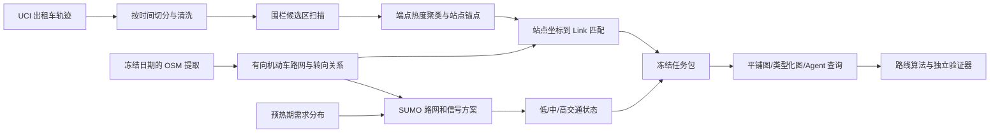

# 围栏热点站点—公开真实地图与仿真交通实验设计

**状态：**研究设计稿，尚未下载或构建数据，也没有新增路线实验结果。用户已明确排除此前提供的本地 `fence10089` 数据包；本方案不读取、不转换、不复用其中的围栏、站点、道路或任何内部数据。

## 1. 研究目标与推荐方案

建议把路线层增加一个独立的“公开轨迹热度 + 真实开源路网 + 可控交通仿真”实验分支。主问题是：在同一批围栏内热点站点、同一份有向道路事实、同一模型和相同预算下，把扁平道路记录改成显式的 Link—转向—信号—时变路况关系，能否提升模型对站点道路归属和路线约束的读取能力。

推荐采用葡萄牙 Porto 区域作为候选城市：UCI 的 Taxi Service Trajectory 数据含 442 辆出租车、约 171 万条轨迹，覆盖 2013-07 至 2014-06；UCI 页面标注 CC BY 4.0。该数据的轨迹和端点可以形成公开、可复现的空间热度代理，但它记录的是出租车轨迹，不是网约车订单或官方站点，论文中应称“出租车出行端点热度代理”。[UCI 数据集](https://doi.org/10.24432/C55W25)

道路拓扑使用冻结版本的 OpenStreetMap（OSM）机动车路网。OSM 可提供道路几何、部分道路等级、单行方向、转向限制和信号灯位置；OSM 的 `oneway` 与道路绘制方向有关，信号灯标记表示设施位置/作用对象，并不提供可直接当作真实信号周期的完整配时。[OSM 单行标签](https://wiki.openstreetmap.org/wiki/Key:oneway)；[OSM 信号灯标签](https://wiki.openstreetmap.org/wiki/Tag:highway%3Dtraffic_signals)

信号相位、排队和时段拥堵由 SUMO 在 OSM 路网副本上生成，作为**仿真交通状态**。SUMO 官方文档明确支持导入 OSM 网络并构造信号灯程序；自动生成的信号方案未必与现实方案相同，因此字段和结果必须标记为 `simulated`，不得写作实测信号配时或真实拥堵。[SUMO OSM 导入](https://sumo.dlr.de/docs/Networks/Import/OpenStreetMap.html)；[SUMO 信号灯仿真](https://sumo.dlr.de/docs/Simulation/Traffic_Lights.html)

这条分支检验的是“AI 如何读取复杂道路事实并产生可验证路线”，不替代现有 100×100 合成地图、调度层实验或已完成结果。合成基线继续独立报告；公开数据分支通过后，再决定是否将该路网适配到派单层。

## 2. 数据构成、来源与证据边界

| 数据部分 | 建议来源/生成方式 | 用途 | 证据类型 |
|---|---|---|---|
| 行程轨迹 | UCI Porto Taxi Service Trajectory；只用时间戳和轨迹坐标 | 统计空间热度，生成站点候选与 OD 分布 | 公开观测轨迹；端点热度仍是出租车出行代理 |
| 道路网络 | 固定日期 OSM Porto 区域提取 | 道路 Link、方向、道路属性、转向关系和信号灯位置 | 真实开源地图记录，受 ODbL 归属/共享条款约束 |
| 信号配时 | SUMO 导入 OSM 后生成或明确配置相位 | 计算交叉口等待和受控转向代价 | 仿真值，不是 OSM 观测值 |
| 拥堵状态 | SUMO 以低/中/高需求情景运行；需求率以预热期轨迹统计为锚点，通过预检后确定 | 生成各时段边/转向的旅行时间和队列状态 | 仿真值；不能称为实测拥堵 |
| 可选观测路况敏感性集 | 将不与站点/任务窗口重叠的轨迹片段地图匹配到 OSM，按 Link 和时间窗聚合速度 | 检查仿真路况条件下的结论是否方向一致 | 轨迹估计值，受 15 秒采样、地图版本差异和匹配误差影响；不进入主结果，除非质量门槛通过 |

UCI 轨迹与 OSM 快照时间并不天然一致。主实验固定并发布地图下载日期、坐标系、区域和 SHA-256；不能把当前 OSM 几何描述为 2013—2014 年的道路状态。若后续获取可用的历史 OSM 快照，可另建同年份版本并单独记录；在拿到并校验前不把它作为已存在输入。OSM 数据使用需按 OSM Foundation 的归属要求注明来源及 ODbL。[OSM 归属指引](https://osmfoundation.org/wiki/Attribution_Guidelines)

## 3. 数据集构建流程



### 3.1 时间切分与防泄漏

先按轨迹开始日期排序，再按时间顺序切成约 70% 预热、15% 校准、15% 测试。预热集仅用于热点分布和仿真 OD 需求率；校准集仅用于 SUMO 交通需求规模校准，或用于可选轨迹速度估计；测试集仅用于抽取路线任务和最终评估。站点名单与地图输入在测试前冻结。若清洗或匹配质量不足，按事先定义的仿真需求档位生成 SUMO 车流，并将来源标为 `scenario_generated`，不能回头用测试结果调参。

### 3.2 围栏和路网边界

在 Porto 候选城区建立固定边长约 3 km 的方形候选窗。使用预热集的行程起终点密度扫描候选位置；先筛满足预注册道路规模及信号灯数量下限的窗口，再按预热集端点数最高选择，平局按 OSM 信号灯数和固定窗口 ID 排序。具体下限须在首次数据预检后冻结，不能按模型结果调整。保存最终围栏 GeoJSON、选择脚本版本、坐标参考系和输入哈希。

围栏负责限定站点筛选区域。规划图包含围栏及默认 500 m 缓冲带内的机动车 Link，以免路线被围栏裁剪产生虚假的断连；站点必须落在围栏内。路线可经过缓冲带，所有方法共享同一裁剪图，同时报告围栏外行驶长度/时间。另做“严格围栏内路线”作为边界敏感性分析，不与主结果混报。

### 3.3 热度站点

将预热轨迹的起点、终点投影到公制坐标后，以 250 m 网格聚合，分别记录 `pickup_proxy_count`、`dropoff_proxy_count` 和 `total_heat`。从符合最小样本数的格子中按固定 Top-K 选点；初始建议 K=20，样本数阈值在数据预检后冻结。每格的站点锚点取观测端点坐标的 medoid，生成不含坐标或 Link 编码的随机 `station_id`。没有实际网约车站点或官方上下客点标签时，文稿称作“热度站点候选/虚拟站点”。

测试轨迹两端映射到最近的冻结热点站点，形成 OD 任务；只保留起终点均在围栏内且道路网络中存在可行连接的任务。按热度、直线距离、基准最短旅行时间分层抽样，抽样名单在模型运行前冻结。训练/校准/测试轨迹 ID 不进入模型提示。

### 3.4 点到有向 Link 绑定

每个站点保存坐标与隐藏评估标签。确定性基线使用有向可达的近邻 Link；轨迹真值可用方向感知 HMM/Viterbi 或 FMM 类地图匹配器产生候选 Link 集。不能只选几何最近道路：还要检查行驶方向、机动车可达性、到交叉口的拓扑连续性和候选距离。对于几何上无法唯一判断的点，真值为一组可接受候选 Link，并标记 `ambiguous=true`，避免误把 GPS 噪声当成模型错误。

地图匹配输出分成两份：面向方法的 `station_id + coordinate + allowed public map facts`；仅评估器可见的 `candidate_link_ids + match_confidence + source_trace_refs`。检查样例由地图叠图人工抽核，但不得通过手工修正测试任务后再汇报同一批结果。

## 4. 技术栈与数据结构

| 模块 | 建议技术 | 主要产物 |
|---|---|---|
| 清洗与轨迹统计 | Python、Pandas 或 Polars、PyArrow | 时间切分、端点热度、OD 任务 Parquet |
| 地理处理 | GeoPandas、Shapely、pyproj；QGIS 用于只读抽检 | 围栏、缓冲区、站点与道路空间核验 |
| OSM 提取与图构建 | 固定 OSM PBF；OSMnx/pyosmium；网络图导出为 GeoPackage/GraphML | 冻结原始 OSM、机动车有向图、原始 OSM tag 到标准字段映射 |
| 轨迹地图匹配 | FMM 或实现方向感知候选 + Viterbi 的 Python 管线 | 站点候选 Link、置信度、匹配质量报告 |
| 图与路线 | Python NetworkX/自建 Link 状态图；Dijkstra、A*；时间依赖最短路 | 传统最短路、可达性与路线参考值 |
| 微观交通仿真 | Eclipse SUMO：`netconvert`、`duarouter`/`randomTrips.py`、`sumo`、TraCI | OSM 转换网络、信号程序、路段/转向旅行时间和队列状态 |
| 地图协议与接口 | JSON Schema + JSONL/Parquet；本地只读查询工具 | `DirectedLink`、`TurnMovement`、`SignalControl`、`TrafficState` 查询接口 |
| 结果审计 | 固定 manifest、SHA-256、JSONL 调用记录、HTML/GeoJSON 回放 | 数据版本、模型调用、地图匹配和路线验证证据 |

建议本地文件布局：

```text
data/route_real_map/porto_hybrid_v1/
  source_manifest.json
  raw/porto_taxi_trajectory.csv
  raw/porto_osm_<snapshot>.osm.pbf
  derived/fence.geojson
  derived/stations.parquet
  derived/links.parquet
  derived/turn_movements.parquet
  derived/sumo/
  tasks/train_heat.parquet
  tasks/calibration.parquet
  tasks/test_od.parquet
  manifests/SHA256SUMS.txt
```

核心对象至少包括：

- `Fence(fence_id, polygon, crs, source, snapshot_id)`
- `Station(station_id, coordinate, pickup_proxy_count, dropoff_proxy_count, heat_window, fence_id)`
- `DirectedLink(link_id, from_node, to_node, geometry, length_m, oneway, access, road_class, name, osm_way_id)`
- `TurnMovement(from_link_id, to_link_id, allowed, restriction_source, turn_type, signal_id)`
- `SignalControl(signal_id, osm_presence, phase_source, program_id, phase_state, offset_s)`
- `TrafficState(link_id, movement_id, time_bin, travel_time_s, queue_proxy, source_type, simulation_seed)`
- `RouteTask(task_id, start_station_id, end_station_id, departure_bin, task_stratum)`

OSM 原始值、标准化值和缺失状态分别保留。`signal_presence_source=osm` 与 `phase_source=sumo_generated` 必须可区分；缺省道路速度、SUMO typemap 速度和轨迹估计速度也必须保留各自来源，禁止静默覆盖。

## 5. 有向 Link 路网与路线成本

OSM 道路拆为可审计的有向 Link。双向道路展开为两个方向；单行道路只保留允许方向。将 OSM 原始转向限制关系解析为 Link 间的合法/非法 `TurnMovement`，并把交叉口信号控制关联到具体转向；OSMnx 用于区域路网/几何处理，原始 OSM restriction relation 需单独读取并与 SUMO 转换后的 connection 交叉核验。OSM 信号灯位置不提供周期，因此 `phase_source` 写明为 SUMO 自动生成或实验者配置。

点到 Link 后，路径搜索状态采用“当前有向 Link + 当前时段”。从 Link (i) 转到 Link (j) 的候选只有在 `TurnMovement.allowed=true` 时存在。时变路段/转向成本为：

\[
T(i\rightarrow j, t)=T_{link}(j,t)+T_{turn}(i,j,t),
\]

其中 SUMO 的车辆运行/排队结果用来估算 `T_link`；受控转向的红灯等待和交叉口损失由仿真轨迹统计为 `T_turn`。若直接用 SUMO 逐车通过时间作为 movement cost，则不再额外叠加信号延迟，防止双计。全部值单位为秒，距离另行按米报告。

交通时段至少设置低流量和高流量两档；中流量作为中间档或校准档。SUMO 背景车流的起终边按预热集热点和 OD 代理分布加权抽样，再由 `duarouter` 生成合法背景路径；低/中/高档通过冻结的出发率系数控制。出发率系数可先按校准集检查合理范围，再在模型评测前固定。用 SUMO 输出若干固定时窗的 Link/Movement travel time；固定车流种子、车型、需求量、信号参数、仿真时长与 warm-up。主图包含 OSM 标注信号位置；若某类路口通过 SUMO 推断或人工补加信号，另有来源标记，并做 OSM 信号子集结果敏感性分析。

## 6. 对照方法与因果比较

### 6.1 点绑任务

| 编号 | 方法 | 检验内容 |
|---|---|---|
| P0 | 最近机动车 Link（带方向/通达性过滤） | 几何与规则基线 |
| P1 | 方向感知轨迹地图匹配器 | 传统时空匹配基线 |
| P2 | LLM + 平铺 Link 记录 | LLM 直接读取道路记录并绑定 Link |
| P3 | LLM + 类型化 Link/关系 schema | 与 P2 配对，检验表示可读性 |

### 6.2 路线任务

| 编号 | 方法 | 检验内容 |
|---|---|---|
| R0 | 时变 Link-Dijkstra（或经验证的时间依赖最短路） | 确定性参考最优值 |
| R1 | LLM + 平铺 JSON/CSV 路网，直接输出 Link 序列 | 同事实下的扁平表达条件 |
| R2 | 同一 LLM + 类型化 Link—转向—信号/路况 schema，直接输出 Link 序列 | R1 对 R2 是主地图表达配对比较 |
| R3 | Agent-readable 查询接口 + 固定 Dijkstra | 检验查询式地图工作流与确定性规划器组合 |
| R4 | R3 的拓扑-only 消融；隐藏道路名称、类别和设施解释关系，保留合法方向、允许转向和相同的数值成本 | 检验语义元数据的增量价值 |

R1/R2 使用同一个本地只读地图查询接口，完全相同的底层字段和值、候选 Link 集、地图、任务、模型、提示目标、输出 schema、上下文/查询预算和验证器；接口只改变返回记录的表达方式，缺失字段按一致的显式 `unknown` 传递。这样不要求把完整路网塞进提示词，也不把检索范围差异误当作可读性差异。R2 与 R3 的差异包含路线生成责任分配，不用于单独证明地图表达的因果效果。R0 是 oracle，不当作与 LLM 的同预算方法。

### 6.3 分阶段测量

1. **点绑单测：**只输出一个或多个候选有向 Link，不规划路线。
2. **路线单测：**向所有方法提供同一评估器真值起终 Link，隔离路网读取与路线构造。
3. **端到端：**输入站点坐标和交通时段，完成点绑、路线、校验。将绑定失败与路径搜索失败分开统计。

LLM 路线输出交给独立程序检查；程序可以拒绝非法路线并记录原因，但正式主比较不静默替模型重规划。若另做“Agent 反馈—重规划”，作为单独方法报告调用数、反馈轮数与最终路线。后续 LLM 后端沿用用户已确定的 Codex CLI，并记录模型标识、CLI 版本、token、调用时延与结果文件；本轮只写设计，不发模型请求。

## 7. 任务规模、实验因素与公平性

传统路线算法对冻结围栏内所有可行 OD 运行，保存完整最优值和不可达任务。LLM 正式集建议先预注册 30 个 OD 对，按基准旅行时间/路线 Link 数分成短、中、长三层，每层 10 对；低/高流量各分配 15 对。每个 OD 在两种表示条件成对运行，至少 2 个重复作为设计目标，样本数在一个独立的成本 pilot 和统计功效/可行性复核后、任何正式请求前冻结。若 pilot 显示预算无法覆盖，先缩小样本并重新冻结清单，不在看过效果后删题。Codex CLI 请求遵循已确定的零自动重试规则。

所有方法共享：`osm_snapshot_hash`、`fence_hash`、`map_graph_hash`、站点版本、OD 任务、出发时刻、SUMO 交通场景、候选范围、道路权重、硬约束和路线验证器。随机需求/仿真种子以配对方式复用。按路线复杂度、热点热度、信号数量和时段分层报告，保留全部失败任务。

## 8. 指标与统计报告

- **点绑：**Top-1 命中率、候选集覆盖率、方向合法率、匹配距离误差（m）、置信度校准；模糊点按允许候选集合判定。
- **拓扑：**路线有向连续率、单行/转向限制违反率、信号控制关系引用正确率、有效路线率、完成率。
- **路线质量：**行驶距离（m）、仿真旅行时间（s）、相对 R0 的时间/距离 regret、低/高流量路线代价变化；报告信号等待和排队的分解值，注明其仿真来源。
- **系统效率：**地图查询次数、返回 Link 数、输入/输出 token、Codex CLI 调用数、模型时延、本地搜索扩展数、总耗时。
- **端到端：**从坐标输入成功抵达目标的比例，并将失败归因为点绑、不可达、越界、方向/转向违规、超预算、超时或模型输出格式错误。
- **不确定性：**报告分子/分母、均值和中位数、95% bootstrap 置信区间；配对比较采用同题差值。样本量或重复次数不足时只报描述性结果，不写显著优越结论。

地图可读性主张的主要证据是 R1 与 R2 的成对变化，以及 P2 与 P3 的成对变化。仅 R3 高于 R1 不能说明提升来自地图表示，因为 R3 同时换用了传统路由器。路线合法性、旅行时间、token 和耗时分别报告，不直接加成一个无量纲总分。

## 9. 与现有实验的衔接

- 保留已完成的 100×100 R0/R1/R2 传统路线轨迹、纯 LLM 历史批次和 R4 smoke 原始记录；它们继续回答合成地图上的既定问题。
- 新开 `porto_hybrid_v1` 路线数据目录与独立结果目录，不回填或覆盖现有 `outputs/route_layer/` 结果。
- 主实验仍只研究路线层的地图可读性、站点绑定和有向路线生成；派单层先不改，因为本数据设计尚未提供完整车辆可用状态、动态订单服务承诺和真实网约车派单日志。
- 两个分支可在论文中并列作为互补实验：合成图支持控制变量和大规模重复；Porto 混合图支持真实地理拓扑、公开轨迹热度与仿真交通约束。跨分支不作直接平均或统一排名。

## 10. 实施阶段与验收门槛

1. **来源预检：**下载公开 UCI 文件和一个 Porto OSM PBF；保存许可、下载时间、哈希、字段/坐标说明。不得使用被排除的 fence10089 输入。
2. **空间预检：**画出轨迹覆盖与 OSM 网络；执行候选围栏筛选；确认候选区足够的道路连通性、方向属性、热点数和信号灯数。未满足阈值时先调整候选区选择规则并记录，不进入模型实验。
3. **图构建审计：**比较 OSM 单行和 access tags 与转换后的有向边；抽查转向限制和信号关联；核验全部站点至少有一个合法 Link 候选；存下不可达任务清单。
4. **仿真预检：**生成少量固定随机背景交通，导出信号控制、各时段 Link/Movement 时间与队列；检查无死锁/大量未插入车辆；确认信号/拥堵来源标签。
5. **零请求协议预检：**冻结字段白名单、平铺/类型化序列化、工具边界、输出 schema、validator 和 token 估算；在本地用基准路线验算 R0 并保存地图库哈希。
6. **模型 pilot：**在用户明确授权的预算下，仅对预先挑选的少量任务执行一次成对 pilot；不自动重试。完成 token/费用估算和失败审计后，再冻结正式样本清单与总请求上限。
7. **正式批次与复核：**固定清单运行；逐条保存请求/响应和结果，复算地图哈希、合法率、配对样本、调用/token 统计。报告仅限该冻结数据版本和仿真配置。

当前未执行上述数据下载、地图裁剪、SUMO 仿真或模型调用；所以没有围栏坐标、有效站点数、道路数、信号灯数、拥堵数值、路线性能或 LLM 费用结果。

## 11. 风险与论文措辞

1. Porto 轨迹是出租车行程样本，不等同于网约车热点站点或订单需求；将热度命名为 proxy，并用独立测试月份评估。
2. OSM 完整性因地区而异；没有信号灯标注不表示现实中没有信号灯。按原始标记、SUMO 推断和人工配置分别计数和编码。
3. SUMO 交通灯和拥堵来自模型假设；论文可说“在 OSM 路网之上构建的仿真信号与拥堵情景”，不可说“真实配时/真实拥堵数据”。
4. OSM 路网当前快照与 2013—2014 轨迹存在时间差；研究聚焦地图结构读取而非历史交通还原，并报告时间匹配限制。
5. 路网转换会改变 Link 拆分、连接和信号控制关系；保留原始 OSM 元素 ID、标准化映射和 SUMO 输出版本，以便审计。
6. 开源数据许可：UCI 轨迹页面标注 CC BY 4.0；OSM 数据按 ODbL 使用并归属 OpenStreetMap contributors；SUMO 软件为 EPL 2.0。公开派生数据前另行检查各来源对原始数据再分发的具体条件。

可用的审慎表述：

> 本研究构建了一个由 Porto 出租车轨迹派生热点、OpenStreetMap 有向道路网络和 SUMO 交通仿真组成的混合路线基准，用于比较不同地图表示对点到 Link 绑定与受约束路线生成的影响。交通灯相位和拥堵状态是仿真生成量，不代表实测信号控制或全量城市实时路况。

## 12. 主要来源

1. UCI Machine Learning Repository, *Taxi Service Trajectory—Prediction Challenge, ECML PKDD 2015*, DOI: [10.24432/C55W25](https://doi.org/10.24432/C55W25)；数据集说明论文：[ECML/PKDD 2015 Discovery Challenges](https://ceur-ws.org/Vol-1526/paper22.pdf)。
2. OpenStreetMap Wiki, [Key:oneway](https://wiki.openstreetmap.org/wiki/Key:oneway), [Relation:restriction](https://wiki.openstreetmap.org/wiki/Relation:restriction) 与 [Tag:highway=traffic_signals](https://wiki.openstreetmap.org/wiki/Tag:highway%3Dtraffic_signals)。
3. OpenStreetMap Foundation, [Attribution Guidelines](https://osmfoundation.org/wiki/Attribution_Guidelines)；[OpenStreetMap Copyright and License](https://www.openstreetmap.org/copyright)。
4. Eclipse SUMO, [Importing OpenStreetMap](https://sumo.dlr.de/docs/Networks/Import/OpenStreetMap.html), [Traffic Lights](https://sumo.dlr.de/docs/Simulation/Traffic_Lights.html), [randomTrips.py](https://sumo.dlr.de/docs/Tools/Trip.html)。
5. OSMnx, [project documentation](https://osmnx.readthedocs.io/en/stable/)；FMM, [Fast Map Matching source repository](https://github.com/cyang-kth/fmm)。

## 13. 设计自审

- **研究贡献：**当前只提出可检验的地图表示问题，不声称已有方法优势或首创性；正式主张需由 R1/R2 和 P2/P3 配对结果支持。
- **写作清晰度：**真实观测轨迹、OSM 地图事实、轨迹估计值和 SUMO 仿真状态使用不同字段来源和结果标签。
- **实验强度：**有最近 Link、地图匹配、时变 Dijkstra 和 LLM 表达对照；OD 样本量仍需在数据与调用预算预检后冻结。
- **评价完整度：**分别覆盖点绑准确、路线合法、路线代价、系统调用成本和失败类型；外部真实驾驶效果不在本设计证据范围内。
- **方法可靠性：**边界缓冲、轨迹时间切分、隐藏绑定真值、统一 validator、信号等待防双计和 OSM 转换审计均已纳入；实际质量门槛尚待数据预检。

主要主张—证据对应：UCI 轨迹支持“可派生出租车端点热度代理”；OSM 标签/关系支持“能构造有向道路与部分转向/信号事实”；SUMO 文档支持“可构造交通仿真情景”；“类型化地图提高可读性”目前仅是待检验假设，尚无结果支持。
