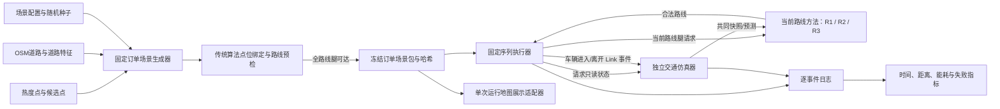
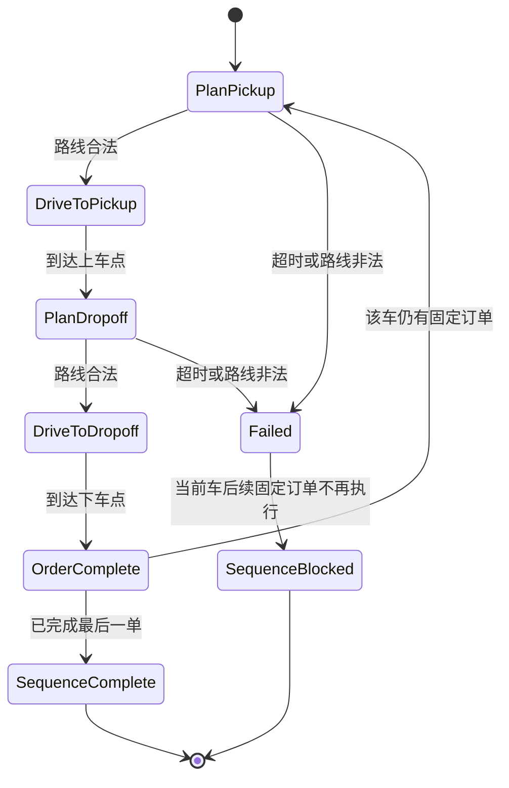

# 固定订单序列生成与执行模块设计

**版本：** 2026-10-23 v1  
**状态：** 设计稿，尚未实现。  
**范围依据：** 用户确认“和原网格实验一样，不要调度”。本设计只覆盖固定订单场景生成、预检、逐车序列执行与结果记录，不引入运行时车辆—订单分配。

## 1. 目标与边界

模块为真实 Porto 路线实验生成可复现的固定车队任务，并让各车辆按预先冻结的订单顺序逐单运行。它负责把订单数据、路线规划器、动态交通仿真与事件记录接起来，使三种路线方法在相同车辆、订单、地图、交通种子和端点条件下比较总时间与车辆资源成本。

每个订单在仿真前写定 `vehicle_id` 和 `sequence_index`。仿真中不重新分配车辆、不抢单、不换单、不重排、不做车辆再平衡，也不调用全局派单优化器。订单在数据文件中可以一次性生成，但每辆车只能在完成上一单的下车段后开始其固定序列中的下一单。

路线优化器（如 R3）只可在当前车辆、当前路线腿的合法路线候选中选择路线；它没有订单或车辆的分配权。地图交通环境独立推进信号、背景流量和队列。路线方法读取共同的只读交通状态；车辆实际进入和离开 Link 的事件反馈给交通仿真，用于更新共享道路占用。

### 不在本模块内

- 在线订单到达后由算法决定由哪辆车接单。
- 跨车转单、重派、订单优先级调度、拼车或空闲车辆再平衡。
- 由路线方法更改信号控制、背景交通或路网属性。
- 用传统路线替换 LLM/Agent 方法生成失败的路线。
- 把历史 Porto 出租车 OD 聚合包称作真实网约车派单记录。

## 2. 当前材料与需要补齐的部分

现有固定车队方案和 `scenario_config.json` 已明确不做派单；当前配置建议每个种子 10 辆车、每车 10 单、共 100 单，固定 10 个种子，并把每个订单的两个路线腿共 200 腿列入传统算法预检。这些是当前方案配置，不是已经完成的正式实验条件；SUMO 网络、最终有向 Link、点位绑定和路线可达性仍未完成。

当前端点比例为 70% 候选点到候选点、30% 道路特征模糊端点订单；30% 内“单模糊端点”与“双模糊端点”的比例尚未冻结。订单生成脚本 v0.1.0 仍只生成单模糊端点规则，种子 0–9 文件均为旧规则草案，不能作为正式输入。地图中 `porto-map-order-package-v1.json` 是历史聚合需求演示数据，不是本模块的固定订单包。

因此本设计要求新增独立的逐次运行订单场景格式，并更新生成器；不覆盖历史聚合需求包、旧订单草案或已有实验结果。地图预览可通过适配器读取固定订单包，在运行视图中叠加该次订单端点；未导入运行包时底图继续不显示生成订单端点。

## 3. 架构选项

| 选项 | 方案 | 取舍 |
|---|---|---|
| A | 一个脚本同时生成订单、检查路线并运行 SUMO | 初期最省文件，但场景构造、校验和运行容易耦合，重跑与审计困难。 |
| **B（推荐）** | 分成场景生成器、传统预检器、固定序列执行器、交通仿真适配器和结果汇总器 | 可冻结同一订单包供各方法重放；每个模块有单一职责；不会因运行时调度逻辑改变实验问题。 |
| C | 复用现有全局调度器，再把分配结果锁住 | 会引入本实验不需要的分配模型与约束，容易让“固定序列路线执行”被误解为调度实验。 |

采用 B。场景与校验是运行前准备；执行器只推进固定订单；交通仿真器只管理道路状态和车辆运动；路线方法只负责当前路线腿。

## 4. 模块与数据流



模块调用约定：

| 接口 | 输入与输出 | 必须保持的规则 |
|---|---|---|
| `generate_fixed_scenario(config, sources, seed)` | 配置与来源文件 → `DraftScenario` | 只生成数据，不做运行时分配；保存端点类别实际计数和来源哈希。 |
| `preflight_scenario(draft, canonical_graph)` | 草案包与正式有向图 → `PreflightReport` | 检查绑定、路线腿可达和车辆序列完整性；校验参考路径留在私有侧车文件。 |
| `run_fixed_scenario(frozen_scenario, planner, traffic, event_sink)` | 冻结包、路线适配器、交通适配器、日志接收器 → `RunSummary` | 只能按固定序列推进车辆；不接受订单分配或重排命令。 |
| `planner.plan_leg(start, goal, objective, traffic_snapshot)` | 当前路线腿及共同交通状态 → `RouteResponse` | 返回现有 Link ID 序列、预测时间/能耗和状态；路线必须经独立 validator。 |
| `traffic.get_snapshot(link_ids, entry_times)` | Link 集合及预计进入时刻 → 只读状态快照 | 路线方法只读；车辆运行只通过进入/离开事件更新交通仿真。 |

### 4.1 固定订单场景生成器

**职责：**按固定种子从候选点和道路特征位置生成车辆初始位置、订单端点、车辆归属及顺序；输出数据，不运行路线、不分配订单。

**输入：**冻结后的候选点表、OSM 道路特征表、端点混合配置、车队规模、每车订单数和 seed。来源文件、地图版本、生成器版本和配置都写入 manifest。

**输出：**`fixed_order_scenario_v1` 草案包。每个订单必须包含 `order_id`、`vehicle_id`、`sequence_index`、`order_kind`、`pickup`、`dropoff` 和 `release_policy`。`vehicle_id` 与 `sequence_index` 一经包冻结，执行期间不可变。

端点类别至少支持：

- `candidate_to_candidate`：上车、下车均来自已筛选候选点。
- `one_candidate_one_fuzzy`：一个端点来自候选点，另一个是带不确定半径和道路特征提示的模糊点。
- `two_fuzzy`：上下车都是道路特征模糊点。

正式比例以每个场景包内实际计数保存，不能只保存百分比。建议先把 30% 模糊订单配置为单模糊端点 15%、双模糊端点 15%，作为可调的初始建议；它尚未获得用户冻结确认。若保持每种子 100 单，该拆分可得到整数配额。端点类型比例和模糊点上/下车方向都由 seed 确定，并在三种路线方法间完全相同。

### 4.2 点位绑定与传统路线预检器

**职责：**在正式运行前，将订单端点和车辆初始位置按统一规则绑定到正式有向 Link 图，并检查每条路线腿在机动车准入、单行、转向限制及连通约束下是否可达。

每单预检两段：当前车辆位置到上车点，以及上车点到下车点。第一单的车辆位置取车辆初始位置；后续订单的当前位置取该车上一单下车点。因此当前每种子 100 单对应 200 条待预检路线腿。此步骤只判定可达性并保存供审计的参考路径；参考 Link 序列放入校验器私有文件，不提供给 R1/R2/R3 作为路线答案。

若任一端点未能按冻结规则绑定，或任一路线腿不可达，整个场景保持 `preflight_failed`，不得进入正式比较。修复生成规则后应重新生成并记录新版本与哈希；不得针对某一种路线方法单独换点、换订单或补路。

### 4.3 固定序列执行器

**职责：**根据冻结场景推进车辆状态，不做订单分配。所有车辆在共同仿真起点开始各自的首单；每辆车在当前订单完成后立即开始下一项固定订单。

每单分为两次独立路线规划与行驶：

1. 车辆当前位置到上车点（空驶）。
2. 车辆到达上车点后，再按此时的交通状态规划并执行上车点到下车点（载客）。

分开规划能让第二段路线读取车辆真实到达上车点时的信号和队列状态。每次规划只提交当前路线腿；本单途中不重规划。规划耗时只让发出该请求的车辆等待，交通环境及其他车辆继续推进。仿真加速模式下也要把路线方法测得的规划延迟注入该车等待时间。

车辆状态机：



不加入未冻结的上下客服务时长；若后续纳入，应作为所有方法相同的固定参数单独记录，不能混入道路通过时间。

### 4.4 路线方法与优化器

三种方法沿用固定车队路线实验设计：R1 时变 Dijkstra；R2 纯 LLM 基于已有有向 Link 生成当前路线腿；R3 使用 Agent-readable 地图，由 LLM 给出合法路线候选、数学优化器在这些候选中选择当前路线腿。R3 的优化器不得读取其他车辆待派订单，不得更改 `vehicle_id` 或订单序列。

最快时间和最低能耗作为两个独立目标条件运行，不把秒、kWh、token 或 CPU 时间合成没有依据的总分。所有组共用地图图事实、端点、状态预测器和 validator。路线不合法、超时或无法生成时记录为方法失败，不使用传统算法替代。

### 4.5 推荐技术栈

| 模块 | 技术建议 | 边界 |
|---|---|---|
| 场景生成、执行编排、事件聚合 | Python | 生成与运行拆成独立入口；同一 seed 和输入哈希可复建场景。 |
| 场景契约 | JSON Schema + JSON | JSON 保存固定订单场景与配置；JSONL 保存逐事件记录；汇总可导出 JSON/CSV/Parquet。 |
| 地图与最终路由网络 | OSM 快照 + SUMO `netconvert` 导入；最终 Link/connection 作为路由事实来源 | 点位绑定、单行与转向限制预检使用与仿真同一版本的网络；候选区完整 OSM 底图仍由地图展示层另行保留。 |
| 动态交通和车辆运行 | Eclipse SUMO + TraCI | 维护信号相位、背景交通、队列、实验车辆、实际 Link 进入/离开和电动车能耗。当前材料显示这套运行依赖尚未就绪。 |
| 路线搜索和校验 | 基于冻结有向 Link/movement 图的时变 Dijkstra；独立 validator | 搜索图及 validator 读取同一网络事实；validator 私有参考路径不返回给 LLM。 |
| 地图运行展示 | 现有浏览器地图 + 固定订单场景 JSON 适配器 | 只展示导入运行包中的端点与运行事件，不生成派单、不改变仿真。 |
| 来源与复现 | SHA-256 manifest | 关联热度表、OSM、候选点、场景配置、生成器、冻结订单包和运行产物。 |

## 5. 数据契约与文件

建议新增文件，旧草案保持原样留档：

```text
derived/scenarios/
  fixed_order_scenario_v1.schema.json
  fixed_order_module_config_v1.json
  fixed_order_seed_00_v1_draft.json
  validator_truth_seed_00_v1.json
  preflight_seed_00_v1.json
  fixed_order_manifest_v1.json
  runs/<method>/<seed>/events.jsonl
  runs/<method>/<seed>/summary.json
```

上述是新增的版本化文件名；现有 `scenario_config.json`、`orders_manifest.json` 和 `orders_seed_*_draft.json` 保持为历史方案/草案，不覆盖。

场景包根对象包含 `schema_version`、`scenario_id`、`status`、`seed`、地图/生成配置哈希、`vehicles` 和 `orders`。每个 vehicle 包含车辆 ID、初始位置和固定订单 ID 列表；每个 order 包含订单 ID、车辆 ID、该车内连续的 `sequence_index`、订单端点类别、上车点、下车点和释放规则。端点对象包含点位 ID、经纬度、来源类别、模糊半径/道路特征提示以及公共路由输入所需的绑定候选信息。

实际包中点位字段、坐标系、空值规则和状态枚举由 JSON Schema 固定。地图真值（原始道路特征 node/way、生成模糊点所依据的特征 ID、校验器绑定记录及参考路径）存入校验侧车文件，与路线方法可见的 scenario JSON 分离。所有输入文件和输出文件用 SHA-256 清单关联。

`release_policy` 对首单取 `at_sim_start`；后续订单取 `after_previous_order_dropoff`。该字段表达固定执行顺序，不是动态到达时间或调度器生成的候选订单。

历史需求展示包 `map_order_demand_package_v1` 继续用于热度/OD层导入。正式固定订单场景使用上述独立 schema；地图预览用适配器读取其公开端点，不把历史聚合 OD 改写成固定实验订单。

## 6. 动态交通接口与时间口径

路线方法只能调用只读状态查询，字段至少包含 `sim_time_s`、`link_id`、`movement_id`、当前信号相位、距相位切换秒数、排队长度、观测速度、预计进入时刻、预计通过时间、预计能耗、`source_type` 和交通 seed。状态预测器对各方法返回相同的底层值。

车辆执行器仅把 `vehicle_link_enter` 与 `vehicle_link_exit` 等事件送入 SUMO/交通仿真器；不传路线偏好或交通控制命令。信号与背景交通由交通仿真器按共同仿真时钟持续变化。所有交通相位和拥堵数值标记为 `simulated`；OSM 只提供道路几何、交通规则标签和信号位置，不提供 Porto 实测配时。

逐车时间分解：

`vehicle_elapsed = runtime_route_planning_delay + actual_empty_travel + actual_loaded_travel + configured_service_dwell`

其中 `configured_service_dwell` 当前设计为 0；运行时长不含离线场景生成和一次性可达性预检时间。车队完成时间是从共同 `t=0` 到最后一辆车完成固定序列的仿真时长；同时报告所有车辆经历时间之和，避免用一个值掩盖并行车辆差异。每条 Link 的实际通过时间由该车进入至离开 Link 的仿真时间差计算，不能用规划 ETA 替代。

## 7. 失败处理与结果记录

- 场景生成缺少候选点或道路特征时明确失败并记录原因，不静默改变比例或采样规则。
- 预检失败的场景不进入正式实验；重新生成须产生新场景版本和哈希。
- 运行时路线超时、格式错误、使用不存在的 Link、方向或转向非法时记录失败；不自动重试、不走传统算法兜底。
- 某辆车当前路线腿失败后，该车剩余固定序列标为 `blocked_by_prior_failure`；其他车辆继续运行。失败订单及其后续阻塞订单保留在分母中，不伪造完成时间或零成本。
- 同一仿真时限对各方法、种子一致。仿真时限数值须在正式运行前写入配置；若场景没有全部完成，报告为 `partial_run`，完整车队 makespan 记为未定义，并同时报告已完成、失败、阻塞和超时订单数。
- 每条事件记录 `run_id`、方法、seed、车辆/订单 ID、仿真时间、事件类型、Link ID、规划请求 ID、规划墙钟耗时、预测值、实际进入/离开时间、状态来源和 validator 结果。

## 8. 评价指标与比较控制

**主指标：**完整车队 makespan、车辆经历时间总和、路线规划延迟总和、空驶实际时间、载客实际时间、总行驶距离、SUMO 电动车模型能耗。只有全序列完成的运行才报告完整 makespan；未完成情况按失败规则单独列出。

**有效性指标：**场景通过预检比例、路线合法率、每车订单完成比例、路线生成失败/超时数、Link 实际通过时间记录完整度、预测通行时间误差。

**计算资源：**传统路由 CPU 时间、优化器耗时、LLM 调用次数、输入/输出 token、调用墙钟时延分别记录；估算费用与账户实扣分开。不得将不同物理单位未经校准地相加。

公平性控制：三组加载同一个冻结订单包、地图图版本、端点绑定、仿真种子和交通配置；规划器输入时间点由当前仿真状态决定。不同路线选择造成的实验车队排队差异作为闭环系统结果记录，不允许再平衡或人工干预来消除差异。

## 9. 实施顺序与验收门槛

1. **冻结订单规则：**确认每个 seed 的车辆/订单数量、70/30 内部模糊端点拆分、模糊点特征范围、初始位置抽样、服务停留和共同仿真时限。
2. **更新场景 schema 与生成器：**输出固定车辆顺序、实际端点类型计数、来源哈希和 validator 私有真值；相同输入与 seed 必须可复现。
3. **构建正式有向 Link 与点位绑定：**冻结机动车准入、one-way、转向限制和接入连接规则；所有订单端点都按相同 matcher 处理。
4. **通过传统算法场景预检：**现有 100 单规模每 seed 的 200 条路线腿全部可达；任何失败场景不得标记 frozen。
5. **实现固定序列执行器与事件适配：**确认 `vehicle_id`/sequence 在执行中不可更改，交通仿真在路线计算期间持续推进，逐 Link 进入/离开事件可复算总时间。
6. **运行方法级预检：**先用传统方法做无模型链路检查；后续模型调用与正式批次须单独冻结模型、调用上限、输出预算和费用熔断。

### 设计验收条件

- 代码接口中没有 `assign_order`、`reassign_vehicle` 或全局匹配调用；订单只按冻结的 `vehicle_id` 与顺序推进。
- 场景校验能发现重复订单、缺失顺序、跨车订单引用、比例计数不符、点位未绑定和不可达路线腿。
- 同一 seed 和同一输入哈希可重建相同场景包；更换 seed 会记录为另一个独立场景。
- 规划器无法读取校验器真值路径；无效路线不会被静默修复。
- 仿真日志能将规划延迟、各 Link 实际通过时间、上下车段和订单完成时间分别还原。
- 浏览器地图只在导入某次运行包后显示该次订单端点；地图展示不影响车辆顺序、路由或交通状态。

## 10. 待冻结项

1. 30% 模糊订单的拆分比例。建议先试 15% 单模糊端点、15% 双模糊端点；这是设计建议，不是用户已确认参数。
2. 当前方案的 10 辆车、每车 10 单、10 个 seed 是否作为正式规模；现有配置为建议值，仍需路网预检。
3. 模糊道路特征类别、半径和端点匹配容差；现有 35 m 仅为草案参数。
4. 若方法失败后剩余订单阻塞的最大仿真时限数值，以及是否加入固定上下客停留时间；当前建议服务停留设为 0，并在正式预注册前固定时限。

本文件只完成模块设计，不代表场景生成器、订单包、SUMO 网络、路线执行或正式实验已经实现。现有 `orders_seed_*_draft.json` 仍是待更新、待预检的旧草案。

## 11. 关联材料

- 固定车队路线实验：[真实路网固定车队路线执行实验设计_20261022.md](真实路网固定车队路线执行实验设计_20261022.md)
- 当前固定订单生成器：[generate_fixed_fleet_orders.py](../../data/real_map_dispatch/porto_hybrid_v1/generate_fixed_fleet_orders.py)
- 当前场景配置：[scenario_config.json](../../data/real_map_dispatch/porto_hybrid_v1/derived/scenarios/scenario_config.json)
- 历史热度/OD 展示包说明：[map_import/README.md](../../data/real_map_dispatch/porto_hybrid_v1/map_import/README.md)
