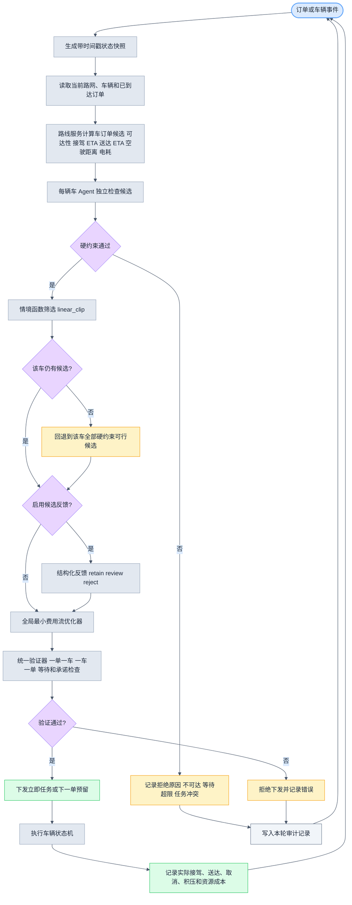
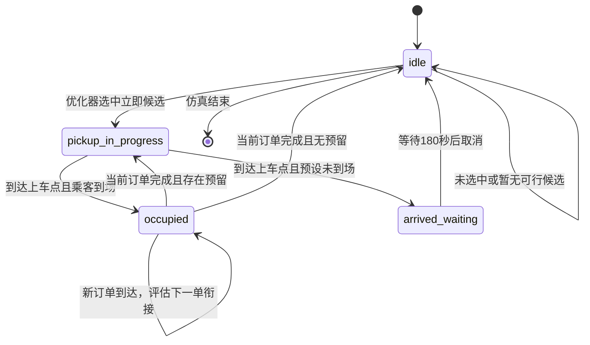
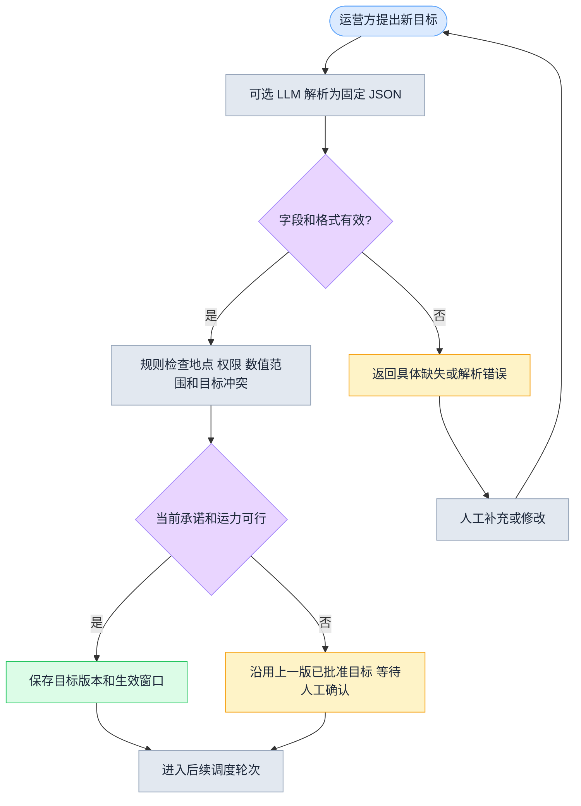

# 调度 Agent 完整可实验设计

日期：2026-10-16  
状态：D0/D1 传统算法组已完成 10 个种子的离线矩阵；D2–D4 多种子对照仍待运行。当前结果不证明性能提升。
依据：`output/paper/第三次课_Agent工作流完善稿.md`、`output/paper/调度层实验方案_20261009.md`、`output/paper/调度层实验字段_20261009.md`。

## 1. 研究边界和主方法

本版本研究**已知道路图上的一对一动态无人网约车调度**：每辆车同时最多服务一名乘客，当前订单完成后才能执行预留的下一订单。车辆 Agent 只提出候选，最终车—订单分配由全局协调器完成。最大接驾等待时间是硬约束，不能被 LLM 或成本权重放宽。

主方法采用教师设计中的完整链路：

```text
订单/车辆事件
  -> 状态快照
  -> 路线服务计算每个车—订单候选
  -> 每车 Agent 做硬约束检查和情境函数筛选
  -> 可选结构化候选反馈
  -> 全局最小费用流优化器
  -> 统一验证器
  -> 执行、记录实际结果、进入下一事件
```

当前实现名称为 `D4_agent_llm_feedback_optimizer`。它默认使用离线、确定性的反馈规则，因此不需要 API 也能重复运行；需要真实模型时，通过 `--feedback-mode deepseek` 插入现有的 DeepSeek 客户端。离线规则不能被写成 LLM 实验结果。

### 1.1 调度层拟研究贡献与创新边界

当前最值得检验的创新方向是**服务承诺约束下的连续调度 Agent**。车辆 Agent 不只判断当前订单是否可接，还维护当前订单、预计完成时间、已有服务承诺和下一订单预留，并在当前订单完成前后生成 `next_order_handoff` 候选。该设计把车辆从一次性的空闲车辆，建模为具有连续服务状态的调度主体。

调度层的机制贡献由三部分组成：

1. **局部候选决策**：每车 Agent 只输出结构化 `CandidateDecision`，包括可行性、接驾 ETA、等待余量、承诺结束时间、衔接类型和拒绝原因，不直接抢占订单；
2. **全局冲突消解**：全局优化器在统一候选表上完成一对一车—订单分配，保护当前服务承诺；
3. **校验与回退**：统一验证器检查等待上限、任务不重叠和已有承诺，失败时使用确定性安全回退，并保存错误记录。

该方向的可验证假设是：连续状态和候选接口能减少无效衔接候选、优化器重复搜索或无效求解，同时不降低服务率和等待表现。当前不能把“多 Agent”“LLM+优化器”“下一订单衔接”或最小费用流本身写成独立首创；这些是已有研究或通用组件，必须通过文献比较和 D0–D4 消融实验确定本文的具体差异。

此外，调度层把订单产生至车辆到达上车点的 300 秒最大接驾等待，与车辆到达后乘客未上车的 180 秒取消分开建模。该语义区分和候选/校验/回退日志主要服务于可复现实验和错误归因，不直接等同于性能提升。

## 2. 模块职责

| 模块 | 输入 | 输出 | 不负责的事情 |
|---|---|---|---|
| 状态环境 | 路网、车辆、订单、事件时间 | 时间戳状态快照 | 不预测未来订单 |
| `GraphRouteOracle` | 车辆可用位置、上车点、下车点 | 可达性、距离、预计时间、路径 | 不做订单分配 |
| 车辆 Agent | 本车状态、已到达订单、路线候选 | 保留/拒绝候选、回退记录 | 不抢占订单、不改硬约束 |
| 情境函数 | 7 个状态特征 | 有界接驾阈值 | 不生成可执行代码 |
| 候选反馈 | 通过硬约束的候选 | `retain/review/reject` | 不直接下发车辆动作 |
| 全局优化器 | 各车候选及统一约束 | 无冲突的联合分配 | 不读取未来订单 |
| 执行器 | 已验证分配 | 车辆/订单状态更新 | 不把预测当实际结果 |
| 审计记录 | 所有中间结果 | JSON 运行记录和汇总 | 不删除失败、超时、积压 |

这样既保留了“每辆车一个 Agent”的课堂要求，也避免把多个局部 Agent 的建议误写成最终全局决策。

## 3. 车辆 Agent 状态机

```text
idle
  --新订单/完成事件--> 生成本车可行候选
  --被选中--> pickup_in_progress
  --未被选中--> idle

pickup_in_progress
  --到达上车点且乘客到场--> occupied
  --到达上车点但预设未到场--> idle + passenger_no_show 取消

occupied
  --新订单--> 仅评估当前送达后的 next_order_handoff
  --当前订单完成且无预留--> idle
  --当前订单完成且有预留--> pickup_in_progress

任意状态
  --路线不可达/等待超限/任务冲突--> 不生成可行候选
```

`next_order_handoff` 只表示“当前订单完成后衔接下一订单”，不表示拼车。当前订单承诺优先；本首版不允许通过换车取消已有承诺。

## 4. 候选生成和硬约束

对于车辆 `i` 和订单 `j`，路线服务先计算：

1. 当前可用位置到上车点的 `pickup_leg`；
2. 上车点到下车点的 `ride_leg`；
3. 预计接驾时刻 `t_pickup`；
4. 预计送达时刻 `t_dropoff`；
5. 空驶距离、总距离和估计电耗。

候选等待时间定义为：

```text
predicted_wait = max(0, t_pickup - order.arrival_time)
```

候选只有同时满足下列条件才可交给优化器：

```text
route_reachability = true
predicted_wait <= max_pickup_wait_sec       # 默认 300 秒
current_commitment_ok = true
one_to_one_ok = true
time_non_overlap_ok = true
vehicle.reserved_order_id is null
```

路线不可达、等待超限和承诺冲突分别记录原因，不能统一写成“模型拒绝”。车辆到达后乘客等待上车的 180 秒取消规则与 300 秒接驾规则分开记录。

## 5. 情境函数

首版使用可审计的 `linear_clip`，输入 7 个特征：

```text
f = [
  local_order_density,
  local_idle_vehicle_density,
  demand_supply_ratio,
  commitment_slack,
  candidate_eta,
  time_context,
  vehicle_state_code
]
```

阈值计算为：

```text
threshold = clip(240
                 -20*f1 +30*f2 -5*f3 +15*f4
                 -60*f5 +0*f6 +0*f7,
                 120, 300)
```

候选通过情境函数的条件是 `predicted_wait <= threshold`。函数只能压缩候选，不能放宽硬最大等待约束；如果某车筛选后没有候选，回退到该车全部**已通过硬约束**的候选，并记录 `fallback_used=true`。

三种可比较的函数来源：

- `fixed`：阈值固定为 300 秒；
- `manual_linear_clip`：当前代码中的人工参数；
- `llm_linear_clip_surrogate`：接口和参数结构按 LLM 版本预留，离线运行时使用同一确定性参数，不能当作真实 LLM 效果。

## 6. 候选反馈接口

候选反馈只能读取已经通过路线和硬约束检查的结构化候选，输出：

```json
{
  "decision": "retain|reject|review",
  "risk": 0.0,
  "reason": "short_string"
}
```

`review` 仍进入优化器，`reject` 才从候选表中删除。反馈不能修改路线时间、最大等待、车辆容量或当前承诺。

真实模型提示词的固定要求是：只依据输入事实；只能返回固定 JSON；不能生成 Python 或任意优化目标；不能把解释当成约束满足证明。API 失败、JSON 解析失败和风险越界都回退到结构化离线规则，并保留错误信息。

当前可选 live adapter：

```bash
python scripts/run_dispatch_experiment.py \
  --method D4_agent_llm_feedback_optimizer \
  --feedback-mode deepseek \
  --seed 0
```

该模式需要运行环境中的 `DEEPSEEK_API_KEY`。默认离线模式不会读取密钥，也不会发送网络请求。

## 7. 低频目标更新接口

普通订单到达不等待 LLM。调度器读取最近一版已经批准的目标版本，例如：

```json
{
  "objective_version": "objective-v1",
  "hard_constraints": {
    "max_pickup_wait_sec": 300,
    "one_to_one": true,
    "max_next_reservation_per_vehicle": 1
  },
  "priority": ["preserve_commitments", "maximize_served_orders", "minimize_wait"],
  "soft_preferences": {"empty_distance": "secondary", "energy": "reported"},
  "effective_window": [0, 3600]
}
```

运营方提出新目标时，目标解析器只能输出上述固定字段；规则检查地点/区域是否存在、数值是否在授权范围内、硬约束是否冲突、当前运力是否可能满足。检查失败时沿用上一版目标并返回具体原因，不能让模型凭空把“不要等太久”改成一个未经批准的秒数。目标更新实验应单独比较人工结构化输入、规则解析和 LLM 解析，不与普通订单调度结果混为一组。

当前 D0–D4 实现使用固定 `objective_priority`，因此可以先验证车辆候选—全局协调链路，再决定是否加入低频目标更新实验。

## 8. 全局优化器

优化器建立车辆—订单二分图，并加入每辆车的“保持空闲”虚拟边。边成本使用分层量纲编码：

```text
先最大化服务订单数
再最小化预计接驾等待
再最小化空驶距离
再最小化估计电耗
```

实现采用确定性最小费用流：每辆车容量为 1，每个订单容量为 1，虚拟未服务边有远高于可行候选的惩罚。所有候选按 ID 排序后建图，保证同一输入和同一方法版本可以重放。

优化器只输出车—订单分配。选中后再次运行统一验证器；验证失败时不下发该结果，并在 `hard_constraint_errors` 中记录失败原因。

## 9. 仿真事件和订单执行

首版配置：

| 参数 | 默认值 |
|---|---:|
| 离散地图 | `20×20` 可通过参数改为 `100×100` |
| 车辆 | 10 |
| 仿真时长 | 3600 秒 |
| 订单 | 100 |
| 最大接驾等待 | 300 秒 |
| 到达后上车等待 | 180 秒 |
| 预设未到场比例 | 5% |
| 每车下一订单预留 | 1 笔 |
| 电耗率 | 0.18 kWh/km |

订单按随机种子生成到达时刻；正式调度矩阵使用三个固定、不重叠的上车区域，沿 x 轴划分为高/中/低密度带。每个订单先以相同概率抽取区域，再从该区域的合法上车点中均匀抽样。100×100 地图的区域宽度为 16、33、51 个节点列；面积按 100 米节点单元估算。区域范围、合法上车点清单和采样模式随每次运行保存。D0/D1 同一种子共享相同场景指纹。运行中的 Agent 只能看到当前已到达订单。所有方法复用同一地图、车辆初始位置、订单序列、未到场标记和路线服务规则。

事件包括：新订单到达、车辆到达上车点、当前订单完成、乘客未到场取消、等待超时。每个事件生成一轮 `DispatchInput` 和 `DispatchOutput`。供需不足时，订单保留为 `unserved/timeout`，不强行制造服务成功。

## 10. 方法对照

| 方法 | 候选筛选 | 反馈 | 最终分配 |
|---|---|---|---|
| `D0_greedy` | 无情境筛选，仅硬约束 | 无 | 最早截止时间 + 最近可行车 |
| `D1_optimizer` | 完整硬约束候选 | 无 | 全局最小费用流 |
| `D2_agent_optimizer` | 人工 `linear_clip` | 无 | 全局最小费用流 |
| `D3_agent_llm_context_optimizer` | LLM 参数接口的离线替身 | 无 | 全局最小费用流 |
| `D4_agent_llm_feedback_optimizer` | 同 D3 | 离线规则或 DeepSeek | 全局最小费用流 |

纯 LLM 直接派单可作为后续 `D5` 对照，但不作为当前完整 Agent 的默认路径：它必须输出相同的 `DispatchOutput`，并经过同一硬约束验证器，不能因为模型直接给出分配就跳过优化和校验。

## 11. 输出和指标

每次运行保存：

- `config`：地图、规则、目标和 schema 版本；
- `map`：完整路网；
- `orders`、`vehicles`：最终状态；
- `rounds`：每轮输入快照、候选、Agent 判断、反馈、优化器结果和验证结果；
- `summary`：汇总指标。

首版汇总至少包括：服务率、已服务订单平均/P95/最大接驾等待、未服务和取消数量、空驶距离、电耗、调度轮数、候选筛选前后数量、回退次数、优化器耗时、总决策耗时和 LLM 调用计数。正式实验还应按 5 分钟时间窗口和热点分层汇总。

## 12. 文件和运行入口

实现文件：

- `dispatch_experiment/models.py`：输入、候选、决策和汇总结构；
- `dispatch_experiment/route_oracle.py`：确定性路网路线服务；
- `dispatch_experiment/agent.py`：车辆 Agent、情境函数、反馈接口；
- `dispatch_experiment/optimizer.py`：贪心基线、最小费用流、统一验证器；
- `dispatch_experiment/llm.py`：可选 DeepSeek 结构化反馈适配器；
- `dispatch_experiment/runner.py`：订单生成、事件仿真、日志和汇总；
- `scripts/run_dispatch_experiment.py`：命令行入口。
- `scripts/run_dispatch_matrix.py`：多方法、多种子矩阵入口。

离线运行示例：

```bash
python scripts/run_dispatch_experiment.py \
  --method D4_agent_llm_feedback_optimizer \
  --seed 0 \
  --map-size 20 \
  --output-dir outputs/dispatch_layer
```

输出文件名为 `outputs/dispatch_layer/<method>_seed_<seed>.json`。正式实验时将 `--map-size 100`，对种子 `0–9` 分别运行，并保留每个种子的输入和结果。

正式矩阵入口：

```bash
python scripts/run_dispatch_matrix.py \
  --seeds 0 1 2 3 4 5 6 7 8 9 \
  --map-size 100 \
  --output-dir outputs/dispatch_layer
```

它会生成 `dispatch_matrix_manifest.json`，但不会把不同方法的输入合并；每个方法和种子仍有独立 JSON 结果。

## 13. 正式实验顺序与进展

1. D0/D1 已按 100×100、10 辆车、100 个订单、种子 0–9 完成；每个种子的最终选择和结果相同，且 2,311 个方法—种子调度轮次中没有多车、多订单可行候选同时竞争的轮次。完整记录见 `docs/dispatch-layer-traditional-run-2026-10-19.md`；
2. 在同一优化器上加入 D2，观察候选压缩和服务结果变化；
3. 加入 D3，单独统计函数生成/复用/越界触发，不把离线替身写成真实模型结果；
4. 加入 D4，分别报告反馈保留率、风险、API 调用、token、延迟和失败回退；
5. D2–D4 正式对照仍需各运行 10 个随机种子；
6. 报告未服务、超时、取消和验证失败，不只报告成功订单；
7. 只有完成多种子结果和消融后，才讨论 Agent 是否带来改进。

## 14. 当前证据边界

- D0/D1 运行结果仅支持当前合成地图、车辆/订单配置和离线模拟设置；两者本批选择完全一致，不能据此声称集中式优化器普遍等同或优于贪心；
- 代码和字段是**实验设计/实现证据**，不自动构成性能结论；
- 默认 `offline_rule` 是可重复的控制实现，不代表 LLM 能力；
- `deepseek` 运行结果只能说明该模型、该提示词、该预算和该仿真设置下的结果；
- 离散静态路网不等于真实道路部署，电耗是简化估计；
- “多 Agent + 优化器”本身不自动构成创新，需要与 D0/D1/D2/D3 对照并结合文献比较；
- 当前实现未训练 MARL，论文中应称为“多车辆 Agent 协调系统”，不能称为已训练的多智能体强化学习策略。

## 15. 流程图

### 15.1 主调度流程



### 15.2 单车 Agent 状态流



### 15.3 低频服务目标更新流程



## 16. 与老师设计的对照

老师的设计主线没有被替换：仍然是“环境状态 → 单车 Agent → 路线与成本 → 全局协调器 → 执行反馈”，并保留非拼车、当前订单优先、完成后衔接下一订单和 LLM 可选调用。

| 老师设计 | 当前实现 | 改进点 | 实验价值 |
|---|---|---|---|
| 车辆到达位置后等待，订单到来时判断接单或拒绝 | `idle`、`pickup_in_progress`、`arrived_waiting`、`occupied` 四类状态 | 把自然语言循环改成可执行状态机，明确每个事件和下一状态 | 可以统计每类状态持续时间、取消和积压 |
| 单车 Agent 判断是否接单 | Agent 只提交候选，不直接占用订单 | 把“接单/拒绝”改成“候选/不候选”，订单归属交给协调器 | 避免多个 Agent 同时占用同一订单 |
| 根据地图和订单条件判断 | `GraphRouteOracle` 输出可达性、距离、时间和路径 | 将路线事实与 Agent 判断分开，优化器读取结构化成本 | 可以复用同一候选表比较 D0–D4 |
| 检查是否存在顺路的下一订单 | `next_order_handoff`，每车最多一笔预留 | 明确当前订单结束时间、下一单接驾时间和任务不重叠 | 可以单独计算衔接成功率和衔接等待 |
| 约束与优化器参与全局协调 | 二分图最小费用流 + 虚拟空闲边 | 把“优化”落成确定性求解，严格先服务数量、再等待、再资源成本 | 可重放、可与贪心基线比较 |
| LLM 在某些环节调用 | 普通订单调度默认不调用；候选反馈和目标更新可插拔 | 限制 LLM 输入输出，避免每轮调用和任意代码执行 | 可以单独报告调用、token、延迟和失败回退 |
| 目标改变后由 LLM 解析 | 固定 JSON、规则检查、版本化、失败沿用旧目标 | 补充地点、权限、数值范围、冲突和运力可行性检查 | 可比较人工表单、规则解析和 LLM 解析 |
| 优化后执行任务 | 下发前统一验证，验证失败进入安全回退 | 增加最后一道一致性门禁，不把模型输出直接当作事实 | 记录验证失败率和错误类型 |
| 执行结果反馈下一轮 | 保存每轮输入、候选、决策、实际结果和资源成本 | 将“反馈”变成可审计 JSON，而不是模糊的知识库记忆 | 支持多种子重放和失败样例分析 |
| 实验指标包括服务率、等待和负载 | 另外记录候选压缩率、回退次数、优化器耗时、LLM 费用、空驶距离和电耗 | 将 Agent 机制指标与乘客结果、计算成本分层 | 能判断收益来自哪里，避免只看服务率 |

## 17. 改进后的边界

当前改进主要是**工程化和可验证化**，不是已经证明了新的调度效果。它解决了老师草图中仍需落地的接口、状态、约束、回退、日志和对照问题，但尚未证明 Agent 优于集中式优化器，也没有训练 MARL。正式论文仍需运行 D0–D4 多种子实验，再决定哪一部分可以作为主要研究贡献。

