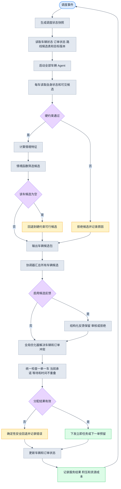
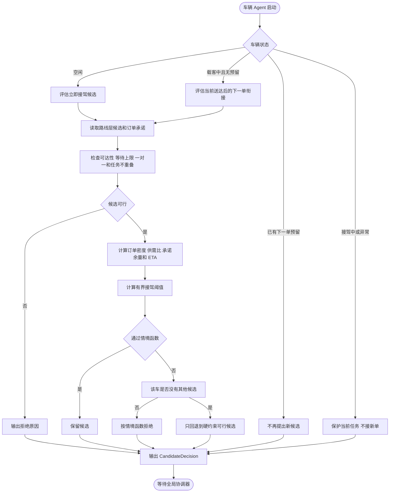
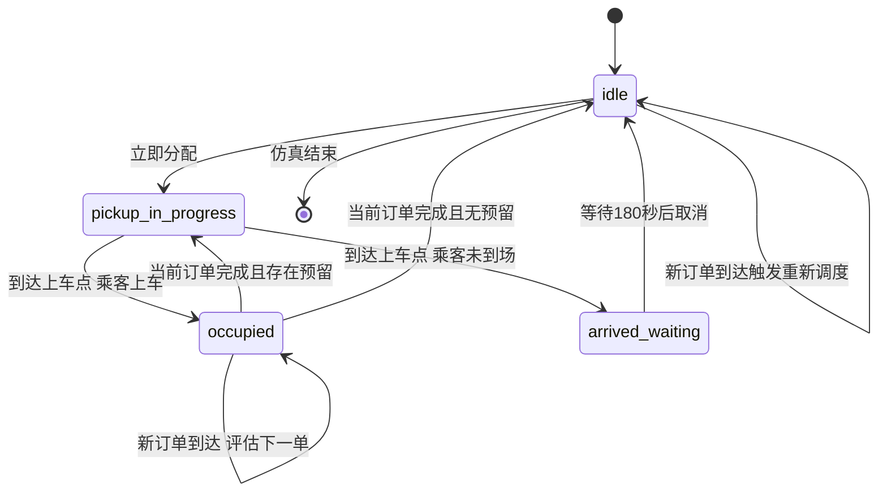

# 调度层 Agent 流程图与教师设计对照

日期：2026-10-16  
说明：本文档只描述调度层。路线层已经完成的路线候选表作为输入，不在本图中展开路线搜索过程。

## 1. 调度层 Agent 的输入和输出

### 输入

- 当前仿真时间和触发事件；
- 车辆状态：位置、当前订单、预计可用时间、已有承诺；
- 已到达且未服务的订单；
- 路线层预先生成的车辆—订单候选表；
- 最大接驾等待时间、每车最多一笔下一订单预留、一对一服务规则；
- 已批准的目标版本和优化优先级。

### 输出

- 立即分配或下一订单预留；
- 未服务订单和积压状态；
- Agent 候选判断、回退原因、优化器状态；
- 实际接驾、送达、取消、空驶、耗电和计算成本记录。

## 2. 调度层主流程

## 3. 单个车辆 Agent 的调度逻辑

## 4. 调度事件和状态回流

调度层使用两种不同的时间规则：

1. 订单产生到车辆到达上车点，最大等待时间默认 300 秒；
2. 车辆到达上车点后，乘客最多等待 180 秒。

两者必须分别记录，不能把乘客未到场取消误记为运力不足。

## 5. 调度层拟研究创新点

本节把当前设计中的创新候选写成可验证的研究主张。它们是“拟研究贡献”，不是已经完成文献证明或实验验证的首创结论。

### 5.1 核心创新：服务承诺约束下的连续调度 Agent

车辆 Agent 不只判断“当前能不能接单”，还维护当前订单、预计完成时间、已有服务承诺和下一订单预留。车辆完成当前订单后，Agent 才能评估 `next_order_handoff` 候选。这样，车辆调度对象从一次性的空闲车辆，扩展为带有连续服务状态的车辆主体。

核心待验证假设是：在不破坏当前服务承诺的前提下，Agent 的连续状态管理能够减少无效衔接候选、优化器重复搜索或无效求解，同时保持服务率和等待时间可接受。

### 5.2 机制创新：局部 Agent 候选、全局优化和校验回退分层

车辆 Agent 只输出结构化 `CandidateDecision`，不直接占用订单，也不单独决定最终派单。全局优化器负责多车多订单冲突消解，调度校验器负责一对一、等待上限、当前承诺和任务不重叠检查；验证失败时进入确定性回退。

候选决策包至少包含车辆 ID、订单 ID、立即接驾或下一单衔接类型、可行性、接驾 ETA、等待余量、当前承诺结束时间、拒绝原因和来源版本。该接口使局部判断、全局分配和执行结果能够分别记录和比较。

### 5.3 约束和语义创新：区分接驾等待与到达后未上车

调度层分别记录两类事件：订单产生至车辆到达上车点的 300 秒最大接驾等待，以及车辆到达上车点后的 180 秒乘客未到场取消。前者是调度筛选硬约束，后者是执行状态中的取消事件，不能合并为同一种“等待超时”。

### 5.4 实验创新：机制消融和可审计对照

在固定地图、订单、车辆、路线候选表、硬约束、随机种子和验证器的条件下，使用 D0–D4 对照 Agent 候选筛选、离线反馈、可选真实 LLM 反馈和全局优化器的作用。除服务率和等待时间外，还记录候选压缩率、回退次数、优化器耗时、LLM 调用次数、token、失败和空驶/电耗。

### 5.5 不单独作为创新的内容

- 多 Agent 本身；
- LLM 与数学优化器的组合；
- 当前订单完成后衔接下一订单这一概念；
- 最小费用流本身；
- 路线层 Agent-readable map。

这些内容只能作为系统组成或对照变量。正式论文中应通过相关工作比较，说明本文在服务承诺状态、下一订单衔接接口、候选协议和可验证实验设计上的具体差异。

## 6. 与老师调度 Agent 设计的对照

| 老师设计中的调度环节 | 调度层 Agent 的落地方式 | 改进内容 |
|---|---|---|
| 车辆等待订单事件 | 事件驱动快照：新订单、当前订单完成、取消、超时 | 明确何时重新调度，避免周期调用含义不清 |
| 车辆根据地图和订单判断接单或拒绝 | 每辆车只输出 `CandidateDecision` | Agent 不直接抢单，避免多个车辆同时占用一个订单 |
| 检查是否能接下一笔顺路订单 | `next_order_handoff` 候选 | 将当前订单完成时间、下一单接驾 ETA 和预留上限写入候选 |
| 多个 Agent 协同 | 协调器汇总候选后统一优化 | 将局部建议和全局分配分开，冲突由优化器处理 |
| 使用约束和数学关系 | 300 秒最大等待、一对一、当前承诺、任务不重叠 | 硬约束先检查，不能被成本权重抵消 |
| 优化器负责全局分配 | 确定性最小费用流 | 先最大化服务订单数，再最小化等待和资源成本 |
| 模型只在某些环节调用 | 普通调度不强制调用 LLM | 降低调用成本，并保留无模型基线 |
| 反馈进入后续决策 | 保存每轮候选、预测、实际和错误 | 反馈从概念变成可审计实验记录 |

## 7. 调度层中保留的老师设计

- 每辆车对应一个 Agent；
- 车辆 Agent 先局部判断，协调器再做全局分配；
- 当前订单优先，下一订单只能在当前订单完成后执行；
- 仍然是一对一服务，不是拼车；
- LLM 是可插拔模块，不是每轮调度的必经步骤；
- 优化器是最终车—订单分配者。

## 8. 调度层特有的改进边界

这些改进是把老师的调度思路变成可实验接口和可复现运行流程，不等于已经证明效果提升。当前实现支持 D0–D4 对照，默认离线运行；正式的 100×100 地图、10 辆车、100 个订单和多随机种子结果仍需单独运行。

